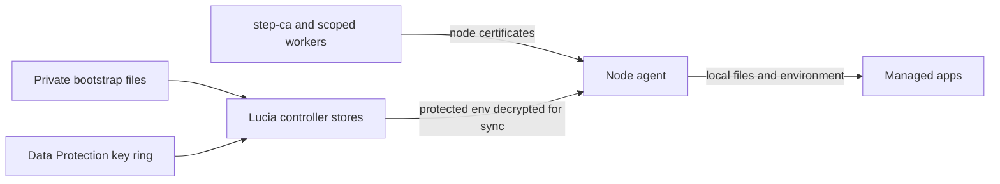
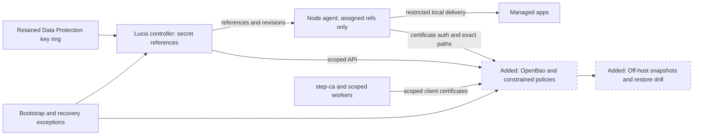
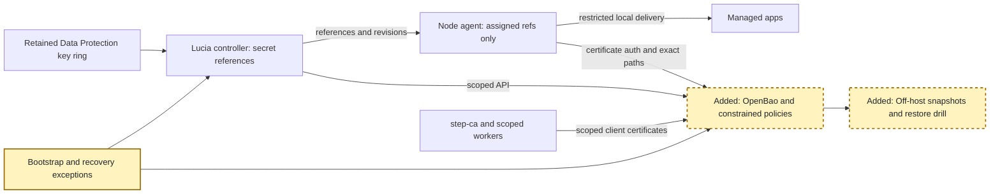
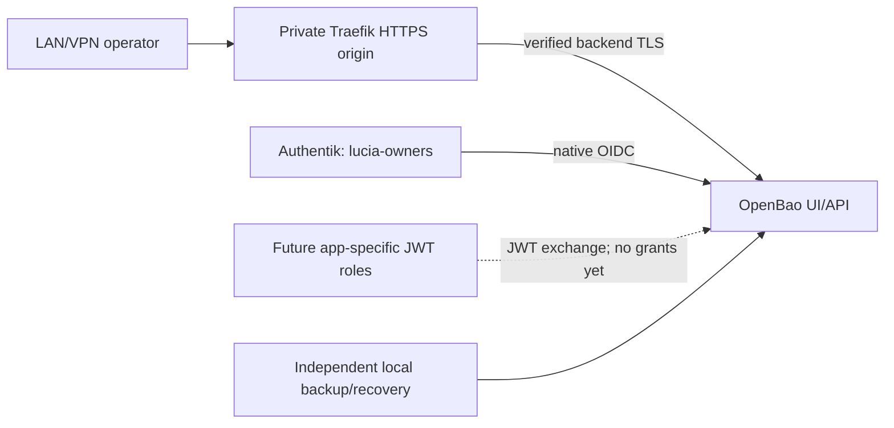
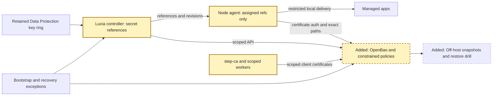
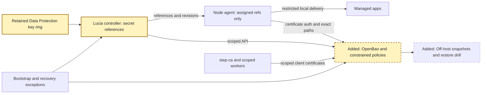
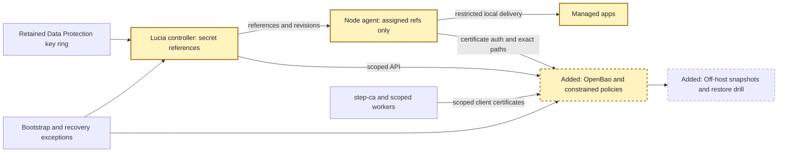
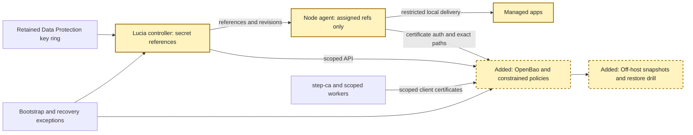

# RPI Plan: OpenBao integration

## Task Metadata

* Task ID: `lucia-openbao`
* Task slug: `openbao-integration`
* Plan date: 2026-10-29

## Executive Summary

**OpenBao is Lucia's selected secrets-management backend.** Start with one controller-hosted instance, integrated Raft storage, off-host snapshots, and manual unseal with offline key-share custody. Keep `step-ca` as the certificate issuer. Integrate supplied certificate bundles as stored application secrets, not as a CA migration.

The rollout establishes recovery first, then constrained identities, one controller credential pilot, controller-store migration, and reference-based delivery to managed apps. Existing settings and secret-entry flows remain the entry points; this is not a new general-purpose vault UI.

Planning execution: complete, including one standard critique and its corrections. P01-T01 is complete. Foundation and P01-T02 synthetic recovery pass on AMD64 and native ARM64. The owner initialized/unsealed the service and verified scoped administration and initial-root revocation. Private recovery inputs are confirmed. The first operational encrypted restic snapshot succeeded; the daily timer and NAS mount are enabled/active. P01-T02 awaits a separately approved isolated operational restore drill. The full integration is not complete.

### What You May Not Know

* After an OpenBao restart, the owner must unseal it. Existing running apps can continue using already-delivered static credentials, but operations requiring a fresh secret must report an explicit unavailable state.
* Bootstrap identity, CA, Data Protection, backup-access, and recovery material cannot depend exclusively on the vault they must recover. A small documented local/offline exception set remains.
* A node agent already runs as root and can see its local apps' secrets. Per-stack paths isolate remote access; they do not protect an app from its own node administrator.
* Vault API compatibility must be proved for the selected client and pinned release. Changing a stored password or certificate does not automatically reload an app or change the corresponding external account.

## Phase Checklist

### Before

### After

Bootstrap remains outside the new dependency. Runtime secret values move to OpenBao; controller and node contracts retain references and nonsecret lifecycle metadata.

<!-- rpi:phase id=P01 -->
### [ ] P01: Establish a recoverable foundation

Goals:
* OpenBao can be installed, manually unsealed, backed up, and recovered without Lucia or a managed app supplying its own recovery credentials.

Dependencies:
* None for implementation preparation; owner-selected custody and off-host destination must be recorded before initialization or migration.

Highlighted work: deployment, bootstrap custody, and independently recoverable snapshots.

<!-- rpi:task id=P01-T01 -->
#### [x] P01-T01: Deploy the foundation service safely

Goals:
* The existing foundation deployment owns a pinned OpenBao container with durable Raft state and verified TLS, without coupling other foundation services to its unsealed state.

Requirements:
* FR-001, FR-002, NFR-001, NFR-004.
* Production server mode only; never development mode, default root tokens, `latest` tags, or TLS-verification bypass.
* Initial setup is explicit and repeat-safe: existing initialized state is never reinitialized or replaced after an error.

Details:
* Extend the existing identity AppHost/provisioning ownership, not `StackCatalog`. Isolate OpenBao state from web-host mounts; the controller receives neither Raft data nor unseal shares.
* Pin a stable release and verified ARM64/AMD64 image digest using the existing platform pin/worker mechanism. Confirm release-specific config and run read-only Aspire API discovery before authoring unfamiliar AppHost calls.
* Use Raft on durable controller-local storage. Do not mount live Raft state over a network filesystem or require PostgreSQL.
* Keep API access private to authorized lab clients. Certificate-auth traffic must reach an OpenBao TLS listener directly or through TLS passthrough; ordinary TLS termination and forwarded certificate headers are not client proof. Reserve a collision-checked endpoint using existing settings, not a hardcoded lab hostname.
* Retain `step-ca` for server/client leaves. Its startup and renewal workers, Authentik, LDAP, and recovery access must start without OpenBao.
* Treat sealed, uninitialized, unavailable, and ready as different states. Compose startup dependencies and update-worker readiness must not block unrelated foundation services waiting for manual unseal. An OpenBao image update explicitly warns that unseal will be required.
* Add deployment/render assertions to existing identity/platform checks and a disposable container qualification fixture; do not generate or print real initialization output during automated checks.
* Use one reusable qualification runner, `tools/security/check_openbao.mjs`, throughout P01-P05. Its interface is `node tools\security\check_openbao.mjs --image <verified-image-reference> --phase <foundation|client|migration|delivery|all>`. The foundation phase exists; other phase values remain reserved and fail explicitly until implemented. Require a working Docker engine, isolated temporary state/network, and synthetic certificates/keys/credentials. Record an explicit qualification block if that runtime is unavailable; do not install it or substitute a live service.

Guidance:
* Foundation source and incremental deploy/code documentation are written and qualified. See the changes record for current evidence.
* `openbao-settings.json` is the explicit private-endpoint opt-in. The pinned release is 2.7.2; its index contains AMD64 and ARM64 manifests. The existing update mechanism uses `manual` policy, because its ordinary image rollback cannot restore Raft data.
* `tools/identity/check_openbao.py --render` verifies disabled and opt-in Aspire graphs without deployment. `tools/security/check_openbao.mjs --phase foundation --image <pin>` checks the lifecycle; optional `--platform linux/arm64` selects ARM64.
* AMD64 and owner-approved native ARM64 pass both the baseline lifecycle and subsequent declarative audit/restore additions. Local ARM64 emulation still fails the post-restart TLS listener check, including with Docker-local Raft volumes; native qualification is the target evidence. The uninitialized operational service now runs with loopback-only publication; existing container IDs and protected identity inputs remain unchanged.

References:
* [src/Lucia.Homelab.Identity.AppHost/AppHost.cs](../../../src/Lucia.Homelab.Identity.AppHost/AppHost.cs): source of deployed foundation services.
* [tools/identity/provision.py](../../../tools/identity/provision.py): provisioning ownership and readiness conventions.
* [src/Lucia.Homelab.Server/Platform/PlatformImages.cs](../../../src/Lucia.Homelab.Server/Platform/PlatformImages.cs): canonical image pins.
* [tools/runners/platform_images.py](../../../tools/runners/platform_images.py) and [tools/runners/platform_update_worker.py](../../../tools/runners/platform_update_worker.py): mirrored platform-update policy.
* [Research](../../research/2026-10-29/openbao-integration-research.md): C1, W1-W3.

Dependencies:
* None.

<!-- rpi:task id=P01-T02 -->
#### [ ] P01-T02: Make initialization and disaster recovery usable

Goals:
* An owner can initialize once, unseal after restart, and restore an off-host snapshot with no dependency on the current controller's working vault.

Requirements:
* FR-002, FR-003, NFR-001, NFR-003.
* No automated storage or submission of Shamir shares. Never retain the initial root token as a runtime credential.
* Before the first migrated secret, restore an actual snapshot into a disposable isolated instance and prove a fixture secret and policy can be read with the appropriate original unseal material.
* Initialization is blocked until D5's custody threshold, private custody locations, off-host destination, and retention are recorded. Daily snapshots and unhealthy-after-24-hours status are checkable initial defaults under D7.
* Before any migration, the foundation fixture passes restart/seal/unseal, snapshot restore, and enabled audit-device failure cases. An approved operational snapshot restore also passes the private handling gate below.

Details:
* At the operator gate, record share count/threshold and offline custody locations without recording share values. Recommend separate failure domains; multiple shares together are not independent custody.
* Use the initial root token only through a private operator channel to establish scoped operator administration and audit. Verify that the operator can administer the installation's intended auth/policy/mount boundary without root, then revoke the initial root token in P01. P02 uses this scoped operator to establish runtime/policy-worker identities; it does not depend on retaining root. Document root regeneration and lost-share/rekey procedures.
* Enable release-supported audit configuration here, before any credential migration. Preserve sensitive-field HMAC behavior and OpenBao's native fail-closed behavior when no enabled audit destination can record. Qualify disk/output failure before rollout; add a second independent destination where available rather than bypassing audit to improve availability.
* Schedule daily Raft snapshots and take one after a migration cutover. Copy off-host using restricted credentials available outside OpenBao. Record retention, destination, job identity, last success, and restore procedure in protected operational configuration.
* Reuse restic, the existing app-backup repository format and its tag-scoped retention approach. Capture a Raft API snapshot first; never back up the live Raft directory. Keep the foundation job independent of node sync/app scheduling and keep its repository recovery key and storage access outside OpenBao. Resolve the actual repository privately; the user-supplied NAS Backups share is a fallback, not a public source constant.
* Backup jobs run outside the web host and ordinary managed-stack lifecycle. A sealed instance produces a visible missed-backup state, not an empty or successful artifact. A backup older than 24 hours is unhealthy.
* Preserve required configuration, public trust, audit archives, Data Protection key ring, and bootstrap secrets through their own backup paths; they are not all inside a Raft snapshot. Keep offline shares separate from snapshots and backup credentials.
* Block migration if the destination, custody threshold, retention, or isolated restore proof is missing. Do not ask for secret values in chat.
* The automated restore proof uses an actual snapshot of the disposable synthetic vault and only its test key shares. Any restore of an operational snapshot is a separate owner-approved drill in an isolated disposable container on an approved Docker host, never in the live volume or on a shared untrusted runner. The operator supplies real shares interactively through a nonlogged channel; no arguments, fixture files, CI, or chat carry them. Record the approved host and privately verify teardown of restored secret-bearing state afterward.

Guidance:
* [tools/identity/openbao_backup.py](../../../tools/identity/openbao_backup.py) and [deployment/identity/openbao-backup-policy.hcl](../../../deployment/identity/openbao-backup-policy.hcl) implement the AMD64/native-ARM64-qualified snapshot job. The actual Spark job now uses a snapshot-only AppRole, private recovery inputs and existing NAS restic repository. The first encrypted snapshot succeeded with accepted retention; its daily 03:00 UTC timer is enabled/active. An isolated operational restore still requires separate approval and proof.
* OpenBao 2.7.2 audit setup uses the supported declarative `audit` stanza in generated `server.hcl`; do not enable `unsafe_allow_api_audit_creation`. Audit output remains setup-user-managed external configuration, including during isolated restores.
* [deployment/identity/openbao-operator-policy.hcl](../../../deployment/identity/openbao-operator-policy.hcl) supports the human userpass operator login in the deploy runbook. Local qualification proves that login survives initial-root revocation and isolated restore. P02 workload certificate identities still depend on this task's completion.
* The shared foundation runner passes enabled-audit failure, scoped operator/root handoff, the real Python-to-restic pipeline, app-tag retention isolation and actual restore into separate volumes on AMD64 and native ARM64. Only its deliberately local repository bypasses the NAS mount check. Actual repository access, scheduling and operational recovery remain unproven.
* The bounded deployment preserves the live foundation Compose files, installed source and platform manifests. Its private `openbao/deployment/docker-compose.json` is a single-service slice of canonical Aspire output, bound to existing private state and the existing identity project/network; no temporary fixture paths remain in runtime mounts. Before any later whole-foundation redeploy, ship the new canonical AppHost/provisioner and manual image-policy integration rather than regenerating from the older installed source. Review private network exposure and backup connectivity before operational backup setup.
* Spark has the approved distribution restic package, enabled NFS mount and private configuration/job copies. The controller API's `source` already includes the repository folder, so the repository is the mount root. Owner retry of the repaired helper preserved the role, revoked the unstored SecretID and completed credential storage, the first actual snapshot and timer installation. The local API passes CA-verified `localhost` TLS without LAN exposure. Rotate the backup SecretID before its 30-day expiry, before 2026-11-29.

References:
* [docs-site/docs/deploy/security-model.mdx](../../../docs-site/docs/deploy/security-model.mdx): current bootstrap and Data Protection recovery boundaries.
* [Research](../../research/2026-10-29/openbao-integration-research.md): W1, W5, W7, W9.
* [src/Lucia.NodeAgent/ResticBackups.cs](../../../src/Lucia.NodeAgent/ResticBackups.cs) and [src/Lucia.Homelab.Server/Stacks/StackBackups.cs](../../../src/Lucia.Homelab.Server/Stacks/StackBackups.cs): existing restic repository, tag and retention conventions; do not make foundation recovery depend on the app scheduler.

Dependencies:
* P01-T01.

<!-- rpi:task id=P01-T03 -->
#### [x] P01-T03: Expose private UI/API access with native Authentik authentication

Goals:
* Provide one owner-selected HTTPS origin for `/ui/` and `/v1/`, reachable only on LAN/VPN ingress, without changing backup or recovery dependencies.

Requirements:
* FR-001, FR-004, FR-009, FR-010, NFR-001, NFR-002.
* Native browser OIDC grants only `lucia-owners` the existing `lucia-operator` policy, never root. Preserve local userpass recovery and the unchanged backup identity.
* Prepare a separate native JWT validation mount without app roles. External JWTs are exchanged for OpenBao tokens; arbitrary secret endpoints do not directly accept Authentik bearer tokens.
* Verify exact callbacks, issuer/audience/owner-claim checks, short token lifetimes, unauthenticated/invalid-token rejection, private-only routing and backend certificate verification.

Details:
* Reuse existing Authentik registration helpers and active domain metadata. Own a dedicated provider, application and operator claim; fail on collisions or unexpected access bindings rather than adopting unrelated resources.
* Route only the private `host` entrypoint, with a private-source allowlist and no `public` entrypoint or browser ForwardAuth. Use HTTPS to OpenBao with the installed CA and `identity-gateway` server name, never skipped verification.
* Use the existing domain certificate where it covers the selected origin. Keep DNS private and register the approved foundation-service origin with Lucia's existing managed DNS reconciler; do not require a separate manual AdGuard record or duplicate its credential access. Stage owner-operated configuration with hidden input for the scoped operator password; never store the resulting temporary token.
* Preserve genuine client-TLS proof for P02 certificate authentication through the independent direct/passthrough path, not forwarded headers.
* This owner-requested task may proceed while P01-T02's operational restore is paused. It does not resume P02 workload work, operational restore, or secret migration.

References:
* [tools/identity/application.py](../../../tools/identity/application.py): ownership, domain and registration helpers.
* [src/Lucia.Homelab.Server/Domains/DomainActivationIngress.cs](../../../src/Lucia.Homelab.Server/Domains/DomainActivationIngress.cs): separate private/public gateway entrypoints.
* [OpenBao JWT/OIDC documentation](https://openbao.org/docs/auth/jwt/).

Dependencies:
* P01-T01; existing scoped operator/root handoff already verified under P01-T02. Operational restore is not a prerequisite for this explicitly approved access-only task.

<!-- rpi:phase id=P02 -->
### [ ] P02: Establish scoped access and a qualified .NET boundary

Goals:
* Controller, policy worker, operator, and node identities have explicit capabilities, with no universal token and no client-library assumptions left untested.

Dependencies:
* P01.

Highlighted work: constrained policies, workload proof, and the .NET client contract.

<!-- rpi:task id=P02-T01 -->
#### [ ] P02-T01: Bound identities, paths, and revocation

Goals:
* Runtime consumers can access only their assigned secrets, and node removal or stack movement removes remote access without waiting for certificate expiry.

Requirements:
* FR-004, FR-005, NFR-001, NFR-002.
* Explicit KV-v2 mounts and separate `data`/`metadata` capabilities; no runtime principal receives root, unrestricted policy administration, or access to bootstrap recovery material.
* Negative authorization fixtures prove unrelated CA certificates, sibling stack paths, encoded traversal, wrong installation IDs, and removed node identities are refused.

Details:
* Use path prefixes scoped to an installation and controller credential domain or stack ID. References are structured and validated; clients cannot choose arbitrary URLs, mounts, paths, output filenames, or policy text.
* Separate a narrow controller runtime identity from an operator/policy worker. The worker follows existing validated file-queue conventions, accepts fixed operations and known identifiers, and cannot be induced to grant access outside the installation's managed prefixes.
* Use `step-ca` client certificates with exact role constraints. Existing managed-node proof is a candidate for node authentication, not blanket trust in the CA. Qualify exact CN/SAN, chain, client-auth EKU, expiration, and renewal behavior; provision a dedicated controller client leaf without exposing CA signing credentials.
* Extend the existing scoped enrollment-worker pattern for the fixed controller client identity: only the trusted worker calls `step-ca`, checks the designated CSR/purpose, and returns a bounded client-auth chain. The controller creates/retains its own leaf key and never receives the worker's CA credentials. Do not reuse the existing server-only app certificate as a client certificate.
* Replace the foundation backup job's temporary AppRole login with a dedicated `step-ca` client identity and automated certificate renewal. Keep its snapshot-only policy and private key separate from controller/app identities; retain independent recovery with Lucia/OpenBao unavailable. Qualify renewal, expired/unrelated-certificate refusal and snapshot login before cutover, then revoke obsolete AppRole credentials. Do not grant the backup job self-minting SecretID privileges as the long-term solution.
* Node policy is the union of exact paths needed by its current assignments, not every stack in the installation. Apps do not receive the node's OpenBao token or certificate key. Node-root compromise remains an explicit local trust boundary.
* Use bounded short-lived tokens: planner-selected initial defaults are a 15-minute TTL and one-hour hard maximum, limiting unattended token lifetime while allowing normal renewal. Qualify renewal, expired-token reauthentication, clock skew, and outage behavior under those defaults; they are not vendor-prescribed constants or user-selected SLAs.
* Reconcile policies from authoritative node/stack state before delivery. Removal/move revokes old tokens by accessor and disables the old login role/path grants before completing; track failed cleanup as pending, not success. Certificate-role deletion alone is not token revocation.
* Preserve P01-T03's scoped Authentik operator access and private UI/JWT routes. Local recovery/backup must remain independent of Authentik; forwarded client-certificate headers are not certificate proof.

References:
* [src/Lucia.NodeAgent/ManagedIdentity.cs](../../../src/Lucia.NodeAgent/ManagedIdentity.cs): exact node certificate checks.
* [src/Lucia.Homelab.Server/Security/AppCertificates.cs](../../../src/Lucia.Homelab.Server/Security/AppCertificates.cs): existing scoped certificate-worker pattern.
* [docs-site/docs/code/identity.mdx](../../../docs-site/docs/code/identity.mdx): privileged queue boundary.
* [Research](../../research/2026-10-29/openbao-integration-research.md): W3, W6, W8, W12.

Dependencies:
* P01-T02.

<!-- rpi:task id=P02-T02 -->
#### [ ] P02-T02: Qualify the client and explicit failure contract

Goals:
* .NET consumers have a small, tested OpenBao integration that respects cancellation, token lifetime, and safe error reporting.

Requirements:
* FR-005, FR-009, NFR-001, NFR-002, NFR-004.
* Integration fixture proves certificate login, KV-v2 versioned reads/writes with compare-and-set, token renewal/reauthentication, denial, missing data, sealing, and cancellation against the pinned server.

Details:
* Evaluate VaultSharp against only the required APIs and its license/dependency footprint. If incompatible or unnecessarily broad, use a small typed `HttpClient` boundary. Do not build a generic multi-vendor secret-provider framework or introduce a new project solely to wrap a few calls.
* Domain records retain validation and nonsecret metadata; the transport layer does not own domain decisions.
* Configure bounded response size, request timeout, cancellation, and retry behavior. Do not retry writes blindly or downgrade TLS/authentication failures into missing-secret results.
* Define credential-free distinctions for sealed/unavailable, forbidden, missing version, conflict, and invalid stored data. Do not dump upstream response bodies, headers, credentials, or templated payloads into exceptions or OTEL.
* Retain ASP.NET Data Protection for cookies and non-migrated state. Do not make its key ring depend on OpenBao.
* Add deterministic checks to the owning server/node check projects and one reusable disposable-server integration fixture. Pin the chosen client only after the fixture passes.
* The shared runner's `client` phase owns certificate-login, missing-version, sealed/unavailable, cancellation, and renewal qualification before P03 pilot execution; it extends the P01 runner rather than adding another harness.

References:
* [src/Lucia.Homelab.Server/Host/HuggingFaceManagementCredentials.cs](../../../src/Lucia.Homelab.Server/Host/HuggingFaceManagementCredentials.cs): bounded validation and safe status patterns.
* [src/Lucia.NodeAgent/Lucia.NodeAgent.csproj](../../../src/Lucia.NodeAgent/Lucia.NodeAgent.csproj): .NET and existing telemetry dependencies.
* [tests/Lucia.Homelab.DomainChecks/Lucia.Homelab.DomainChecks.csproj](../../../tests/Lucia.Homelab.DomainChecks/Lucia.Homelab.DomainChecks.csproj): server check ownership.
* [Research](../../research/2026-10-29/openbao-integration-research.md): Q3 qualification limit.

Dependencies:
* P02-T01.

<!-- rpi:phase id=P03 -->
### [ ] P03: Migrate controller credentials without changing their meaning

Goals:
* Existing credential-entry flows store recoverable secret references while retaining validation, disconnect, masking, and revoke behavior.

Dependencies:
* P02.

Highlighted work: domain-preserving controller migration and local bootstrap exceptions.

<!-- rpi:task id=P03-T01 -->
#### [ ] P03-T01: Inventory and pilot a single credential store

Goals:
* A complete migration ledger exists, and one representative store demonstrates safe cutover and recovery before bulk migration.

Requirements:
* FR-006, FR-008, FR-009, NFR-001, NFR-002, NFR-003.
* Each ledger entry has an owner, current location, consumer, target path or justified exception, migration state, and rollback rule; never include secret values.
* Hugging Face is the first pilot. Repeated migration, concurrent save/disconnect, corrupt local data, absent remote version, sealed vault, and interruption between vault write and local-reference commit preserve the documented state.
* The shared runner's `migration` phase and Hugging Face owning checks must pass before the pilot's live cutover. Repeat/interruption/concurrency checks prove no partial record replacement and no new applied revision after failed resolution.

Details:
* Start the ledger from the security model's inventory, then trace provider, DNS/network, assistant sign-in, Web Push, NAS, registry, backup, SSO, generated app, and supplied-certificate secrets. Hash-only API-key verifiers remain hashes, not recoverable vault secrets.
* Enumerate infrastructure bootstrap exceptions: identity database and directory/Authentik bootstrap, CA key/password, minimal controller login/API bootstrap where needed, Data Protection keys, OpenBao client authentication material, recovery access, and independent snapshot destination access.
* Preserve Hugging Face's managed/disconnected/legacy distinctions. A disconnected record must never resurrect a legacy environment credential.
* Use an explicit per-record migration journal: read/validate/decrypt existing state, CAS-write a version, verify value privately, atomically commit the reference and metadata, and mark the cutover. Retry discovers its prior write rather than generating a replacement secret.
* Serialize migration with normal domain writes or use revision checks. Do not dual-write indefinitely. Retain the old protected record in an access-controlled recovery archive until qualification; never silently read it after cutover when OpenBao fails.
* The operator owns that archive and records its protected location, retained/disposed state, and link to P05-T02 closure. Successful migration/recovery qualification triggers an explicit cleanup decision; retaining it longer requires a recorded reason. Cleanup is not automatic and never deletes active Data Protection/bootstrap material.
* Rollback is an explicit quiesced operation that reconciles post-cutover changes. Reject stale recovery records that would resurrect a revoked or disconnected credential.

References:
* [src/Lucia.Homelab.Server/Host/HuggingFaceManagementCredentials.cs](../../../src/Lucia.Homelab.Server/Host/HuggingFaceManagementCredentials.cs): pilot semantics.
* [docs-site/docs/deploy/security-model.mdx](../../../docs-site/docs/deploy/security-model.mdx): initial inventory.
* [tests/Lucia.Homelab.HuggingFaceChecks](../../../tests/Lucia.Homelab.HuggingFaceChecks): owning regression checks.

Dependencies:
* P02-T02.

<!-- rpi:task id=P03-T02 -->
#### [ ] P03-T02: Apply the proven migration to controller domains

Goals:
* Each in-scope controller credential has an explicit OpenBao-backed lifecycle or a documented bootstrap/security exception, without a second permanent source of truth.

Requirements:
* FR-006, FR-008, FR-009, NFR-001, NFR-002, NFR-003.
* Preserve validation-before-save, masked responses, owner authorization, one-time reveal, disconnect, revocation, per-owner isolation, and secret-scrubbing contracts.
* Completion requires every controller-only ledger entry to be migrated or assigned a justified exception; an unexamined store is not implicitly out of scope. Node/app-facing entries remain explicitly pending P04, and final all-entry closure belongs to P05-T02.
* Each batch's owning suite proves cross-owner access is denied and disconnect/revoke cannot be undone by stale migration records before that batch's live cutover.

Details:
* Migrate in small domain batches after the pilot: provider/network credentials; registry/NAS/backup references; per-owner assistant/provider credentials and generated signing material where recoverable storage is appropriate.
* Keep the current domain services as the authoritative validation/status layer. Change storage at their boundary rather than exposing OpenBao paths to browsers or assistants.
* Retain per-owner authorization for assistant/GitHub credentials. A controller identity having technical access to multiple domains does not authorize cross-owner reads.
* Registry/NAS/backup node consumers must be transitioned with capability negotiation or marked pending P04; never send a reference to an old node as though it were a password.
* Dynamic credential engines, external password rotation, and migrating infrastructure bootstrap are not implied by moving a value into KV.

References:
* [src/Lucia.Homelab.Server/Domains/CloudflareCredentialStore.cs](../../../src/Lucia.Homelab.Server/Domains/CloudflareCredentialStore.cs): DNS credential store.
* [src/Lucia.Homelab.Server/Host/AdGuardCredentialStore.cs](../../../src/Lucia.Homelab.Server/Host/AdGuardCredentialStore.cs): network credential pattern.
* [src/Lucia.Homelab.Server/Stacks/StackRegistries.cs](../../../src/Lucia.Homelab.Server/Stacks/StackRegistries.cs), [src/Lucia.Homelab.Server/Stacks/StackNas.cs](../../../src/Lucia.Homelab.Server/Stacks/StackNas.cs), and [src/Lucia.Homelab.Server/Stacks/StackBackups.cs](../../../src/Lucia.Homelab.Server/Stacks/StackBackups.cs): node-facing credentials and backup dependency.
* [src/Lucia.Homelab.Server/Assistant](../../../src/Lucia.Homelab.Server/Assistant): per-owner and provider credential inventory.

Dependencies:
* P03-T01.

<!-- rpi:phase id=P04 -->
### [ ] P04: Deliver references safely to managed applications

Goals:
* Updated node agents resolve only assigned references and deliver secrets in the form each app supports, with explicit revision and restart behavior.

Dependencies:
* P02 and P03-T01; independent of unrelated controller-domain batches in P03-T02.

Highlighted work: stack contracts, assigned-reference resolution, and application delivery.

<!-- rpi:task id=P04-T01 -->
#### [ ] P04-T01: Add capability-gated references to stack and node contracts

Goals:
* Controller storage, node sync, catalog rendering, and assistant edits distinguish secret references from plain configuration and never mistake one for the other.

Requirements:
* FR-004, FR-007, FR-008, NFR-001, NFR-002.
* Stable per-stack secret IDs and explicit secret versions/revisions survive rendering, restart, backup/restore, and moves.
* Old agents retain the existing explicit legacy path until upgraded; reference-backed workloads are not newly placed on an incapable agent.

Details:
* Extend both copies of `NodeDesiredStack` and the manifest/storage schema deliberately; support reading old stored state during migration. Do not encode references as magic strings inside passwords.
* Inventory generated and user-supplied catalog secrets and custom-compose environment inputs. Classify them at save time, preserving nonsecret environment values and existing `KeepSecrets`/managed masking behavior.
* Use the existing node agent as the initial resolver. Do not add a per-app sidecar or custom templating system when the current runner can deliver exact references.
* Bind a desired revision to specific secret versions. Before applying, resolve all required values successfully, stage them safely, and only then replace applied state. Report the applied secret revision in credential-free status.
* A .NET app that directly consumes OpenBao gets its own scoped identity; it must not borrow the node's token. Direct SDK consumption is supported by the qualified boundary but is not a requirement for third-party images.
* Update assistant secret-entry and scrub paths so neither references nor upstream errors become an avenue to reveal values.

References:
* [src/Lucia.Homelab.Server/Stacks/StackStore.cs](../../../src/Lucia.Homelab.Server/Stacks/StackStore.cs): stored environment, sync contract, and revision logic.
* [src/Lucia.NodeAgent/StackRunner.cs](../../../src/Lucia.NodeAgent/StackRunner.cs): mirrored contract, applied hash, and reconciliation.
* [src/Lucia.Homelab.Server/Stacks/StackCatalog.cs](../../../src/Lucia.Homelab.Server/Stacks/StackCatalog.cs): generated secrets and render semantics.
* [src/Lucia.Homelab.Server/Stacks/StackSso.cs](../../../src/Lucia.Homelab.Server/Stacks/StackSso.cs): managed secret masking and SSO worker delivery.

Dependencies:
* P02-T02 and P03-T01.

<!-- rpi:task id=P04-T02 -->
#### [ ] P04-T02: Complete local delivery, certificate bundles, and lifecycle cleanup

Goals:
* Managed apps receive valid local credentials without OpenBao administration rights, and updates have predictable reload, restart, move, and removal behavior.

Requirements:
* FR-007, FR-008, FR-009, NFR-001, NFR-002, NFR-003.
* File-capable apps receive restricted mounted files. Environment-only apps use the current restricted local environment path with its exposure documented.
* Supplied certificate/private-key bundles are validated and delivered as one revision; the existing `step-ca` issuer and renewal workflows remain intact.
* Before each affected live app cutover, the node/domain suites and shared runner's `delivery` phase prove wrong-key/expired/invalid-chain bundles, partial writes, assignment changes during resolution, and failed move-health confirmation cannot produce a partial or falsely applied revision.

Details:
* Use root-only directories, atomic staged writes, symlink/path traversal rejection, and read-only mounts to the consumer where supported. Do not grant the resolver a Docker socket; existing runner operations remain the only deployment authority.
* Prefer memory-backed runtime files when the app/Compose lifecycle permits; otherwise use explicit root-only persistent delivery with its residual exposure documented. Do not claim plaintext disappears from Docker inspection when environment variables are used.
* A reference-version change drives a known reload or recreation path. Do not automatically rotate a database password merely by updating KV: coordinate the external account and consumers in a separate supported rotation workflow.
* While sealed/unavailable, leave a running static-credential workload untouched; reject new/revised secret-dependent applies. A cold start requires successful resolution. No stale hidden fallback, empty value, or cross-version partial apply is permitted.
* Do not copy secret delivery files, credential-bearing generated configs, or OpenBao tokens in stack transfer/backup archives. Extend the existing `NotMoved`/archive rules and rehydrate from references after restore or move; preserve the restore's intended secret-version metadata.
* Remove old-node policy grants and tokens during moves, provision the target's exact grant, and finish only after application health confirms the intended revision. Deleting secrets cannot erase values already seen by a compromised old node.
* Bound target health confirmation with an explicit operation deadline. If it expires, preserve recoverable app data, report failed/pending-recovery with the last confirmed applied revision, and revoke unused target grants. Do not automatically restore old-node privileges or claim the move succeeded. Authorized retry/rollback reconciles grants anew and cannot create simultaneous running copies; the fixture proves this failed-health path.
* Revoking a secret in OpenBao does not revoke it at its external provider. Explicitly distinguish vault access removal, retained secret versions, application shutdown, and provider-side revocation.

References:
* [src/Lucia.NodeAgent/StackRunner.cs](../../../src/Lucia.NodeAgent/StackRunner.cs): `NotMoved`, apply, move, and restore.
* [src/Lucia.Homelab.Server/Stacks/StackTransfers.cs](../../../src/Lucia.Homelab.Server/Stacks/StackTransfers.cs): transfer authorization.
* [src/Lucia.Homelab.Server/Security/AppCertificates.cs](../../../src/Lucia.Homelab.Server/Security/AppCertificates.cs): retained issuer boundary.
* [tests/Lucia.NodeAgent.Checks](../../../tests/Lucia.NodeAgent.Checks) and [tests/Lucia.Homelab.DomainChecks/StackChecks.cs](../../../tests/Lucia.Homelab.DomainChecks/StackChecks.cs): lifecycle ownership.
* [Research](../../research/2026-10-29/openbao-integration-research.md): W4, W8, W10.

Dependencies:
* P04-T01.

<!-- rpi:phase id=P05 -->
### [ ] P05: Qualify operations and finish the documented cutover

Goals:
* Operators can recognize failures, recover the service, and verify a credential's active revision without leaking its value.

Dependencies:
* P03-T02 and P04-T02.

Highlighted work: operational visibility, fault qualification, documentation, and migration closure.

<!-- rpi:task id=P05-T01 -->
#### [ ] P05-T01: Prove outage, restart, and recovery behavior

Goals:
* The rollout has reproducible evidence for its critical failure modes and a secret-free operational status.

Requirements:
* FR-003, FR-005, FR-008, FR-009, NFR-001, NFR-002, NFR-003, NFR-004.
* The final aggregate fixture reruns restart/seal/unseal, controller restart, wrong/expired certificate, token renewal, policy denial, node removal, stack move, interrupted migration, snapshot restore, missing version, and audit-output failure. Each prerequisite subset must already pass in its P01/P02/P03/P04 owning task before the corresponding live cutover; P05 is final evidence aggregation, not permission to delay those checks.
* Secret sentinels must be absent from API/status output, logs, traces, generated Compose, transfer archives, and nonsecret stored manifests. Expected private runtime files and OpenBao storage are checked separately, not misreported as leaks.

Details:
* Verify the release-supported audit configuration already established in P01-T02; preserve sensitive-field HMAC behavior and avoid raw logging. Verify persistent local output, any configured independent destination, native fail-closed behavior, and disk-full alerts.
* Status exposes initialization/seal state, reachability, last snapshot age, and pending migration/reconciliation without values, unseal material, bearer tokens, or request bodies.
* Reuse existing status/error surfaces; any new UI is limited to operational status rather than browsing secret values.
* Run targeted ownership checks first: `dotnet run --project tests\Lucia.Homelab.DomainChecks`, `dotnet run --project tests\Lucia.NodeAgent.Checks`, and affected provider check projects. Run disposable integration qualification separately from real lab deployment.
* Provider ownership starts with `tests\Lucia.Homelab.HuggingFaceChecks`, `tests\Lucia.Homelab.CloudflareChecks`, `tests\Lucia.Homelab.AdGuardChecks`, `tests\Lucia.Homelab.AssistantChecks`, `tests\Lucia.Homelab.AuthChecks`, and `tests\Lucia.Homelab.KeyChecks` for the domains actually changed. The single runner's `all` phase aggregates its earlier fixture phases. Record AMD64 local Docker results and approved ARM64 qualification separately; one does not stand in for the other.
* Real deployment, node-agent upgrade, and real backup/restore drills require an explicit user deployment request and the corresponding lab/deploy skills. Never run a restore against live Raft state as a test.

References:
* [tests/Lucia.Homelab.DomainChecks/Program.cs](../../../tests/Lucia.Homelab.DomainChecks/Program.cs): executable checks.
* [tests/Lucia.NodeAgent.Checks/Program.cs](../../../tests/Lucia.NodeAgent.Checks/Program.cs): node fixtures.
* [tools/runners/check_platform_images.py](../../../tools/runners/check_platform_images.py): platform pin parity.
* [Research](../../research/2026-10-29/openbao-integration-research.md): W7-W9.

Dependencies:
* P03-T02 and P04-T02.

<!-- rpi:task id=P05-T02 -->
#### [ ] P05-T02: Publish the decision and operating contract with the feature

Goals:
* Users, operators, and developers have accurate instructions, and every inventoried secret has a recorded final disposition.

Requirements:
* FR-010, NFR-001, NFR-003.
* Documentation ships alongside the behavior it describes, not only after P05. Completion requires migration-ledger closure and an explicit inventory of retained bootstrap/recovery exceptions.

Details:
* Add concise secrets-management pages for guide, deploy, and code audiences and update security-model, identity, node, app, and configuration pages as their behavior changes. Update `docs-map.json` for the new domain.
* Record OpenBao/MPL-2.0 selection, private deployment, manual-unseal expectations, no-HA limitation, custody/restore process, outage behavior, secret references, delivered plaintext limits, and issuer-versus-certificate-storage distinction.
* Load `lucia-docs` and `humanize-writing` before authoring documentation. Use `WhoWhatWhy`, generic examples, and fixture-only screenshots if needed. No private lab endpoints or secret values.
* After successful pilot, migration qualification, and recovery evidence, offer explicit operator cleanup of old protected migration archives. Keep Data Protection keys and bootstrap exceptions; never silently delete rollback material.
* Record measured restore time and backup schedule against NFR-003 without promising an unmeasured recovery SLA. Archive closure records the operator's approved disposal or a reason for retention; no secret-bearing migration archive disappears without that decision.

References:
* [docs-map.json](../../../docs-map.json): source-to-doc mapping.
* [docs-site/docs/deploy/security-model.mdx](../../../docs-site/docs/deploy/security-model.mdx): security and plaintext-delivery inventory.
* [docs-site/docs/code/identity.mdx](../../../docs-site/docs/code/identity.mdx): trust and worker boundaries.
* [AGENTS.md](../../../AGENTS.md): documentation requirements.

Dependencies:
* P05-T01 for final closure; incremental documentation depends on each owning task.

## User Decisions and Requirements

### Confirmed User Direction

* "I like OpenBao. It's looking like the best contender of the bunch. Especially with the fact that it's API compatible with HashiCorp Vault. Let's pin that as our decision, and plan out integrating and setting up OpenBao."
* OpenBao is selected for Lucia and its managed apps. Its MPL-2.0 license is accepted in place of the earlier MIT preference.
* Initial availability: one controller-hosted instance with off-host backups; add HA later.
* Initial unseal: manual unseal with offline key-share custody.
* Certificate scope: retain `step-ca`; use OpenBao for secrets and supplied certificate bundles first.
* The original planning stage produced this plan. The subsequent direct `/rpi-implement` invocation authorizes implementation preparation, not commits, pushes, lab deployment, operational initialization, or secret migration.
* The user subsequently approved disposable native ARM64 qualification on the Spark, with installed services unchanged and all fixture resources removed afterward. This does not authorize an operational OpenBao deployment.
* For off-host backups, reuse restic where possible. The user supplied a private NAS Backups share as the fallback; do not publish its address or put its access credentials in OpenBao.
* Shamir quorum: 3 shares, with any 2 required to unseal. The user selected this explicitly; share values and custody locations are not recorded here.
* The owner confirmed that the three independent share-custody locations are recorded privately. Their locations and eventual share values stay outside this plan and chat.
* The owner confirmed that the restic repository password and NAS access details are stored outside Lucia/OpenBao. No credentials or private destination values are recorded here.
* OpenBao snapshot retention is confirmed at 7 daily, 4 weekly and 6 monthly snapshots. These are restic retention buckets, not a promise of 17 distinct copies.
* The owner completed private initialization, share storage and manual unseal. A subsequent read-only status check confirmed `initialized=true`, `sealed=false`, 3 shares and threshold 2. No share or root-token values were collected by the assistant.
* The owner reported successful installation of the `lucia-operator` policy and userpass login through the private root channel.
* The owner supplied nonsecret verification output showing a separate login with `[default lucia-operator]`, the `lucia-file/` audit device, successful empty KV-v2 mount/backup-policy creation and a passing raw-storage-denial check. That temporary operator token was revoked.
* The owner subsequently confirmed `Root handoff verified.`: the initial root token was revoked and rejected with HTTP 403, a fresh operator login could inspect audit/policy state, and its temporary session token was revoked. Removal of the revoked root-token entry remains private operator housekeeping; keep all unseal shares and the operator password.
* The owner approved configuring/testing daily OpenBao backups on the Spark using the existing restic repository and accepted retention, including scoped backup login, private configuration, initial encrypted snapshot and daily timer without restarting existing services. A new NAS mount or software installation must be raised separately; operational restore remains unapproved.
* The owner subsequently approved adding restic and NAS mounts to the Spark for this independent backup job. Reuse only the existing backup destination/repository, leave node backups and running services unchanged, and keep credential entry private.
* After the NAS rejected the initial Spark mount, the owner adjusted NFS access privately and confirmed the change. The subsequent Spark mount succeeded; the assistant did not modify NAS access rules.
* The owner completed the repaired private backup setup and supplied nonsecret success output. Read-only verification confirms a healthy encrypted snapshot completed at 2026-10-30T14:47:08Z, active/enabled daily backup timer and active/enabled NFS mount. No operational restore is authorized yet.
* The owner selected "Pause here—keep backups running" when offered the isolated operational restore drill. Keep the approved timer/mount running; do not stage or execute the drill or advance dependent migration work without renewed direction.
* For the backup credential's long-term lifecycle, the owner selected dedicated `step-ca` client-certificate authentication with automated renewal rather than AppRole SecretID self-rotation. This is planned under P02-T01, not implemented or deployed. Current AppRole expiry and the paused recovery gate remain unchanged.
* The owner selected native OIDC login and JWT-to-OpenBao-token exchange, one private HTTPS origin for UI/API, `lucia-owners` with the existing scoped operator policy, LAN/VPN-only access, and JWT preparation without any app roles. The selected hostname is retained in private deployment state, not public documentation. P01-T03 brings this bounded rollout forward; it does not approve the paused operational restore or credential migration. Preserve local backup/recovery and genuine client-TLS proof for future certificate identities.
* The user subsequently approved native disposable recovery qualification and deployment of only the uninitialized OpenBao service on the Spark, leaving existing services unchanged. Initialization and unseal remain user-owned; this does not authorize migration, unrelated service deployment, commits or pushes.
* The approved recovery configuration now passes natively on ARM64. The uninitialized deployment stays loopback-only for manual setup; opening a private network endpoint and enabling production backup connectivity remain reviewed rollout steps.

### Planning Decisions and Feedback

| Group | Decision or feedback item | Status | Owner | Rationale or input needed | Evidence | Planning impact |
|---|---|---|---|---|---|---|
| D1 | Single instance now, HA later | Confirmed | User | User selected the recommended availability option; no host-failure availability claim | User answer; W2 | P01 |
| D2 | Retain `step-ca` | Confirmed | User | User selected secrets and supplied certificate bundles without issuer migration | User answer; C1, C4 | P01-T01, P04-T02 |
| D3 | Manual Shamir unseal | Confirmed | User | User selected offline key-share custody; restart requires owner action | User answer; W1 | P01-T02, P05 |
| D4 | Node-agent resolution first | Selected | Planner | Reuse the privileged runner that already writes app credentials; no sidecar needed for initial delivery | StackRunner and security model | P02-T01, P04 |
| D5 | Offline custody parameters and off-host destination | Confirmed privately: quorum, custody locations, external backup access and retention | User | 3 shares/2 required; independent custody and out-of-vault repository/NAS recovery access confirmed; 7 daily/4 weekly/6 monthly retention accepted. No secret values or private locations in this plan | User answers; W1, W7 | Owner initialization may proceed; actual backup configuration/runtime and recovery proof remain P01-T02 requirements |
| D6 | Inventory-driven migration, pilot first | Selected | Planner | Existing stores carry domain semantics that a global configuration replacement would lose | C2-C4 | P03, P04 |
| D7 | Initial operational defaults | Selected defaults, not user SLAs | Planner | Daily snapshots with unhealthy status after 24 hours provide a simple initial recovery cadence; 15-minute token TTL/one-hour hard maximum bound exposure with renew/reauth qualification. A stricter RPO or changed availability tradeoff requires owner direction. | Mechanisms W1, W6, W7; defaults chosen by planner | P01-T02, P02-T01; validate before rollout |
| D8 | Reuse restic for off-host snapshots | Confirmed | User | Existing app backups already use restic; use a distinct foundation tag and independently recoverable credentials/schedule. Actual private repository and retention remain D5 inputs. | User response; ResticBackups.cs and StackBackups.cs | P01-T02 |

## Planning Readiness and Next Step

| Field | Record |
|---|---|
| Planning execution and readiness | Planning complete; foundation/recovery tooling qualified on AMD64 and native ARM64; uninitialized-only deployment complete; private operational recovery gates remain |
| Decision participation | User-owned; standalone request; D1-D3 answered and persisted |
| Blockers | Private recovery confirmations, owner root handoff and initial operational snapshot/timer are complete. P01-T02 still requires separately approved isolated operational restore evidence |
| Latest critique | [.copilot-tracking/reviews/plans/2026-10-29/openbao-integration-plan-critique.md](../../reviews/plans/2026-10-29/openbao-integration-plan-critique.md); Complete, original verdict Revise; all PC-001 through PC-008 resolved in this plan |
| Relevant research | [.copilot-tracking/research/2026-10-29/openbao-integration-research.md](../../research/2026-10-29/openbao-integration-research.md) |
| Plan | `.copilot-tracking/plans/2026-10-29/openbao-integration-plan.md` |
| Changes-record role | `.copilot-tracking/changes/2026-10-29/openbao-integration-changes.md` holds implementation evidence |
| Continuation owner | User |
| Required gates | Prior custody/root-handoff gates, repository decryption and actual encrypted backup/timer setup passed. Separately approved isolated operational restore and private owner participation remain before P01-T02 completion or migration |
| Next action | P01-T03 is complete: native auth, private TLS routes and managed DNS are deployed, and the owner confirms successful Authentik sign-in in Firefox. Copilot's embedded browser loses the popup opener; use a standalone browser without weakening OAuth or proxy protections. Keep daily backups running and operational restore/migration paused; rotate the backup SecretID privately before 2026-11-29 |

## Goals

* Centralize runtime secrets without weakening existing trust boundaries or introducing a circular recovery dependency.
* Preserve existing configuration and application behavior while enabling auditable, scoped secret references.
* Make outage, migration, rotation boundaries, and recovery operationally explicit.

## Scope and Non-Goals

### In Scope

* OpenBao foundation deployment, manual unseal, snapshots, constrained auth, narrow .NET integration, inventory-driven controller migration, managed-node/application delivery, supplied certificate bundles, and operating documentation.

### Non-Goals

* HA deployment, auto-unseal, replacing Authentik/LDAP/`step-ca`, or moving all bootstrap material into OpenBao.
* Generic multi-provider abstractions, a full secrets-browser UI, or per-app sidecars by default.
* Dynamic database users, automatic external-password rotation, transit encryption, SSH CA migration, or a hardware KMS.
* Production changes in the planning stage.

## Functional Requirements

* FR-001: Deploy one pinned controller-hosted OpenBao instance with Raft, private verified TLS, distinct health states, and no catalog placement.
* FR-002: Initialize once and manually unseal through private operator channels, with offline shares and no standing root token.
* FR-003: Produce scheduled off-host snapshots, identify stale/missed backups, and demonstrate isolated recovery before migration.
* FR-004: Separate operator, policy-worker, controller-domain, node-assignment, and direct application capabilities.
* FR-005: Authenticate and access the pinned OpenBao API from .NET with qualified renewal, cancellation, and explicit error behavior.
* FR-006: Migrate inventoried controller secrets through domain-preserving, restart-safe pilot and batch cutovers.
* FR-007: Deliver reference-backed app and node-consumed secrets with capability/version negotiation and explicit file/environment/reload behavior.
* FR-008: Preserve create/update/disconnect/revoke, move/remove, backup/restore, and rollback semantics without silent fallback or regenerated credentials.
* FR-009: Surface safe unavailable/denied/conflict states and audit/backup status without revealing credentials.
* FR-010: Document the architectural decision, retained exceptions, operator recovery, developer contracts, and user-visible consequences.

## Non-Functional Requirements

* NFR-001: Secret exposure and privilege remain bounded.
  * Objective condition: no real secret values in source, plans, public docs, logs, OTEL, manifests, or ordinary status payloads; negative authorization and sentinel tests pass.
* NFR-002: Updates are deterministic and failure-safe.
  * Objective condition: repeat/interruption/concurrency fixtures produce one authoritative reference revision; failed resolution does not report a new applied revision or partially replace runtime files.
* NFR-003: Recovery is independently executable.
  * Objective condition: daily snapshot schedule, unhealthy status after 24 hours without success, and isolated restoration with external custody/configuration before first migration; measured restore duration recorded.
* NFR-004: Deployment and integration are reproducible.
  * Objective condition: release/digest/client pins recorded; ARM64 controller and AMD64 fixture paths qualified; canonical AppHost and mirrored platform-pin rules remain aligned.

## Risks and Open Questions

| Priority | Type | Risk or question | Affected work | Impact | Smallest action or evidence needed | Owner |
|---|---|---|---|---|---|---|
| H | Execution gate | Private recovery confirmations, root handoff and actual operational backup/timer passed; isolated operational restore remains | P01-T02 | Migration remains blocked | Approve and prove isolated recovery with private owner-entered shares; never put secret values in chat | User/operator |
| H | Accepted architectural risk | One host and manual unseal create an intentional availability boundary | P01, P05 | Fresh secret operations stop during outage/restart | Document and qualify restart/recovery behavior; HA deferred by user | User accepted D1/D3; operator runs recovery |
| H | Irreversible custody risk | Permanent loss of enough Shamir shares prevents unsealing, including restored snapshots | P01-T02 | Data may be irrecoverable; root tokens do not replace shares | Independent protected custody, privately verified recoverable quorum, documented rekey before quorum is lost | User/custodians |
| H | Implementation risk | Role removal alone leaves existing tokens; assignment changes can race delivery | P02-T01, P04-T02 | Old node retains remote access | Revoke tracked accessors, reconcile grants, test move/remove races | Implementer |
| H | Implementation risk | Vault-client/version mismatch or certificate auth behind TLS termination | P01-T01, P02-T02 | Authentication fails or proof is weakened | Disposable pinned-server fixture with exact TLS path | Implementer |
| H | Implementation risk | Copying new secret files in data archives or resurrection through rollback | P03, P04-T02 | Secret leakage or revoked credential revival | Archive exclusions and revision-aware rollback tests | Implementer |
| M | Residual trust | Node root and controller runtime can access secrets they legitimately consume | P02-P04 | Vault does not prevent local privileged compromise | Explicit threat boundary and narrow remote capabilities | Operator |
| M | Implementation risk | Audit destination failure prevents API access | P01-T02, P05-T01 | Service interruption | Enabled-device fault fixture and disk/collector status | Implementer |
| M | Qualification gap | Native ARM64 foundation and synthetic recovery pass; operational NAS/timer/restore and .NET client remain unqualified | P01-T02, P02-T02 | Full integration not yet proven | Complete privately configured operational recovery gates and record client fixture evidence | Implementer/operator |

## Dependencies

* Existing foundation provisioning and private `step-ca` trust stay operational independently.
* Owner authorizes deployment separately and supplies private custody/backup configuration at the execution gate.
* Updated agents precede migration of reference-backed workloads onto those agents.
* P01 establishes and verifies scoped operator administration before revoking initial root. P02 provisions runtime/policy-worker identities using that scoped operator; no standing root token crosses the handoff.

## Sources

* Relevant BRD/PRD/ADR search: `.adr-config.yml`, `brd_id`, `prd_id`, ADR headings, and `OpenBao` across repository Markdown/MDX/YAML. No relevant existing business source found; no formal ADR was supplied. This plan records the user-approved decision without inventing an accepted ADR identifier.
* [PRODUCT.md](../../../PRODUCT.md): current product behavior, not an OpenBao business mandate.
* [AGENTS.md](../../../AGENTS.md): operational and documentation constraints.
* [docs-site/docs/deploy/security-model.mdx](../../../docs-site/docs/deploy/security-model.mdx): current complete audience-facing inventory and trust boundaries.
* [docs-map.json](../../../docs-map.json): implementation-to-documentation ownership.
* [.copilot-tracking/research/2026-10-29/openbao-integration-research.md](../../research/2026-10-29/openbao-integration-research.md): C1-C4 and W1-W12; task-local references name the consuming contract.

## Test Ownership and Change Budget

* Exact removals: none. Existing provider, identity, node, and stack regression coverage stays.
* Maximum additions: no new test projects/frameworks; at most one server OpenBao check file, one node OpenBao check file, one reusable disposable-server qualification runner (`tools/security/check_openbao.mjs`, created by P01-T01 and extended by later tasks), and one identity provisioning check script. Extend existing domain-specific checks for migration cases.
* Semantic coverage: policy/path binding, token lifecycle, secret-version CAS, migration state, capability negotiation, safe delivery, and failure distinctions.
* Regression coverage: existing credential validation/disconnect, SSO/masking, Data Protection recovery, node enrollment, stack rendering/move/restore, and platform update behavior.
* Canonical targets: identity AppHost, platform pins and mirrored worker policy, domain credential services, stack contracts, node runner, and owning documentation.
* Generated targets: Compose output, local delivery files, and rendered agent configuration; generated files are fixtures/deployment output, not hand-edited source.
* Validation evidence: owning check output, disposable integration results, secret-sentinel scans, image/client pins, and isolated snapshot restore proof go in the implementation changes record. No product tests are claimed to have run during planning.

## Critique Disposition

* Critique setting and provenance: standard; default planning protocol.
* Critique status: Complete; one initial standard assessment, with planner-owned corrections applied.
* Latest critique and verdict: [.copilot-tracking/reviews/plans/2026-10-29/openbao-integration-plan-critique.md](../../reviews/plans/2026-10-29/openbao-integration-plan-critique.md), original verdict Revise. All blocking findings are resolved; no second critique is required.
* Earlier critiques: none.
* Limitations: runtime qualification belongs to implementation. Mermaid source styling checked; dual-theme rendering not verified.

| Finding | Disposition | Action owner | Exact resolving evidence | Decision route | Response or residual risk |
|---|---|---|---|---|---|
| PC-001 | Resolved | Planner | P01-T02, P02-T02, P03-T01/T02, P04-T02 assign pre-cutover checks; P05-T01 aggregates only | Direct correction | No post-cutover prerequisite cycle |
| PC-002 | Resolved | Planner | P01-T02 operator handoff and top-level Dependencies now use one sequence | Direct correction | Initial root revoked after scoped operator verification; P02 uses operator |
| PC-003 | Resolved | Planner | P03-T01 archive custodian/disposition links to P05-T02 closure | Direct correction | Cleanup remains an explicit operator decision |
| PC-004 | Resolved | Planner | P01-T01 names the synthetic runner; P01-T02 separates real-share drill and handling/teardown | Direct correction | Real operational restore remains authorization-gated |
| PC-005 | Resolved | Planner | P04-T02 deadline, failed-health state, grant cleanup and retry/rollback fixture | Direct correction | No automatic old-node regrant or false success |
| PC-006 | Resolved | Planner | Dedicated irreversible Shamir-quorum risk row and P01-T02 custody gate | Direct correction | Offline custody remains owner responsibility |
| PC-007 | Resolved | Planner | P03-T02 and P04-T02 negative-case fixture requirements | Direct correction | Cross-owner, bundle mismatch, partial write and assignment race explicitly covered |
| PC-008 | Resolved | Planner | D7 and P02-T01 label operational values as planner defaults with rationale/qualification | Direct correction | Not vendor constants or user SLAs |

## Artifact Self-Check

* [x] Summary and phase checklist precede supporting sections.
* [x] User direction, proposed implementation decisions, execution gates, and non-goals are distinguished.
* [x] Every requirement is referenced by a task; tasks have Goals, Requirements, Details, References, and Dependencies.
* [x] Phase diagrams reuse stable IDs, mark added nodes, and highlight phase changes with explicit text color.
* [x] Current source evidence grounds the baseline; no live lab or production changes were made.
* [x] Test ownership, exact removals, additions budget, generated targets, and evidence ownership are explicit.
* [x] Standard critique completed and blocking findings resolved.
* Checked sections: user decisions, phases/tasks, requirements, dependencies, risks, source search, test budget.
* Limited sections: dual-theme rendered preview and runtime qualification are not claimed.

## Follow-Up Items

* HA across independent hosts, auto-unseal, dynamic database credentials and OpenBao PKI issuance remain deferred enhancements. Authentik operator OIDC is now in active P01-T03 scope at the owner's request.

## Handoff

* Authoritative implementation handoff: Planning Readiness and Next Step.
* Implementation owns creation of `.copilot-tracking/changes/2026-10-29/openbao-integration-changes.md`.
