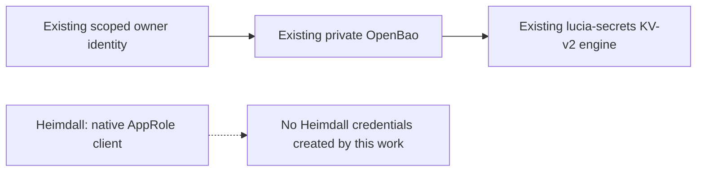
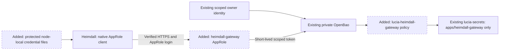
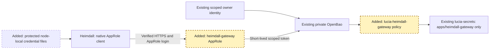
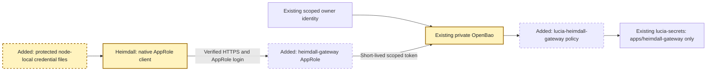

# RPI Plan: Heimdall Gateway OpenBao AppRole

## Task Metadata

* Task ID: heimdall-openbao-approle
* Task slug: heimdall-openbao-approle
* Plan date: 2026-10-30

## Executive Summary

A dedicated AppRole now lets Heimdall Gateway access only its approved secrets in the existing OpenBao installation. P01 qualification and P02-T01 private credential delivery are complete; gateway configuration and deployment remain outside the completed scope.

The supplied public documentation confirms native AppRole support, KV-v2 and a configurable auth mount. The owner selected create/read/update/list access only within Heimdall's isolated prefix on a Lucia-managed node. Its SecretID will not expire automatically; short-lived tokens limit session lifetime, and the operator rotates or revokes the SecretID privately when needed.

The owner's explicit creation request has been fulfilled with scoped operator authentication and private files on the selected managed node. Application wiring, deployment and gateway restart remain unapproved. The operational restore remains paused.

### What You May Not Know

An AppRole exchanges a RoleID and SecretID for an OpenBao token. The token's policies enforce access boundaries. A token lifetime alone does not solve SecretID expiry, rotation or application restart behavior.

The existing owner policy is a scoped foundation policy, not unrestricted administration. Proposed resources must fit that boundary or require a separately approved policy change.

Heimdall's documented secrets API writes values and lists names. A read-only AppRole permits reference resolution but cannot support its `PUT /api/v1/secrets/{name}` flow. Its AppRole client signs in again at three quarters of its lease and retries once after a 403, re-reading credential files. SecretIDs must therefore support repeated authentication, or an external delivery mechanism must supply replacements.

The gateway needs the AppRole's generated RoleID, not just its role name, plus a generated SecretID. OpenBao returns a SecretID at creation; it does not offer a later plaintext read-back of that existing value. The documented native gateway settings are `RoleIdFile` and `SecretIdFile`; `OPENBAO_SECRET_ID` is only meaningful if a deployment explicitly maps it. Prefer direct private file delivery over UI console output or environment variables.

## Phase Checklist

### Before



### After



The existing engine and private ingress remain intact. One application receives its own credentials and an explicit prefix, not the owner's token.

<!-- rpi:phase id=P01 -->
### [x] P01: Qualify the exact AppRole boundary

Goals:
* Establish a tested policy and login contract before a real application credential exists.

Dependencies:
* Confirmed D1-D5 decisions and the existing pinned OpenBao fixture conventions.



Highlighted work: the application role and policy, exercised with synthetic credentials only.

<!-- rpi:task id=P01-T01 -->
#### [x] P01-T01: Fix the configuration and permission contract

Goals:
* The gateway and OpenBao agree on the exact mount, prefix and AppRole configuration without broadening the owner's policy.

Requirements:
* FR-001, FR-002, FR-004, NFR-001, NFR-002.
* Use the existing root namespace, secret mount `lucia-secrets`, prefix `apps/heimdall-gateway/`, auth mount `lucia-approle`, role `heimdall-gateway` and policy `lucia-heimdall-gateway`.
* Refuse to adopt or overwrite an existing differently configured resource. Preserve other roles if the auth mount already exists as type `approle`; otherwise enable only this approved mount. Make no changes to OIDC/JWT, backup auth or the owner policy.
* The policy contract is:

```hcl
path "lucia-secrets/data/apps/heimdall-gateway/*" {
  capabilities = ["create", "read", "update"]
}
path "lucia-secrets/metadata/apps/heimdall-gateway" {
  capabilities = ["list"]
}
path "lucia-secrets/metadata/apps/heimdall-gateway/*" {
  capabilities = ["read", "list"]
}
```

* Role settings: `bind_secret_id=true`, `secret_id_ttl=0`, `secret_id_num_uses=0`, `token_num_uses=0`, `token_policies=lucia-heimdall-gateway`, `token_ttl=15m`, `token_max_ttl=1h`, `token_explicit_max_ttl=1h`, service tokens. Permit only this application policy plus the normal `default` self-service policy; no inherited broad policies.
* The TTLs are planner-selected starting bounds consistent with the existing platform plan. Unlimited SecretID uses support Heimdall's repeated logins; unlimited token uses allow ordinary API operations within the bounded token lifetime.

Details:
* The documented custom auth mount avoids granting the operator access to arbitrary `auth/approle` or unprefixed policies.
* Do not add a namespace, secrets engine, generic provisioner, application policy-admin permissions or self-minting SecretID capabilities.
* Do not add CIDR constraints based on an assumed node address: the current TLS proxy may be the source observed by the backend. The existing private ingress and policy remain the approved boundary.

References:
* [deployment/identity/openbao-operator-policy.hcl](../../../deployment/identity/openbao-operator-policy.hcl): allowed `lucia-*` auth and policy administration.
* [Heimdall Vault configuration](https://seiggy.github.io/HeimdallGateway/reference/configuration/#heimdallsecretsvault): custom mount and KV-v2 prefix.
* [OpenBao AppRole API](https://openbao.org/docs/api/auth/approle/): role and credential fields.

Dependencies:
* None.

<!-- rpi:task id=P01-T02 -->
#### [x] P01-T02: Prove isolation and credential lifecycle with synthetic data

Goals:
* A runnable check demonstrates the exact positive and negative authorization boundary without touching live secrets.

Requirements:
* FR-001 through FR-004, NFR-001 through NFR-004.
* Reuse the pinned production-mode disposable OpenBao fixture conventions. Use the exact P01-T01 policy and role settings; no live root token, live data or operational restore.
* Verify create/read/update of a synthetic secret under the prefix, exact-prefix listing with and without a trailing slash, and an authenticated metadata read under that prefix.
* Seed synthetic sibling-app and backup/controller canaries with the fixture operator. Confirm the application cannot read or list sibling/ancestor paths, switch mounts/namespaces to gain access, delete/undelete/destroy secrets, modify policies/auth configuration, or generate SecretIDs.
* Verify at least two logins with the same SecretID, positive zero-expiry/zero-use-limit metadata, returned token TTL at most 900 seconds, hard maximum 3600 seconds and only the allowed policies. Wrong credentials fail.
* Generate a replacement SecretID, prove both initially work, revoke the old accessor and prove old login fails while new login works. Explicitly demonstrate that revoking a SecretID does not revoke a token already issued from it, then revoke the known synthetic token accessor and prove that token is denied.
* Retain a minimal runnable check and a value-free result in session artifacts. Clean up all named disposable resources.

Details:
* This is configuration qualification, not a new Vault client or test framework. No product-source changes are required.
* Keep policy-boundary assertions separate from existing foundation/backup regression assertions. Do not equate role configuration read-back, health or cached application responses with proof of actual secret access.

References:
* [tools/security/check_openbao.mjs](../../../tools/security/check_openbao.mjs): existing TLS, non-dev container and isolated API-fixture conventions.
* [Heimdall upstream authentication](https://seiggy.github.io/HeimdallGateway/architecture/upstream-auth/#hashicorp-vault-and-openbao): KV-v2 operations and reauthentication behavior.

Dependencies:
* P01-T01.

<!-- rpi:phase id=P02 -->
### [ ] P02: Activate the one application and qualify manual rotation

Goals:
* The real gateway can use only its approved secrets, and the operator has a private replacement/revocation procedure.

Dependencies:
* P01.
* The owner explicitly requested this one role and its credentials while operational recovery remains paused. This authorizes P02-T01, not the broader rollout. P02-T02 separately requires gateway-configuration/restart authorization and an approved native read test.



Highlighted work: protected credential delivery and the gateway's verified use of the role.

<!-- rpi:task id=P02-T01 -->
#### [x] P02-T01: Provision and deliver the application credentials privately

Goals:
* Only the intended gateway receives its AppRole bootstrap files, and unrelated services remain unchanged.

Requirements:
* FR-001 through FR-005, NFR-001, NFR-002, NFR-005.
* Confirm the receiving node, a ready private file destination, verified HTTPS access and scoped operator authentication before creation. The owner selected the receiving managed node; its connection details remain private runtime inputs. No application deployment or configuration change is implicit in this provisioning-only request.
* Apply only the qualified role/policy contract with the existing scoped operator identity. Never regenerate a RoleID or replace a matching role on a retry.
* Generate the real SecretID only after the receiving node is ready. Deliver it directly into a protected node-local file without terminal output, chat, shell history, `.env`, source control or shared logs. Retain its accessor privately for replacement/revocation. Handle interrupted creation explicitly rather than generating unexplained extra SecretIDs.
* Prepare source files readable by UID 1654, under a root-only operational directory. Retain the accessor in root-only state. Future Docker secret targets must be `/run/heimdall-openbao/role-id` and `/run/heimdall-openbao/secret-id`, outside the general `file:` resolver root; do not assume Compose's `uid` field remaps a local bind-mounted secret.
* Verify the created role, the actual AppRole login, bounded token lifetime and effective positive/negative capabilities without reading real application values. Revoke the temporary application and operator tokens.
* Preserve unrelated roles, mounts, identity settings, backup/unseal state and every application; do not restart any service.

Details:
* Store only value-free ownership/configuration and validation receipts with implementation evidence. Real credentials remain in private operational state on the receiving node.
* Existing-installation/version checks and gateway wiring move to P02-T02 under the owner's narrowed creation request. If a compatible gateway is absent, credential delivery does not authorize installing it.

Guidance:
* The qualified session-only `provision-heimdall-openbao.py` performs collision/drift checks, journals issuance, writes private files and verifies effective capabilities without reading real application values. A pending issuance without a durable credential bundle blocks a retry; inspect/revoke that tagged credential privately instead of blindly generating another.
* Its root-only operational directory is `/etc/heimdall-gateway/openbao`; source files are `role-id` and `secret-id`, and `credentials.json` privately retains the revocation accessor. These are operational paths, not repository files.

References:
* [Heimdall Compose guide](https://seiggy.github.io/HeimdallGateway/getting-started/docker-compose/): UID 1654, Docker secret mounts and service separation.
* [.copilot-tracking/plans/2026-10-29/openbao-integration-plan.md](../2026-10-29/openbao-integration-plan.md): parent recovery/workload boundaries.

Dependencies:
* P01-T02 and the owner's explicit provisioning authorization.

<!-- rpi:task id=P02-T02 -->
#### [ ] P02-T02: Wire and verify the gateway, then record replacement/revocation

Goals:
* Actual cold-start reads/writes work through Heimdall, with an explicit manual credential-lifecycle runbook.

Requirements:
* FR-002 through FR-005, NFR-001 through NFR-005.
* Obtain separate authorization to edit/recreate the gateway. Confirm its private Compose directory and pinned image implement the documented settings. Require an existing compatible gateway stack; if absent, scope its first deployment separately rather than bootstrapping its database or state here. Confirm container DNS/TLS access.
* Back up private gateway configuration and file metadata before editing. A rollback must restore a known working gateway configuration without broadening permissions or leaving unstored credentials behind.
* Use these nonsecret gateway settings, replacing only the private address input:

```dotenv
Heimdall__Secrets__Provider=HashiCorpVault
Heimdall__Secrets__Vault__Address=<approved-private-https-origin>
Heimdall__Secrets__Vault__AuthMethod=AppRole
Heimdall__Secrets__Vault__AuthMount=lucia-approle
Heimdall__Secrets__Vault__Mount=lucia-secrets
Heimdall__Secrets__Vault__PathPrefix=apps/heimdall-gateway/
Heimdall__Secrets__Vault__RoleIdFile=/run/heimdall-openbao/role-id
Heimdall__Secrets__Vault__SecretIdFile=/run/heimdall-openbao/secret-id
```

* Leave `Namespace` unset. Use normal certificate verification for the existing publicly trusted HTTPS route; do not replace its trust with the unrelated private backend CA. Do not enable the gateway's dev-mode `vault` profile.
* Recreate only the gateway, preserving its existing Compose files/profiles and state. No database migration or image upgrade is part of this credential change; do not restart OpenBao, Traefik, Authentik, PostgreSQL, Valkey or other applications.

* After a cold start, use the gateway's existing admin authentication and required request header to write a synthetic application secret through `PUT /api/v1/secrets/{name}` and list it. These operations prove real file-based authentication and write/list permissions, not native reference resolution.
* Separately verify native reference resolution through an owner-approved existing provider/MCP/model test against its intended destination. The documented OpenRouter integration's Test action, which performs `GET /key`, is one supported example when that integration already exists and the owner approves the request. Obtain authorization for possible side effects/costs and use its properly scoped reference without collecting its credential. If no approved native read test is available, leave P02-T02 pending rather than substitute a direct OpenBao read, add a plaintext-read API, create an unapproved test service or claim cached success.
* Confirm a returned reference such as `vault:lucia-secrets/apps/heimdall-gateway/<synthetic-name>#value`. Check values without printing them or forwarding real provider credentials to a test endpoint. Remove the named canary using the operator identity; the app must not have delete permission.
* Confirm an unrelated synthetic reference is refused by the application identity without exposing its value. Show successful real file-based reauthentication, not just a cached read or healthy HTTP process.
* A replacement sequence creates a second SecretID privately, installs its source file, recreates only the gateway to refresh the file-secret bind mount, verifies a cold login/read, and only then revokes the old SecretID accessor. RoleID remains stable.
* Verify rollback to the old still-valid credential before old-accessor revocation if replacement fails. After revocation, issue a new credential for recovery rather than implying the revoked one can be restored.
* Document that SecretID revocation prevents new logins but does not revoke previously issued tokens. Revoke known token accessors when immediate invalidation is required; otherwise existing stolen renewable tokens may last up to the one-hour hard maximum. Do not claim the current operator can enumerate every gateway token accessor.
* Record value-free evidence of configured roles/policies, file permissions, actual gateway success and preservation of backup/unseal/other-service state.

Details:
* This configures provider/upstream secret storage, not a bootstrap configuration provider. Keep database, OIDC and Data Protection bootstrap files separate; no application secret migration is implicit.
* Do not let the gateway mint its own SecretIDs or administer the role. Node-root compromise and a compromised gateway can expose its own credentials; the policy limits the resulting secret-store access.
* No automatic SecretID expiry is intentional. Private manual replacement remains an operator responsibility, and a short token TTL does not make the bootstrap SecretID short-lived.

Guidance:
* P02-T01 delivered `/etc/heimdall-gateway/openbao/role-id` and `/etc/heimdall-gateway/openbao/secret-id` on the owner-selected node. Mount these individual source files at the documented `/run/heimdall-openbao` targets. Their ownership is UID 1654 / 0400; Docker must access the root-only source directory.
* Do not mount that whole directory or its root-only `credentials.json` revocation bundle into the gateway. Do not generate another credential merely to wire the existing one.
* Direct OpenBao login/capability checks are complete; they are not native gateway runtime or secret-reference-resolution evidence. P02-T02 remains unchecked.

References:
* [Heimdall secrets API](https://seiggy.github.io/HeimdallGateway/architecture/upstream-auth/#secrets-api): write/list behavior and secret references.
* [Heimdall Vault configuration](https://seiggy.github.io/HeimdallGateway/reference/configuration/#heimdallsecretsvault): credential-file re-reading and reauthentication.
* [OpenBao AppRole API](https://openbao.org/docs/api/auth/approle/): SecretID accessor destruction.

Dependencies:
* P02-T01.

## User Decisions and Requirements

### Confirmed User Direction

* User requests planning an AppRole for their AI Gateway, Heimdall Gateway.
* User supplied `https://seiggy.github.io/HeimdallGateway/getting-started/docker-compose` as the application evidence.
* User selected "Create, read, update and list only Heimdall's secrets (Recommended)". Permit those application operations, not secret deletion or administration of authentication, policies or other applications.
* User selected the receiving managed node for Heimdall credentials during implementation. Keep connection details private and credentials on that node, not in the Spark controller or application environment variables.
* User asked whether `OPENBAO_SECRET_ID` is required and available from the UI. The generated SecretID is now held in its private node-local file; it must not be copied through chat.
* User selected "No automatic expiry; rotate/revoke privately as needed, with short-lived app tokens." The gateway does not receive automatic SecretID-issuance permissions.
* Use the generated AppRole credential files for gateway wiring. Do not invent an environment value, substitute an operator/root token or print the SecretID. `OPENBAO_SECRET_ID` still requires explicit deployment mapping; native `RoleIdFile`/`SecretIdFile` settings are preferred.
* User now requests: "ok, can you create the approle and generate the credentials please". This authorizes one early Heimdall role/policy and private credential provisioning, not a gateway restart, app deployment, operational restore or the broader workload rollout. Confirm the receiving private node destination and use scoped operator authentication.
* Use the existing OpenBao system rather than a new secrets backend.
* Preserve the application isolation discussed in this conversation: dedicated credentials and explicit path permissions.
* Current authorization is credential provisioning only. Gateway wiring, deployment, restart and native gateway qualification require separate authorization.

### Planning Decisions and Feedback

| Group | Decision or feedback item | Status | Owner | Rationale or input needed | Evidence | Planning impact |
|---|---|---|---|---|---|---|
| D1 | Gateway integration contract | Resolved from supplied evidence | User/evidence | Native AppRole, configurable `AuthMount`, KV-v2 `Mount`/`PathPrefix` and credential files are documented. Confirm the deployed image supports these settings before P02-T02 gateway wiring. | Public Compose, upstream-auth and configuration pages. | Removes the credential-design blocker; no application code change is currently indicated. |
| D2 | Secret scope and permissions | Confirmed | User | Allow create/read/update/list only within Heimdall's prefix; no deletion, unrelated paths or control-plane administration. | User's explicit choice following the documented secrets API walkthrough. | Supports gateway-managed provider keys and constrains policy drafting. |
| D3 | Runtime and delivery | Confirmed | User | Run the Compose stack on a Lucia-managed lab node; use protected node-local files and Docker secrets. Exact node and deployed image are implementation preflight inputs, not public plan content. | Explicit user selection plus the public Compose guide. | Constrains file ownership to the container UID and requires private DNS/TLS reachability from the container. |
| D5 | Bootstrap credential lifetime | Confirmed | User | Non-expiring SecretID, private manual rotation/revocation and short-lived app tokens. | Explicit user selection. | Set SecretID TTL/uses to zero, retain bounded token lifetime and document replacement/revocation. |
| D4 | Resource layout and token bounds | Selected implementation defaults | Planner | Root namespace, `lucia-secrets`, prefix `apps/heimdall-gateway/`, auth mount `lucia-approle`, role `heimdall-gateway`, policy `lucia-heimdall-gateway`; 15-minute tokens with one-hour hard maximum. | Public client supports custom paths; existing operator policy allows `lucia-*`; parent plan already uses these token bounds. | Requires no new engine or operator privilege expansion; resources must be collision-checked before adoption. |
| D6 | Live activation | Credential provisioning authorized; app deployment still gated | User | Direct creation request authorizes one early role/policy and private credential delivery while the restore remains paused. Do not restart or configure the gateway from this authorization. | Owner's explicit current request. | Qualification and provisioning may proceed after destination/authentication preflight; gateway wiring remains outside scope. |

## Planning Readiness and Next Step

| Field | Record |
|---|---|
| Planning execution and readiness | Bounded implementation complete: P01 and P02-T01. P02-T02 gateway wiring/qualification remains gated; P02 phase remains unchecked. |
| Decision participation | User-owned, standalone planning request. |
| Blockers | None for completed provisioning scope. P02-T02 needs separate configuration/restart authorization and an approved native read test. |
| Latest critique | [.copilot-tracking/reviews/plans/2026-10-30/heimdall-openbao-approle-plan-critique.md](../../reviews/plans/2026-10-30/heimdall-openbao-approle-plan-critique.md): Complete / Revise, with PC-001 and PC-002 resolved in the planner's disposition. No repeat critique required. |
| Relevant research | User-supplied public documentation establishes the native integration contract. No separate research artifact is needed for those established facts. |
| Plan | `.copilot-tracking/plans/2026-10-30/heimdall-openbao-approle-plan.md` |
| Changes-record role | [.copilot-tracking/changes/2026-10-30/heimdall-openbao-approle-changes.md](../../changes/2026-10-30/heimdall-openbao-approle-changes.md) records bounded implementation and remaining work. |
| Continuation owner | User/manual planner. |
| Required gates or confirmations | Private destination and scoped operator authentication completed for provisioning. Gateway configuration/restart and native read test remain unapproved. |
| Next action | Hand the nonsecret file locations to the gateway implementer. Leave P02-T02 gateway wiring/restart and native gateway validation pending separate authorization. |

## Goals

* Heimdall authenticates with its own workload identity.
* Its token permits only the explicitly approved application secret operations.
* Login, renewal and credential replacement have a supported lifecycle rather than an unexplained expiry.

## Scope and Non-Goals

### In Scope

* Gateway integration evidence, policy scope and AppRole configuration planning.
* Credential delivery, rotation, revocation and restart behavior.
* Bounded positive and negative checks for the eventual implementation.

### Non-Goals

* Gateway configuration or deployment under the current credential-only authorization.
* Reusing the owner/operator identity or backup identity for the gateway.
* Operational restore, unrelated migrations, blanket namespace administration or other applications' credentials.
* A generic Lucia secrets-delivery subsystem or Heimdall catalog entry. A node runtime does not imply these unfinished platform features are available.

## Functional Requirements

* FR-001: Use a dedicated AppRole identity for Heimdall Gateway with explicit application permissions.
* FR-002: Match the documented Vault client contract: `AuthMethod=AppRole`, custom `AuthMount`, KV-v2 `Mount` and `PathPrefix`, and `RoleIdFile`/`SecretIdFile`.
* FR-003: Define supported bootstrap, token renewal or reauthentication, SecretID replacement and revocation behavior.
* FR-004: Permit create/read/update on Heimdall's KV-v2 data paths and the metadata read/list required for its prefix. Deny unrelated secret reads/listing, secret deletion and auth/policy/mount administration.
* FR-005: Deliver credentials through node-local Docker secret files readable by the gateway's documented UID 1654. Do not rely on unsupported Compose file-secret UID remapping or assume atomically replacing a source file refreshes an existing bind-mounted inode.

## Non-Functional Requirements

* NFR-001: Do not include real credentials, tokens or secret values in artifacts, command arguments or chat.
* NFR-002: Verify TLS and preserve the private OpenBao access boundary.
* NFR-003: Require an eventual negative check showing the application token cannot read or enumerate unrelated secrets.
* NFR-004: Run synthetic qualification without operational data or a live root token; prove token lifetime and the different effects of SecretID versus token revocation.
* NFR-005: Keep AppRole credentials outside the gateway's configured generic `file:` resolver directory, and preserve unrelated service IDs/state during a gateway-only configuration change.

## Risks and Open Questions

| Priority | Type | Risk, question, or planning item | Affected work | Impact | Smallest action or evidence needed | Owner |
|---|---|---|---|---|---|---|
| H | Deployment evidence | Deployed image compatibility remains a private execution input. | P02-T02 | Published docs can be newer than the running image. | Verify selected image/settings and private Compose location before wiring the gateway. | Implementer |
| H | Credential compromise | The chosen SecretID does not expire automatically. | P02-T01/P02-T02 | A stolen bootstrap credential can keep obtaining its scoped tokens until revoked. | Protect files, scope access and preserve a private revocation accessor; owner-selected residual risk. | Operator |
| M | Revocation | SecretID revocation alone leaves already-issued tokens valid. | P01-T02/P02-T02 | Immediate application-wide token revocation is not established by this plan. | Revoke known accessors; otherwise use the one-hour hard bound and document the limitation. | Operator |
| H | Authorization gate | The operational restore remains paused. | P02 | The requested early application grant does not prove operational recovery or authorize a broader migration. | Keep the explicit one-app exception bounded to credentials; leave restore and gateway changes paused. | User |
| M | Runtime readiness | Credential delivery does not qualify the existing gateway installation. | P02-T02 | Gateway-only recreation cannot bootstrap an absent database/volume stack. | Require an existing compatible stack before wiring; otherwise scope installation separately. | Implementer |
| M | Native read evidence | The management API lists names and writes values, but does not return a secret value. | P02-T02 | List/write or a direct OpenBao read could be misreported as native gateway reference resolution. | Use an owner-approved documented upstream test; otherwise leave runtime qualification pending. | Implementer/operator |

## Dependencies

* Existing healthy private OpenBao deployment and scoped owner access.
* Public application evidence and confirmed D1-D5 direction.
* The explicit creation request authorizes this role and private credential delivery. Gateway configuration/restart is not authorized. The broader plan's operational restore and generic workload/migration gates remain paused.

## Sources

* User request: "kk, so I need to plan an AppRole for my AI Gateway (Heimdall Gateway)".
* [Heimdall Docker Compose guide](https://seiggy.github.io/HeimdallGateway/getting-started/docker-compose/): operator-supplied application context, single-instance Compose deployment and Docker secret files. Its optional dev-mode OpenBao profile must not replace the existing production instance.
* [Heimdall upstream authentication](https://seiggy.github.io/HeimdallGateway/architecture/upstream-auth/#hashicorp-vault-and-openbao): native AppRole, policy example, KV-v2 references, secret write/list operations and reauthentication behavior.
* [Heimdall Vault configuration](https://seiggy.github.io/HeimdallGateway/reference/configuration/#heimdallsecretsvault): configurable auth mount, root namespace default, secret mount/prefix and credential-file settings.
* [OpenBao AppRole documentation](https://openbao.org/docs/auth/approle/#configuration): role creation, RoleID lookup, SecretID generation and repeated-use/expiry constraints. CLI/API are the documented configuration workflows.
* [deployment/identity/openbao-operator-policy.hcl](../../../deployment/identity/openbao-operator-policy.hcl): existing mount, policy and auth-administration boundaries.
* [tools/identity/openbao_access.py](../../../tools/identity/openbao_access.py): configured owner identity and private API access.
* [.copilot-tracking/plans/2026-10-29/openbao-integration-plan.md](../2026-10-29/openbao-integration-plan.md): existing foundation, workload boundaries and pending integration work.
* No matching Heimdall source or BRD/PRD/ADR was found in this repository quick search. The supplied public application documentation is the current functional evidence.

## Critique Disposition

* Setting: standard, skill default.
* Execution: Complete. Verdict: Revise. Critical 0, High 0, Medium 2, Low 0.
* Artifact: [.copilot-tracking/reviews/plans/2026-10-30/heimdall-openbao-approle-plan-critique.md](../../reviews/plans/2026-10-30/heimdall-openbao-approle-plan-critique.md).
* PC-001: Resolved directly in P02-T01's preflight and the runtime-readiness risk. An existing compatible stack is required; absence stops before credential generation rather than expanding into installation.
* PC-002: Resolved directly in P02-T02 and the native-read risk. Synthetic write/list and real native reference resolution are separate checks. An owner-approved documented provider/MCP/model test is required; absent evidence leaves the task pending.
* Both corrections preserve confirmed scope and need no new planning decision. No additional critique is requested or required.

## Artifact Self-Check

* Confirmed requirements, planner-selected defaults and live authorization gates are distinguished.
* Two phases and four tasks include stable markers, goals, requirements, references and dependencies.
* Before/After and phase diagrams use the prescribed font initialization and stable component IDs.
* Canonical targets: this plan's policy, role and configuration contracts; the future implementation changes record holds evidence.
* Generated targets: private operational policy/configuration receipts, node-local credential files and a node-private Compose override; none contain secrets in source control.
* Maximum additions: zero product-source files or product dependencies; one minimal runnable synthetic qualification script plus value-free receipts in session artifacts. No source removals, new platform abstraction, general framework or fixture framework.
* Test ownership: P01-T02 owns synthetic semantic policy/lifecycle checks; P02-T02 owns actual client and private file-delivery checks. Existing foundation/backup behavior is regression evidence, not a substitute for either.
* Validation evidence: assertion summaries and secret-free receipts, with actual node/image verification retained privately.
* No production changes were made.

## Follow-Up Items

* None.

## Handoff

The plan and critique are current. A later `/rpi-implement` request may execute P01 using `.copilot-tracking/changes/2026-10-30/heimdall-openbao-approle-changes.md` as its implementation evidence record. P02 remains subject to D6, an existing compatible stack and explicit production authorization; no live SecretID is available until that provisioning occurs.
