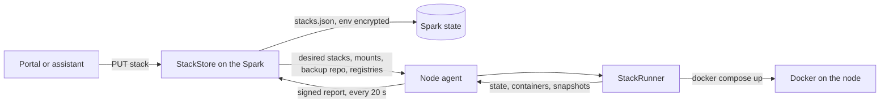
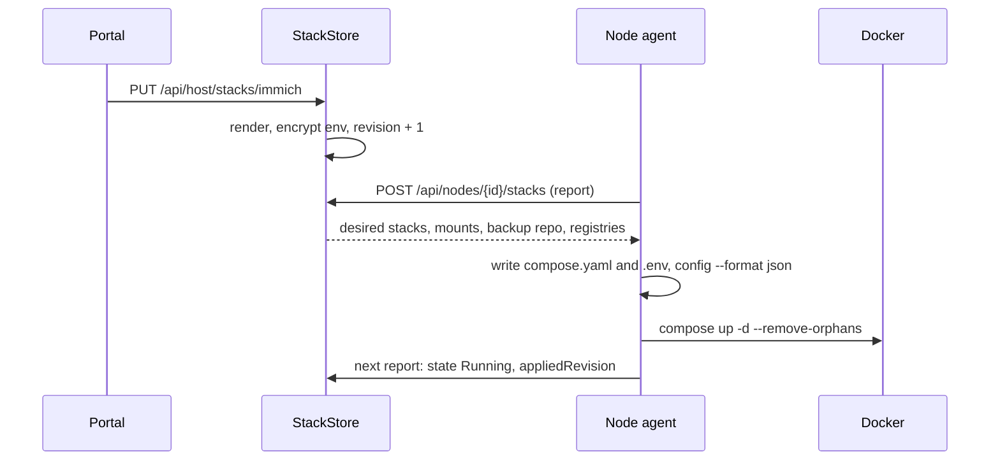

import WhoWhatWhy from '@site/src/components/WhoWhatWhy';
import Source from '@site/src/components/Source';

# Apps and stacks

<WhoWhatWhy
  who="Developers adding a catalog app or changing how Lucia stores, delivers and applies Docker Compose projects."
  what="The catalog classes, template versioning, the stack store, the node agent's stack runner, backups, image checks and registries."
  why="Lucia's controller must never run Docker commands on a node. It only publishes desired state, and each node converges on it."
/>

Users call them **apps**. In code the same thing is a **stack**: one Docker Compose project, pinned to one node, with a stored definition on the Spark. A stack is either a **catalog app** (Lucia renders its compose file from a few settings) or a **custom app** (the owner pastes the compose file). Everything below applies to both unless it says otherwise.

| Piece | Where |
|---|---|
| Catalog and app classes | <Source path="src/Lucia.Homelab.Server/Stacks/StackCatalog.cs" /> |
| Stack store, save, move, sync | <Source path="src/Lucia.Homelab.Server/Stacks/StackStore.cs" /> |
| HTTP routes | <Source path="src/Lucia.Homelab.Server/Stacks/StackEndpoints.cs" /> |
| Node side: apply, move, restore | <Source path="src/Lucia.NodeAgent/StackRunner.cs" /> |
| Backups | <Source path="src/Lucia.Homelab.Server/Stacks/StackBackups.cs" />, <Source path="src/Lucia.NodeAgent/ResticBackups.cs" /> |
| Image update checks | <Source path="src/Lucia.Homelab.Server/Stacks/StackImages.cs" /> |
| Registry sign-ins | <Source path="src/Lucia.Homelab.Server/Stacks/StackRegistries.cs" />, <Source path="src/Lucia.NodeAgent/RegistryLogins.cs" /> |
| Web UI | <Source path="src/frontend/src/Stacks.tsx" />, <Source path="src/frontend/src/stackManagement.ts" /> |
| Checks | <Source path="tests/Lucia.Homelab.DomainChecks/StackChecks.cs" /> |

## Who touches this

Owners install and manage apps in the portal. The assistant has tools over the same store (`delete_app`, `restore_backup`, `upgrade_app_images`), and they go through the same `StackStore` methods, so a hand edit, a catalog install and an assistant action all produce the same document. Every route under `/api/host/stacks` requires the `HostOwner` policy. The node-facing routes under `/api/nodes/{id}` are anonymous at the HTTP layer and authenticated by a signed proof from the node's key.

## The flow in one picture



The controller never pushes. Each node polls every 20 seconds, sends what it sees, and gets back what it should be running. That makes a node that was offline for a day converge the moment it returns, and it means the Spark needs no inbound path to nodes.

## How a catalog app is defined

A catalog app is a class that extends `CatalogApp`. The constructor takes its id, **version**, display name, summary, a sentence on what the server needs, fixed placement requirements and the settings fields.

```csharp title="src/Lucia.Homelab.Server/Stacks/StackCatalog.cs"
public abstract class CatalogApp(string id, int version, string name, string summary, string needs, string[] require, CatalogField[] fields)
{
    public string Id => id;
    public int Version => version;
    // ...
    public virtual bool ServerBound => false;
    public virtual bool UsesAddress => false;
    public virtual string BackupMode => "live";
    public virtual string[] BackupExclude => [];
    public virtual AppSso? Sso(IReadOnlyDictionary<string, string> settings) => null;
    public virtual bool Telemetry => false;
    internal virtual bool Bucket => false;
    internal abstract CatalogOutput Render(IReadOnlyDictionary<string, string> settings, ManagedNodeFacts node, IReadOnlyDictionary<string, string> env);
}
```

The virtual members are switches. Each one opts the app into a behaviour that other code implements:

| Member | Effect |
|---|---|
| `ServerBound` | The compose names this server's GPUs. The app can't move, one copy per server, and image checks skip it because its images follow the CUDA line. |
| `UsesAddress` | The app needs an IPv4 address of its own, bound in compose as `${LUCIA_ADDRESS}`. |
| `BackupMode`, `BackupExclude` | `stop` stops the app for the backup. Excluded paths (such as downloaded models) are skipped. |
| `Sso` | Lucia registers an Authentik OIDC client and writes `LUCIA_SSO_*` into the environment. The render must generate `SSO_CLIENT_SECRET`. |
| `Telemetry` | While Observability runs, Lucia keeps `LUCIA_OTLP_ENDPOINT` and `LUCIA_OTLP_AUTHORIZATION` in the environment. |
| `Bucket` | While Object storage runs, Lucia grants the app a bucket and keeps `LUCIA_S3_*` in the environment. |

`Render` returns a `CatalogOutput`: the compose text, the environment text, placement requirements and the app's web routes.

### A small real example: AdGuard Home

AdGuard is the shortest app that uses a feature beyond plain rendering. It declares no settings and no requirements, sets `UsesAddress`, and renders one container.

```csharp title="src/Lucia.Homelab.Server/Stacks/StackCatalog.cs" {1,8,22}
internal sealed class AdGuardApp() : CatalogApp("adguard", 1, "AdGuard Home",
    "Block ads and trackers for every device on your network, and answer for Lucia's own names.",
    "Any server with Docker ready, and a free address on your network for devices to use as their DNS server.",
    [], [])
{
    private const string Image = "adguard/adguardhome:v0.107.79@sha256:aba9e3bf0613be3ba3755e1fc311b126e2c24bec25e18b6483894a88283074f0";

    public override bool UsesAddress => true;

    internal override CatalogOutput Render(IReadOnlyDictionary<string, string> settings, ManagedNodeFacts node, IReadOnlyDictionary<string, string> env)
    {
        // DNS, the web interface, DNS-over-HTTPS (and HTTP/3), DNS-over-TLS and -QUIC, and the first-run wizard.
        string[] ports = ["53/tcp", "53/udp", "80/tcp", "443/tcp", "443/udp", "853/tcp", "853/udp", "3000/tcp"];
        var compose = $$"""
            # Installed from Lucia's catalog (adguard, version {{Version}}). Lucia rewrites this file when the catalog
            # updates the app. Convert the app to a custom app to edit it by hand.
            services:
              adguard:
                image: {{Image}}
                restart: unless-stopped
                ports:
            {{string.Join("\n", ports.Select(port => $"      - \"${{LUCIA_ADDRESS}}:{port.Split('/')[0]}:{port}\""))}}
            // ...
            """;
        return new(compose.ReplaceLineEndings("\n"), "", []);
    }
}
```

Points to notice:

- The image is pinned by digest. The tag says what it is, and the digest makes sure it is that.
- In the source, `${{LUCIA_ADDRESS}}` sits inside an ordinary interpolated string, where the doubled braces come out as one. The compose file ends up with a literal `${LUCIA_ADDRESS}`, which Compose expands from the node's `.env`.
- The class returns no routes, because AdGuard's own web interface is reached by its address.

### Adding an app

1. Write a class like the one above. Use the fields to expose only what an owner should choose: a port, a web name, a media folder. A field's `Kind` is `port`, `text`, `choice`, `range`, `gpus`, `secret` or `hidden`. `secret` values are moved into the app's environment and blanked in the manifest.
2. Register it in `StackCatalog.Apps`:

   ```csharp title="src/Lucia.Homelab.Server/Stacks/StackCatalog.cs"
   public static readonly CatalogApp[] Apps = [new LocalAiApp(), new AdGuardApp(), new ObservabilityApp(), new ObjectStorageApp(), /* ... */ new GitHubRunnerApp()];
   ```
3. Return routes from `Render` for any web address (`new StackRoute("grafana", 3030)`). Lucia validates them (one DNS label, free names, at most eight per app) and the gateway serves them.
4. Mount NAS folders only under `/mnt/lucia/nas/<nas>/<share>`. Lucia adds a `nas=<nas>/<share>` placement requirement for them, so the app only lands on a node that has the share mounted.
5. Generate secrets with `StackCatalog.Secret(env, "NAME")`. It keeps the previous value from `env` when it's at least 32 characters, so re-rendering doesn't rotate a database password.
6. Add a check (see [Testing](#testing)), and the app appears in the catalog and the portal's install form without any frontend change. The form is built from `Fields`.

## Versioning and re-rendering

A stack's manifest stores `template = {id, version, settings, images}`. It does not store the compose file for catalog apps in a form the owner edits. The compose is regenerated on **every save**:

```csharp title="src/Lucia.Homelab.Server/Stacks/StackStore.cs"
var previous = existing is null ? "" : _protector.Unprotect(existing.ProtectedEnv);
var output = app.Render(settings!, target, StackCatalog.KeepSecrets(app, settings!, StackCatalog.ReadEnv(previous)));
var pinned = StackImages.Keep(output.Compose, request.Manifest.Template!.Images ?? existing?.Manifest.Template?.Images);
(compose, env, require) = (StackImages.Apply(output.Compose, pinned), output.Env + LuciaLines(previous), StackRequirements.Normalize(output.Require));
```

Three things happen in those lines. The previous environment feeds `Render` so generated secrets survive. Image overrides the owner took are re-applied only while they're newer than what the catalog renders. And `LuciaLines` carries over the variables Lucia itself keeps (`LUCIA_SSO_*`, `LUCIA_OTLP_*`, `LUCIA_LAB_*`, `LUCIA_S3_*`, `LUCIA_STORAGE_*`), which `Render` never produces.

The saved manifest records `app.Version`. The summary sent to the UI includes both `template.version` (installed) and `template.latest` (the catalog's), and the app's settings section shows an **Update** button when `latest > version`. That button saves the same settings again, which re-renders onto the new version.

:::warning Bump the version
Deploying a new server build does not touch installed stacks. They change only when saved. **Any change to the rendered compose, env or embedded config must bump the app's `Version`**, or installed stacks never see it, and the UI never flags them. The re-render procedure for a rolled-out change is in the `lucia-stack-templates` skill and summarised in [Running apps](../deploy/apps.mdx#roll-out-a-template-change).
:::

Related rules from the same skill that bite in practice:

- Escape `$` as `$$` inside embedded configs, or Compose interpolates it. Observability does this for its Grafana dashboards with `.Replace("$", "$$")`.
- A new config (a dashboard, say) needs a `configs:` entry, a mount and a version bump. Compose before 2.30 doesn't recreate a container when only an inline config changes. Observability labels each service `lucia.configs` with a hash of its configs so the container is recreated.
- Anything that edits a stack out of band must bump its revision, or no node redeploys it. `SetLucia` does this for the `LUCIA_*` variable groups.

## How a stack reaches a node

`StackStore.Save` validates the name, normalises compose and env, renders catalog apps, checks placement, and writes the stack with `Revision + 1`. A new stack goes to its pinned node or to the eligible online node running the fewest stacks. An existing stack stays where it is. Only `Move` changes its node, because only a move takes its data along.

The stored environment is encrypted with ASP.NET data protection (`Lucia.Homelab.StackEnvironment.v1`). Definitions persist in `stacks/stacks.json` beside the onboarding state. Node reports stay in memory and reappear within one sync after a restart.

The node side is a loop in `StackRunner.RunAsync`:

```csharp title="src/Lucia.NodeAgent/StackRunner.cs"
using var timer = new PeriodicTimer(TimeSpan.FromSeconds(20));
do
{
    if (NodeRuntime.Current.State != "Ready") continue;
    // ...
    var containers = await ContainersAsync(token);
    var desired = await client.StacksAsync(node, certificate(), Report(containers), key, token);
    if (desired.Mounts is { } mounts) NasMounts.Reconcile(mounts, token);
    ResticBackups.Configure(desired.Backup, token);
    if (desired.Registries is { } registries) RegistryLogins.Write(registries);
    // ... addresses
    Reconcile(desired.Stacks ?? [], link, token);
} while (await timer.WaitForNextTickAsync(token));
```

One response carries everything: stacks, NAS mounts, the backup repository and registry sign-ins. `Reconcile` compares each desired stack with the node's `.lucia-applied.json`:

```csharp title="src/Lucia.NodeAgent/StackRunner.cs"
internal sealed record AppliedStack(long Revision, string Desired, long RestartCount, long PullCount, string? Files = null)
{
    /// <summary>A hash of the compose file and env, since Compose doesn't recreate a container when only its inline configs change.</summary>
    public static string Hash(NodeDesiredStack stack) =>
        Convert.ToHexString(System.Security.Cryptography.SHA256.HashData(Encoding.UTF8.GetBytes(stack.Compose + "\0" + stack.Env)));
}
```

If the target differs from what was applied, the node runs `ApplyAsync`. The counters carry user intent without changing the compose file: `RestartCount` forces `--force-recreate`, and `PullCount` runs `docker compose pull` first. This is why "Restart" and "Update" in the UI are just increments on the stored stack.



### What the node writes

`ApplyAsync` writes `compose.yaml` and `.env` into `/srv/lucia/stacks/<name>` with private permissions, then asks Compose for the resolved config as JSON and builds an override file, `compose.lucia.json`, with two rewrites:

- **Volumes.** Plain named volumes become bind mounts under `<stack>/volumes/<key>`. The data is then visible on disk, trivial to back up, and a move can copy the directory. External volumes and volumes with a custom driver stay as written (`VolumeOverride`).
- **Logging.** Services without their own `logging` get rotating `json-file` logs (20 MB, 3 files) labelled with the project and service. The telemetry relay depends on those labels to tell containers apart (`LoggingOverride`).

The node also refuses to start a stack whose compose uses a NAS path that isn't mounted yet (otherwise Docker would bind the empty mount point), and waits for an app's own address to be held. Those waits surface as a `Failed` state whose message starts with `Waiting for `, which the UI shows as **Waiting**.

Failures are recorded with the key of the target that failed and retried after two minutes (`RetryAfterFailure`), so a broken compose file doesn't spin.

### Node environment

`StackStore.NodeEnv` adds two things to the environment sent to the node, without storing them: `LUCIA_ADDRESS` (when the app has its own address) and one `LUCIA_URL_<HOST>` per route once a domain is active. Compose files use them as `${LUCIA_URL_GRAFANA:-http://server:3030}` so an app knows its public URL when it has one and still works by IP before then.

### Moves and restores

A move is a two-phase handshake carried by the same sync. The source node is told `Desired=Stopped` with a `Send` id; it stops the stack and streams the stack directory as a tar archive through the Spark to the target (`/api/nodes/{id}/transfers/{move}`, authenticated with a signed header proof). The target is told to `Receive`, unpacks into `.incoming-<name>`, and swaps it in. Anything already at that path is set aside as `.replaced-<name>-<time>`, never merged. When the target reports the `.lucia-received` marker for that move id, `Sync` finishes the move and updates the stack's `Node`. Lucia's own files are excluded from the archive and rewritten on the target.

A restore follows the same swap from a restic snapshot. A `RestoreAsync` that fails leaves the current data in place.

## Backups

The Spark owns the schedule, and the nodes own the data. Nothing runs on a timer on the nodes.

- `StackBackups.cs` stores one destination (a NAS share plus folder, and the owner's time zone) and one `BackupRecord` per stack in `backups.json`. The restic repository password is generated once and encrypted.
- When a stack is due (03:00 in the owner's zone, counted from the last request), the next sync to its node carries a `NodeBackupRequest`. The node's report closes it.
- The node's `ResticBackups` mounts nothing itself. It checks the share is really mounted (otherwise it would fill the local disk with a repository no one else sees), installs `restic` with `apt-get` the first time, creates the repository if `cat config` says it's missing, then runs `restic backup` with tags `lucia:stack=<name>` and `lucia:version=1`.
- Retention runs per stack with `forget --group-by "" --keep-daily 7 --keep-weekly 4 --keep-monthly 6 --prune`.
- `BackupMode = "stop"` makes the node `compose stop` before and `compose start` after. A run has a 12-hour limit.
- The password travels in `RESTIC_PASSWORD`, never on a command line.

Snapshots are listed by the nodes (the only machines with the repository mounted) and cached by the Spark. A stack that is moving or restoring is skipped.

## Image updates and registries

`ImageUpdateChecks` is a background service that wakes every minute and asks `ImageRegistry` to check every stack's compose, except server-bound apps. `ImageRegistry` remembers results for 6 hours, but images it hasn't seen yet are checked within the minute. Tag comparison is deliberately conservative:

```csharp title="src/Lucia.Homelab.Server/Stacks/StackImages.cs"
public static int Compare(string current, string candidate) =>
    Version(current) is { } a && Version(candidate) is { } b && a.Shape == b.Shape
        ? a.Numbers.Zip(b.Numbers, (x, y) => y.CompareTo(x)).FirstOrDefault(order => order != 0) : 0;
```

Tags compare only when they have the same shape (`v8.9.0-ls104` against `v9.1.0-ls108`, never against `9.1.0-dev`). Databases (`DataStore`) are only offered patch updates, because their data may need migration.

`POST /api/host/stacks/{name}/upgrade-images` with `{ "major": false }` takes the chosen tags:

- For a **custom** app, the compose file is rewritten with the new tag and digest.
- For a **catalog** app, the tags go into `template.images` as overrides. The next `Save` re-renders and re-applies them via `StackImages.Apply`, and `Keep` drops an override once the catalog catches up. The compose stays Lucia's.

Registry sign-ins (`StackRegistries.cs`) are separate state: `registries.json`, at most 16, with the secret encrypted (`Lucia.Homelab.RegistryCredentials.v1`). `SaveRegistry` signs in to the registry first (`ImageRegistry.SignIn`) and refuses a bad secret. Every sync carries them to the nodes. `RegistryLogins.Write` puts them in `/etc/lucia/docker/config.json`, and `ComposeAsync` points Docker at it with `DOCKER_CONFIG` only while the file exists. It never touches root's own `~/.docker`. The update checker reuses the same sign-ins through `RegistryLogins()`.

## Web addresses and sign-in

`StackRoute(Host, Port, GrpcPort?, Public?)` is the unit. `AppGateway.Build` turns every active route into Traefik router and service entries in `apps.yml`, next to the domain's file. A route with a `GrpcPort` gets a second router that matches `Content-Type: ^application/grpc` and forwards over `h2c://`, which is how Observability serves OTLP over HTTP and gRPC on one name. `Public` adds a router on the public entrypoint, only while public access is on.

Catalog apps with `Sso` are registered with Authentik by `AppSsoRegistrations`, which loops every 15 seconds. The web host holds no Authentik credentials. It writes one request file per app and the Spark's scoped identity service answers. See [Identity](./identity.mdx).

## Testing

The stack tests are plain checks in a console project:

```powershell
dotnet run --project tests/Lucia.Homelab.DomainChecks
```

`StackChecks.Run` is called from `Program.cs` with a `check(bool, message)` callback. A check renders an app and asserts on the output. The AdGuard one is representative:

```csharp title="tests/Lucia.Homelab.DomainChecks/StackChecks.cs"
var adguard = StackCatalog.Find("adguard");
var adguardCompose = adguard.Render(StackCatalog.Settings(adguard, null), null!, new Dictionary<string, string>()).Compose;
check(adguard.UsesAddress && !adguard.ServerBound && adguardCompose.Contains("      - \"${LUCIA_ADDRESS}:53:53/udp\"\n", StringComparison.Ordinal)
    && adguardCompose.Contains("      - \"${LUCIA_ADDRESS}:853:853/tcp\"\n", StringComparison.Ordinal)
    && !System.Text.RegularExpressions.Regex.IsMatch(adguardCompose, @"- ""\d"), "AdGuard must publish every port on its own address only.");
```

Write a check for a new app that covers what could silently break: the secrets survive a second `Render` with the first output's environment, the routes and requirements are what you expect, and any field with validation rejects bad input through the `Rejects` helper. The same file covers name and env validation, report validation, the gateway output, image tag comparison and routes.

The node-side rewrites (`VolumeOverride`, `LoggingOverride`) are checked in `tests/Lucia.NodeAgent.Checks/InstallationChecks.cs`.

## Design choices

- **Desired state, not commands.** The controller stores what should run and lets nodes pull it. A node that reboots, loses its network or is replaced converges without a replay of events. It also keeps the Spark's web host free of a Docker socket.
- **Render on save.** Catalog compose is a function of settings plus the template version, so the same input always gives the same file and an "Update" is a re-render. Owners who want to edit the file convert the app to a custom one, and Lucia stops owning it.
- **Bind mounts under the stack directory.** One directory per app holds its definition and data. Move, backup and restore all operate on that one path.
- **Revision counters on the controller, hash on the node.** The revision says "something changed". The hash catches the case where only an inline config changed and Compose wouldn't recreate the container.

For the operator's view of the same machinery, see [Running apps](../deploy/apps.mdx). For the Observability and Object storage apps in particular, see [Observability internals](./observability.mdx).
