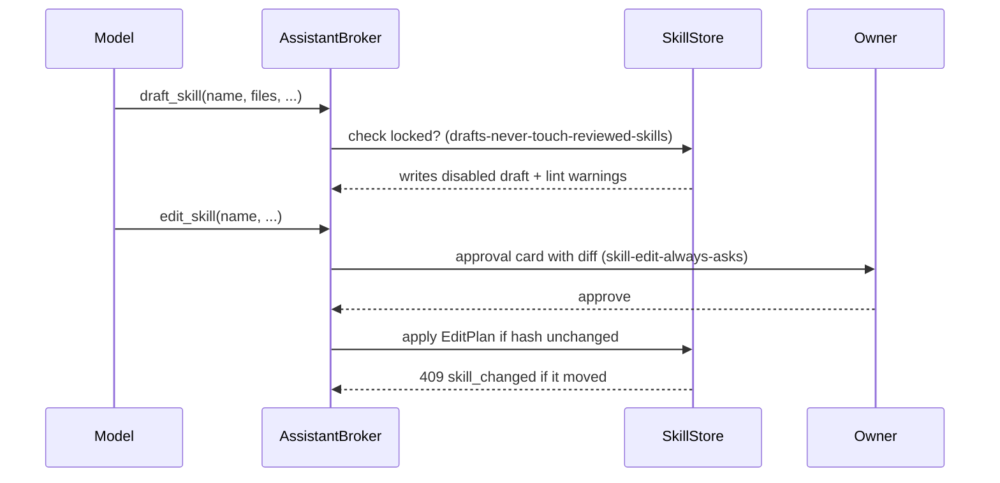
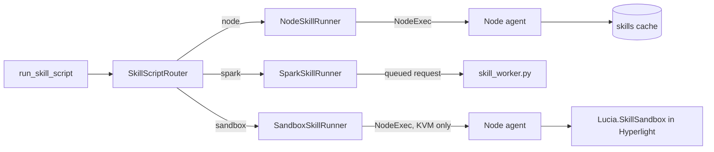

import WhoWhatWhy from '@site/src/components/WhoWhatWhy';
import Source from '@site/src/components/Source';

# Assistant skills

<WhoWhatWhy
  who="Developers changing how the assistant reads skills, runs their scripts or adds a runner."
  what="The skill folder layout and its limits, the three tools the model sees, how a script call is classified and approved, the three runners, and the node and Spark plumbing under them."
  why="A skill is a folder of text that a model reads and a script that runs on real machines. The checks that keep a script inside its approval have to live on the server, next to the store, not in the prompt."
/>

A skill is a folder under the assistant's data directory. The assistant reads its instructions, reads its files and runs its scripts through three tools that Lucia's broker governs like every other tool. The guide is [Assistant skills](../guide/assistant-skills.mdx). Deployment is in [Deploying assistant skills](../deploy/assistant-skills.mdx). The chat side it plugs into is [the assistant page](./assistant.mdx).

## Map of the folder

Everything lives in `src/Lucia.Homelab.Server/Assistant/Skills/`, with the frontend and the runners beside it.

| File | Role |
|---|---|
| `SkillStore.cs` | The folder on disk, `index.json`, the content hash, zip and GitHub import, duplication, limits |
| `SkillMarkdown.cs` | Reads the `SKILL.md` header and the `metadata` keys |
| `SkillChecker.cs` | Checks a script's syntax, C# diagnostics included, before it is saved |
| `AssistantSkills.cs` | Builds the turn's skill tools from `AgentSkillsProvider` and the store |
| `SkillAgent.cs` | Wraps the Agent Framework's skill provider for a turn |
| `SkillScriptRouter.cs` | Picks the runner for a script by its execution mode |
| `NodeSkillRunner.cs` | Runs a `node` script through the node agent |
| `SparkSkillRunner.cs` | Runs a `spark` script through the Spark's skill queue |
| `SandboxSkillRunner.cs` | Runs a `sandbox` script in a Hyperlight micro-VM on a KVM node |
| `SkillSandboxRuntime.cs` | The sandbox runtime package the controller ships |
| `SkillPackages.cs` | Tar.gz packages for nodes, built once per hash |
| `SkillNodeEndpoints.cs` | The `skills` and `sync-skills` routes the node agent calls |
| `SkillEndpoints.cs`, `SkillModels.cs`, `SkillBundle.cs` | The `/api/assistant/skills` routes, DTOs and bundles |
| `BuiltIn/<name>/SKILL.md` | The five shipped skills, including `skill-authoring` |
| `SkillStore.Drafts.cs` | Drafts: `draft_skill` writes, the lock on reviewed skills, owner-edit detection, enabling by hash |
| `SkillStore.Edit.cs` | Edits: reads the `edit_skill` arguments once, builds the approval plan, applies it on approval |
| `SkillReviewLint.cs` | Heuristic warnings written onto a draft, as `lucia.review-warnings` |
| `SkillModels.cs` | Also holds `SkillAuthors`, the `lucia.author`, `lucia.source-chats`, `lucia.rationale` and `lucia.last-edit` keys |

Assistant side: `src/Lucia.Homelab.Server/Assistant/SkillAuthoring.cs` holds the chat-review tools (`list_chats`, `read_chat_transcript`, `mark_chats_reviewed`) and the `/create-skill` context. `AssistantChatLog.cs` counts each chat's declined, expired, failed and timed-out calls.

Node side: `src/Lucia.NodeAgent/SkillSync.cs` and `SkillCache.cs`. Sandbox: `src/Lucia.SkillSandbox/`. Spark: `tools/skills/skill_worker.py` and `deployment/skill-runner/Dockerfile`. Frontend: `AssistantSkills.tsx`, `SkillScriptEditor.tsx`, `skills.ts` and `useSkillsToReview.ts`, which feeds the Needs review count. The chat-side skill code is in `assistant.ts` and `AssistantPanel.tsx`.
## Folder layout and limits

`SkillStore` keeps one folder per skill, named by the skill. It follows the agentskills.io layout: `SKILL.md`, then `scripts/`, `references/` and `assets/`. Anything that isn't part of a package, such as enabled state and source, lives in `index.json` at the top of the folder.

```text
<Assistant:Directory>/skills/
  index.json                 enabled state, source, updated time, hash per skill
  <name>/SKILL.md
  <name>/scripts/...
  <name>/references/...
  <name>/assets/...
```

The limits are constants on `SkillStore`:

```csharp title="src/Lucia.Homelab.Server/Assistant/Skills/SkillStore.cs"
public const int MaxSkills = 200, MaxFiles = 200, MaxFileBytes = 1024 * 1024, MaxSkillBytes = 5 * 1024 * 1024, MaxEditableBytes = 256 * 1024,
    MaxZipBytes = 5 * 1024 * 1024, MaxDomains = 50;
```

Built-in skills are read from the assembly's `BuiltIn/` folder, and `IsBuiltIn(name)` makes them read-only. Duplicating one creates an owned copy. `DuplicateAsync` takes a new name and copies the files.

Import has two entry points, both checked against the same limits. A zip upload is read in a bounded stream and rejected above `MaxZipBytes` (413 `zip_too_large`). A GitHub import calls `api.github.com` over the assistant's checked connection, and rejects a folder address that isn't `github.com/owner/repo/tree/ref/path`.

### The header

`SkillMarkdown` reads the `SKILL.md` front matter. Lucia's own keys live under `metadata`:

| Key | Values | Meaning |
|---|---|---|
| `lucia.execution` | `node`, `spark`, `sandbox` | Which runner handles its scripts (`SkillExecution.Valid`) |
| `lucia.tier` | `read`, `change`, `destructive` | The tier of a script call |
| `lucia.allowed-domains` | host list | Hosts the skill may read, added to the broker's host grants |
| `lucia.network` | `none`, `bridge` | Network for a Spark script's container. Default `none`. Sandbox scripts get a network only when `lucia.allowed-domains` is set |

```csharp title="src/Lucia.Homelab.Server/Assistant/Skills/SkillModels.cs"
public const string ExecutionKey = "lucia.execution", TierKey = "lucia.tier", DomainsKey = "lucia.allowed-domains", NetworkKey = "lucia.network";
```

## The content hash

Each skill has a hash over its files, and a script's grant depends on that hash. A grant is `skill:<name>@<first 8 hex>`:

```csharp title="src/Lucia.Homelab.Server/Assistant/Skills/AssistantSkills.cs"
public static string Grant(string name, string hash) => $"skill:{name}@{hash[..8]}";
```

Any edit changes the hash, so an old "always allow" no longer matches. The node and sandbox paths check the hash against the store before they run anything, and `SkillPackages` only serves a package whose hash still matches.

## The three tools

`AssistantSkills.ContextAsync` builds a turn's skill context. It asks an `AgentSkillsProvider` for its tools and instructions, then wraps each one in a `LiveSkillFunction`. The model sees four tools:

| Tool | Tier | What it does |
|---|---|---|
| `load_skill` | `read` | Returns a skill's `SKILL.md` body |
| `read_skill_resource` | `read` | Returns one of the skill's listed files |
| `run_skill_script` | per skill, see below | Runs a script with its arguments |
| `refresh_skills` | `read` | Reloads the enabled list and reports what was added or removed |

`run_skill_script` is classified per call. The model names a skill, and `Classify` reads that skill's tier and grant:

```csharp title="src/Lucia.Homelab.Server/Assistant/Skills/AssistantSkills.cs"
internal (string Tier, string? Grant) Classify(JsonNode? input)
{
    var name = input is JsonObject fields && fields["skillName"] is JsonValue value && value.TryGetValue(out string? text) ? text : null;
    return name is not null && SkillStore.ValidName(name) && store.HashOf(name) is { } hash
        ? (store.SettingsOf(name).Tier, Grant(name, hash))
        : (ToolTier.Change, null);
}
```

A call that names no skill, or a skill that doesn't exist, is a change. The broker then asks, which is the safe default. The grant key goes into the same per-chat and per-job grant sets described on [the assistant page](./assistant.mdx#the-broker-policy).

The model is offered the enabled skills' names and descriptions, and calls `load_skill` to read one before it follows it.

## Drafts and edits

The assistant can write skills too, but never as a live change. Two tools do it, and each has its own tier.

| Tool | Tier | What it does |
|---|---|---|
| `list_skills` | `read` | Lists enabled and built-in skills, with author, runner, tier and, for drafts, their chats and rationale. Pass `includeDisabled` for disabled skills and drafts |
| `get_skill` | `read` | Reads one skill's `SKILL.md` and file list, or one file. It never runs anything |
| `draft_skill` | `draft` | Creates a disabled skill, or updates the assistant's own untouched draft when `update` is set |
| `edit_skill` | `skill-edit` | Proposes a change to an owner or assistant skill. The owner approves a diff first |

### Drafts

`SkillStore.Drafts.cs` owns a draft's life. A draft is always saved disabled, and it carries `lucia.author: assistant`, its `lucia.source-chats` (at most 10), a `lucia.rationale` (at most 1,000 characters) and the lint warnings. A draft takes at most 40 files.

The assistant may rewrite a draft only while it is still its own and untouched. Two things lock a draft for good: the owner enables it, or the owner edits it, which sets `lucia.last-edit`. The policy denies a `draft_skill` call that targets a locked skill (`drafts-never-touch-reviewed-skills`).

Enabling a draft needs the hash the owner reviewed. `SkillEnabledRequest.Hash` carries it, and a mismatch returns `409 skill_changed`. This guards against the assistant changing a draft between the review and the switch.

### Edits

`SkillStore.Edit.cs` handles `edit_skill`. The arguments are read once, exactly: names are case-sensitive, a field may not repeat or be unknown, and each value must have its type. That one reading becomes the `EditPlan` the owner sees as a diff, and the same plan is what gets written on approval. Nothing is re-read from the model.

Each plan is kept for 2 hours (`ApprovalLife`), and at most 200 are held at once (`MaxApproved`). A diff file is capped at 32 KiB and the whole diff at 192 KiB. Applying an approved plan checks the skill's hash again, and returns `409 skill_changed` if it moved since the owner was asked.

### How the policy treats each tier

The rules in `AssistantBroker.cs` decide what happens. The first match by priority wins, and anything not covered is denied.

| Rule | Priority | Effect |
|---|---|---|
| `disabled-skills-never-run` | 120 | Denies `load_skill`, `read_skill_resource` and `run_skill_script` for a skill that isn't runnable this turn |
| `drafts-never-touch-reviewed-skills` | 120 | Denies `draft_skill` on a locked skill |
| `skill-edit-plan-mode` | 110 | Denies `edit_skill` in Plan mode |
| `skill-edit-chats-only` | 109 | Denies `edit_skill` in a job |
| `skill-edit-always-asks` | 97 | Requires approval for every `edit_skill` |
| `drafts-allowed` | 75 | Allows `draft`-tier calls: `draft_skill` and `mark_chats_reviewed` |

`edit_skill` is never offered as "always allow". The frontend's `parseSettings` removes it from `autoTools`, and `grantText` returns no grant option for it.



After a draft is created or an edit is applied, `SkillAuthoring` sends a push notification through `Notify`. It is best effort: a failure is logged with only the error type and never stops the write.

### Lint

`SkillReviewLint.cs` gives heuristic warnings, which a draft shows in the Needs review list. It flags command passthrough, a `read` tier on a script that seems to change something, `LUCIA_SKILL_ARGS` used without validation, and network calls from a node script. These are hints, not guarantees, so the owner still reads the script.

### Chat issues

`AssistantChatLog.cs` counts a chat's declined, expired, failed and timed-out calls. The sessions list shows the counts, and `/create-skill` uses them to find candidates. Reviewed chats are recorded in `skill-reviews.json` (up to 2,000 per owner), so the next review skips them unless the owner picks them.

## Scope per turn

A chat offers every enabled skill. A job passes its `Skills` field. `null` or an empty list means no skills, `"*"` means every enabled skill, and a list means those names. Built-in skills are always included.

### Mid-turn changes

`refresh_skills` makes the turn pick up store changes. Each skill call is wrapped in a `LiveSkillFunction` that compares the store's `Revision` with the one it was built against. If the revision moved, the call goes to a freshly built provider. A skill that was disabled mid-turn returns `Error: that skill is no longer enabled.`

## Routing a script to a runner

`SkillScriptRouter` reads the skill's execution mode and hands the call to one runner:



All three paths verify the skill's hash before they run anything, and they pass the script's `language` from its extension.

### Node

`NodeSkillRunner` sends a script to a managed server through `NodeExec`, the same path `run_command` uses. The node agent runs the script from its own copy, installed by `SkillSync` (covered below). The model can name the server with a `node` argument; the rest of the arguments go to the script.

A `.cs` script runs as `dotnet run <file> -p:PublishAot=false -p:NuGetAudit=false`. .NET 10 file-based apps default to PublishAot, and its restore fetches the AOT compiler, so the flags keep the run from failing offline.

### Spark

`SparkSkillRunner` writes a request into the Spark's queue at `host/data/assistant/skill-runner/requests/<id>.json` and waits for `responses/<id>.json`. `tools/skills/skill_worker.py` is the setup-user service that claims requests. It runs the skill in a throwaway container built from `deployment/skill-runner/Dockerfile`, where containers run read-only as `nobody`, with `/tmp` as the only writable place. A request claimed but not answered before a crash is answered `interrupted` and never runs again. `interpreter()` and `checker()` in `skill_worker.py` add the same two `-p:` flags to a `.cs` script's `dotnet run` and `dotnet build`.

### Sandbox

`SandboxSkillRunner` runs a Python or JavaScript script in a Hyperlight micro-VM. It only accepts `.py`, `.js` and `.mjs` (`SkillLanguages.SandboxCanRun`). With no KVM-capable node the call fails with the `NoServer` message, which reads "No server can run sandboxed skills: Hyperlight needs an x86_64 server with KVM."

The runner builds a shell command for the chosen node. The command checks that Docker is installed and that `/dev/kvm` exists, copies the skill into a private work directory, and runs the sandbox image. The flags are:

```text
--device /dev/kvm --network none|bridge --read-only --tmpfs /tmp --cap-drop ALL --security-opt no-new-privileges --pids-limit 256 --memory 1g --cpus 2 --user 65534:65534
```

`--network bridge` is only used when the skill lists `lucia.allowed-domains`. The skill and the runtime are mounted read-only. The sandbox runtime is `Lucia.SkillSandbox`, shipped as `boot/skill-sandbox-linux-x64`.

## Node plumbing

`SkillNodeEndpoints` gives the node agent two routes: a signed `skills` manifest and a download for each `name@hash` package. `SkillPackages` builds a tar.gz for each enabled node or sandbox skill, keyed by its hash.

On the agent, `SkillSync` runs every minute and on a `sync-skills` request. It downloads each missing `name@hash` package, checks the SHA-256 before it unpacks, and writes the files with restrictive modes (folders 0700, files 0600, no execute bit). `SkillCache` installs each package in one rename, and removes hashes the manifest no longer lists.

The heartbeat advertises the `skills` feature, plus `kvm` when `/dev/kvm` and Docker are present, and a map of the hashes it holds. See [the node agent README](../deploy/nodes.mdx) for the agent-side view.

## Adding a runner or a tool

- **A new execution mode.** Add the value to `SkillExecution`, handle it in `SkillScriptRouter` and in the header check, and add a runner that verifies the hash before it runs. Add the mode to the editor's `skills.ts` list, so the frontend offers it.
- **A new skill tool.** `AssistantSkills.ContextAsync` is the only place skill tools are wrapped. Give the new tool a tier there. Anything that runs code must be `Change` or stricter, and it needs a `Classify`-style grant.
- **A new warning.** Destructive skill-related calls take their approval text from `AssistantTools.Warning`, like any other tool. `run_skill_script` already has an entry.

The checks project, `tests/Lucia.Homelab.AssistantChecks/`, covers the assistant's broker and tools. Add a check there for any new limit or grant format.

<Source path="src/Lucia.Homelab.Server/Assistant/Skills/SkillStore.cs" /> · <Source path="src/Lucia.Homelab.Server/Assistant/Skills/AssistantSkills.cs" /> · <Source path="src/Lucia.Homelab.Server/Assistant/Skills/SkillScriptRouter.cs" /> · <Source path="src/Lucia.NodeAgent/SkillSync.cs" />
