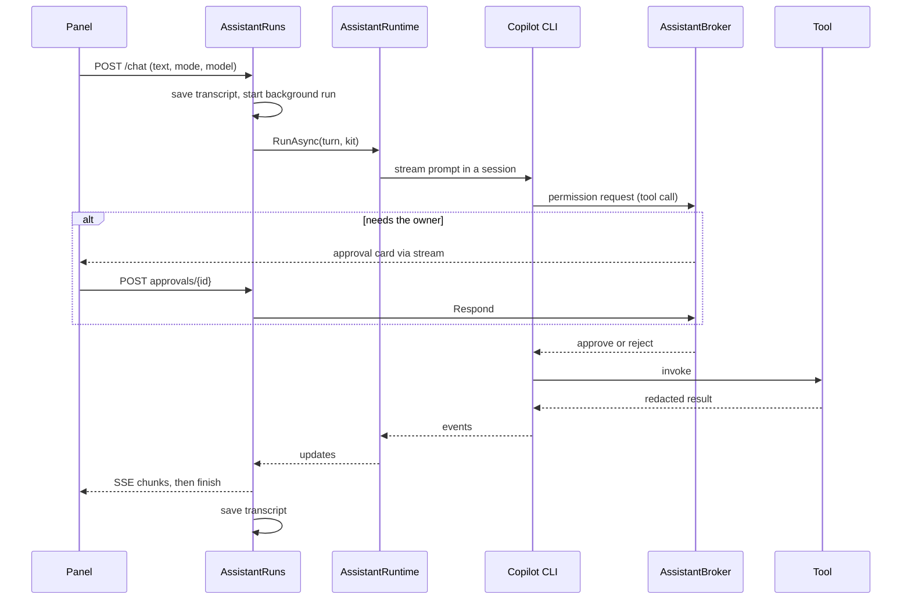

import WhoWhatWhy from '@site/src/components/WhoWhatWhy';
import Source from '@site/src/components/Source';

# Assistant

<WhoWhatWhy
  who="Developers changing the assistant's tools, permissions, model sources or scheduled jobs."
  what="The tool tiers, the broker that approves each call, how one chat turn runs, where models come from, and how jobs are stored and tested."
  why="An assistant that can restart servers has to be safe by construction. The server enforces the rules, and the prompt only describes them."
/>

Owners talk to the assistant in a side panel, and owners schedule it as jobs. It lives in `src/Lucia.Homelab.Server/Assistant/` and runs inside the host process on the Spark. Every endpoint sits behind the `HostOwner` policy. For what users see, read the [guide](../guide/assistant.mdx). For machines, paths and ports, read [Deploying the assistant](../deploy/assistant.mdx).

## Why it is built this way

Three decisions shape most of the code.

1. **The model gets Lucia's tools and nothing else.** The Copilot runtime starts in `CopilotClientMode.Empty`, with no built-in tools, files or shell, and a replaced environment. A call to anything outside Lucia's kit is rejected.
2. **Policy runs on the server, per call.** A broker evaluates a small deny-by-default policy for each tool call and either runs it, asks the owner, or refuses. The system prompt says the same things, but nothing depends on the model obeying it.
3. **Turns outlive the browser.** A turn runs on a background task, publishes stream chunks into a replayable buffer, and saves its transcript when it ends. The panel can disconnect and reattach.

## Map of the folder

| File | Role |
|---|---|
| `AssistantEndpoints.cs` | DI registration, the `/api/assistant` routes, the loopback engine route, the SSE stream |
| `AssistantTools.cs` | The tools, `AssistantTool` (redaction and output cap), approval warnings |
| `AssistantBroker.cs` | Tiers, the policy, approvals, questions, per-chat grants, the owner's settings |
| `AssistantRuntime.cs` | The Copilot CLI child, session config, model list, reasoning and tier handling |
| `AssistantRuns.cs` | Turn start and execution, chat storage, job prompts |
| `AssistantStream.cs` | Maps runtime events to AI SDK UI message chunks |
| `AssistantProviders.cs` | LiteLLM and Local AI model sources |
| `AssistantEngineProxy.cs` | Loopback shim that writes reasoning effort into a request |
| `AssistantJobs.cs` | Job storage, the cron ticker, job grants |
| `Skills/` | Owner skills: the store, the tools, the three script runners. See [Assistant skills](./assistant-skills.mdx) |
| `AssistantPush.cs` | Web Push without a library |
| `AssistantWeb.cs` | `read_web_page`: public sites only |
| `GitHubSignIn.cs` | GitHub device flow and token refresh |

Frontend: `src/frontend/src/AssistantPanel.tsx` (chat, cards), `AssistantTuning.tsx` (mode button, effort menu, context donut), `AssistantSettings.tsx`, `Jobs.tsx`, `MultiSelect.tsx`, plus `assistant.ts` and `assistantJobs.ts` for parsing and helpers.

## Tool tiers

Each tool declares a tier. The tier and the chat's mode decide what the broker does with a call.

```csharp title="src/Lucia.Homelab.Server/Assistant/AssistantBroker.cs"
public static class ToolTier
{
    public const string Read = "read", Web = "web", Registry = "registry", Change = "change", Destructive = "destructive", Secret = "secret";
}
```

| Tier | Examples | In a chat | In a job |
|---|---|---|---|
| `read` | `list_nodes`, `read_logs`, `ask_owner`, `notify_owner`, `load_skill`, `read_skill_resource`, `refresh_skills` | Runs | Runs |
| `web` | `read_web_page` | Runs for allowed hosts, asks otherwise | Also runs for the job's hosts |
| `registry` | `query_registry` | Asks per registry | Runs for the job's registries |
| `change` | `install_catalog_app`, `app_action`, `run_backup` | Runs if the owner allowed it in settings or for this chat; else asks | Also runs if the job allows it |
| `destructive` | `delete_app`, `node_action`, `run_command` | Always asks | Asks unless the job allows that tool |
| `secret` | `request_secret` | Runs: the card is the consent | Same |

`run_skill_script` takes its tier from the named skill's `lucia.tier` (`read`, `change` or `destructive`), and a call that names no valid skill counts as `change`. Its grant key is `skill:<name>@<hash>`, so editing a skill makes old grants lapse. See [Assistant skills](./assistant-skills.mdx).

Plan mode refuses `change`, `destructive` and `secret` outright.

## The broker policy

`AssistantBroker.Kit` builds the permission handler for one turn. The policy is a YAML document evaluated by the Agent Governance Toolkit. The first matching rule by priority wins, and `default_action: deny` covers anything no rule names.

```yaml title="src/Lucia.Homelab.Server/Assistant/AssistantBroker.cs"
default_action: deny
rules:
  - name: plan-mode-changes-nothing
    condition: "mode == 'plan' and tier == 'change' or mode == 'plan' and tier == 'destructive' or mode == 'plan' and tier == 'secret'"
    action: deny
    priority: 100
  - name: job-granted
    condition: "tier == 'destructive' and job_granted"
    action: allow
    priority: 95
  - name: destructive-always-asks
    condition: "tier == 'destructive'"
    action: require_approval
    priority: 90
```

The permission handler does the work around the policy:

1. Rejects anything that isn't one of Lucia's custom tools (the runtime's own shell, file and URL tools included).
2. Counts calls and rejects after `MaxCallsPerTurn` (50).
3. For web and registry tools, parses the URL or image and derives the host. A malformed argument is rejected here, before any policy runs.
4. Builds a grant key: `tool:<name>`, `host:<host>` or `registry:<host>`. It checks the chat's in-memory grants, the job's grants and the owner's settings, and passes `autonomy` and `host_allowed` into the policy.
5. On `Allow` for read or secret tools, approves quietly. For other allowed or refused calls, it publishes the card events (so the chat shows the call ran on its own, and why).
6. On `Ask`, publishes an approval request and waits up to `AnswerWait` (30 minutes) for `Respond`. Stopping the turn cancels the wait.

The `reason` text on the card comes from `AssistantTools.Warning`, so each destructive tool states what it puts at risk.

"Allow for this chat" is a set of grant keys held in memory, keyed by chat. `Forget` clears it when a chat is deleted, and a host restart clears it too. In a job's chat, "always" instead saves the grant to the job through `AssistantJobGrants.Add`.

Questions use a different path. `ask_owner` and `request_secret` call `broker.AskAsync` and wait for the owner's answer through `Answer`. A call that waits for a secret refuses a plain answer, so a secret never reaches a question whose answer the model reads.

## Tool results

`AssistantTool` wraps every function. It redacts the result (a credential redactor plus the known secret field names from the catalog), caps it at 48 KB with a note, and turns an unexpected exception into a generic `tool_failed`. Only Lucia's own exception types (`AssistantException`, `HardwareOnboardingException`, and a few others) pass their text to the model. That keeps stack traces and paths out of the conversation.

## Adding a tool

The tool list lives in `AssistantTools.Create`. Each entry is `Tool(tier, name, description, delegate)`. A group of tools for one domain can live in its own partial file, as the CrowdSec tools do in `AssistantCrowdSec.cs`, and join the list from there. Here is a real small one, `check_node_updates`:

```csharp title="src/Lucia.Homelab.Server/Assistant/AssistantTools.cs"
Tool(ToolTier.Change, "check_node_updates", "Asks a server to check for OS package updates now.",
    async Task<object?> ([Description(NodeHelp)] string node, CancellationToken ct) =>
        await requests.Act((await Node(node, ct)).Id, "check-updates", ct)),
```

To add a tool:

1. **Pick a tier.** If it changes state, it is `Change`. If it deletes, interrupts, exposes or runs arbitrary code, it is `Destructive`. When in doubt, take the stricter tier.
2. **Add the entry to `Create`.** The delegate's parameters become the tool's JSON schema. Put a `[Description]` on every parameter, because the model reads them. Take `CancellationToken ct` and pass it through. The factory is `AIFunctionFactory.Create`, so default values become optional parameters.
3. **Call the real service.** Inject what you need through the constructor of `AssistantTools` (`requests` above is `NodeRequests`). Do the work, validate names with helpers such as `App(...)` and `Node(...)`, and throw `AssistantException` for problems the model can act on.
4. **Return data, not prose, where you can.** Return an anonymous object, or a string for a simple "Done". The wrapper serializes and redacts it.
5. **For a destructive tool, add a case to `Warning`.** That text is the impact line on the approval card.

```csharp title="src/Lucia.Homelab.Server/Assistant/AssistantTools.cs"
("node_action", "restart") => $"Every app on {node} is offline for a few minutes while it restarts.",
("run_command", _) => $"This runs the command below as root on {node}. It can change anything there.",
```

6. **Mention it in the identity prompt only if the model needs steering.** The prompt in `AssistantRuntime` names the main lookup tools. A new read tool usually needs no edit there.
7. **Check what you get for free.** The settings endpoint returns every tool from `Create` with its tier, and Settings → Assistant shows the change tools as checkboxes. Job permissions work the same way for change and destructive tools. The tool name becomes a grant key, so renaming a tool later silently drops saved grants.

Then add a check (see [Testing](#testing)).

## One chat turn

`POST /api/assistant/chat` starts a turn and streams it. `AssistantRuns.StartAsync` validates the request, rejects a second turn on the same chat (409 `run_active`), appends the user message to the transcript and starts `ExecuteAsync` on a background task. The HTTP handler only replays and follows the run's chunk buffer.



Details worth knowing:

- **Context block.** The prompt is prefixed with a `<lucia-context>` block naming the mode and the page. The identity prompt tells the model it is Lucia's own data and never an instruction. For a job it adds a line saying nobody is watching.
- **Sessions.** The session key is `<owner>-<chatId>`. The runtime resumes the session when it exists, so the conversation lives in the CLI's own state under `runtime/`, while the readable transcript is Lucia's JSON file.
- **Stopping.** Cancelling a Microsoft Agent Framework run only detaches, so `AbortAsync` resumes the session and aborts it.
- **Retry.** Sending the same `MessageId` again removes the failed or stopped answer and reruns the last user message.
- **Finished runs linger 30 seconds** in memory so a reconnecting panel can still replay the end.
- **The stream** is AI SDK UI message protocol over SSE (`AssistantStream.Map`). It turns runtime events into `text`, `reasoning`, `tool-*` and `message-metadata` chunks, keeps the saved message in step, and sums token usage for the finish chunk.
- **Failures** go through `runtime.ExplainAsync`, which turns a Copilot refusal into something the owner can act on. Details are logged by error type only.

## Model sources

`AssistantProviders` turns a model id into either "use Copilot" or a provider config. The id carries where it runs:

| Id | Source |
|---|---|
| `gpt-5`-style bare id | GitHub Copilot, with the owner's GitHub token |
| `litellm:<model>` | The LiteLLM catalog app |
| `local:<model>` | The model loaded on the Spark, over loopback |
| `local:<stack>/<model>` | The Local AI app of a managed node |

LiteLLM and Local AI use the runtime's bring-your-own-key provider (`Type = "openai"`, `WireApi = "completions"`), so they need no GitHub sign-in. `AssistantRuns.StartAsync` only checks for a GitHub connection when the model is a Copilot one.

- **LiteLLM keys.** The host mints one virtual key per owner with the app's master key (`key/generate`, alias `lucia-assistant-<owner>`), stores it encrypted with Data Protection under `litellm/`, and mints again when LiteLLM answers 401 or 403.
- **The Spark.** `AssistantEndpoints.Spark` builds `http://127.0.0.1:<port>/v1` with `HostPlatform:InferenceApiKey`. The host proxy lets that through (see [deployment](../deploy/assistant.mdx#loopback-and-the-host-proxy)).
- **Context limits.** Local engines report `context_length` or `max_model_len`. When an engine gives no output limit, `ResolveAsync` reserves a quarter of the window for the answer so prompt and answer always fit.
- **Picker errors.** A source that can't list its models returns a `Reason` string instead of failing the whole list.

## Reasoning effort and context tier

Copilot models report their efforts and context tiers. `Card` turns a runtime model into `AssistantModel`, and `TuningAsync` keeps a requested effort or tier only if the model offers it. A stale browser choice then never fails a turn.

Models the owner brought report no efforts. The owner lists the efforts each accepts in Settings, saved as `ModelEfforts` and applied in `ModelsAsync`. The runtime cannot add fields to a provider request, so for a turn that picks an effort, `AssistantEngineProxy.Open` points the provider at a loopback route on the host itself and registers a one-turn token:

```csharp title="src/Lucia.Homelab.Server/Assistant/AssistantEngineProxy.cs"
request.Remove("reasoning_effort");
if (effort == "none")
{
    var kwargs = request["chat_template_kwargs"] as JsonObject ?? new JsonObject();
    kwargs["enable_thinking"] = false;
    request["chat_template_kwargs"] = kwargs;
}
else request["reasoning_effort"] = effort;
```

`Forward` refuses anything that isn't from loopback with a known bearer token, rewrites chat request bodies (16 MB cap), forwards to the real engine with the real key, and streams the answer back, flushing each piece. The lease ends with the turn. A turn on the default effort never opens the shim.

The context donut reads `SessionUsageInfoEvent` from the runtime. `AssistantStream` emits `message-metadata` with `used`, `limit` and the system, conversation and tools split whenever it changes. The frontend's `contextFill` falls back to the model card's window when the runtime reports no limit.

## Jobs

`AssistantJobs` is a `BackgroundService`. Every minute it wakes, loads each owner's jobs and starts any enabled job whose cron time fell in the last interval (`Cronos`, standard five fields, evaluated in the job's time zone). A job that is still running skips the turn.

`RunNowAsync` and the ticker both call `StartAsync`, which records a run and calls `AssistantRuns.RunJobAsync`. That runs each prompt through the normal `StartAsync` in one new chat, in `execute` mode, and stops at the first prompt that doesn't succeed.

A job's grants (`tool:`, `host:`, `registry:`) become an `AssistantJobGrants` handed to `broker.Kit`. When a call waits, the run records the open approval. If it times out, the run ends as `unanswered`.

Push notifications go out when a call starts waiting, and when a run ends `failed` or `unanswered`.

### Storage

Everything lives under `Assistant:Directory`, in a per-owner folder. The owner key is the first 16 hex characters of a SHA-256 of the signed-in subject.

```text
<Assistant:Directory>/
  users/<owner>/
    settings.json          change tools, sites, per-model efforts
    devices.json           push devices
    <chatId>/transcript.json, session.json
    jobs/<jobId>.json      the job
    jobs/<jobId>.runs.json newest 50 runs
  github/<owner>.json      encrypted GitHub token
  litellm/<owner>.json     encrypted LiteLLM virtual key
  push-key.json            encrypted VAPID key
  runtime/  workspace/     Copilot CLI state and working directory
```

Writes go through `DomainOnboardingStore.WriteJson`, reads go through `RejectLinks`, and ids are validated as GUIDs or hex before they reach a path. Jobs hold `Prompts` (1 to 10, 32,768 characters each), `Cron`, `TimeZone`, `Model`, `Reasoning`, `ContextTier`, the `Tools`, `Hosts` and `Registries` grants, and `Skills` (names, `*` for every enabled skill, or empty). `AssistantJobs.SaveAsync` checks that granted tools are change or destructive tools that exist.

## Push

`AssistantPush` implements Web Push (RFC 8030, 8291 and 8292) directly: a VAPID key pair created once and protected with Data Protection, `aes128gcm` payload encryption, and `TTL: 86400`. It accepts subscription endpoints only from known push hosts (`fcm.googleapis.com`, Mozilla, Apple and Windows) and keeps at most 20 devices per owner.

## Testing

`tests/Lucia.Homelab.AssistantChecks/` is a console app. It runs with no Copilot runtime, GitHub token or network, using fakes for GitHub and for an OpenAI-compatible engine. It stores its files under the test project's folder and prints the number of assertions at the end.

```text
dotnet run --project tests/Lucia.Homelab.AssistantChecks
```

Its broker checks build fake tools for each tier and drive the real policy:

```csharp title="tests/Lucia.Homelab.AssistantChecks/Program.cs"
AssistantTool GovTool(string name, string tier) => new(AIFunctionFactory.Create((Func<string>)(() => "ok"), new AIFunctionFactoryOptions { Name = name }),
    tier, (value, _) => Task.FromResult(value), NullLogger.Instance);
AssistantTool[] govTools = [GovTool("peek", ToolTier.Read), GovTool("tweak", ToolTier.Change), GovTool("nudge", ToolTier.Change),
    GovTool("wipe", ToolTier.Destructive), GovTool("fetch", ToolTier.Web), GovTool("vault", ToolTier.Secret), GovTool("run_command", ToolTier.Destructive)];
```

`GovCall` sends a permission request for a tool, and `GovNew` reads the chunks the broker published, so a check can assert both the verdict and what the owner would see. The suite covers stream mapping, the broker (Plan mode, grants, the 50-call limit, questions), jobs (validation, schedules, lost runs), push, providers, the engine proxy and web reading.

When you add a tool, add a check where it matters: its tier, its validation errors, and its warning text. When you change the policy, add a verdict check next to the existing ones.

<Source path="src/Lucia.Homelab.Server/Assistant/AssistantBroker.cs" /> · <Source path="src/Lucia.Homelab.Server/Assistant/AssistantTools.cs" /> · <Source path="src/Lucia.Homelab.Server/Assistant/AssistantRuns.cs" /> · <Source path="tests/Lucia.Homelab.AssistantChecks/Program.cs" />
