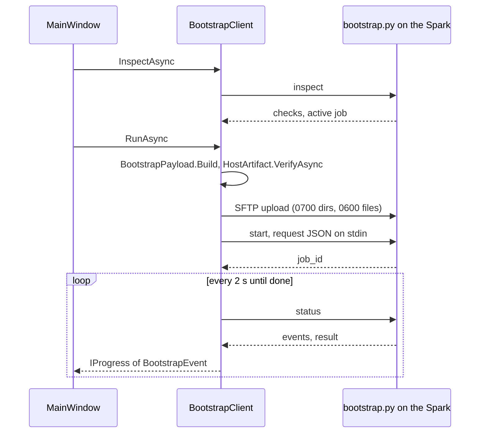

import WhoWhatWhy from '@site/src/components/WhoWhatWhy';
import Source from '@site/src/components/Source';

# Desktop bootstrap

<WhoWhatWhy
  who="Developers changing the setup app, its Spark-side script or the payload it ships."
  what="The two desktop projects, the JSON protocol over SSH, the durable job, and how host keys and secrets are handled."
  why="The app installs a controller that holds the lab's keys. It has to be safe to run against a machine it has never seen, and safe to close halfway."
/>

For what an operator sees, read the [deployment page](../deploy/desktop-bootstrap.mdx). This page is about how it works.

## Projects

| Project | Role |
|---|---|
| <Source path="src/Lucia.Desktop"/> | Avalonia UI. `MainWindow` drives five steps and calls the client. `SetupForm` validates input before it reaches the client |
| <Source path="src/Lucia.Desktop.Core"/> | No UI. `BootstrapClient`, `BootstrapProtocol`, `BootstrapPayload`, `HostArtifact`, `HostPins`, `CertificateTrust`. Uses SSH.NET |
| <Source path="tools/desktop/bootstrap.py"/> | The script the client runs on the Spark. Standard library only |
| <Source path="tests/Lucia.Desktop.Checks"/> | Protocol, payload, pinning and trust checks |
| <Source path="tests/Lucia.Desktop.UiChecks"/> | UI behaviour checks |
| <Source path="tools/desktop/check.py"/> | Offline tests of `bootstrap.py` with mocked Docker, Aspire and LDAP |
| <Source path="tools/desktop/publish.ps1"/> | Builds the self-contained package |

`Lucia.Desktop.Core` is where the logic lives so it can be tested without a window. `Lucia.Desktop.csproj` also lists the Python, Dockerfile, LDIF and AppHost files as `Content` items linked into a `BootstrapPayload` folder. That list is the payload. A file missing from it never reaches the Spark.

## One script, three commands

The client never installs anything itself. It sends `bootstrap.py` as an argument to `python3 -c` and runs one of three commands:

```csharp title="src/Lucia.Desktop.Core/BootstrapClient.cs"
internal static string ScriptCommand(string script, params string[] arguments) =>
    "python3 -c " + BootstrapProtocol.Quote(script) + " " + string.Join(' ', arguments.Select(BootstrapProtocol.Quote));
```

| Command | Input | Output |
|---|---|---|
| `inspect` | none | JSON with checks, planned changes, any active job id |
| `start --archive <path> --sha256 <hash>` | Setup request as JSON on stdin | `{job_id}` |
| `status --job-id <id>` | none | Status, events so far, and a result when done |

Every argument goes through `BootstrapProtocol.Quote`, which single-quotes and rejects NUL. Every response is parsed by a strict reader with a 1 MiB cap. `BootstrapProtocol.Inspection` and `Status` throw `Spark returned an invalid bootstrap response` on a missing or mistyped field rather than guessing.

The secrets travel in the stdin body, not in the command line:

```csharp title="src/Lucia.Desktop.Core/BootstrapProtocol.cs"
internal static byte[] Request(SetupOptions options, HostPackageUpload? hostPackage = null) => JsonSerializer.SerializeToUtf8Bytes(new
{
    schema_version = 1,
    public_host = options.PublicHost,
    owner_username = options.OwnerUsername,
    owner_password = options.OwnerPassword,
    // ...
```

The byte array is zeroed with `CryptographicOperations.ZeroMemory` after the call. `Redactor` strips the SSH password, key passphrase and owner password from any message before it reaches the UI.

:::note
The request still carries a `sudo_password` field, and the form can show a prompt for it. `bootstrap.py` rejects any non-empty value with "This version does not perform privileged prerequisite installation", and its `inspect` always reports `requires_sudo: false`. The field is vestigial. Do not build on it.
:::

## A run, end to end



`RunAsync` is resumable. If `inspection.ActiveJobId` is set, it skips the upload and goes straight to polling. Cancelling the token stops the polling loop and nothing else. The `start` call itself uses `CancellationToken.None` so that once the job exists, the client always receives its id.

Uploads are checked on the way in. `ValidateDirectory` and `HasPrivatePermissions` compare owner id and mode on what SFTP reports, so a pre-existing remote directory with loose permissions is refused.

## Payload and host archive

`BootstrapPayload.Build` packs the `BootstrapPayload` folder into a hashed archive. `bootstrap.py` verifies the SHA-256 before unpacking, and re-validates it with `validated_payload`. The host archive is separate: `HostArtifact.Load` reads `HostPayload/manifest.json`, `VerifyAsync` hashes the tarball before upload, and the Spark checks it again in `tools/host/provision_host.py`. A desktop built without a `HostPayload` can connect and inspect but reports the `Host package` check as blocked.

Both folders are located relative to the executable (`AppContext.BaseDirectory`), which is why the published output must stay together.

## Trusting the Spark's SSH key

`HostPins` stores one small JSON file per host under `%LOCALAPPDATA%\Lucia\Desktop\host-pins` (or the platform equivalent). Connecting runs `Check` first:

```csharp title="src/Lucia.Desktop.Core/HostPins.cs"
internal void Check(HostKeyInfo key)
{
    Validate(key);
    var existing = Read(key);
    if (existing is null) throw new HostKeyConfirmationRequiredException(key);
    Match(existing, key);
}
```

An unknown host throws `HostKeyConfirmationRequiredException` carrying the fingerprint. The UI shows it, and only after the user confirms does `TrustHost` write the pin. A pin that no longer matches is a hard stop before authentication. There is no "continue anyway" path, and the error tells the user to verify independently and remove the old pin by hand.

## Certificate trust

`CertificateTrust` is separate from setup and needs its own click. `ExportAsync` writes the public root to a path the user chose and fails if the result cannot be confirmed. `InstallAsync` imports into the OS store (Windows current-user Root, macOS login keychain, Linux system store after a native prompt) and then verifies the exact SHA-256 is present. It only ever handles the public root from the `InstallationResult`, and `Validate` checks the shape before any import.

## The remote job

`bootstrap.py` is the part that lasts. Its rules:

- State lives under `~/.local/share/lucia/bootstrap` (private, symlink-free, owned by the SSH user) and identity state under `~/.local/share/lucia/identity`. Each path is checked with `owned_path` and `no_symlinks`.
- One job at a time. `.provision.lock` is a held `flock`. `inspect` reports the active job and the client attaches to it instead of starting another.
- Job directories are named by 32 hex characters, and `job_directory` rejects anything else.
- Reviewed fields (`REVIEW_FIELDS`) are saved to `request.json` without passwords. On resume, the script compares the saved review with the existing installation and refuses if they disagree.
- Passwords stay out of `request.json` and out of the job metadata.

## Tests

```powershell
dotnet run --project tests\Lucia.Desktop.Checks -- --payload .
dotnet run --project tests\Lucia.Desktop.UiChecks
python tools\desktop\check.py
```

`Lucia.Desktop.Checks` has two extra modes that need a real Spark: `--upload-probe <host> <user> <key> <payload>` uploads the real payload and verifies the SSH stdin JSON handoff round trip without starting an installer. `check.py` runs a short-lived worker on Linux with an isolated `HOME` to test real `flock` and session handoff after the launcher exits.

## Changing the flow

- A new Spark-side file means a new `Content` line in `Lucia.Desktop.csproj`, and usually an entry in the `SOURCES` of the deploy scripts under `.github/skills/lucia-host-deploy`.
- A new field in the request means changing `BootstrapProtocol.Request`, `REVIEW_FIELDS` or `HOST_FIELDS` in `bootstrap.py`, and `validate_request`. The schema check rejects unknown keys on both sides.
- A new preflight check is a `check(...)` call in `inspect` in `bootstrap.py`. Mark it `action=True` if the user can fix it from the app.
