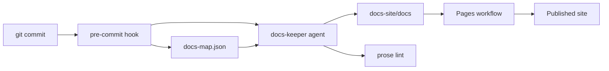

import WhoWhatWhy from '@site/src/components/WhoWhatWhy';
import Source from '@site/src/components/Source';

# Documentation

<WhoWhatWhy
  who="Developers who change code or docs."
  what="The three audiences, the tools that keep the docs current, and what to do when you add a feature."
  why="Docs that fall behind the code are worse than none, so updating them is part of every change."
/>

## How it fits together

The docs are a Docusaurus site in `docs-site/`. The landing page is a separate Astro site in `site/`. A GitHub Actions workflow builds both and serves the docs under `/docs/`.



## Three audiences

| Folder | Reader |
|---|---|
| `docs/guide` | Home lab users who are newer to computers |
| `docs/deploy` | DevOps engineers running the platform |
| `docs/code` | Developers changing it |

Every page starts with the `WhoWhatWhy` component. The `lucia-docs` skill (`.github/skills/lucia-docs/SKILL.md`) holds the full conventions: page shape, snippets, diagrams, components and screenshots.

## The pre-commit hook

Install it once per clone:

```bash
node tools/docs/install-hooks.mjs
```

When staged changes touch product code, the hook runs the `docs-keeper` agent. The agent reads the diff, finds the pages that describe the changed code through <Source path="docs-map.json" />, edits them, and the hook stages its edits so they land in your commit. It never blocks a commit because the agent failed. It does block when the prose lint finds Tier 1 AI words from the `humanize-writing` dictionary.

| Setting | Effect |
|---|---|
| `LUCIA_SKIP_DOCS=1` | Skip the hook for one commit. |
| `LUCIA_DOCS_MODEL` | Use another model. The default is `claude-haiku-5.5`. |
| `LUCIA_DOCS_MINUTES` | Time limit for the agent. The default is 8. |

## When you add a feature

1. Add or change the doc pages for each audience that cares. Link them to each other.
2. Add a `docs-map.json` entry if the code lives somewhere no entry covers.
3. Write the words with the `humanize-writing` skill, then run `node tools/docs/lint-prose.mjs`.
4. If you added or changed a diagram, run `npm run check:diagrams` in `docs-site/`. The build does not catch Mermaid syntax errors.
5. Run `npm run build` in `docs-site/`. A broken link fails it.
