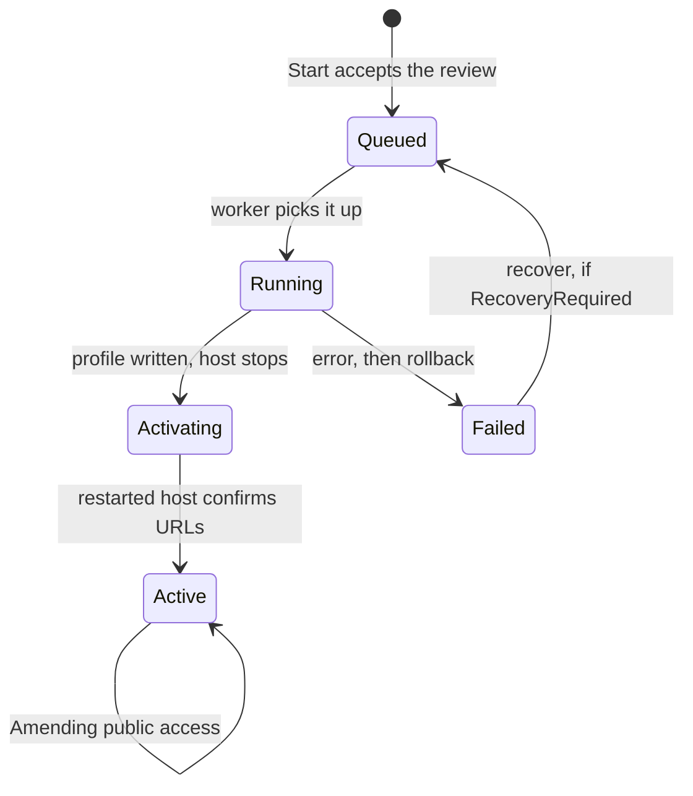

import WhoWhatWhy from '@site/src/components/WhoWhatWhy';
import Source from '@site/src/components/Source';

# Domains and DNS

<WhoWhatWhy
  who="Developers changing domain onboarding, certificate issuance, gateway routes or the public-access flow."
  what="The job document and its state machine, the workers that run it, the Cloudflare, Certbot and AdGuard seams, and the checks that cover them."
  why="This flow edits public DNS, a TLS certificate, the gateway and the sign-in origin, and the host restarts partway through. It has to be resumable at any line, so state is a journal and every step can repeat."
/>

## Who touches it

An owner uses it through **Settings → Domains**. Other domains consume its output: `Stacks` asks it for the active naming to validate app routes and publishes `apps.yml` beside `domain.yml`, `Nodes` writes DNS rewrites under its namespace, and identity reads the profile it commits. For the operator's view see [Networking and DNS](../deploy/networking-and-dns.mdx); for the user's, [Your domain](../guide/your-domain.mdx).

## Layout

All server code is in <Source path="src/Lucia.Homelab.Server/Domains/">Domains/</Source>.

| File | Role |
|---|---|
| `DomainOnboardingEndpoints.cs` | DI wiring, the `/api/host/domains` group (owner only), the connection guard |
| `DomainOnboardingService.cs` | `Status`, `Plan`, `Start`, `SetPublic`, `Recover` |
| `DomainOnboardingStore.cs` | The one persisted document (`workflow.json`), the records, atomic writes |
| `DomainOnboardingWorker.cs` | The background state machine: execute, recover, renew, amend |
| `DomainNames.cs` | Naming rules and certificate-name planning |
| `DomainDnsPreflight.cs` | Delegation and AdGuard collision review |
| `DomainActivationIngress.cs` | Builds and publishes `domain.yml` |
| `DomainActivationConfiguration.cs` | `DomainRuntimeProfile` and `active.json` |
| `DomainConnectivity.cs` | HTTPS probes by SNI, DNS answer parsing |
| `Cloudflare*.cs` | Credential store, HTTP client, zone and record service, endpoints |
| `Certbot*.cs` | Process execution, file hygiene, issue and renew, failure diagnostics |
| `PublicIngress.cs` | Public records and the router forward |
| `AdGuardCertificateWorker.cs` | Certificate for AdGuard's own name |
| `DomainOperations.cs` | The read-only overview snapshot |
| `DomainSupport*.cs` | Diagnosis and the advisory model explanation |

The Spark side is `tools/domains/activation_worker.py`, a user service that updates only Lucia's own Authentik callbacks. The UI is `src/frontend/src/DomainOnboarding.tsx`, `DomainOverview.tsx`, `PublicAccess.tsx` and the typed client in `networkManagement.ts`.

## The job document

Everything the flow knows is one JSON file. `DomainSetupDocument` holds either a reviewed `Plan` or a running `Job`, never both, and each `Job` carries the plan it was approved with.

```csharp title="src/Lucia.Homelab.Server/Domains/DomainOnboardingStore.cs"
public sealed record DomainSetupEvent(DateTimeOffset At, string Phase, string Message);
public sealed record DomainSetupJob(
    Guid Id, string State, string Phase, string Message, string Actor,
    DateTimeOffset CreatedAt, DateTimeOffset UpdatedAt, DomainSetupPlan Plan,
    DomainSetupEvent[] Events, string[] CreatedRewrites, CertbotCertificateReceipt? Certificate = null,
    // ...
    string[]? PendingRewrites = null, bool RecoveryRequired = false, string? IngressBefore = null,
    string? IngressPublished = null, bool RegistrationRequested = false,
    // ...
```

The extra fields are the journal. `CreatedRewrites` and `PendingRewrites` record every AdGuard write before and after it happens. `IngressBefore` and `IngressPublished` hold the gateway file's old and new text. `RegistrationRequested` marks that the activation helper may have changed Authentik. Recovery reads only these, so it can undo exactly what this job did and no more.

`DomainOnboardingStore.Update` serializes writers with a semaphore, applies a pure function to the current document and writes the result atomically. The constructor takes an exclusive file lease (`.workflow.lock`) with an ownership marker, and it refuses to start if the lock file exists but the state file is missing, so a lost file cannot silently reset an in-flight change. Reads are bounded to 1 MiB, JSON is strict (`UnmappedMemberHandling.Disallow`, no duplicate properties), and every path goes through `RejectLinks` so a symlink is never followed.

## State machine

`State` is the coarse lifecycle and `Phase` is the step inside it.



Inside `Running` the phases are `Checking`, `Staging`, `Issuing`, `Ingress`, `LocalDns` and `Registration`. `Activating` has `Activating` then `ActivationCheck`. A failed job passes through `Recovering` and ends in `Recovery`.

Before any job exists, `POST /plan` stores a `DomainSetupPlan` that expires after 30 minutes. `POST /start` calls `AcceptReview`, which checks the review hash with a constant-time comparison, rejects an expired plan, a changed subscriber agreement or any blocker, and requires `AcceptTerms` and `AcceptDnsChanges`. The plan moves into a new `Queued` job in the same atomic update.

### The worker loop

`DomainOnboardingWorker` is a `BackgroundService` that wakes every five seconds and does at most one thing per tick.

```csharp title="src/Lucia.Homelab.Server/Domains/DomainOnboardingWorker.cs"
using var timer = new PeriodicTimer(TimeSpan.FromSeconds(5));
do
{
    var document = await store.Read(stoppingToken);
    if (document.Job is { State: "Queued", Phase: "Recovering" } cleanup)
        await Recover(cleanup.Id, "Retrying cleanup of the previous DNS attempt.", stoppingToken);
    else if (document.Job is { State: "Queued" } job) await Execute(job, stoppingToken);
    else if (document.Job is { State: "Active", Phase: "Active", PublicRequested: { } wanted } amend && wanted != amend.Public)
        await Amend(amend, wanted, stoppingToken);
    else if (document.Job is { State: "Active" or "Activating", NextRenewalAt: { } next } active && next <= DateTimeOffset.UtcNow)
        await Renew(active, stoppingToken);
    else if (document.Job is { State: "Activating" } pending
        && (pending.NextActivationCheckAt is null || pending.NextActivationCheckAt <= DateTimeOffset.UtcNow))
        await CompleteActivation(pending, stoppingToken);
} while (await timer.WaitForNextTickAsync(stoppingToken));
```

State is the queue. A request handler only edits the document, such as `Queued` or `PublicRequested`, and the worker acts on what it finds. That is why a restart needs no special replay.

### Execute

`Execute` runs the whole activation. In order: recheck that AdGuard, the Cloudflare account and the zone still match the review; re-run `DomainDnsPreflight`; Certbot staging; Certbot production; build the `DomainRuntimeProfile`; publish `domain.yml` and wait until the gateway serves the new certificate; add each reviewed AdGuard rewrite; verify the names resolve through AdGuard; ask the helper to prepare the Authentik registration; write `active.json`; stop the application.

Two details carry the design.

**Journal first, then act.** Each rewrite is first appended to `PendingRewrites`, then added, then moved to `CreatedRewrites`. A crash between the steps leaves an entry that recovery knows how to judge.

**`active.json` is the commit point.** After the restart, the worker compares `DomainActivationConfiguration.Read(root)?.ProfileId` with the job id. If they match, it finishes activation, otherwise it rolls back:

```csharp title="src/Lucia.Homelab.Server/Domains/DomainOnboardingWorker.cs"
if (initial.Job is { State: "Running" or "Activating" } interrupted)
{
    if (DomainActivationConfiguration.Read(store.Root)?.ProfileId == interrupted.Id)
        await CompleteActivation(interrupted, stoppingToken);
    else
        await Recover(interrupted.Id, "The host restarted before domain activation committed.", stoppingToken);
}
```

### Recover

`Recover` undoes in reverse order and trusts nothing it did not write. It rolls the Authentik registration back through the helper, then deletes only rewrites that still match `(domain, answer)` and are enabled, and restores the gateway file only if its current text equals `IngressPublished`. Anything that changed in the meantime is reported and left alone. If anything is uncertain, `RecoveryRequired` stays true and the owner can retry through `POST /jobs/{id}/recover`, which requeues the job as `Recovering`.

### Renew and Amend

`Renew` runs `certbot renew --keep-until-expiring`, which does nothing until a renewal is due. If the leaf's hash changed, it republishes `domain.yml`, waits for the gateway, and records `Renewed`; if the gateway check fails it restores the previous file. The outcome is `Renewed`, `NotDue` or `Failed`.

`Amend` toggles public access. It asks for a certificate with the new names (`DomainNames.WithPublic` adds `*.<zone>` and moves Authentik to `auth.<zone>`), republishes the gateway with the `public` entrypoint, adds a DNS record for the new Authentik name, rewrites the profile and restarts. A failure restores the gateway file and keeps the old addresses.

### Concurrency

`DomainConnectionGate` is a mutex shared by the service and worker. `UseDomainConnectionGuard` is middleware that takes it around `PUT` and `DELETE` on the AdGuard connection and Cloudflare credentials, and answers `409` while a job is `Queued`, `Running`, `Activating`, `Renewing` or `Amending`. A token cannot be swapped under a running issuance.

## Names and ingress

`DomainNames.Plan` is a pure function, which makes it cheap to test. The rule that matters is certificate coverage: the namespace and `*.namespace`, plus an exact name for any URL a wildcard would not cover.

```csharp title="src/Lucia.Homelab.Server/Domains/DomainNames.cs"
var certificateNames = new List<string> { ns, "*." + ns };
foreach (var host in hosts)
{
    var prefix = host.EndsWith("." + ns, StringComparison.Ordinal) ? host[..^(ns.Length + 1)] : null;
    if (host != ns && (prefix is null || prefix.Contains('.')))
        certificateNames.Add(host);
}
```

`ServiceHost` accepts only plain HTTPS origins on port 443 without paths, credentials or queries, and inside the verified zone.

`DomainIngressConfiguration.Build` serializes the three routers as JSON and `Publish` writes `domain.yml` through a pending file and `File.Move`, then `NotifyGateway` sets the parent directory's modification time to trigger Traefik's reload. Certificate paths are checked against a strict grammar and must sit under the published root, which rules out Certbot's `live` symlinks. App routes follow the same pattern in `AppGateway`, in `Stacks/StackRoutes.cs`.

## Seams

**AdGuard** is behind `ILocalDnsProvider`, and the whole workflow depends on that interface and nothing else AdGuard specific. A different DNS provider implements it:

```csharp title="src/Lucia.Homelab.Server/Host/AdGuardConnection.cs"
public interface ILocalDnsProvider
{
    Task<AdGuardConnectionStatus> GetConnectionAsync(CancellationToken cancellationToken = default);
    Task<AdGuardHealth> GetHealthAsync(CancellationToken cancellationToken = default);
    Task<IReadOnlyList<AdGuardRewrite>> ListRewritesAsync(CancellationToken cancellationToken = default);
    Task AddRewriteAsync(AdGuardRewrite rewrite, CancellationToken cancellationToken = default);
    Task DeleteRewriteAsync(AdGuardRewrite rewrite, CancellationToken cancellationToken = default);
}
```

The contract says what the caller owns: AdGuard has no conditional write, so durable intent, idempotency and rollback belong to the caller. That is why the job keeps its own journal. See [Network devices](./network-devices.mdx) for the connection service.

**Cloudflare** is `CloudflareDomainService` over `CloudflareHttp`. Credentials are encrypted with Data Protection into `cloudflare-domains.json`. Token checks are read-only (token endpoint, validity dates, active full-setup zones), so DNS Write is proved only by Certbot staging, which is why activation runs it first.

**Certbot** is `CertbotCertificateService` over an `ICertbotExecutor`. The real executor runs `/opt/certbot/bin/certbot` with a fixed environment. Tests swap in a fake. Each operation takes a cross-instance file lease, validates the config tree, writes the token to a private credentials file for the run, and cleans up in `finally`. `CertbotFailureDiagnostics` reads the private log for known causes and maps them to a code, and `SanitizeLogs` strips the token.

**Failure support.** `DomainSupportSkill.Diagnose` is a code-to-explanation table: a failure code, `RecoveryRequired` and a typed `DomainFailure` in, a `DomainDiagnosis` out. `DomainSupportWorker` can then ask the loaded local chat model, through a Microsoft Agent Framework agent, to restate it in at most three sentences. The agent has no tools and a 90 second deadline, and it only ever sees the diagnosis. The diagnosis stands without the model.

## Public ingress

`PublicIngress` is a `BackgroundService` that reconciles every 5 minutes or when `StackStore.RoutesChanged` fires. Its Cloudflare rule is narrow: it edits or deletes a record only if the comment is `Managed by Lucia`, and adopts a foreign record only if it already points at the WAN address.

```csharp title="src/Lucia.Homelab.Server/Domains/PublicIngress.cs"
if (same.Length == 1 && same[0].Type == "A" && (same[0].Comment == Comment || same[0].Content == wan))
```

The router side is `UniFiConnectionService.SetPublicForwardAsync`, which returns `Forwarding`, `Adopted` or `Off`. It takes the internet port (`wanPort`, from `PublicIngress.DefaultWanPort` unless the job sets `PublicPort`) and delegates the decision to `PlanPublicForward`, a pure function that returns the forwards to disable, the one to create or update, and the state. Lucia's forwards on other ports are disabled. The forward on the internet port is adopted if one exists:

```csharp title="src/Lucia.Homelab.Server/Host/UniFiConnection.cs"
var onPort = forwards.Where(item => F(item, "dst_port") == wan && F(item, "proto") is "tcp" or "tcp_udp").ToArray();
var target = onPort.FirstOrDefault(item => F(item, "name") == PublicForwardName);
if (target.ValueKind != JsonValueKind.Object) target = onPort.FirstOrDefault();
```

An adopted forward keeps its protocol, source restriction and interface. A new one is plain TCP from anywhere, because the gateway's public entrypoint admits only Cloudflare.

The port is stored on the job as `PublicPort` (null means 443). `PUT /api/host/domains/public/port` calls `DomainOnboardingService.SetPublicPort`, which needs an active domain, and then wakes `PublicIngress`.

## Extension points

- **New DNS provider:** implement `ILocalDnsProvider`, register it, and keep the contract that writes accept private answers only.
- **New route type:** emit routers in `AppGateway.Build`, and add the name to `ManagedNodeDns.Wanted` so local DNS follows.
- **New failure explanation:** add a code to `CertbotFailureDiagnostics` or the gateway probes, then a case in `DomainSupportSkill.Diagnose`. Keep the text free of logs and secrets.
- **New phase:** set it with `Phase(...)` and make the step repeatable, since a restart reruns the unit of work.

## Testing

The checks are console programs that exit non-zero on failure, not xUnit. Run them from the repository root, since some resolve `tests/...` relative to the working directory.

```bash
dotnet run --project tests/Lucia.Homelab.DomainChecks
dotnet run --project tests/Lucia.Homelab.CloudflareChecks
dotnet run --project tests/Lucia.Homelab.CertbotChecks
dotnet run --project tests/Lucia.Homelab.CertbotChecks -- --without-symlinks   # Windows
```

| Project | Covers |
|---|---|
| `DomainChecks` | Naming and wildcard coverage, rejected inputs, public-mode ingress, DNS preflight against a fake DoH server, DNS answer parsing (compression loops, truncation, SERVFAIL), recovery and operations |
| `CloudflareChecks` | Token and zone verification against a fake API, credential encryption, secret leakage in logs and errors |
| `CertbotChecks` | Arguments for staging, production and renew, consent and input validation, strict directory modes, symlink escape, hook rejection, concurrent leases, certificate dates and SAN checks, process timeouts |

`CertbotChecks` and `CloudflareChecks` compile only the files they test with `<Compile Include=...>`, so they run without the GPU and native dependencies of the full server. `DomainChecks` references the server project and can export a fixture with `--export-ingress-fixture <dir>`. Two Python checks cover the Spark side:

```bash
python tools/domains/check_worker.py          # request and rollback logic, fake transports
python tools/domains/check_ingress.py <domain.yml>   # real Traefik, disposable TLS (Linux, opt in)
```

Python is not installed on the Windows workstation. Run them through `uv`, WSL or on the Spark. When you change anything in `DomainOnboardingWorker`, add a check that interrupts it at the new line, as the recovery checks do.

## Related pages

[Network devices](./network-devices.mdx) covers the AdGuard and UniFi connections this flow calls. [Apps and stacks](./apps-and-stacks.mdx) owns the route model. [Identity](./identity.mdx) covers what the activation helper updates.
