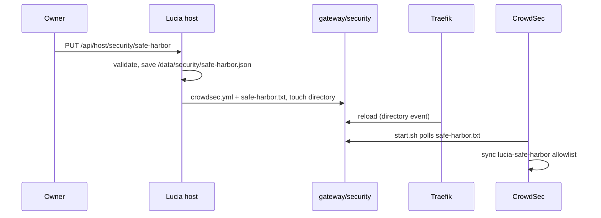

import WhoWhatWhy from '@site/src/components/WhoWhatWhy';
import Source from '@site/src/components/Source';

# Gateway security

<WhoWhatWhy
  who="Developers changing the gateway's CrowdSec setup, the safe harbor, app routes or the identity AppHost."
  what="The shared GatewaySecurity source, the SafeHarbor service and API, where AppSec attaches to routes, how the plugin is pinned, and the checks that hold it together."
  why="The gateway's static configuration names middlewares that a file must define. Two programs write that file, so they share one renderer and one set of inputs instead of agreeing by convention."
/>

The operator's view is in [Gateway protection](../deploy/crowdsec.mdx). This page is about the code.

## One renderer, two writers

<Source path="src/Lucia.Homelab.Server/Security/GatewaySecurity.cs" /> has no dependencies outside the BCL. The server compiles it, and the identity AppHost links the same file:

```xml title="src/Lucia.Homelab.Identity.AppHost/Lucia.Homelab.Identity.AppHost.csproj"
<Compile Include="..\Lucia.Homelab.Server\Security\GatewaySecurity.cs" Link="GatewaySecurity.cs" />
```

The AppHost calls `GatewaySecurity.Publish` on every publish and deploy, before Aspire starts the gateway, so a gateway whose entrypoints name `crowdsec@file` always finds it. The host calls the same method at startup and whenever the owner saves the safe harbor. Both build the harbor from the same inputs: loopback, the host's trusted proxy networks, the ingress address, then the owner's saved list.



`Publish` writes atomically, skips unchanged files, and touches the directory only when something changed. Traefik watches `/config` alone, so a changed time on the `security` entry is what triggers the reload, the same trick `DomainIngressConfiguration.NotifyGateway` uses.

`Render` emits two plugin middlewares from a shared base. The fail-open settings are the ones to keep an eye on:

```csharp title="src/Lucia.Homelab.Server/Security/GatewaySecurity.cs"
var decisions = Common("stream");
decisions["updateIntervalSeconds"] = 15;
decisions["updateMaxFailure"] = -1;
decisions["streamStartupBlock"] = false;
var appsec = Common("appsec");
appsec["crowdsecAppsecEnabled"] = true;
// ...
appsec["crowdsecAppsecFailureBlock"] = false;
appsec["crowdsecAppsecUnreachableBlock"] = false;
// HTTP/2 uploads without a length can't be read ahead; they are checked on their headers alone.
appsec["crowdsecAppsecUnreadableBodyBlock"] = false;
```

The plugin's defaults for all four of those block traffic. Flip one and an engine outage becomes a gateway outage.

## The safe harbor API

<Source path="src/Lucia.Homelab.Server/Security/SafeHarbor.cs" /> maps `GET` and `PUT /api/host/security/safe-harbor` under the `HostOwner` policy. `GatewaySecurity.Canonical` does the validation, and the AppHost uses it again on the saved file:

| Input | Result |
|---|---|
| `192.168.1.50`, `192.168.1.50/32` | `192.168.1.50` |
| `10.0.0.0/8`, `fd00::/8` | Accepted. Private ranges may be as wide as the range itself. |
| `203.0.113.0/24`, `2001:db8:1::/48` | Accepted. Public entries stop at /24 and /48. |
| `0.0.0.0/0`, `8.0.0.0/8`, `127.0.0.1`, `224.0.0.1` | Refused. |
| `104.16.0.1` | Refused: inside Cloudflare's ranges. |
| `192.168.1.5/24` | Refused: host bits set. |

The host knows the harbor is live when `GatewaySecurity:GatewayDirectory` is set; the AppHost sets it to `/gateway-security`, a read-write mount of `identity/gateway/security`. Without it the list is still saved, and the response says `enabled: false`.

## Where AppSec attaches

The entrypoints carry the ban check. AppSec is narrower. `AppGateway.Build` takes an `appSec` flag (from `DomainOnboarding:GatewayAppSec`, which the AppHost sets) and adds `crowdsec-appsec@file` to each app's LAN router and its gRPC router. Public routers don't repeat it, because the `public` entrypoint already runs it. Lucia's own routes (`host.yml`, `domain.yml`) never get it. `DomainOperations.AppRoutes` builds with the same flag, so the overview's "Published" check still compares like with like.

## The plugin pin

Traefik loads the bouncer from `plugins-local/src/github.com/maxlerebourg/crowdsec-bouncer-traefik-plugin`. Go module zips leave out `vendor/`, so <Source path="tools/identity/provision.py" /> downloads three zips from `proxy.golang.org`, checks each against `PLUGIN_ARCHIVES`, and unpacks the two dependencies into `vendor/` without their tests, the way `go mod vendor` would. `tree_digest` hashes the result as a `sha256sum`-style listing. `GatewaySecurity.TreeDigest` computes the same listing, and the AppHost refuses to publish unless it equals `PluginTreeSha256`.

To move to a new plugin release, update `PLUGIN_VERSION`, the three zip hashes and `PLUGIN_TREE_SHA256` in `provision.py`, then `PluginVersion` and `PluginTreeSha256` in `GatewaySecurity.cs`. The domain checks fail until both sides match.

## Tests

| Check | Covers |
|---|---|
| <Source path="tests/Lucia.Homelab.DomainChecks/SecurityChecks.cs" /> | Harbor validation, the rendered fail-open flags, atomic publishing, `ReadOwner`, the tree digest format, AppSec on app routes, Cloudflare in `profiles.yaml`, the plugin pins shared with `provision.py`, and the relay's `crowdsec` scrape job. |
| <Source path="tools/identity/check.py" /> | The bouncer key created on an existing install, LF staging of the engine files, and the plugin installer against fixture archives: tampered zips, path escapes, refetching a changed tree. |
| <Source path="tools/host/test_host.py" /> (`LUCIA_TEST_APPHOST=1`) | A real `aspire publish`: entrypoint middlewares, the plugin flag, dual access-log output, the truncation loop, no published LAPI or AppSec port, and the harbor written for the gateway. |
