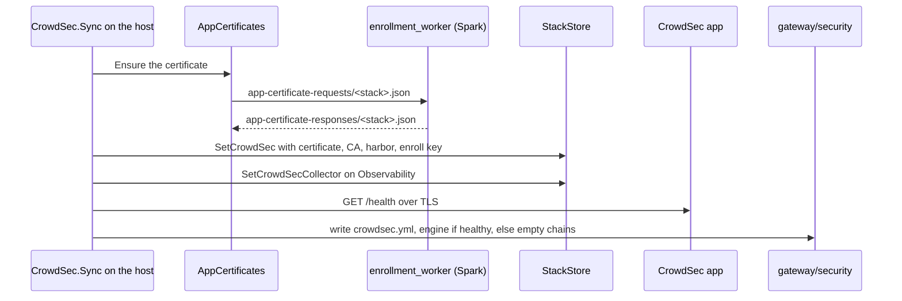

import WhoWhatWhy from '@site/src/components/WhoWhatWhy';
import Source from '@site/src/components/Source';

# Gateway security

<WhoWhatWhy
  who="Developers changing the CrowdSec app, the gateway's middlewares, the safe harbor, app certificates or the Gateway protection page."
  what="The CrowdSecApp template, the CrowdSec sync service and its API, AppCertificates and the Spark worker that signs them, GatewaySecurity shared with the identity AppHost, and the checks that hold it together."
  why="The engine moved off the Spark into a catalog app, so the gateway now reaches it across the LAN. Every hop is authenticated, every piece of state lives where Lucia already keeps state, and the gateway never depends on the engine being up."
/>

The operator's view is in [Gateway protection](../deploy/crowdsec.mdx). This page is about the code.

## The parts

| Part | Source | Job |
|---|---|---|
| Catalog app | <Source path="src/Lucia.Homelab.Server/Stacks/CrowdSecApp.cs" /> | Renders the stack: engine, sidecar, start script, settings, acquisition, profiles. Also renders the Observability collector config. |
| Sync and API | <Source path="src/Lucia.Homelab.Server/Security/CrowdSec.cs" /> | A 15-second loop that keeps certificate, harbor, collector and middlewares in step; the page's endpoints; `CrowdSecLapi`. |
| App certificates | <Source path="src/Lucia.Homelab.Server/Security/AppCertificates.cs" /> | Key, CSR, request file, response validation, renewal. |
| Signer | <Source path="tools/nodes/enrollment_worker.py" /> | The Spark's scoped worker; `handle_app` signs app certificates with step-ca. |
| Middlewares | <Source path="src/Lucia.Homelab.Server/Security/GatewaySecurity.cs" /> | Renders `crowdsec.yml`, live or empty chains. BCL only, compiled into the AppHost too. |
| Safe harbor | <Source path="src/Lucia.Homelab.Server/Security/SafeHarbor.cs" /> | The owner's list; raises `Changed`. |
| Stack access | <Source path="src/Lucia.Homelab.Server/Stacks/StackCrowdSec.cs" /> | `StackStore.CrowdSec()`, `SetCrowdSec`, `SetCrowdSecCollector`. |
| Page | <Source path="src/frontend/src/CrowdSec.tsx" />, <Source path="src/frontend/src/crowdsecStatus.ts" /> | `#/security`, strict parsers. |



## The template

`CrowdSecApp` overrides `RequiresApps` (Observability), `RequiresWhy`, `Single`, `BackupMode => "stop"` and `BackupExclude => ["volumes/state"]`. `RequiresApps` and `Single` are new on `CatalogApp`; `StackStore.RequireCompanions` refuses a new install that misses either, and the catalog response carries `requires`, `requiresWhy` and `single` so the install page can explain before the owner tries.

`Render` also returns `Names: [crowdsec-host]`. `CatalogOutput.Names` and `StackManifest.Names` are an app's direct names: labels under the active domain that `ManagedNodeDns` points straight at the app's server rather than the gateway. `StackStore.ValidNames` runs them through the same checks as web addresses (and web addresses check against them), and `RequireDomain` refuses a new install that has names while no domain is active.

Two services share one tmpfs volume. The sidecar gets every variable Lucia changes after install, so a renewed certificate or a new enroll key recreates only the sidecar:

```yaml title="rendered compose (excerpt)"
  lucia:
    network_mode: none
    read_only: true
    environment:
      CA_CERT: ${LUCIA_CROWDSEC_CA:-}
      TLS_CERT: ${LUCIA_CROWDSEC_TLS_CERT:-}
      HARBOR: ${LUCIA_CROWDSEC_HARBOR:-}
      ENROLL_KEY: ${LUCIA_CROWDSEC_ENROLL_KEY:-}
  crowdsec:
    environment:
      USE_TLS: "true"
      LOCAL_API_URL: https://${LUCIA_CROWDSEC_NAME:-localhost}:8080
      AGENT_USERNAME: lucia-host
    extra_hosts:
      - "${LUCIA_CROWDSEC_NAME:-localhost}:127.0.0.1"
```

`LUCIA_CROWDSEC_NAME` is the engine's name under the domain, `crowdsec-host.<namespace>`. `CrowdSec.Lines` writes it only together with a certificate for it, so the engine never runs under a name it can't serve. Before that, `localhost` keeps compose valid while `start.sh` waits for the certificate.

The engine's `start.sh` waits for `tls.sha256`, registers the bouncer under a name that carries a digest of its key, and starts a loop beside the image's own script. The loop sends `SIGHUP` when the certificate marker changes, syncs the `lucia-safe-harbor` allowlist, enrolls in the Console once per key, and logs a `lucia-status` JSON line every minute. Values in that line go through `yq strenv()`, never string concatenation.

A few choices came from testing against the real image:

- AppSec checks a bouncer key by calling the local API at the client URL with its own HTTP client, which honours the credentials' CA but not `insecure_skip_verify`, and has no unix socket support. Hence the engine's own name pointed at loopback, with `CACERT_FILE` set, so the self-call verifies the same certificate the gateway does.
- `USE_TLS` also sets `api.server.tls.ca_cert_path`, which would enable client-certificate sign-in. The settings file sets it back to `""`.
- Compose can't write inline configs into a read-only container, so the engine isn't read-only. The sidecar's script is inline in its entrypoint, so it is.
- The local API answers `401` to a machine sign-in without a `User-Agent`. `CrowdSecLapi` always sends one.

## The log transform

The collector posts OTLP/JSON. The intake splits it and rebuilds Traefik's JSON line from each record's attributes:

```yaml title="CrowdSecApp.Acquisition (excerpt)"
transform: |
  evt.Line.Labels.type != "traefik" ? nil : map(flatten(map(flatten(map(JsonExtractSlice(evt.Line.Raw, "resourceLogs") ?? [], #.scopeLogs ?? [])), #.logRecords ?? [])), "{" + join(map(#.attributes ?? [], ToJsonString(#.key) + ":" + ToJsonString(#.value.stringValue ?? #.value.intValue ?? "")), ",") + "}")
```

`fromPairs` would be shorter, but it builds a `map[interface{}]interface{}` that `ToJsonString` can't encode. The collector's `transform/crowdsec` sets the `time` attribute the parser reads, because Traefik's OTLP records only carry `StartUTC` as nanoseconds.

The guard at the front and the AppSec source's `unique_id: lucia-appsec` are both there for one CrowdSec 1.8.1 bug. The engine files each transform under the datasource's id, but the http datasource reports an empty one, and so does AppSec unless it's given its own. Without the id, AppSec's events ran through this transform too, which found no `resourceLogs`, returned an empty list and dropped them. Requests were still blocked, but no `waf` alert was raised and `crowdsecurity/appsec-vpatch` never saw a hit. Either fix is enough on its own. Keep both until CrowdSec fixes the lookup.

## AppSec alerts

Every in-band block raises an alert of kind `waf` named after the rule (`crowdsecurity/vpatch-env-access`). Those alerts carry no remediation, so `profiles.yaml` never bans on them directly. The same block also reaches the parsers as an `appsec-block` event, and the hub's `crowdsecurity/appsec-vpatch` scenario bans an address that trips two different rules within a minute. That scenario alert goes through the profiles like any other: a public address gets the 4-hour, 24-hour, 7-day ladder, and a private one is recorded only.

`CrowdSecLapi.ParseAlerts` keeps each alert's `kind`, and `BlockedPath` takes the path from the first event's `uri` meta, falling back to the alert's `target_uri` (a JSON list stored as text). Paths are cut at 256 characters. The local API can't filter by kind, so `CrowdSec.Alerts(limit, appSec)` reads the latest 500 alerts and filters them when the page asks for `kind=appsec` or `kind=scenario`.

## Certificates

`AppCertificates.Ensure` keeps the current certificate while it's valid for the app's name with more than four days left. Otherwise it makes a key, stores it encrypted with Data Protection under `/data/security/app-certificates/`, and writes the request with the server the app runs on now. It accepts the worker's answer only if the request hash matches, the chain builds to Lucia's root with the server-auth EKU, and the leaf names exactly that one DNS name, no address, with the waiting key. The address only authorises the request, so a move keeps the certificate.

The worker trusts nothing in the request alone. `authorize_app` reads `stacks/stacks.json` and `nodes/identities/<node>.json` itself, takes the label from the stack's `manifest.names`, and the namespace from `domains/workflow.json` (the job that `domains/active.json` names), the same way `ManagedNodeDns.ActiveJob` does. It refuses Lucia's own hostnames and the server's own name, then checks the CSR, the issued leaf and `openssl verify -verify_hostname` against that one name. `APP_TEMPLATES` lists the apps allowed to ask at all:

```python title="tools/nodes/enrollment_worker.py"
APP_TEMPLATES = frozenset({"crowdsec"})  # catalog apps that may have a certificate for their name
```

To add another app that the gateway reaches over the LAN, list it there, give its template a name setting that it returns in `CatalogOutput.Names`, and add checks on both sides.

## Keeping Lucia's values out of the stack API

`StackStore.ManagedSecrets` names the variables only Lucia uses: `LUCIA_CROWDSEC_TLS_KEY`, `_ENROLL_KEY` and `_TOKEN` in any stack, plus `GATEWAY_KEY`, `LUCIA_MACHINE_PASSWORD` and `INTAKE_TOKEN` in a CrowdSec stack (the catalog app, or a converted copy whose compose runs the CrowdSec image). `StackStore.Get` passes the environment through `Mask`, which keeps the names and shows `[kept by Lucia]`. The assistant's `get_app` reads the same view. On a custom-app save, `KeepManaged` drops whatever was sent for those names and puts the stored lines back; a catalog app's environment never comes from the browser in the first place.

## Companion versions and a silent log path

`CatalogApp.RequiresVersions` holds the oldest version of a required app that works: for CrowdSec, Observability `ForwardsToCrowdSec` (12), the first collector that loads `LUCIA_CROWDSEC_COLLECTOR`. `RequireCompanions` refuses a new install below it with `requires_update`, and the catalog marks the requirement `current: false`.

After install, `CrowdSec.Status` downgrades `healthy` to `needs-observability` while Observability is missing or older, and to `no-logs` when `Track` sees the engine's `linesRead` stand still for `QuietAfter` (15 minutes). Both keep `protecting` true, since the middlewares still point at the engine, but the page no longer says it's protecting.

## Middlewares

`GatewaySecurity.Render(harbor, cloudflare, link)` writes both middlewares as empty chains (`{"chain": {"middlewares": []}}`) when `link` is null, and as the bouncer plugin over HTTPS with the key and Lucia's root inline when it isn't. The fail-open flags are the ones to watch: `updateMaxFailure: -1`, `streamStartupBlock: false`, `crowdsecAppsecFailureBlock`, `crowdsecAppsecUnreachableBlock` and `crowdsecAppsecUnreadableBodyBlock` all `false`, and `httpTimeoutSeconds: 2`.

The identity AppHost calls `Publish` with no link on every deploy, then the host's loop takes over. `Publish` also deletes the old `safe-harbor.txt` the Spark-side engine read.

## The plugin pin

Traefik loads the bouncer from `plugins-local/src/github.com/maxlerebourg/crowdsec-bouncer-traefik-plugin`. <Source path="tools/identity/provision.py" /> downloads three zips from `proxy.golang.org`, checks each against `PLUGIN_ARCHIVES`, and unpacks the two dependencies into `vendor/`. `GatewaySecurity.TreeDigest` computes the same listing as `tree_digest`, and the AppHost refuses to publish unless it equals `PluginTreeSha256`. A plugin upgrade changes `PLUGIN_VERSION`, the zip hashes and `PLUGIN_TREE_SHA256` in `provision.py`, then `PluginVersion` and `PluginTreeSha256` here.

## Tests

| Check | Covers |
|---|---|
| <Source path="tests/Lucia.Homelab.DomainChecks/SecurityChecks.cs" /> | Harbor validation; live and empty middlewares; the rendered stack (pins, ports, hardening, secrets kept, sidecar isolation, TLS everywhere); the transform guard and AppSec's id; alert kinds and blocked paths; Observability's third config and `CollectorLines`; `RequireCompanions`; `AppCertificates` against an offline CA (request shape, refusal, wrong name, foreign root, renewal, a move keeping the certificate, a rename replacing it); `RequireDomain`; the status-line parser; `RequiresVersions` and `Track`; `ManagedSecrets`, `Mask` and `KeepManaged`; the worker's pins; no `crowdsec` scrape on the Spark. |
| <Source path="tools/nodes/check_enrollment.py" /> | `app_request`, `authorize_app` against stack, node and domain records (the name from the manifest and the active namespace only), CSR and chain rules, the exact `step ca sign` command, `openssl verify -verify_hostname`, queue answers. Run it on Linux. |
| <Source path="src/frontend/tests/crowdsecStatus.test.mjs" /> | Page parsers, summaries, the route and navigation, `requirementProblem`. |
| <Source path="tools/identity/check.py" /> | No engine key or files from provisioning, and the plugin installer. |
| <Source path="tools/host/test_host.py" /> (`LUCIA_TEST_APPHOST=1`) | A real `aspire publish`: no engine on the Spark, OTLP-only access logs, empty-chain middlewares. |
