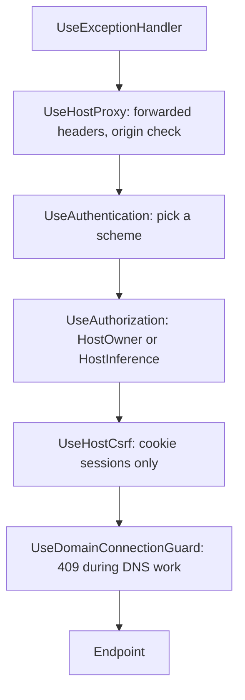

import WhoWhatWhy from '@site/src/components/WhoWhatWhy';
import Source from '@site/src/components/Source';

# Host server

<WhoWhatWhy
  who="Developers adding an endpoint, a setting or a background worker to the controller."
  what="How `Program.cs` composes the app, what runs in which order on a request, how the three sign-in paths are chosen, and where configuration is bound and validated."
  why="Every domain plugs into the same two calls. Knowing the pipeline order is the difference between an endpoint that is protected and one that only looks protected."
/>

The controller is <Source path="src/Lucia.Homelab.Server/Program.cs"/>, 103 lines of composition and no logic. Each domain exposes an `AddX` method for services and a `MapX` method for routes, and the file calls them in a fixed order.

## Shape of Program.cs

```csharp title="src/Lucia.Homelab.Server/Program.cs"
var builder = WebApplication.CreateBuilder(args);
DomainActivationConfiguration.Apply(builder);

builder.AddServiceDefaults();
builder.AddHostOutputCache();
builder.Services.AddProblemDetails();
builder.Services.AddApiDocumentation();
builder.AddInferenceKeyManagement();
builder.AddHostPlatform();
// ... one AddX per domain
builder.AddAssistant();
builder.AddLabMap();

var app = builder.Build();
```

Three things happen around the `AddX` calls:

1. **Two CLI short-circuits.** `--check-model-lease` and `--bundle-model <dir>` run a command and return before the web host is built. The second packs a model into a publish directory.
2. **`DomainActivationConfiguration.Apply`.** If an active domain profile exists in the domain state directory, it injects `HostAuthentication` values (public origin, authority, one alias for the old origin) into configuration in memory. It runs before `AddHostPlatform` so authentication binds the activated values. A missing `active.json` changes nothing. See [Domains and DNS](./domains-and-dns.mdx).
3. **`AddServiceDefaults`.** From `Extensions.cs`: OpenTelemetry, service discovery, the standard resilience handler on every `HttpClient`, and the `self` liveness check.

`AddHostPlatform` is the anchor. It binds `HostPlatform`, calls `AddHostAuthentication`, then registers the model catalog and inference runtime. Later domains assume the authentication policies already exist.

## Request pipeline

The order of the `app.Use*` calls is the order a request passes through them.

```csharp title="src/Lucia.Homelab.Server/Program.cs"
app.UseExceptionHandler();
app.UseHostProxy();
app.UseAuthentication();
app.UseAuthorization();
app.UseHostCsrf();
app.UseDomainConnectionGuard();
app.MapHostAuthentication();
// ... one MapX per domain
app.UseOutputCache();
app.MapDefaultEndpoints();
app.MapHostWeb();
```



- **`UseHostProxy`** exists only when `HostAuthentication:Enabled` is true. It applies `UseForwardedHeaders`, trusting only `TrustedProxyNetworks`, then rejects any request whose host and port do not match `PublicOrigin` or one of up to four `AdditionalPublicOrigins`, with `400 invalid_origin`. Three kinds of request skip the origin check: `/health/live`, HTTPS requests to `/api/boot` (the installer arrives under a LAN alias), and loopback calls to `/v1` or `/assistant-engine` that carry a bearer token (the assistant's Copilot CLI runs in the same container).
- **`UseAuthentication`** runs the `Host` policy scheme, described below.
- **`UseAuthorization`** enforces each group's policy.
- **`UseHostCsrf`** validates an antiforgery token on unsafe methods, and only when the request authenticated through the cookie scheme. A bearer header cannot be attached by a cross-site form, so bearer callers are exempt.
- **`UseDomainConnectionGuard`** returns `409` for `PUT` or `DELETE` on the AdGuard connection and Cloudflare credentials while a domain job is queued, running or activating. It takes a mutex, so a change cannot slip between the check and the write.

The output cache is Redis-backed when a `cache` connection string exists (Aspire provides one in development) and in-memory otherwise.

## Choosing an auth scheme

`Host` is a policy scheme. For each request it forwards to one of three real schemes:

```csharp title="src/Lucia.Homelab.Server/Host/HostAuthentication.cs"
public static string SelectScheme(HttpRequest request, bool enabled, HostPlatformOptions platform)
{
    // Boot endpoints validate their own short-lived device proof/capability, not browser cookies or human JWTs.
    if (request.Path.StartsWithSegments("/api/boot"))
        return HostApiKeyAuthentication.SchemeName;
    if (!request.Headers.ContainsKey("Authorization"))
        return enabled ? CookieScheme : HostApiKeyAuthentication.SchemeName;
    // ...
```

| Request | Scheme | Result |
|---|---|---|
| Path under `/api/boot` | `HostApiKey`, which returns no result | Anonymous. The boot protocol checks its own proof |
| No `Authorization` header | Cookie (or `HostApiKey` when auth is disabled) | Browser session from OIDC sign-in |
| Bearer equal to the owner or inference key | `HostApiKey` | Role `Owner` or `Inference` |
| Bearer with the managed-key prefix | `HostApiKey` | Role `Inference`, looked up in `InferenceApiKeyStore` |
| Any other bearer, auth enabled | `HostJwt` | Authentik access token |

Two policies guard the groups:

```csharp title="src/Lucia.Homelab.Server/Host/HostAuthentication.cs"
.AddPolicy("HostOwner", policy => policy.RequireAuthenticatedUser().RequireRole("Owner"))
.AddPolicy("HostInference", policy => policy.RequireAuthenticatedUser().RequireRole("Owner", "Inference"))
```

Static keys compare with `CryptographicOperations.FixedTimeEquals` over SHA-256 hashes, so neither length nor content leaks through timing, and keys under 32 characters never match. The JWT path needs the `lucia_api` scope, an `azp` equal to the client id and a `uid` claim, and accepts only `RS256`. Browser sessions last eight hours with no sliding renewal.

For the identity side, see [Identity](./identity.mdx). For the boundaries, see the [security model](../deploy/security-model.mdx).

## Endpoint groups

Each `MapX` creates one or more `MapGroup` calls. Several groups share the `/api/host` prefix and carry their own tags and filters, which is why that prefix appears in many files.

| Prefix | Defined in | Policy |
|---|---|---|
| `/api/auth/session`, `/auth/login`, `/auth/logout` | `Host/HostAuthentication.cs` | Anonymous, except logout |
| `/api/host` (models, spark-model) | `Host/HostPlatformEndpoints.cs` | `HostOwner` |
| `/v1` | `Host/HostPlatformEndpoints.cs`, `InferenceEndpoints.cs` | `HostInference` |
| `/api/host/inference-keys` | `Host/InferenceApiKeys.cs` | `HostOwner` |
| `/api/host/huggingface`, `/connections/adguard`, `/connections/unifi` | `Host/` | `HostOwner` |
| `/api/host/domains` | `Domains/DomainOnboardingEndpoints.cs` | `HostOwner` |
| `/api/host/stacks`, `/catalog`, `/nas`, `/registries`, `/backups`, `/routes/external`, `/spark-runner` | `Stacks/StackEndpoints.cs` | `HostOwner` |
| `/api/host/packages` | `Packages/PackageUpdatesEndpoints.cs` | `HostOwner` |
| `/api/host/telemetry` | `Telemetry/SparkTelemetryService.cs` | `HostOwner` |
| `/api/host/telemetry/relay/v1/{signal}` | `Telemetry/TelemetryRelay.cs` | No policy. Checks the relay's shared token header |
| `/api/host/lab-map`, `/unifi/snmp` | `LabMap/LabMapEndpoints.cs` | `HostOwner` |
| `/api/host/directory`, `/ssh-keys` | `Domains/PeopleDirectory.cs`, `Nodes/OwnerSshKeys.cs` | `HostOwner` |
| `/api/assistant` | `Assistant/AssistantEndpoints.cs` | `HostOwner` |
| `/api/boot`, `/api/boot/devices/{id}`, `/api/nodes/{id}` | `Boot/`, `Stacks/StackEndpoints.cs` | Anonymous. Each route validates a device or node proof |

The anonymous groups are deliberate. A node or an installer has no browser session, and a cookie would be the wrong credential. Those groups attach `BootProtocolErrorFilter` and verify signed proofs themselves. For anything else under `/api`, put the route in a group that calls `RequireAuthorization("HostOwner")`.

Most groups also add an `IEndpointFilter` (`HostErrorFilter`, `HardwareOnboardingErrorFilter`, `PackageUpdatesFilter`) that turns a domain exception into a stable status and JSON error shape. Handlers throw typed exceptions and never build error responses by hand.

## Serving the portal

`MapHostWeb` is last. It maps `GET /health/live`, serves static files from `wwwroot`, and falls back to `index.html` for any non-reserved path. The reserved prefixes are `/api`, `/v1`, `/auth`, `/health`, `/signin-oidc` and `/signout-callback-oidc`. A missing route under one of them returns `404` JSON, not the portal, so a mistyped API call fails loudly. The `.glb` MIME type is added here for the lab map's 3D models, and a new static file type needs a mapping in the same place.

## Configuration binding

Settings come from `appsettings.json`, then `appsettings.Development.json`, then environment variables, where `__` is the section separator. In production the Identity AppHost sets nearly all of them as container environment, for example `HostAuthentication__PublicOrigin`.

| Section | Class | How it is checked |
|---|---|---|
| `HostPlatform` | `HostPlatformOptions` | Data annotations plus `ValidateOnStart`. `ApiKey` is required and at least 32 characters. Backend must be `cpu`, `ggml_cpu`, `ggml_cuda` or `cuda`. Owner and inference keys must differ |
| `HostAuthentication` | `HostAuthenticationOptions` | `Validate` in `AddHostAuthentication`. Startup fails outside Development when `Enabled` is false |
| `DomainOnboarding`, `HardwareOnboarding`, `Boot` | per-domain options | Read in each `AddX` |
| `PackageUpdates` | `PackageUpdatesOptions` | `Directory` must be absolute |
| `SparkTelemetry` | `SparkTelemetryOptions` | When enabled, needs Linux and absolute paths |
| `Assistant`, `InferenceKeys`, `HuggingFaceManagement`, `AdGuardManagement`, `CloudflareDomains` | per-domain options | Credentials or state directories under `/data` |
| `Telemetry:RelayDirectory` | read directly | Turns on the controller relay and its endpoint |

The pattern for a new setting:

```csharp title="src/Lucia.Homelab.Server/Host/HostPlatformEndpoints.cs"
builder.Services.AddOptions<HostPlatformOptions>()
    .BindConfiguration("HostPlatform").ValidateDataAnnotations()
    .Validate(o => o.Backend is "cpu" or "ggml_cpu" or "ggml_cuda" or "cuda", "Unsupported inference backend.")
    .Validate(o => o.InferenceApiKey is null || o.InferenceApiKey != o.ApiKey, "Owner and inference API keys must differ.")
    .ValidateOnStart();
```

Fail at startup with a sentence that names the setting. `HostAuthenticationOptions` goes further and checks the files it points at: the CA path must hold a currently valid public certificate and no private key, and `TrustedProxyNetworks` must list private CIDRs only. A misconfigured container then exits and the compose healthcheck shows it, where a quieter design would run in a weaker mode. [Configuration](../deploy/configuration.mdx) is the operator's list of every setting.

## Background work

Long-running domain work uses hosted services registered next to the domain: `DomainSupportWorker`, `AdGuardFleet`, `ManagedNodeDns`, `ManagedNodeDhcp`, `AppSsoRegistrations`, `AppTelemetry`, `HostModelStartup` and others. `HostModelStartup` skips loading a model when the optional Spark model holds the machine's memory, or when package updates have paused local AI, and records a reason the portal shows.

Two limits to know: `MaxRequestBodySize` is 16 MiB, and the assistant chat endpoint disables request timeouts so a stream can run.

## Adding an endpoint

1. Put it in the domain's `MapX` method, inside an existing group that already has the right policy.
2. Let the handler throw the domain's typed exception. The group's filter shapes the error.
3. Bind new settings with `AddOptions<T>().BindConfiguration(...)` and validate on start.
4. Add a check to the matching project under `tests/`. [Getting started](./getting-started.mdx) lists them.
5. If you added a setting or a route a reader would notice, update the [configuration](../deploy/configuration.mdx) page and the docs map entry for `Program.cs`.

In `Development`, `MapDevelopmentApiDocumentation` serves the OpenAPI document and a Scalar reference at `/scalar/v1`, and redirects `/` there. The `/health` and `/alive` checks exist only in Development too.
