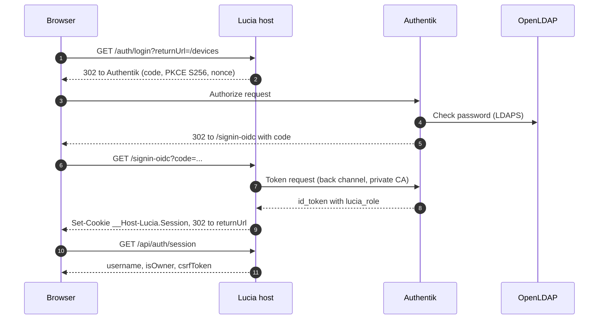
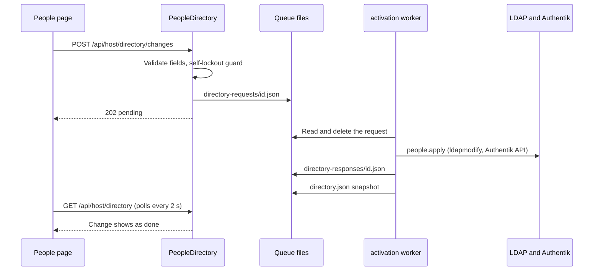

import WhoWhatWhy from '@site/src/components/WhoWhatWhy';
import Source from '@site/src/components/Source';

# Identity

<WhoWhatWhy
  who="Developers changing sign-in, roles, the People page or the Authentik and LDAP setup."
  what="The OIDC flow between the browser, the Lucia host and Authentik, how a role claim becomes an authorization policy, and how a People change travels to LDAP."
  why="The portal can restart servers and change DNS. Authentication has to be strict, and the web host has to stay unable to edit the directory itself even if someone takes it over."
/>

## Who touches this and why it's split

Owners and members sign in through a browser. Scripts call the API with a bearer key or an Authentik access token. Managed servers sign in with their own machine certificates (see [Nodes](./nodes.mdx)). Three different callers, three different proofs.

The design rule is that the Lucia host (an ASP.NET Core container) authenticates people but never edits identity data. People, groups and app clients live in OpenLDAP and Authentik. Changes to them are written as small JSON files that a separate worker, running as the Spark's user with the admin credentials, validates and applies. A compromised host can queue a request. It can't read the CA keys or the Authentik admin token, because it never mounts them. [Security model](../deploy/security-model.mdx) draws the boundary, and [Identity (deploy)](../deploy/identity.mdx) covers the containers.

| Piece | Where | Job |
|---|---|---|
| Host authentication | <Source path="src/Lucia.Homelab.Server/Host/HostAuthentication.cs" /> and `HostAuthenticationOptions.cs` | Cookie, OIDC, JWT bearer and API-key schemes, CSRF, proxy and origin checks |
| API keys | `HostApiKeyAuthentication.cs`, `InferenceApiKeys.cs` | The owner key, the inference key and managed `lucia_inf_` keys |
| People directory | <Source path="src/Lucia.Homelab.Server/Domains/PeopleDirectory.cs" /> | Validates changes and queues them as files |
| Directory worker | <Source path="tools/identity/people.py" /> | Applies a change to LDAP and Authentik, publishes `directory.json` |
| Host registration | <Source path="tools/identity/application.py" /> | Creates the `lucia` OIDC provider, the role mapping and group bindings |
| App SSO | <Source path="tools/identity/app_clients.py" /> | One owner-only OIDC client per catalog app |
| Provisioning | <Source path="tools/identity/provision.py" />, <Source path="src/Lucia.Homelab.Identity.AppHost/AppHost.cs" /> | Containers, CA, LDAP source, owner |
| Frontend | `src/frontend/src/People.tsx`, `AccountAccess.tsx`, `directory.ts` | The People page and the sign-in panel |

## Sign-in flow

The browser never holds a token. The host runs the OpenID Connect code flow with PKCE as a confidential client, then gives the browser an encrypted session cookie.



A few details matter more than the arrows suggest.

- `/auth/login` accepts only a local `returnUrl`. `IsLocalReturnUrl` rejects `//`, backslashes, control characters and nested percent-encoding. It also redirects an alias host to the canonical `PublicOrigin` first, so the nonce and correlation cookies are set on the host that will receive the callback.
- The back-channel handler trusts only Lucia's private root (`CustomRootTrust`) for the Authority. Hostname and lifetime checks stay on. Revocation checking is off because the CA publishes no CRL or OCSP. When a public domain is active and the Authority uses a public certificate, `AuthorityUsesSystemTrust` switches to the normal store.
- `SaveTokens` is off. Only the `id_token` is kept, encrypted in the cookie, for the logout hint.
- The session is exactly 8 hours (`SessionLifetime`) with `SlidingExpiration = false`. Authentik's own login session is also 8 hours.

```csharp title="src/Lucia.Homelab.Server/Host/HostAuthentication.cs"
authentication.AddCookie(CookieScheme, options =>
{
    options.Cookie.Name = "__Host-Lucia.Session";
    options.Cookie.SecurePolicy = CookieSecurePolicy.Always;
    options.Cookie.HttpOnly = true;
    options.Cookie.SameSite = SameSiteMode.Lax;
    options.Cookie.Path = "/";
    options.ExpireTimeSpan = SessionLifetime;
    options.SlidingExpiration = false;
```

The session cookie is `Lax` because the callback is a cross-site top-level redirect. The CSRF cookie (`__Host-Lucia.Csrf`) is `Strict`. A cookie-authenticated request that isn't GET, HEAD, OPTIONS or TRACE must carry the token in `X-CSRF-TOKEN`; `UseHostCsrf` checks it. The SPA reads the token from `/api/auth/session`. Bearer requests skip that check, because a script that sends an `Authorization` header can't be a forged form post.

## Which scheme handles a request

`HostAuthentication.Scheme` is a policy scheme. It looks at the request and forwards to one of four handlers.

```csharp title="src/Lucia.Homelab.Server/Host/HostAuthentication.cs"
public static string SelectScheme(HttpRequest request, bool enabled, HostPlatformOptions platform)
{
    // Boot endpoints validate their own short-lived device proof/capability, not browser cookies or human JWTs.
    if (request.Path.StartsWithSegments("/api/boot"))
        return HostApiKeyAuthentication.SchemeName;
    if (!request.Headers.ContainsKey("Authorization"))
        return enabled ? CookieScheme : HostApiKeyAuthentication.SchemeName;
    // ...
    if (HostApiKeyAuthentication.GetRole(token, platform) is not null)
        return HostApiKeyAuthentication.SchemeName;
    if (token.StartsWith(InferenceApiKeyStore.Prefix, StringComparison.Ordinal))
        return HostApiKeyAuthentication.SchemeName;
    return enabled ? JwtScheme : HostApiKeyAuthentication.SchemeName;
}
```

| Request has | Handler | Result |
|---|---|---|
| No `Authorization` header | Cookie | A person in a browser |
| Bearer equal to the owner key | API key | Role `Owner`, user `host-owner` |
| Bearer equal to the inference key, or starting `lucia_inf_` | API key | Role `Inference` |
| Any other bearer | JWT | An Authentik access token. It needs the `lucia_api` scope, `azp` equal to the client ID and a `uid` claim. |
| Path under `/api/boot` | None here | The boot endpoints check device proofs themselves |

`Matches` compares SHA-256 hashes with `CryptographicOperations.FixedTimeEquals`, rejects keys under 32 characters or presented values over 4096, and `HostPlatformEndpoints` validates that the owner and inference keys differ. The two authorization policies are `HostOwner` (role `Owner`) and `HostInference` (`Owner` or `Inference`).

## Roles come from groups

Authentik computes `lucia_role` with a scope mapping that `application.py` creates. The role is a claim in the id token, and `RoleClaimType` is set to it, so `RequireRole("Owner")` reads it directly.

```python title="tools/identity/application.py"
def _role_expression(owner_group, access_group):
    # all_groups matches Authentik's binding engine, including inherited membership.
    return (
        f'if request.user.all_groups().filter(pk="{uuid.UUID(owner_group)}").exists():\n'
        '    return {"lucia_role": "Owner"}\n'
        f'if request.user.all_groups().filter(pk="{uuid.UUID(access_group)}").exists():\n'
        '    return {"lucia_role": "Inference"}\n'
        "return {}"
    )
```

So `lucia-owners` gives `Owner`, `lucia-users` gives `Inference` (the UI calls that a Member), and anyone else gets no role. `/api/auth/session` then reports `authenticated: true` with `canAccess: false`, which `AccountAccess.tsx` turns into the "Your account needs access" panel.

The registration is repeat-safe and journaled in `host-auth.json`. It refuses to adopt resources it doesn't own, to remove unmanaged bindings, or to touch a binding with expiry. Drift raises `ApplicationDrift` with a credential-free message instead of overwriting.

## The people queue

Editing a person has to cross the boundary from the host to the worker. The host validates, writes one file per change, and answers `202`. The worker applies it and answers with another file.



`PeopleDirectory.Fields` is the whitelist of actions and the exact fields each takes. Anything else is rejected before a file is written. Only signed-in people can queue changes: owner API keys carry no username, so the self-lockout check couldn't run.

```csharp title="src/Lucia.Homelab.Server/Domains/PeopleDirectory.cs"
private static void Guard(string actor, string action, Dictionary<string, object?> fields)
{
    var self = fields.GetValueOrDefault("username") as string == actor;
    var refused = action switch
    {
        "deleteUser" when self => "You can't delete your own account.",
        "setUserActive" when self && fields["active"] is false => "You can't disable your own account.",
        "setUserGroups" when self && !((string[])fields["groups"]!).Contains(Owners) => "You can't remove yourself from lucia-owners.",
```

The worker validates again, because the file is its trust boundary, not the host's validation. `people.apply` requires `set(value) == COMMON | FIELDS[action]`, a matching `schemaVersion` and `id`, and checks each target against the current directory. It also refuses reserved names (`root`, `docker`, `sudo`, and prefixes such as `lucia-`, `ldap-` and `node-`) so that a directory group can't grant local rights on a server, and it keeps the enrolled owner in `lucia-owners`.

Notes on the files:

- A request may contain a password, so the worker deletes it once read. The host keeps at most 20 queued requests and returns `429 directory_queue_full` after that.
- `directory.json` is secret-free. The host treats the directory as `Ready` only when `checkedAt` is under five minutes old.
- A response file older than one hour is deleted by the host on read. A success shows as `done` only after the snapshot is newer than the response.
- Deleting a user also removes their SSH keys through `OwnerSshKeys.RemoveUser`.
- Password changes in Authentik write back to LDAP. `enable_password_changes` grants that through the `ldap-password-reset` group, and the snapshot reports it as `passwordChange`.

## Catalog app sign-in

When a catalog app declares SSO, the host writes `app-sso-requests/<stack>.json`. `app_clients.reconcile` keeps exactly one confidential, authorization-code OIDC client per request, named `lucia-app-<stack>`, bound to `lucia-owners`. It removes owned clients whose request has gone. Redirect URIs must be exact `https` addresses on a name under the active domain, at most eight, and never one of Lucia's own hostnames. Without an active domain the request fails with "App sign-in needs an active domain."

## Extension points

To add a directory action:

1. Add it to `PeopleDirectory.Fields` and, if it can lock someone out, to `Guard`.
2. Add the same field set to `FIELDS` in `people.py`, write the handler, and register it in `ACTIONS`.
3. Add the request type and wording in `directory.ts`, then the control in `People.tsx`.
4. Add cases to `check_people.py` and `AuthChecks`.

To protect a new Lucia-owned group, extend the `protected` test in `snapshot` and the checks in `_update_group` and `_delete_group`.

## Tests

| Suite | Covers | Run |
|---|---|---|
| `tests/Lucia.Homelab.AuthChecks` | Option validation, scheme selection, return URLs, CSRF, API keys, role boundaries on the API, a TLS backchannel against a fixture CA | `dotnet run --project tests/Lucia.Homelab.AuthChecks` |
| `tools/identity/check_people.py` | Validation, guards and snapshot with LDAP and the API mocked | `python3 tools/identity/check_people.py` |
| `tools/identity/check.py`, `check_application.py`, `check_tls.py` | Provisioning, the Authentik registration and certificate handling, offline | `python3 tools/identity/check.py` |

Python isn't installed on the Windows dev box. Run the Python checks on the Spark, in WSL, or with `uv run`.
