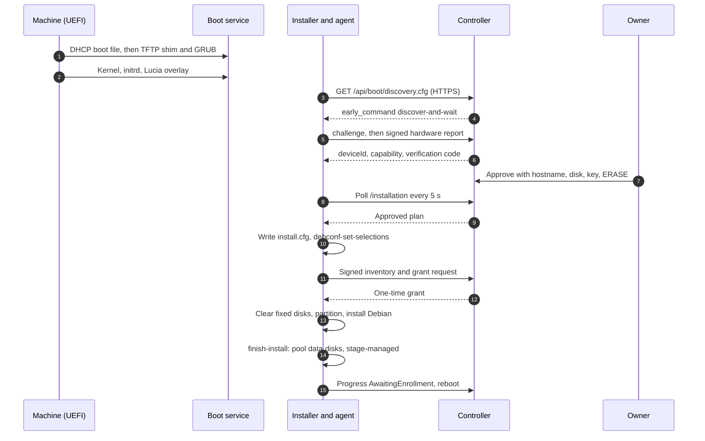

import WhoWhatWhy from '@site/src/components/WhoWhatWhy';
import Source from '@site/src/components/Source';

# Installer

<WhoWhatWhy
  who="Developers changing the boot bundle, the installer hooks, the discovery and approval endpoints, or the install guard in the node agent."
  what="The pieces of the PXE and unattended-install path, the full sequence from DHCP to the first heartbeat, and the checks that stand between an approval and an erased disk."
  why="This is the one feature that wipes disks on a stranger's machine, so each step has to be able to refuse and none may continue on a guess."
/>

[Adding a server](../guide/adding-a-server.mdx) is the owner's view and [Installer (deploy)](../deploy/installer.mdx) covers operating it. This page covers how it's built. What happens after the first boot is in [Nodes](./nodes.mdx).

## The pieces

| Piece | Path | Role |
|---|---|---|
| Boot service | <Source path="deployment/boot/serve.py" />, `Dockerfile` | A container that serves the installer over HTTP and TFTP, only while an admission lease is valid |
| Overlay scripts | `deployment/boot/discover-and-wait`, `partitioner-guard`, `finish-install`, `screen.sh`, `grub.cfg.in` | Run inside Debian's installer |
| Bundle builder | <Source path="tools/boot/prepare.py" /> | Builds the signed, hash-checked `public/` bundle and its receipt |
| Boot provisioning | `tools/boot/provision_boot.py` | Validates a bundle and writes `boot-settings.json` for the AppHost |
| Controller | <Source path="src/Lucia.Homelab.Server/Boot" />, <Source path="src/Lucia.Homelab.Server/Onboarding" /> | Discovery endpoints, grants, the approval journal |
| Agent | `src/Lucia.NodeAgent` (`discover`, `wait-install`, `installation-guard`, `stage-managed`) | The only code in the installer that talks to the controller |
| Qualification | `tools/boot/qualify_install.py`, `tests/Lucia.ManagedNode.Qualification` | A disposable-VM install that gates `installation_qualified` |

## From power-on to a managed node



The first two steps are plain PXE. DHCP is the router's job and Lucia never touches it. Everything from step 3 is HTTPS to the controller, verified against Lucia's private root, which is baked into the overlay.

### Why admission is a lease file

The boot service has no network path to the controller. It decides whether to serve anything from one file, `/control/admission.json`, which the controller writes. `BootAdmissionHeartbeat` rewrites it every 3 seconds, and each copy is valid for 10 seconds at most, and never past the owner's discovery window.

```csharp title="src/Lucia.Homelab.Server/Boot/BootAdmissionLease.cs"
var expires = now.AddSeconds(10);
if (expires > window) expires = window;
var bytes = JsonSerializer.SerializeToUtf8Bytes(new
{
    schemaVersion = 1, issuedAt = now, expiresAt = expires, windowExpiresAt = window
});
```

`serve.py` checks the lease on every HTTP request, and its supervisor loop re-reads it every half second to start or stop `dnsmasq`. With no valid lease, HTTP answers `403` and `dnsmasq` isn't running at all, so TFTP is closed. A malformed lease, a symlink or a future-dated one means closed (`503` on HTTP). A crashed controller therefore closes boot service within 10 seconds, with no stop message needed. On the controller, `HardwareOnboardingStore` starts every run with the window closed.

### What the boot service serves

`serve.py` holds an allowlist of nine paths (eight bundle files plus `grubx64.efi` at the TFTP root for firmware that asks for it there). The TFTP root is the same directory, mounted read-only. Netboot's original archive has BIOS menus and installer files nobody has checked, so `prepare.py` writes only `public/`, and `verify_bundle` rejects extra files, extra GRUB entries and the old preseed route.

The container runs as `65534`, read-only, with all capabilities dropped. A sysctl lets it bind port 69 without a privileged user.

### The bundle

`prepare.py build` runs in a throwaway Linux container, never on the deployment host. It:

1. Verifies Debian's `InRelease` with `gpgv` against the archive keyring, then walks the chain: signed Release hash, then `SHA256SUMS`, then `netboot.tar.gz`. Pinned digests for the installer build are checked as well.
2. Builds the overlay: the whole agent publish directory, verified Debian libraries (`libc6`, `libssl3t64` and the rest) kept private beside it, storage and network-firmware packages, `depmod` data, and the scripts from `deployment/boot`.
3. Writes the CA and `/etc/lucia/discovery.conf` (server URL, kernel ABI, optional connect address) into the overlay and points GNU wget at an installer CA bundle that includes Lucia's root.
4. Fills `@DISCOVERY_URL@` in `grub.cfg.in`, and emits `receipt.json` with every hash.

```text title="deployment/boot/grub.cfg.in"
linux /debian-installer/amd64/linux auto=true priority=critical netcfg/choose_interface=auto url=@DISCOVERY_URL@ quiet fb=false ...
initrd /debian-installer/amd64/initrd.gz /lucia/lucia-overlay.cpio.gz
```

The overlay is a second initrd, so the upstream kernel and initrd stay byte-identical to Debian's. `--installation` is a separate profile. It adds `etc/lucia/installation-enabled`, `installation-guard` and `finish-install`. Without that marker, `discover-and-wait` stops after registering, and `partitioner-guard` blocks partitioning forever.

:::note
A few values in `prepare.py` are specific to the lab it grew in: the connect-address check requires a fixed test subnet, and the default server is a placeholder hostname. Generalize those before a second site depends on them.
:::

## Discovery

`discover-and-wait` runs as a network-preseed `early_command`. It checks UEFI and `x86_64`, loads the NVMe, SATA and virtio modules, runs `lucia-node-agent discover`, shows the code on tty5 and then blocks. It never decides anything.

The agent generates a P-256 key in `/run/lucia`, fetches a challenge, signs its hardware JSON and posts it. `HardwareOnboardingStore.RegisterDiscoveryAsync` admits the device only while the window is open, and returns a capability exactly once:

- The token is `d1.<key fingerprint>.<capability>`. The store keeps only a hash of the capability.
- The verification code is the first 12 hex characters of the key fingerprint, as `xxxx-xxxx-xxxx`. The owner compares it with the screen, which proves the browser and the machine mean the same device.
- A second registration for the same key returns `409`. It can't recover or rotate the token.
- A changed inventory (more than the stable fields) bumps `InventoryRevision` and invalidates any approval.

Each device record expires 30 minutes after discovery. The approval authority is 15 minutes, never past that.

## Approval, grant and the guard

`ApproveInstallAsync` accepts a request only if the confirmation is the literal `ERASE`, the hostname is a lowercase DNS label, the disk is a stable `/dev/disk/by-id/` path that exists in the inventory, isn't removable or read-only, the machine is `x86_64` and UEFI, and the recovery key parses. Then the agent can build its plan.

`wait-install` polls `GET /api/boot/devices/{id}/installation`. When the controller says `canRequestInstallationGrant`, the agent compares a fresh inventory with the one it registered. Any difference means it stops. Then it writes `install-plan.json` and a fixed debconf file, `/run/lucia/install.cfg`, from `InstallationRules.Preseed`. That file contains no credentials and no shell. The pieces that matter:

```text title="src/Lucia.NodeAgent/InstallationRules.cs (Preseed output)"
d-i partman/early_command string /usr/lib/lucia/installation-guard
d-i partman-auto/disk string <approved by-id path>
d-i preseed/late_command string /usr/lib/lucia/finish-install
```

The grant is requested later, when partman is about to start, by `installation-guard`. `InstallationRunner.GuardAsync` re-reads everything, then:

1. Writes `grant-attempt.json` **before** the POST. If the outcome is uncertain, a rerun refuses and asks for an owner to inspect. It never retries a grant that might have been consumed.
2. Signs a fresh inventory with the discovery key and asks `POST /api/boot/devices/{id}/grant`. The controller returns the grant only if the disk, inventory revision, session key and expiry all match the approval. One request ID can use a grant, once.
3. Checks that the grant equals the plan field by field, reports `Installing` and writes `installation-started.json`. Only then does it exit zero.

Next, `partitioner-guard` (which is also `installation-guard`) resolves the by-id path to a kernel device and tells partman and GRUB about it. It then stops any device-mapper or md device that sits only on fixed disks, zeroes the first and last MiB of every fixed disk and partition, and lists the non-approved disks in `/run/lucia/data-disks`. Any failure leaves the script in a sleep loop. There is no path that continues to partman unguarded.

After Debian installs, `finish-install` pools the data disks into one LVM volume (`lucia-data/data`, ext4, `/srv/data`, `nofail`) and runs `stage-managed`. That copies the agent runtime into `/target`, writes the recovery account, SSH and sudo configuration and the systemd unit, and reports `AwaitingEnrollment`. Enrollment continues in [Nodes](./nodes.mdx).

## Readiness flags

The controller exposes discovery and installation as separate readiness levels, and the UI shows the reasons.

```csharp title="src/Lucia.Homelab.Server/Onboarding/HardwareOnboardingOptions.cs"
var canDiscover = reasons.Count == 0;
if (!BootArtifactsQualified) reasons.Add("Debian 13.7 x86-64 UEFI boot and installer artifacts have not been qualified.");
if (!EnrollmentQualified) reasons.Add("Private CA and directory-backed node enrollment have not been qualified.");
if (!InstallationEnabled) reasons.Add("Installation is disabled pending explicit coordinator qualification.");
```

The AppHost sets the three installation flags together, from `installation_qualified` in `boot-settings.json`. `provision_boot.prepare_boot` refuses `installation_qualified` unless `installation-qualification.json` matches this exact bundle: the `installation_payload_sha256`, the backend's hash, the enrollment worker's hash, and four results from the disposable VM run (the chosen disk was installed, the other disk unchanged, a managed heartbeat arrived, a directory login worked). `--skip-qualification` exists for development and is never for a release.

`installation_payload_sha256` covers the executable content: agent files, artifacts, the overlay minus the CA and controller config. Any change to a boot script, the agent or a package alters it, and the bundle has to be qualified again.

:::warning
The qualification record still carries `otherDiskUnchanged`, and `qualify_install.py` still fails the run if the second disk's hash changes. The current `partitioner-guard` zeroes the first and last MiB of every fixed disk, including that one, because approval now covers all of them. The two disagree in the repository today. Reconcile the check with the guard before relying on a fresh qualification run.
:::

## Extension points

- **A new boot file.** Add it to `PUBLIC` in `prepare.py`, to `ALLOWED` in `serve.py`, to `tools/desktop/bootstrap.py` `FILES`, to `BootstrapPayload.cs` and to `Lucia.Desktop.csproj`. Then update `check_prepare.py`.
- **Firmware for another NIC.** Add its package to `network_firmware_overlay`. The Realtek `rtl_nic` firmware is the only set today, hash-checked against the signed Debian `non-free-firmware` index.
- **Change the install recipe.** Edit `InstallationRules.Preseed`. The recipe is single-disk GPT, a 512 MB EFI partition and ext4 root, with no LVM and no swap. A preseed change moves the payload hash.
- **Support routed or BIOS boot.** Not a flag. These need a new qualification story, because the guard assumes a trusted layer-2 network and UEFI.

## Tests

| Suite | Covers |
|---|---|
| `tests/Lucia.Homelab.BootChecks` | `DiscoveryChallenges` (single use, expiry, address binding, wrong curve) and the boot HTTP surface |
| `tests/Lucia.NodeAgent.Checks` (`InstallationChecks.cs`) | Plan validation, grants, disk safety, staging |
| `tests/Lucia.Homelab.OnboardingChecks` | The journal: windows, approvals, grants, transitions |
| `tools/boot/check_prepare.py`, `check_container.py`, `check_service.py`, `check_provision.py` | Bundle integrity, the boot container, the lease logic, provisioning |
| `tools/boot/qualify_install.py` | A full unattended install in a disposable UEFI VM with two disks, the second holding a marker |

```bash
dotnet run --project tests/Lucia.Homelab.BootChecks
dotnet run --project tests/Lucia.Homelab.OnboardingChecks
python3 tools/boot/check_service.py   # on the Spark, in WSL, or with uv
```
