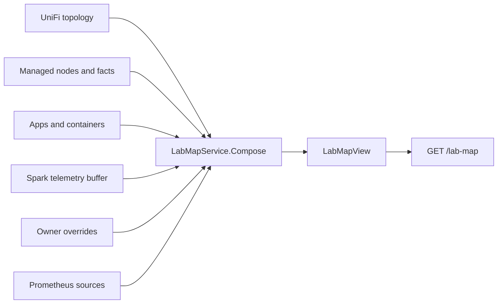

import WhoWhatWhy from '@site/src/components/WhoWhatWhy';
import Source from '@site/src/components/Source';

# Lab map and portal

<WhoWhatWhy
  who="Developers changing the lab map's data, its layout and 3D scenes, or the portal's navigation."
  what="The two endpoints, how the structure and the live readings are built and joined, the layout algorithm, the two scenes, and the shell around them."
  why="The map joins four sources that each know a different piece: UniFi knows the network, Lucia knows servers and apps, AdGuard knows names, and Prometheus knows traffic. Keeping the join in one place lets every source be missing without breaking the picture."
/>

For users, see [Lab map](../guide/lab-map.mdx). For the metrics pipeline that feeds the traffic, see [Observability](./observability.mdx).

## Who uses it and why this shape

Owners open it, usually on a wallboard. Because it runs all day on a screen nobody is watching, the design favours cheap, bounded reads: structure at most once a minute, live numbers every 10 seconds, every upstream answer size-limited and cached. A source that fails reduces the map. It never blocks it.

## Layout

| Path | Role |
|---|---|
| `LabMap/LabMapEndpoints.cs` | DI and the routes under `/api/host/lab-map` and `/api/host/unifi/snmp` |
| `LabMap/LabMapService.cs` | `Get` (structure), `Live`, and the pure `Compose` that joins everything |
| `LabMap/LabMapModels.cs` | Every record sent to the browser |
| `LabMap/LabTraffic.cs` | `PrometheusQuery` and the batch of PromQL queries |
| `LabMap/LabFlows.cs`, `TrafficKinds.cs` | NetFlow samples to flows, services and destination categories |
| `LabMap/LabDnsNames.cs`, `LabAsn.cs` | Names from AdGuard's query log, owners from the IP-to-ASN tables |
| `LabMap/ClientClassifier.cs`, `LabCategories.cs` | Guessing a client's group and a building's category |
| `LabMap/LabMapStores.cs` | Owner overrides and the SNMP credentials |
| `LabMap/LabCollector.cs` | Renders SNMP receivers into the Observability app's environment |
| `src/frontend/src/LabMap.tsx` | The page: toolbar, search, list, wallboard, detail panel |
| `labMapModel.ts` | Parsers, `layoutLab`, routing, search, traffic mixes |
| `LabMapScene.ts`, `UniverseScene.ts` | Three.js scenes, behind one `MapScene` interface |
| `universeModel.ts`, `universeStation.ts`, `universeShaders.ts` | The galaxy layout, a station model and the shaders |
| `src/frontend/src/navigation.ts` | The portal's areas and destinations |

## API

All routes need `HostOwner` and share `UniFiManagementFilter` for error shaping.

| Route | Purpose |
|---|---|
| `GET /api/host/lab-map` | The structure: `LabMapView` |
| `GET /api/host/lab-map/live?window=1m&sites=40` | Rates, load, health, flows, mixes, ports and destinations: `LabMapLive` |
| `PUT /api/host/lab-map/clients/{mac}` | Set or clear a client's group |
| `PUT /api/host/lab-map/categories` | Set or clear a building's category |
| `PUT /api/host/lab-map/sites` | Set or clear an Internet destination's district |
| `GET`, `PUT`, `DELETE /api/host/unifi/snmp` | SNMPv3 credentials, write-only |

The window is one of `1m`, `15m`, `1h`, `24h`. `sites` is 40, 100, 1000 or 0 for every destination the series can hold.

## Structure: `Compose`



`Build` gathers the inputs and calls `Compose`, which is a pure static method. The checks in `Lucia.Homelab.DomainChecks` pass UniFi's raw JSON straight into it. UniFi is read at most once a minute for `Get` and every 10 seconds for `Live`, behind a gate, so a slow controller is never hit twice at once. The built view is cached for 60 seconds, and any owner change invalidates it.

What `Compose` does, in order:

1. **Devices.** The first device of type gateway becomes the gateway, and `dev:<mac>` is every device's id. Each device's parent is its uplink if that uplink is another known device, else the gateway. Up to 256 devices and 64 ports each are read.
2. **Networks and zones**, with their VLAN and subnet. `NetworkOf(address)` places an address by subnet.
3. **Clients**, online first, then known ones seen in the last 30 days, up to 2,000 in total. Each is classified by `ClientClassifier` unless the owner overrode it.
4. **Lucia's servers.** The Spark (`host:spark`) and each managed node are placed under the AP or switch their MAC was seen behind, else under the gateway. A node's health comes from `LastSeenAt`: ok within 2 minutes, stale within 15, failed after that.
5. **Apps and containers** from `StackStore.LabStacks`, with published ports and mounts that point at a NAS share.
6. **Storage**, one entry per NAS with the hosts that mount it.

Without UniFi (`State` is `not-connected` or `error`), the gateway becomes a stand-in with id `gw` and Lucia's own machines hang from it. The `Traffic` field says how rich the live data is: `full` when Prometheus answers, `reduced` with UniFi's rates only, `none` otherwise.

Object ids are stable strings that the owner's overrides refer to: `dev:<mac>`, `host:<hostname>`, `app:<name>`, `client:<mac>`, `nas:<id>`, `dest:<key>`, `net:<id>`.

## Live readings

`Live` rebuilds with a 10-second UniFi age, then layers rates in this order, so the better source replaces the worse one for the same id:

1. UniFi's rates for devices, the WAN, each client and each client group.
2. The Spark's own byte rates from the telemetry buffer.
3. Prometheus: node network rates, SNMP per-port rates for devices, container rates and load, rolled up to apps.
4. NetFlow, joined by address into flows, per-object service mixes, listening ports and destinations.

`LabTraffic` runs nine instant queries as one batch, through Grafana's data source proxy with the credentials Lucia generated for the Observability app, so Prometheus never has to be published. Each reading is reused for a window-dependent time (5 seconds for `1m`, 5 minutes for `24h`). For `24h`, queries are rewritten to read the 30-minute recording tier, because raw samples last only about an hour. See [Spark telemetry](./spark-telemetry.mdx) for the tiers.

```csharp title="src/Lucia.Homelab.Server/LabMap/LabTraffic.cs"
internal static readonly string[] Queries =
[
    $"sum by (lucia_node) (rate(node_network_receive_bytes_total{{{Physical}}}[1m]))",
    $"sum by (lucia_node) (rate(node_network_transmit_bytes_total{{{Physical}}}[1m]))",
    // ...
    "topk(600, sum by (lucia_src, lucia_dst, lucia_port, lucia_proto, lucia_server) (sum_over_time({__name__=~\"lucia_netflow_bytes(_total)?\"}[1m])) / 60)",
```

Physical interfaces only (`Physical` excludes `lo`, `veth*`, `br-*`, `docker*` and similar), or each container's traffic would count twice.

### Flows

`LabFlows.Aggregate` is the part most likely to surprise you. It joins NetFlow samples to objects by address. Both directions of a conversation fold together, and a sample's server port belongs to the end the collector named. Samples through the gateway's own Internet address are NAT's second copy and are dropped. Internet addresses become destinations keyed by the registrable domain AdGuard resolved (`LabDnsNames`), else the AS number (`LabAsn`), else the address's /24 or /48. `TrafficKinds` maps ports to a service (`web`, `dns`, `streaming`, `gaming`, `remote`, `vpn`, `mail`, `files`, `iot`, `time`, `other`) and names or AS owners to a destination category.

`LabDnsNames` reads AdGuard's query log in the background at most every 30 seconds and keeps names for two hours, 20,000 at most. `LabAsn` downloads iptoasn.com's tables on first use and refreshes them weekly. Without AdGuard or the tables, destinations simply have fewer names.

### Owner state

Four small JSON stores live in the `AdGuardManagement:CredentialsDirectory` (`/data/network-credentials` in production): `lab-map-clients.json`, `lab-map-sites.json`, `lab-map-categories.json` and `unifi-snmp.json`. Each holds at most 2,000 entries, writes atomically, and normalizes keys (MACs to lowercase, names to 1 to 32 safe characters, built-in ids preferred over typed ones). The SNMP passphrases are encrypted with Data Protection, never returned, and `SnmpStatus` carries only the user name, protocols and the time of the last scrape.

`LabCollectorSync` keeps the Observability app's SNMP receivers current. Every 60 seconds, or when the SNMP settings change, it renders one SNMPv3 receiver per UniFi device (private IPv4 addresses only, 32 at most) into `LUCIA_LAB_COLLECTOR`, with credentials in separate `LUCIA_LAB_SNMP_*` variables that the collector expands itself, so they never appear in the compose file. If UniFi cannot be read, it leaves the current receivers alone.

## The layout

`layoutLab(map, sites)` in `labMapModel.ts` turns a `LabMap` into a `Layout`: nodes with positions, plinths, blocks, roads and tethers. It is deterministic. The same map gives the same city, because each position derives from a hash of the object's id (`seeded`), so a refresh does not shuffle the scene.

- A **quarter** is a network, entered through an AP or switch. The core switch is the archway into the home side and takes anything unplaced.
- Inside a quarter, a **district** holds a client group, or the servers. Inside it, a **neighbourhood** holds one category.
- Areas come from a Voronoi treemap (`treemap`, power cells), so each quarter's size follows how many buildings it needs.
- Roads have four tiers, lane, street, avenue and highway, widening as traffic leaves home.
- The Internet is a set of **regions** (one per destination category, plus the owner's own) with **sites** inside, built from the destinations seen in the last 15 minutes, rebuilt at most once a minute.

`mixTotals` rolls each object's service mix up every hop of its route to the Internet, so a switch shows the traffic of everything below it. `routeOf(layout, id)` gives that route and the detail panel's **Route out** list.

## Scenes

Both scenes implement one interface, so `LabMap.tsx` swaps them with a theme switch:

```ts title="src/frontend/src/UniverseScene.ts"
export interface MapScene {
  setLayout(layout: Layout): void
  setLive(live: LabMapLive | null): void
  setLayers(layers: Layers): void
  setWallboard(on: boolean): void
  select(id: string | null, route: string[]): void
  overview(animate?: boolean): void
  flyTo(id: string): void
  dispose(): void
}
```

`LabScene` draws the city: plinths, wireframe buildings, instanced cars along road curves, drones for wireless links and door glows for listening ports. `UniverseScene` consumes the same `Layout` and calls `layoutCosmos` in `universeModel.ts` to place it as a cosmos: the LAN is a solar system, the gateway a wormhole, switches and APs planets, client groups moons, wireless clients satellites, wired clients cities, servers stations and apps pods docked at them. The Internet is a galaxy through the wormhole, with a system per destination category. Ship traffic reuses `carServices` so colours match the legend.

Both draw with Three.js, EffectComposer and a bloom pass. Labels are DOM elements positioned from projected anchors, in a layer hidden from assistive technology. The accessible view is the **List** and the status strip. When the browser has no WebGL or asks for reduced motion, `LabMap.tsx` renders `FlatMap`, a flat 2D drawing of the same layout, and hides the theme switch.

:::note
The universe scene uses a licensed jumpgate model that is not in the repository. `tools/assets/build-jumpgate.mjs` builds it from a purchased pack into `src/frontend/public/universe/meshes/jumpgate/`, which is gitignored. Without it, gates fall back to bare wormholes. Do not commit it.
:::

### Previewing without a lab

`src/frontend/universe.html` loads the universe scene against fixture JSON in `public/_fixtures` (`map.json`, `live.json`). Run Vite on port 5199 and open `universe.html`. `tools/demo/gate.mjs` screenshots the gates.

## The page

`LabMap.tsx` is lazy loaded and owner-only. It reads the structure every 60 seconds and the live data every 10, both through `ownerRequest`, and pauses both while the tab is hidden. The selected span and site cap persist in `localStorage` (`labmap-span`, `labmap-sites`) as does the theme (`labmap-theme`). `stale` flips when no live reading has landed for 35 seconds, which the status strip shows as "Live readings paused". Wallboard mode requests fullscreen, hides the toolbar and steps through `counts.attention` every 12 seconds with `flyTo`.

## The portal shell

`navigation.ts` is the single list of destinations. Each has a `page`, an `area` (`overview`, `lab`, `ai` or `settings`), a label, a `href`, an `ownerOnly` flag and search keywords. `visibleDestinations(isOwner)` filters it, `findDestinations` powers the shell's search, and `App.tsx` switches on `route.page` from `parseRoute(location.hash)`. To add a page, add a `Route` variant in `dashboard.ts`, a destination here, and a branch in `App.tsx`. An owner-only page still needs a server-side `HostOwner` policy. The flag only hides the link.

`ownerRequest` in `managementApi.ts` is the only way pages call the host API. It refuses non-owner sessions, only allows paths under `/api/host/` or `/api/assistant/`, adds the `X-CSRF-TOKEN` header to anything but a GET, and calls `refreshSession` on a 401.

## Extension points

- **A new data source:** add its read to `Build`, a field on `LabMapView` or `LabMapLive`, a parser in `labMapModel.ts`, and a check in `LabMapChecks`.
- **A new category or traffic type:** edit `LabCategories` or `TrafficKinds` and the matching arrays and palettes in `labMapModel.ts`. The two lists must stay in step. The browser uses `services` and `destCategories` to order and colour things.
- **A new scene or theme:** implement `MapScene`, add it to `themes` and the constructor choice in `LabMap.tsx`.

## Tests

```powershell
dotnet run --project .\tests\Lucia.Homelab.DomainChecks\Lucia.Homelab.DomainChecks.csproj
cd src\frontend; npm test
```

`LabMapChecks.cs` covers the client classifier, categories, the three override stores, SNMP encryption, the collector's rendered receivers, `Compose` from UniFi JSON with two servers and an app, the stand-in gateway, Prometheus parsing, traffic kinds, the ASN table, DNS names and flow aggregation. `npm test` compiles the pure TypeScript modules and runs `tests/labMapModel.test.mjs` for the parsers and layout, and `navigation.test.mjs` for the destinations. The 3D scenes have no automated tests. Check them by running `universe.html` or the portal against fixtures.
