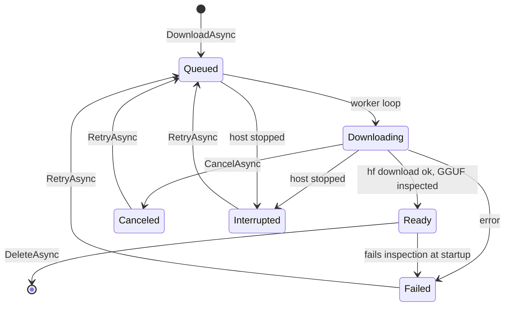
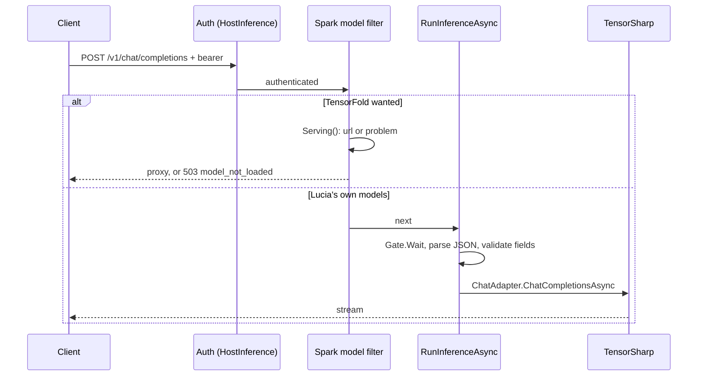

import WhoWhatWhy from '@site/src/components/WhoWhatWhy';
import Source from '@site/src/components/Source';

# Local AI

<WhoWhatWhy
  who="Developers changing model management, the inference runtime, the memory planner, the /v1 API or the Spark model recipe."
  what="The types in Host/, the lifecycle of a model from download to load, how a request reaches an engine, and the worker that reuses the same code on GPU servers."
  why="One 128 GB machine runs the controller, the databases and a 32 GB model. A load that does not fit has to be refused up front, and every download from the internet needs checks before anything reads it."
/>

Related pages: [Local AI in the guide](../guide/local-ai.mdx), [Local AI in deploy](../deploy/local-ai.mdx) and [Configuration](../deploy/configuration.mdx).

## Who touches it and why

Owners manage models and keys. Any signed-in account can use the Playground. Apps call `/v1` with a key. The assistant's engine for the Spark's own model calls `/v1` on loopback with `HostPlatform:InferenceApiKey`, and says "Set HostPlatform:InferenceApiKey to use the Spark's model." when it is missing. Code that lives inside the host, such as the domain support worker, uses `TensorSharpChatClient`, an `IChatClient` singleton over the runtime, with no HTTP hop.

## Layout

All of this lives in `src/Lucia.Homelab.Server/Host/` and is shared with `src/Lucia.Inference.Worker`.

| File | Role |
|---|---|
| `HostPlatformOptions.cs` | Validated settings. See [Configuration](../deploy/configuration.mdx). |
| `ModelCatalog.cs` | The library on disk: manifests, downloads, selection, llama.cpp mirror. A `BackgroundService`. |
| `ModelInspector.cs` | Reads GGUF metadata, estimates KV cost, plans a context that fits. |
| `InferenceRuntime.cs` | Holds the loaded chat and embedding model and swaps them. |
| `InferenceEndpoints.cs` | `/api/host/models/*` and `/v1/*`, shared by host and worker |
| `HostPlatformEndpoints.cs` | Wiring for the host, the Spark model filter on `/v1`, `HostModelStartup` |
| `SparkModel.cs` | The TensorFold recipe controller and proxy |
| `ModelPresets.cs`, `ModelBundleCommand.cs` | The bundled model and the `--bundle-model` publish step |
| `InferenceApiKeys.cs`, `HostApiKeyAuthentication.cs` | Keys and bearer auth |
| `HuggingFaceManagement*.cs` | Token storage, repository search, GGUF header preview |
| `VllmArchitectures.cs` | Which safetensors architectures vLLM 0.30.0 can run |
| `InferenceMetrics.cs` | `Lucia.Inference` OpenTelemetry meter |
| `TensorSharpChatClient.cs` | `IChatClient` over the runtime, for code inside the host |

## A model's life



`DownloadAsync` validates the request, and refuses anything that is not the bundled preset unless `Pro` is true. The browser sets `Pro` when the owner ticks "I understand this has not been qualified". The check is on the server, so a client cannot skip it. It then reuses an identical queued, downloading or ready entry, and queues at most 16.

```csharp title="src/Lucia.Homelab.Server/Host/ModelCatalog.cs"
if (!request.Pro && ModelPresets.Match(request) is null)
    throw new ArgumentException("Choose a catalog model, or explicitly set pro=true for an unvalidated Hugging Face model.", nameof(request));
```

`Validate` is strict about names: a Hugging Face `owner/model`, a revision that does not begin with `-`, a `.gguf` path with no traversal, and for split models only the first shard (`-00001-of-NNNNN`, up to 128). The `hf` child gets an argument list, not a shell string, and a controlled environment. Partial files stay in `files/` so **Retry** resumes.

The bundled preset (`ModelPresets.Bundled`) pins repository, revision, size and SHA-256. `ModelBundleCommand` downloads it during the host publish, re-hashes the file, fetches the licence and refuses anything that is not Apache-2.0. Its `Qualification` string says exact-file qualification on Spark hardware is pending.

### Formats and engines

`ModelFormat.Gguf` runs on TensorSharp, or on llama.cpp through the library mirror. `ModelFormat.Safetensors` is a whole repository for vLLM, with `config.json` as its anchor file. With `RequireTensorSharp` false (on a worker beside vLLM or llama.cpp), `Inspect` skips TensorSharp's architecture and chat-protocol checks and classifies any GGUF with a pooling type as an embedding model.

The llama.cpp mirror copies each Ready GGUF into `LlamaCache`, writes `llama-models.ini` (one `[owner/repo:QUANT]` section per model, `embeddings = true` for encoders, `load-on-startup` for the named ones) and lists a model only after a `.mirrored` marker proves the copy finished.

### The lease

`StartAsync` opens `.lucia-model-catalog.lease` exclusively. Writes call `RequireLease`. Two hosts on one directory would each trust a different in-memory view, so the second one fails to start. `ModelCatalogLeaseChecks` tests this.

## The memory planner

`ModelInspector.Inspect` reads the GGUF header only. `Plan` combines it with settings and what is loaded. `Calculate` is static, so tests can call it with any memory limit:

```csharp title="src/Lucia.Homelab.Server/Host/ModelInspector.cs"
var weights = checked((long)Math.Ceiling(model.WeightBytes * settings.WeightMemoryMultiplier));
var cacheBudget = Math.Max(0, checked(memoryLimit - os - services - voice - runtime - weights - otherResidentBytes));
var capacity = cacheBudget == 0 ? 0 : model.Kind == ModelKind.Embedding ? model.NativeContextTokens
    : checked((int)Math.Min(model.NativeContextTokens, cacheBudget / model.KvBytesPerToken));
if (model.Kind == ModelKind.Chat)
    capacity = capacity / 256 * 256;
```

A request for more than `capacity` throws `ArgumentOutOfRangeException`, which `HostErrorFilter` turns into a 400. `EstimateChatMetadata` computes `kvBytesPerToken`. For the hybrid Qwen architectures (`qwen35`, `qwen35moe`, `qwen3next`) only full-attention layers hold a KV cache, so it reads `layer_types` or divides by `full_attention_interval`. Counting every layer would overstate the cache several times over and refuse loads that fit.

The `ContextPlan` returned to the browser includes each reserve, so the UI can show where the memory went. Its `Qualification` text says the result is a conservative estimate, not a hardware qualification.

## The runtime

`InferenceRuntime` is a singleton with one semaphore, `Gate`. Loads, unloads, status reads and every inference request take it, so a swap waits for running requests and a request waits for a swap. The comment on `Gate` says it plainly: use read/write leases if concurrent batching is ever needed.

`LoadAsync` does, in order: refuse if `Paused`, find the model, plan, reject a plan under 256 context tokens, then load.

- **Embedding:** unload the current one, `EmbeddingModel.Load` on the CPU with the planned `MaxTokens`, wrap it in an `EmbeddingAdapter`.
- **Chat:** unload the current one, set a one-sequence `SchedulerConfig` whose block count is context ÷ 256, set `MAX_CONTEXT` for the duration, call `Chat.LoadModel`, then verify `Chat.ContextTokens` did not exceed the admitted size. On any failure the half-loaded model is cleared.

On success it saves the selection (`active-models.json`) so a restart loads the same models. `UnloadAsync(..., keepSelection: true)` is the pause path: it frees memory but leaves the saved choice for later.

Two writers set `StartupError` and `Paused`, and both exist to explain a refusal to a human. `StartupError` is advisory. `Paused` blocks loads. `SparkModel` sets `Paused` while the Qwen recipe holds the memory, and package updates set `StartupError` while models are paused. See [Spark updates](./spark-updates.mdx).

## Requests



`RunInferenceAsync` is deliberately defensive. It enforces a 2 MiB body for chat and responses, requires a string `model`, bounds the three max-token fields by `MaxOutputTokens`, and rejects non-text content parts with a clear error. Media support is not enabled, and the code says so. The `model` field must match the loaded chat model's file name without extension.

### Auth

`HostApiKeyAuthentication` accepts a bearer token, compares it by SHA-256 with `FixedTimeEquals`, and assigns `Owner` or `Inference`. A `lucia_inf_` token goes to `InferenceApiKeyStore.Match` instead, which checks a hash list and the expiry on every call. The `HostInference` policy accepts either role, `HostOwner` accepts only `Owner`. A browser session carries the role from the identity provider, so the Playground needs no key.

Keys are `lucia_inf_` plus 43 URL-safe base64 characters (32 random bytes). The store keeps a SHA-256 hash and a hint like `lucia_inf_AbC123...wxyz`. The secret is returned once from `Create`. Writes go to a temp file and rename, under an exclusive lease file, with a cap of 1,000 keys.

### The Spark model filter

While the Qwen recipe is wanted, an endpoint filter on `/v1` intercepts `models`, `chat/completions`, `responses`, `systemone` and `decisions`. Lucia has no decision engine of its own, so `systemone` and `decisions` are mapped only so the filter has an endpoint to run on; with the recipe stopped they return 503 `model_not_loaded`. `SparkModel.Serving()` returns the recipe's address once its status says `running` for the current generation and is under a minute old, or a human-readable problem. `/v1/models` is answered locally in Lucia's shape, because TensorFold's own list lacks the fields clients read. The proxy buffers the request body before sending, since TensorFold reads `Content-Length` and ignores chunked bodies.

One quirk is worth reading. TensorFold streams a function call's "done" events before its last argument delta, and some clients trust them and parse truncated JSON. `RelayResponsesAsync` holds those events and replays them just before the terminal event, with the final arguments from the completed response:

```csharp title="src/Lucia.Homelab.Server/Host/SparkModel.cs"
if (type == "response.function_call_arguments.done" || type == "response.output_item.done" && (string?)payload!["item"]?["type"] == "function_call")
    held.Add(payload!);
```

### The recipe protocol

`SparkModel` and `tools/runners/spark_model_worker.py` share two files in `<data>/spark-model/`. The request has a `generation` that the host raises on every change. The worker echoes the generation it applied, and the host ignores a status for any other generation. That makes a stale status from before a restart harmless. `Set("running")` unloads Lucia's models and sets `Paused` first, and `Set("stopped")` starts a background loop that waits for the status to say `stopped` and then reloads the saved selection. `HoldsMemory()` re-derives all of this at startup from the files. The constants `Parallel` and `ContextTokens` are duplicated in the Python worker, with a comment on each side saying to keep them in step.

## Hugging Face management

`HuggingFaceCredentialService` stores the token encrypted with Data Protection, in a private directory with link checks, and returns a `HuggingFaceDownloadCredentials` that cannot be serialized or printed. An existing managed record replaces `HuggingFaceToken`. A disconnect writes a marker, so it does not quietly revive the config token.

`HuggingFaceBrowserService` searches and lists repositories. It builds download choices that are pinned to a commit hash, and marks compatibility `unverified`, because a tag alone proves nothing. For vLLM, `VllmArchitectures` filters to architectures 0.32.0 supports and marks the ones only the opt-in nightly image runs (`requiresNightly`, which includes Decision 3.0 repositories: Qwen3_5Model plus decision_config.json). Serving such a model sets the app's `vllm-image` setting to `nightly`. The nightly image is CUDA 13 only. The `vllm-quantization` setting adds `--quantization fp8` and needs compute 8.9 or newer. `vllm-memory` renders as `--gpu-memory-utilization` (percent divided by 100). It also excludes MLX conversions that keep the original architecture name but store weights vLLM cannot read.

`HuggingFacePreviewService` reads at most 16 MiB (`MaximumHeaderBytes`) of a pinned file's GGUF header with a range request, follows at most 4 redirects and reports `selected_header_estimate`. It sums repository-reported shard sizes for weights and inspects only the first shard's metadata.

## Worker

`src/Lucia.Inference.Worker/Program.cs` is about 100 lines. It registers the same `ModelCatalog`, `ModelInspector` and `InferenceRuntime`, inserts GPU-server defaults at the top of configuration, validates that both keys exist and differ, and maps `MapModelManagement("/api/worker")` behind the owner key and `MapOpenAIInference()` at `/v1` behind the inference key. That reuse is the reason `MapModelManagement(prefix)` takes a route group and a prefix. The portal reaches a worker through `/api/host/nodes/{id}/ai` on the controller, which proxies to it. The worker adds `/health` and a Prometheus `/metrics` guarded by the inference key.

## Extension points

- **A new model format or engine:** add a `ModelFormat`, extend `Validate`, `Inspect` and the frontend's choice builder, and decide whether `Ready` means "TensorSharp can load it". The llama.cpp path shows how.
- **A new preset:** extend `ModelPresets`. `Match` compares the request, ignoring `Pro` and `SizeBytes`, so pinned revision and file must be identical.
- **A new endpoint under `/v1`:** add it in `MapOpenAIInference`. The shared filter and `Gate` already apply. Update `SparkModel` if the Qwen recipe should answer it too.
- **A new metric:** `InferenceMetrics` parses TensorSharp's `chat.complete` log line. Add an instrument there. The log text, which contains prompts, never leaves the provider.

## Tests

```powershell
dotnet run --project .\tests\Lucia.Homelab.Checks\Lucia.Homelab.Checks.csproj
dotnet run --project .\tests\Lucia.Homelab.HuggingFaceChecks\Lucia.Homelab.HuggingFaceChecks.csproj
python tools/host/test_host.py
```

`Lucia.Homelab.Checks` includes the planner (reserves stay separate, a 32 GiB limit leaves no room). `HuggingFaceChecks` uses synthetic tokens, a fake HTTP handler, real disposable Data Protection keys and a loopback server. No GPU, token or download is needed. `test_host.py` covers the host provisioning that writes `context_tokens` and `voice_reserve_gib`. It needs Python, so use `uv`, WSL or the Spark. In `src/frontend`, `npm test` runs `modelManagement.test.mjs` and `playground.test.mjs` for the page logic.
