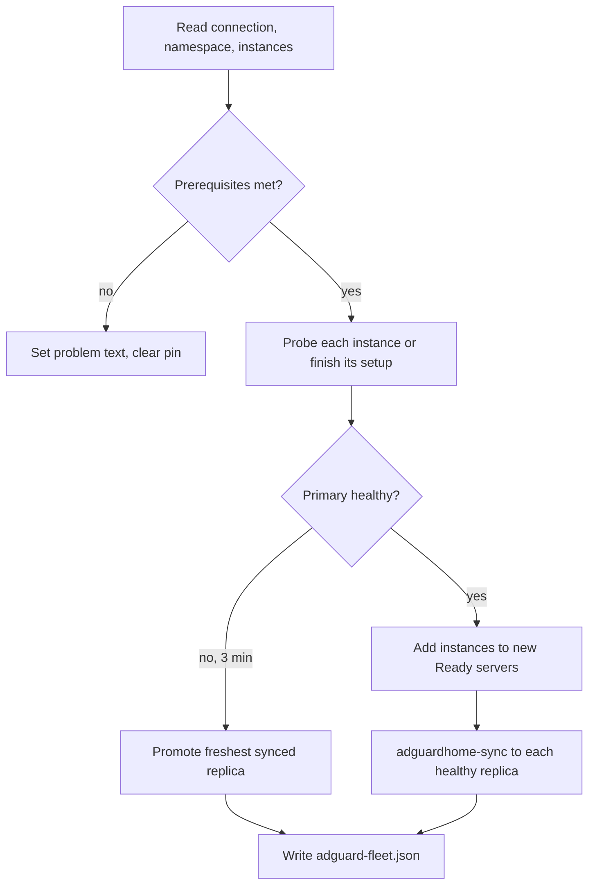

import WhoWhatWhy from '@site/src/components/WhoWhatWhy';
import Source from '@site/src/components/Source';

# Network devices

<WhoWhatWhy
  who="Developers changing how Lucia talks to AdGuard Home, a UniFi gateway or SNMP-capable switches."
  what="The connection services and their transports, the DHCP reservation planner, the AdGuard fleet controller, and their checks."
  why="Lucia holds a LAN administrator login and a router API key. Each one gets a narrow interface, a pinned private address and a transport that cannot leak the secret."
/>

## Who touches it

An owner connects AdGuard and UniFi from **Settings** and enters SNMPv3 credentials for the lab map. Other domains call them through interfaces: the [domain flow](./domains-and-dns.mdx) uses `ILocalDnsProvider`, node enrollment uses `IDhcpReservations`, and the lab map reads UniFi's tables. For the operator's side see [AdGuard HA](../deploy/adguard-ha.mdx) and, for users, [Network](../guide/network.mdx).

## Layout

| Path | Role |
|---|---|
| <Source path="src/Lucia.Homelab.Server/Host/AdGuardConnection.cs" /> | `AdGuardConnectionService`, `ILocalDnsProvider`, request validation |
| <Source path="src/Lucia.Homelab.Server/Host/AdGuardTransport.cs" /> | The HTTP transport and session, first-run install, private-address rules |
| <Source path="src/Lucia.Homelab.Server/Host/AdGuardCredentialStore.cs" /> | Encrypted `adguard.json` |
| <Source path="src/Lucia.Homelab.Server/Host/AdGuardManagementEndpoints.cs" /> | `/api/host/connections/adguard` routes |
| <Source path="src/Lucia.Homelab.Server/Host/AdGuardFleet.cs" /> | One instance per server, sync and failover |
| <Source path="src/Lucia.Homelab.Server/Host/UniFiConnection.cs" /> | Connection, transport, session, validation and endpoints for UniFi |
| <Source path="src/Lucia.Homelab.Server/Nodes/ManagedNodeDhcp.cs" /> | The reservation planner and loop |
| <Source path="src/Lucia.Homelab.Server/Nodes/ManagedNodeDns.cs" /> | The DNS rewrite reconciler |
| <Source path="src/Lucia.Homelab.Server/LabMap/LabMapStores.cs" /> | `SnmpCredentials` and the SNMP settings store |
| <Source path="src/Lucia.Homelab.Server/LabMap/LabCollector.cs" /> | The SNMPv3 collector config the Observability app runs |
| <Source path="src/frontend/src/UniFiSettings.tsx" />, `UniFiSnmp.tsx`, `AdGuardSettings.tsx` | The settings pages |

## Design rules shared by both connections

- **Private addresses only.** Before any request, the transport resolves the host and refuses unless every address is RFC 1918 or an IPv6 ULA. It then connects to exactly those validated addresses through a `ConnectCallback`, so a hostname cannot be re-resolved to something else between the check and the connection.
- **One handler per operation.** No pooled connections cross origins, redirects are off, proxies are off, and responses are capped (1 MiB for AdGuard, 8 MiB for UniFi).
- **Secrets stay out of telemetry.** Operations run inside `SuppressInstrumentationScope`, and the request types override `ToString`, so neither an HTTP span nor a logged object can carry a password or key.
- **Encrypted at rest.** Both stores wrap a JSON record with `IDataProtector` (purposes `Lucia.Homelab.AdGuardCredentials.v1` and `Lucia.Homelab.UniFiCredentials.v1`) and write under `network-credentials/`. The status type never includes the secret.
- **Verify before replace.** A save connects with the new settings first and writes only on success, so a bad edit keeps the working connection.
- **Typed errors.** `AdGuardManagementException` and `UniFiException` carry a status code, a stable `code` and a message safe to show. An endpoint filter turns them into `{ "error": { "code", "message" } }`.

## AdGuard

### The connection service

`AdGuardConnectionService` implements `ILocalDnsProvider`, the interface the rest of Lucia sees. The contract in its doc comment is the important part: add never replaces a domain that already exists, delete targets one exact `(domain, answer)` pair, and the caller owns intent and rollback because AdGuard has no conditional write.

```csharp title="src/Lucia.Homelab.Server/Host/AdGuardConnection.cs"
public interface ILocalDnsProvider
{
    Task<AdGuardConnectionStatus> GetConnectionAsync(CancellationToken cancellationToken = default);
    Task<AdGuardHealth> GetHealthAsync(CancellationToken cancellationToken = default);
    Task<IReadOnlyList<AdGuardRewrite>> ListRewritesAsync(CancellationToken cancellationToken = default);
    Task AddRewriteAsync(AdGuardRewrite rewrite, CancellationToken cancellationToken = default);
    Task DeleteRewriteAsync(AdGuardRewrite rewrite, CancellationToken cancellationToken = default);
}
```

Validation is in `AdGuardValidation`. `Connection` accepts an HTTP or HTTPS origin with an optional port and nothing else (no path, userinfo, query), and requires `AllowInsecureHttp` for `http`. `Rewrite` accepts an ASCII hostname with an optional leftmost wildcard and a canonical private IP answer, and refuses to add a disabled rule. There is no TLS-skip option anywhere.

`AdGuardTransport.RunAsync` also calls `VerifyProfileAsync` on every operation, because a userless AdGuard answers 200 to any Basic credentials. A named profile has to come back.

Lucia never turns DNS, protection or rewrites on. `AddRewriteAsync` checks `AdGuardHealth` and throws "Start AdGuard DNS and enable protection and DNS rewrites…" instead.

Two operations take an extra address so the fleet can reach one instance rather than the primary: `ProbeAsync(address)` and `PushCertificateAsync(names, chain, key, ..., address, plainHttp)`. The transport's `pin` argument sends the request to that address while TLS still validates the hostname.

### Certificate for AdGuard

`AdGuardCertificateWorker` (in `Domains/`) issues a certificate for the name devices use, through the domain flow's Cloudflare token and ACME account, and pushes it to the primary and to each set-up replica. It runs every 12 hours, retries after 30 minutes on error, and wakes when the fleet changes. `InstalledAsync` hands a new instance the current chain and key.

### The fleet controller

`AdGuardFleet` is a `BackgroundService` on the Spark. Its timing constants and rules are small and worth reading in full:

```csharp title="src/Lucia.Homelab.Server/Host/AdGuardFleet.cs"
internal static readonly TimeSpan FailoverAfter = TimeSpan.FromMinutes(3), SyncedWithin = TimeSpan.FromMinutes(10);
private static readonly TimeSpan Tick = TimeSpan.FromSeconds(30), SyncEvery = TimeSpan.FromMinutes(1), Fresh = TimeSpan.FromSeconds(90);
```

`ReconcileAsync` does one pass per tick under a gate:



Choices worth knowing:

- **State is a file.** `domains/adguard-fleet.json` holds the primary, `Seen` servers, `FailingSince`, `PromotedAt` and per-instance `Setup`, `HealthyAt`, `SyncedAt` and errors. Writes are atomic, so reads need no lock.
- **Health is a timestamp.** An instance is healthy if `HealthyAt` equals this tick's time. `Fresh` (90 s) is the window the status endpoint uses.
- **The successor is a pure function.** `Successor` picks the healthy, set-up instance with the latest `SyncedAt` inside `SyncedWithin`, or nothing. `NextAddress` is pure too. Both are tested directly.
- **No failback by design.** Promotion sets `PromotedAt` and never reverses. `MakePrimaryAsync` is the owner's tool and requires a healthy, set-up instance.
- **`adguard.PrimaryAddress`** pins the connection service to the primary's address, so `ILocalDnsProvider` calls follow a promotion without reconfiguring.
- **Sync is a child process.** `SyncAsync` runs `adguardhome-sync run` with an environment built in `SyncEnvironment`: HTTPS origin and replica URLs, the connection's account, and DHCP and TLS features off. The process gets a cleared environment and a one-minute deadline. The tool exits 0 even on failure, so `SyncError` scans the JSON log for `error`, `fatal` or `panic` and redacts any line that contains the password.
- **`Changed`** fires when the primary or the instance set changes. `ManagedNodeDns` and the certificate worker subscribe, so records and certificates follow.

The per-instance addresses come from the node agent (`src/Lucia.NodeAgent/StackAddresses.cs`), which checks with `arping -D`, adds the address with `ip addr add` and announces with `arping -U`. The fleet only reads the result as `AddressState`, and moves an instance when it is `InUse`.

## DNS rewrite reconciler

`ManagedNodeDns` computes the wanted records with a pure `Wanted(naming, nodes, ingress, routes, zone, fleet)` and applies them with `Apply`. It keeps a state file of the records it owns, so it deletes only what it wrote and leaves a user's identical rule alone. It runs on `AddressChanged`, `RoutesChanged` and `fleet.Changed`, and every 5 minutes.

## UniFi

`UniFiConnectionService` implements `IDhcpReservations`, which is all that node automation depends on:

```csharp title="src/Lucia.Homelab.Server/Host/UniFiConnection.cs"
public interface IDhcpReservations
{
    event Action? Changed;
    Task<UniFiConnectionStatus> GetStatusAsync(CancellationToken ct = default);
    Task<(UniFiClient[] Known, UniFiClient[] Online)> ListClientsAsync(CancellationToken ct = default);
    /// <summary>Pins <paramref name="address"/> to the client's MAC. Never retried: callers re-read before acting again.</summary>
    Task ReserveAsync(UniFiClient client, string address, string networkId, CancellationToken ct = default);
}
```

The class also exposes `ReadTopologyAsync` (read-only tables for the lab map) and `SetPublicForwardAsync` (the one port forward). Both are outside the interface because only their own callers need them.

**Authentication.** UniFi uses an `X-API-KEY` header against `/proxy/network/...`. The class comment records the endpoints verified on Network 10.6.106: `rest/user`, `stat/sta`, and `PUT rest/user/{id}` with `use_fixedip`, `fixed_ip` and `network_id`. The Integration API has no reservation endpoint, which is why the legacy proxy is used. Unknown or missing fields are tolerated and an unavailable zone or client-history table degrades to an empty array.

**Certificate trust.** UniFi gateways are usually self-signed. `UniFiTransport` accepts either normal validation or an exact SHA-256 pin the owner approved. The check runs inside the TLS callback, so the key header is never written to an untrusted peer. An unpinned failure returns `unifi_certificate_untrusted` with the observed fingerprint; a pinned mismatch returns `unifi_certificate_changed`.

**Reservations.** `ManagedNodeDhcp` keeps the planning pure. `Plan(nodes, known, online)` returns the per-machine states and the list of reserve actions, and `Apply` performs them:

| State | Meaning | Action |
|---|---|---|
| `Reserved` | Fixed IP equals the node's address | none |
| `Reserving` | A live lease exists and no reservation | one `ReserveAsync` |
| `ReservedElsewhere` | Owner pinned a different address | none |
| `AddressTaken` | Another client holds a reservation on it | none |
| `NotSeen` | No live lease at that address | none |

The Spark itself enters as a `DhcpNode` with no MACs, because its container cannot see the host's NICs. It is matched by the live client at its address. The loop runs on node address changes and connection changes, and every 5 minutes. A reservation is never retried blindly. The next pass re-reads UniFi first.

## SNMP

SNMPv3 credentials are stored by `SnmpSettingsStore` (`/api/host/unifi/snmp`, owner only). `LabCollector.Lines` turns them into environment lines for a second OpenTelemetry collector config, one SNMP receiver per UniFi device reading IF-MIB interface names and octet counters every 30 seconds. The secrets reach the collector as `LUCIA_LAB_SNMP_*` variables that the collector expands itself, so they never appear in the compose file or config text. See [Lab map and portal](./lab-map-and-portal.mdx).

## Frontend

`networkManagement.ts` holds the typed client for the domain page, with strict parsers that throw "Lucia returned incomplete configuration data" for any shape drift. The settings components follow one pattern: load status on mount with an `AbortController`, run changes through `ownerRequest`, never hold a secret after a successful save, and ask for confirmation on Disconnect.

## Testing

The checks are console programs. Run them from the repository root:

```bash
dotnet run --project tests/Lucia.Homelab.AdGuardChecks
dotnet run --project tests/Lucia.Homelab.DomainChecks
```

| Where | Covers |
|---|---|
| `AdGuardChecks` | Connection validation, HTTP consent, private-address enforcement, encrypted storage and file permissions, rewrite semantics against a fake AdGuard, secrets never appearing in output, `0600` and `0700` modes on Unix |
| `DomainChecks/DhcpChecks.cs` | `ManagedNodeDhcp.Plan` across all five states, including network-less leases |
| `DomainChecks/OperationsChecks.cs` | `AdGuardFleet.Successor`, `NextAddress` and `SyncError` |
| `DomainChecks/LabMapChecks.cs` | SNMP settings storage and validation (encrypted passphrases, short ones rejected) |

There is no live AdGuard or UniFi in these checks. They use fake transports and a fake handler, which is why the transports take their resolver and handler factory in the constructor. When you add a UniFi call, add a fake row for it and a check that a secret never reaches the output. Treat that second check as required.

## Related pages

[Domains and DNS](./domains-and-dns.mdx) is the main consumer of `ILocalDnsProvider`. [Nodes](./nodes.mdx) owns heartbeats and addresses. [Apps and stacks](./apps-and-stacks.mdx) owns the AdGuard catalog app.
