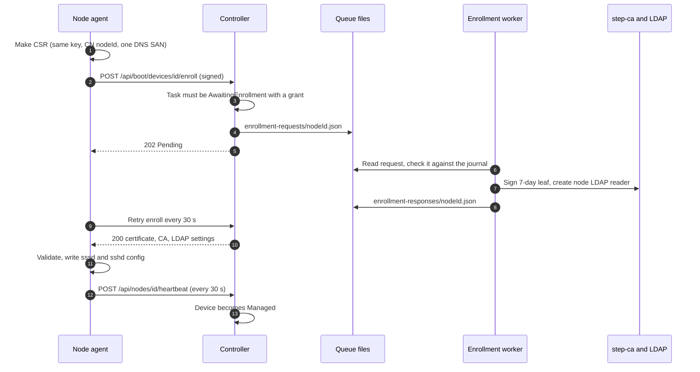
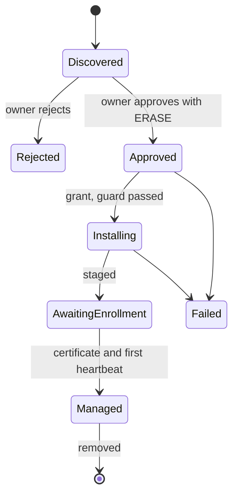

import WhoWhatWhy from '@site/src/components/WhoWhatWhy';
import Source from '@site/src/components/Source';

# Managed nodes

<WhoWhatWhy
  who="Developers working on the node agent, the controller's node endpoints or the enrollment worker."
  what="The agent's projects and modes, the enrollment sequence, the signed-request protocol, what the heartbeat carries and how the controller keeps its state."
  why="A node accepts work from the controller and runs it as root, so every request in both directions has to prove its origin without a password or a bearer token anyone could replay."
/>

A **node** is an x86-64 Debian server that Lucia installed. Owners see it under Devices ([Servers](../guide/servers.mdx)). Operators deploy it as described in [Managed nodes (deploy)](../deploy/nodes.mdx). This page covers how it's built. The install that creates it is in [Installer](./installer.mdx).

## Where the code is

| Path | Holds |
|---|---|
| <Source path="src/Lucia.NodeAgent" /> | One self-contained .NET 10 executable, `lucia-node-agent`. No package references. |
| <Source path="src/Lucia.Homelab.Server/Nodes" /> | `ManagedNodeEnrollment`, SSH keys, DNS and DHCP bookkeeping, the shipped agent release |
| <Source path="src/Lucia.Homelab.Server/Onboarding" /> | `HardwareOnboardingStore`, the journal of devices and tasks |
| <Source path="src/Lucia.Homelab.Server/Boot/InstallationEndpoints.cs" /> | The `/api/boot/devices/{id}/...` and `/api/nodes/{id}/...` endpoints |
| <Source path="tools/nodes" /> | `enrollment_worker.py` (CA and LDAP bridge), `prepare_directory.py` (LDAP policy), `qualify_native.py` |
| <Source path="tests/Lucia.NodeAgent.Checks" /> | The agent's console checks |

`Program.cs` in the agent is a thin dispatcher over a handful of verbs:

```text
inspect | discover | status                      read-only, runs in the installer
wait-install | installation-guard | stage-managed   the install handoff
managed-run                                       the daemon on the installed system
```

`managed-run` takes no flags. It refuses to start unless it's `/usr/lib/lucia/agent/lucia-node-agent` on the installed boot root, in a different boot than the installer, with `/etc/hostname` matching the approved hostname. The installer verbs and the daemon share `DiscoveryClient` (HTTP, retries, signing) and `SecureStateDirectory` (private files, locks).

## Why the proofs look like this

The agent has no secret to send. Every request is a signature made with a P-256 key that was generated on the machine, over a fresh server challenge.

1. The agent asks `GET /api/nodes/{id}/challenge` and gets `{challengeId, nonce, expiresAt}`. A challenge lasts 2 minutes, is bound to the caller's source address and can be used once. The controller holds at most 128 pending challenges.
2. The agent signs `lucia-discovery-v1\n{challengeId}\n{nonce}\n{reportJson}` with ECDSA P-256 and SHA-256, in the 64-byte IEEE P1363 form.
3. The controller verifies it against the challenge and removes the challenge.

```csharp title="src/Lucia.Homelab.Server/Boot/DiscoveryChallenges.cs"
var payload = Encoding.UTF8.GetBytes(
    $"lucia-discovery-v1\n{pending.Challenge.ChallengeId}\n{pending.Challenge.Nonce}\n{request.ReportJson}");
if (signature.Length != 64 || !key.VerifyData(payload, signature, HashAlgorithmName.SHA256,
        DSASignatureFormat.IeeeP1363FixedFieldConcatenation))
    throw new CryptographicException();
```

The key's SHA-256 fingerprint is the node's identity. For a managed node the request also carries its current certificate, and `ManagedNodeEnrollment.ValidateCertificate` checks that the certificate's public key matches the recorded fingerprint, the subject is `CN=<nodeId>`, the one DNS name is the approved hostname, it isn't a CA, its lifetime is at most 7 days and 1 hour, and it chains to the private root. Removing a node deletes its record, so its next call gets the same refusal as any unknown identity.

Large bodies, such as stack reports and exec scripts, don't fit the 32 KiB signed-report limit. `NodeApi.BoundAsync` signs a small proof of `{nodeId, purpose, bodySha256}` and sends the body next to it. The server recomputes the hash.

## Enrollment

Enrollment starts after the installer has staged the system and the machine has rebooted into it.



The controller can't mint certificates, since it holds no CA key. It writes a request file and the **enrollment worker** answers it. The worker is a user systemd service that runs outside the web container with the CA and LDAP admin access. Its rules, from the head of <Source path="tools/nodes/enrollment_worker.py" />:

- A request has exact keys. The CSR's CN is the node ID, and the only extension is one DNS SAN equal to the hostname.
- The worker also checks `onboarding/state.json`. The same node, task, fingerprint and hostname must be in the journal in the `AwaitingEnrollment` or `Managed` phase with a grant. A queue file alone is never authority.
- A response acknowledges the SHA-256 of the exact request bytes it answers.
- Leaves last 7 days and are reused until under 6 days remain, so a node renews about once a day. A failed renewal leaves 6 days of slack. The worker changes no CA policy beyond the `maxTLSCertDuration` claim of `168h` that `start-ca.sh` sets (`defaultTLSCertDuration` stays 24h).
- The LDAP reader is `uid=node-<32 hex>,ou=Services,dc=lucia,dc=home,dc=arpa`. `prepare_directory.py` adds two leading ACL rules that deny every `userPassword` read and limit these readers to read access. It runs once, by a maintainer, and never rolls back on its own.

On the controller side, `ManagedNodeEnrollment.Prepare` is idempotent. It compares a pending request with the new one, refuses any difference in node, task, hostname, key or CSR bytes, and expires an unanswered request after 10 minutes. `WorkerReady` reads `enrollment-worker.json`, which the worker refreshes. If it's older than 45 seconds, enrollment returns `503 node_worker_unavailable`.

On the node, `ManagedIdentity.ValidateConfiguration` accepts a response only when the leaf is a non-CA client certificate with a bounded chain (at most four certificates), for the local key, with the exact CN and SAN. The LDAP URI must use the controller's own hostname, and the bind DN must equal the expected reader. Then `ManagedFiles.ConfigureDirectoryAsync` writes sssd and the SSH drop-in. After sssd restarts, `getent group lucia-owners` must succeed before the first managed heartbeat goes out.

### Renewal and lapsed certificates

Under 6 days left, `ManagedRunner` renews with the same key and the persisted CSR. A pending or failed renewal backs off from 30 seconds to 15 minutes while heartbeats continue on the valid certificate. If a node was off long enough for the leaf to expire, it sends no heartbeats. It signs a renewal proof with the expired leaf, and the controller accepts that only on `/renew`. It builds the chain at the leaf's `NotBefore` plus one minute, so a lapsed node can recover but never act.

## States

The controller's journal moves a device through these phases. Only the node's authenticated heartbeat can make it `Managed`; progress reports from the installer can't.



`HardwareOnboardingStore` keeps this journal in `onboarding/state.json` under an exclusive file lease. It limits itself to 128 devices and 256 tasks, always starts with the discovery window closed, and treats a corrupt state file as an operator problem, not something to recreate. That is deliberate: an empty registry silently recreated would forget which keys hold installation authority.

## The heartbeat

Every 30 seconds the agent sends a `NodeHeartbeat`: hostname, OS version, uptime, load, memory, root storage, the last CPU and GPU readings, the container runtime state, the update summary, the agent's release ID and a list of `Features` (`exec` today). `ValidateHeartbeat` bounds every field. The server stores the latest one on the node's record and keeps the last hour of samples (180 at most) in memory.

The reply is `{ accepted, sshKeys }`. The agent writes each account's keys to `/etc/ssh/lucia-authorized-keys/<user>`. Only changed files are rewritten, and files for accounts with no keys are removed. A reply without `sshKeys` leaves what's there. `OwnerSshKeys` holds the source of truth: up to 10 keys per account, and a shared limit that keeps the reply under the agent's 64 KiB cap.

The controller also records the connection address as the node's address. A change wakes `ManagedNodeDns` (an AdGuard rewrite `hostname.namespace`) and `ManagedNodeDhcp` (a UniFi reservation), both background services that touch only records they created.

## The rest of managed-run

`ManagedRunner` starts these loops next to the heartbeat:

| Loop | Does | Interval |
|---|---|---|
| `NodeRuntime` | Installs and checks Docker, Compose and the NVIDIA container toolkit | 15 minutes |
| `StackRunner` | Syncs stacks and mounts with the controller. See [Apps and stacks](./apps-and-stacks.mdx) | 20 seconds |
| `NodeRequests` | Long-polls for requests: container logs, update actions, assistant commands | continuous |
| `NodeUpdates` | `apt-get -s upgrade` summary for the heartbeat | 2 minutes after start, then 6 hours |
| `NodeUsage` | CPU, temperature and GPU readings, sampled off the heartbeat path | 30 seconds |

`NodeRequests` accepts only allowlisted kinds with fixed argument arrays. `logs` runs `docker logs --tail` (1 to 5000 lines, 96 KiB back). The update kinds `check-updates`, `install-updates`, `restart` and `update-agent` go to `NodeUpdates`. `exec` goes to `NodeExec`, which writes the approved script to a private directory and runs it as `lucia-exec-<job>` in a transient systemd unit, with a limit of 16 KB of script, 30 minutes, 4 jobs at once and 32 KB of output. An unknown kind is refused. The server can never send an arbitrary executable and arguments.

```csharp title="src/Lucia.NodeAgent/NodeExec.cs"
internal const int MaxScript = 16 * 1024, MaxSeconds = 1800, MaxOutput = 32 * 1024, MaxRunning = 4;
```

Agent self-update (`AgentRelease.UpdateAsync`) downloads `GET /api/nodes/{id}/agent`, a flat tar of the files the controller ships. The tar can hold only plain files with plain names (512 files, 512 MiB at most), and its release ID has to equal the one the controller sent. The release ID is a SHA-256 over each file's name and SHA-256, sorted by name, so both sides compute it the same way (`NodeAgentRelease.Compute`). The agent unpacks to `agent.next`, moves the running one to `agent.prev` and restarts the service.

## Extension points

- **A new request kind.** Add the kind to the server's `NodeRequests.Actions` (in `Stacks`), handle it in the agent's `NodeRequests.RunAsync`, and give the agent a fixed argument array. Don't pass server strings into a shell.
- **A new heartbeat field.** Add it to `NodeHeartbeat` and `ValidateHeartbeat` on the server and to `NodeMetrics` in the agent. Keep it optional so an older agent still validates. `Features` exists so the controller can tell what an agent supports without version checks.
- **A new node-side setup step.** Put it in the managed loops with commands that don't depend on server input. The node already has a rule that it never runs a shell.

:::warning
Owner access to Lucia is root on every node, by design: stacks run as root, and the assistant can run approved commands. Treat anything that widens what an owner or the controller can ask a node to do as a security change. [Security model](../deploy/security-model.mdx) explains where that sits.
:::

## Tests

`tests/Lucia.NodeAgent.Checks` is a console project, not xUnit. Run it with `dotnet run --project tests/Lucia.NodeAgent.Checks`. It builds inventory fixtures, drives the signing and secure-state code against loopback TLS, and covers the installation guard, staging and renewal. The staging checks need Linux, so run them in WSL after copying `src/Lucia.NodeAgent` and `tests/Lucia.NodeAgent.Checks` there.

On the controller side, `tests/Lucia.Homelab.OnboardingChecks` covers the journal (windows, approval, grants, phase transitions) and `NodeEnrollmentChecks.cs` in `tests/Lucia.Homelab.DomainChecks` covers CSR and certificate validation. `tools/nodes/check_enrollment.py` tests the worker offline, and `qualify_native.py` runs it against a real CA fixture. `tests/Lucia.ManagedNode.Qualification` is an opt-in controller for a disposable QEMU guest and refuses to run without a marked fixture directory. It never touches live state.
