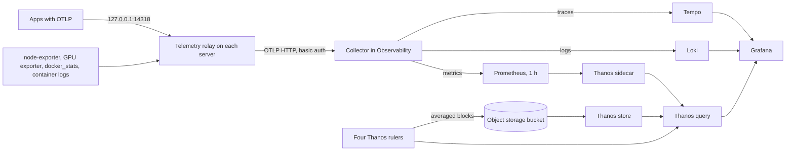

import WhoWhatWhy from '@site/src/components/WhoWhatWhy';
import Source from '@site/src/components/Source';

# Observability

<WhoWhatWhy
  who="Developers changing the Observability or Object storage catalog apps, the telemetry relay, the metric tiers or Lucia's Grafana dashboards."
  what="How one catalog app renders about a dozen services, how Thanos rulers produce the averaged tiers, how relays and apps find the collector, and how buckets are granted."
  why="Lucia wants 30 days of graphs on a small server. Raw Prometheus data can't do that, so the tiers, the relays and the bucket wiring are all designed around keeping storage small and the setup hands-free."
/>

This page covers the full telemetry layer, which is a catalog app like any other (see [Apps and stacks](./apps-and-stacks.mdx) for rendering, versioning and delivery). The Home page's always-on Spark readings are a separate, in-process feature, described in [Spark telemetry](./spark-telemetry.mdx).

## The parts

| Part | Source |
|---|---|
| `ObservabilityApp`, `ObjectStorageApp` | <Source path="src/Lucia.Homelab.Server/Stacks/StackCatalog.cs" /> |
| Metric tiers and recording rules | <Source path="src/Lucia.Homelab.Server/Telemetry/MetricTiers.cs" /> |
| Dashboards (Hardware, Inference, Containers) | <Source path="src/Lucia.Homelab.Server/Telemetry/HardwareDashboard.cs" />, `InferenceDashboard.cs`, `ContainersDashboard.cs` in the same folder |
| Per-server relay and the controller's relay | <Source path="src/Lucia.Homelab.Server/Telemetry/TelemetryRelay.cs" /> |
| Relay delivery, app telemetry sync | <Source path="src/Lucia.Homelab.Server/Stacks/StackTelemetry.cs" /> |
| Bucket grants | <Source path="src/Lucia.Homelab.Server/Stacks/StackStorage.cs" /> |
| Checks | <Source path="tests/Lucia.Homelab.DomainChecks/StackChecks.cs" /> |

Owners install and open it. Other apps and every managed server feed it. The lab map's 24-hour view reads Thanos too.

## Data flow



One idea per hop: everything converges on a single authenticated OTLP endpoint. Metrics land in Prometheus for one hour and are then represented by averages in Thanos.

## One app, many services

`ObservabilityApp.Render` builds a compose file with the collector, Prometheus, Loki, Tempo, Grafana, the Thanos sidecar, query and store, four rulers, a compactor and an `init` container. Its settings fields are the Grafana and OTLP host names (`grafana`, `otlp`) and three ports (3030, 4317, 4318).

Several design decisions show up in the render:

- **Config inline, not files.** Each service's config is a `configs:` entry with inline `content`, so the whole app is one compose document that Lucia can re-render and the node can write. The cost is that Compose before 2.30 doesn't recreate a container when only its inline config changes. Each service carries a `lucia.configs` label holding a 16-character hash of its configs, which forces recreation. The checks count 9 such labels.
- **Escaping.** The collector expands `${env:...}` itself and Grafana expands `$var`, but Compose also expands `$`. Embedded text passes through `$$`:

  ```csharp title="src/Lucia.Homelab.Server/Stacks/StackCatalog.cs"
  var hardware = HardwareDashboard.Json().Replace("$", "$$");
  var inference = InferenceDashboard.Json().Replace("$", "$$");
  var containers = ContainersDashboard.Json().Replace("$", "$$");
  ```

  The Loki derived-field URL in the datasource config needs `$$$$`. Compose turns it into `$$`, and Grafana's provisioning turns that into the literal `$` it wants. A check asserts the exact string.
- **File ownership.** Each image runs as its own uid. An `init` service chowns each volume once, and every other service `depends_on` it with `service_completed_successfully`.
- **Secrets survive.** `OTLP_PASSWORD`, `GRAFANA_ADMIN_PASSWORD` and `SSO_CLIENT_SECRET` come from `StackCatalog.Secret(env, ...)`, which reuses a saved value of 32 or more characters.
- **Routes.** `Render` returns two routes: `grafana` on the Grafana port, and `otlp` on the HTTP port with the gRPC port as `GrpcPort`. The gateway sends gRPC requests for that one name to the gRPC port.

Grafana's address is `${LUCIA_URL_GRAFANA:-http://<server>:<port>}`. Before a domain is active, the variable isn't set and the fallback keeps the app usable by IP. See `StackStore.RouteVariable` and `NodeEnv`.

### Netflow

The collector also listens on UDP 2055 for NetFlow and IPFIX from a UniFi gateway. A `transform/flows` processor labels each record with both addresses, protocol and the lower port when it's below the ephemeral range. A `signal_to_metrics/flows` connector turns each batch's bytes into a delta counter, `lucia.netflow.bytes`. Deltas are kept as sums because a cumulative counter would lose short flows to `rate()`.

## Metric tiers

Prometheus keeps raw data for one hour (`--storage.tsdb.retention.time=1h`) and runs with `external_labels: {tier: raw}`. Four Thanos **rulers** each record averages of the metrics Lucia charts, each from the tier before it. The compactor then applies a different retention per tier.

```csharp title="src/Lucia.Homelab.Server/Telemetry/MetricTiers.cs"
internal static readonly (string Name, string Lookback, string Keep)[] Tiers =
    [("1m", "2m", "6h"), ("30m", "1h", "24h"), ("1h", "2h", "7d"), ("4h", "8h", "30d")];
```

`Rules(index)` generates the recording rules for one tier. Gauges are recorded as `<metric>:avg`, counters as `<metric>:rate` (average of the rate), and NetFlow bytes as `lucia_netflow_bytes:sum`. The first tier reads raw samples. Each later tier averages the previous tier's recorded series:

```csharp title="src/Lucia.Homelab.Server/Telemetry/MetricTiers.cs"
var rules = string.Concat(Gauges
    .Select(item => Rule(item.Metric + ":avg", index == 0
        ? $"avg_over_time({Raw(item.Metric, item.Selector)}[1m])" : $"avg_over_time({item.Metric}:avg{{tier=\"{from}\"}}[{name}])"))
    .Concat(Counters.Select(item => Rule(item.Metric + ":rate", index == 0
        ? $"rate({Raw(item.Metric, item.Selector)}[2m])" : $"avg_over_time({item.Metric}:rate{{tier=\"{from}\"}}[{name}])")))
    // ...
```

The compactor's script loops over `1m:6h 30m:24h 1h:7d 4h:30d`, running `thanos compact` with a `selector.relabel-config` that keeps one `tier` label value at a time and `--retention.resolution-raw` set to that tier's age. Downsampling is off, since the rulers already did it.

Dashboards must read across tiers. `MetricTiers.Gauge` and `MetricTiers.Rate` produce a PromQL expression that takes the raw series and each tier's latest slice, then `max without (tier)`:

```csharp title="src/Lucia.Homelab.Server/Telemetry/MetricTiers.cs"
private static string Tiered(string raw, string recorded, string selector) =>
    "(" + string.Join(" or ", Tiers.Select(tier =>
            $"max without (tier) (last_over_time({recorded}{{{(selector.Length > 0 ? selector + "," : "")}tier=\"{tier.Name}\"}}[{tier.Lookback}]))")
        .Prepend($"max without (tier) ({raw})")) + ")";
```

Where raw data exists it wins by being the finest, and where it has aged out the finest tier that still holds the time takes over. `Lookback` is how far back a chart looks for a tier's latest slice. Dashboard panels call these helpers rather than hand-writing PromQL.

:::tip Adding a metric to the long-term charts
Add it to `Gauges` or `Counters` in `MetricTiers`. It's recorded in every tier from then on, and nothing is back-filled. Bump `ObservabilityApp`'s version, since the rules are part of the rendered compose.
:::

Thanos uses `${LUCIA_S3_OBJSTORE:-}` for its object store config. Without Object storage, an empty value falls back to `{type: FILESYSTEM, config: {directory: /bucket}}`, a local volume, so the app works either way. With it, `SyncStorage` fills the variable (next section).

## Buckets: Object storage

`ObjectStorageApp` runs one Garage node (`--single-node`), a console (garage-ui) and a `provision` job. Any catalog app that overrides `Bucket => true` gets its own bucket, named after the stack, and an S3 key. Observability is the only one today.

The controller's `AppTelemetry` background service calls `SyncStorage` every 15 seconds. It finds the running Object storage stack, builds each bucket-app's grant, and writes the connection into that app's environment through `SetLucia`:

```csharp title="src/Lucia.Homelab.Server/Stacks/StackStorage.cs"
var (key, secret) = (ObjectStorageApp.Key(grant, stack.Name), ObjectStorageApp.KeySecret(grant, stack.Name));
grants.Add($"{stack.Name}:{key}:{secret}");
lines = $"{S3Prefix}ENDPOINT={endpoint}\n{S3Prefix}BUCKET={stack.Name}\n{S3Prefix}ACCESS_KEY={key}\n{S3Prefix}SECRET_KEY={secret}\n"
    + $"{S3Prefix}OBJSTORE={{type: S3, config: {{bucket: {stack.Name}, endpoint: \"{endpoint}\", region: garage, access_key: {key}, "
    + $"secret_key: {secret}, insecure: true, bucket_lookup_type: path}}}}\n";
```

Key ids and secrets are not stored. They're HMAC-SHA256 outputs keyed on `STORAGE_GRANT_SECRET`, so they stay stable across re-renders and moves:

```csharp title="src/Lucia.Homelab.Server/Stacks/StackCatalog.cs"
internal static string Key(string grant, string app) => "GK" + Hex(grant, "key:" + app)[..24];
internal static string KeySecret(string grant, string app) => Hex(grant, "secret:" + app);
```

The grants list goes back to Object storage as `LUCIA_STORAGE_GRANTS`. Its `provision` container loops over them and makes each key and bucket idempotently with Garage's admin API (`GetKeyInfo`/`ImportKey`, `GetBucketInfo`/`CreateBucket`, `AllowBucketKey`), retrying on failure until Garage is up. The endpoint is the server's LAN address and the S3 route's port, refreshed as the app moves. Apps reach it over the LAN without depending on the domain's certificate.

`SetLucia` replaces every line with the given prefix and, when anything changed, bumps the stack's revision so the node redeploys. A moving or restoring stack is skipped and picked up the next cycle.

## Relays

While an Observability app is running, `StackStore.Sync` appends one extra `NodeDesiredStack` to every node's response, named `telemetry-relay`:

```csharp title="src/Lucia.Homelab.Server/Stacks/StackTelemetry.cs"
var config = TelemetryRelay.Config(JsonSerializer.Serialize(hostname), gpu, scrapes, TelemetryRelay.EnvExporter, dockerStats: true);
var compose = TelemetryRelay.Compose(config, gpu, dockerStats: true);
var env = $"OTLP_ENDPOINT={destination.Endpoint.AbsoluteUri.TrimEnd('/')}\nOTLP_AUTHORIZATION={destination.Authorization}\nLOCAL_AI_KEY={key}\n";
var revision = BitConverter.ToInt64(SHA256.HashData(Encoding.UTF8.GetBytes(compose + "\0" + env))) & long.MaxValue;
return new(RelayName, revision, "Running", 0, 0, compose, env);
```

It is not stored. The relay is derived on every sync, and its revision is a hash of its content, so it redeploys exactly when the destination, the server's GPUs or Local AI change. It also disappears when Observability does, and the node's reconcile loop removes any stack directory not in the desired list. `StackStore.ValidateName` rejects `telemetry-relay` so a user can't claim the name.

What the relay runs:

- An OpenTelemetry collector on the host network (512 MB limit) listening on `127.0.0.1:14317` (gRPC) and `127.0.0.1:14318` (HTTP). With `dockerStats`, it runs as root with all capabilities dropped and `no-new-privileges`, because the `docker_stats` receiver reads the Docker socket and the docker group id differs per machine.
- `node-exporter` on `127.0.0.1:19100` with `pid: host` and the root filesystem mounted read-only.
- `nvidia_gpu_exporter` on `127.0.0.1:19835`, only when the server reports NVIDIA GPUs usable from containers.
- Scrapes of Local AI's engine metrics (Lucia Inference, vLLM, llama.cpp) per the app's settings. llama.cpp's router serves metrics per model, so `LlamaModels` reads the model list (cached 5 minutes) and passes the names into the config.

Docker's `json-file` logs, with the compose project and service labels the node agent adds (see [Apps and stacks](./apps-and-stacks.mdx#what-the-node-writes)), are read by the `filelog/docker` receiver and attributed to containers.

### The controller's relay

The Spark's relay can't have the Observability app's credentials, since the app may live on another server. `ControllerRelay` writes `relay.yaml` into `Telemetry:RelayDirectory` with an exporter that posts to the controller:

```csharp title="src/Lucia.Homelab.Server/Telemetry/TelemetryRelay.cs"
app.MapPost("/api/host/telemetry/relay/v1/{signal}", async (string signal, HttpContext context, ControllerRelay relay, StackStore stacks,
    CancellationToken ct) =>
{
    if (signal is not ("traces" or "metrics" or "logs")) return Results.NotFound();
    if (!relay.Accepts(context.Request.Headers[ControllerRelay.Header])) return Results.Unauthorized();
    if (await stacks.TelemetryEndpoint(ct) is not { } destination) return Results.NoContent();
    // ...forward to destination.Endpoint with its Authorization header
```

The token is generated once into `relay-token`, compared with `FixedTimeEquals`, and the controller forwards to wherever `TelemetryEndpoint` says the app currently is. The route is excluded from the API description, and forwarding runs inside `SuppressInstrumentationScope` so tracing the forward doesn't create telemetry about telemetry. The installer's AppHost (`Lucia.Homelab.Identity.AppHost`) runs the relay and exporter containers on the Spark, and Traefik's access logs go through the same endpoint with credentials and query strings dropped.

## How apps find the collector

`StackStore.TelemetryEndpoint` returns the destination: the running Observability stack's route that has a gRPC port, its OTLP user and password, and an endpoint of `https://otlp.<namespace>` once a domain is active, or `http://<server>:<http port>` before. Results are cached for 30 seconds.

`SyncTelemetry` runs in the same 15-second loop as `SyncStorage`. For each installed catalog app with `Telemetry => true` it writes:

```text
LUCIA_OTLP_ENDPOINT=https://otlp.lab.example.com
LUCIA_OTLP_AUTHORIZATION=Basic <base64 of user:password>
```

or removes both lines when Observability is gone. LiteLLM uses them to switch its OpenTelemetry callback on only while they exist (`callbacks: [${LUCIA_OTLP_ENDPOINT:+otel}]`). Using the domain name rather than an IP means the address follows Observability if it moves.

## Dashboards

Each dashboard class builds a Grafana JSON document in C#: `Uid`, `title`, tag `lucia`, `editable = false`, 30-second refresh, a row layout and panels whose queries come from `MetricTiers.Gauge` and `MetricTiers.Rate`. Hardware is the home dashboard. It filters container and bridge interfaces with `MetricTiers.Nics` and pseudo filesystems with `MetricTiers.Disks`, so traffic and disk space aren't double counted.

A dashboard is provisioned as a config mounted at `/etc/grafana/dashboards/lucia/<name>.json`, so changing one means a version bump and a re-render. They are read-only in Grafana by design. Edits belong in the C# so they survive a re-render.

`CrowdSecDashboard` is the exception to "queries come from `MetricTiers`": most of its panels query Loki for CrowdSec's alert records, and the offenders table groups log lines with Grafana transformations (`extractFields`, `groupBy`, `organize`). Its links carry `CrowdSecDashboard.ConsolePlaceholder`, which the Observability render swaps for `${LUCIA_CROWDSEC_CONSOLE:-}` after escaping, so compose fills in Lucia's address. CrowdSec's four community dashboards are vendored JSON, embedded in the assembly and read by `CommunityJson`. Regenerate them with `node tools/telemetry/crowdsec-dashboards.mjs`, which pins the upstream commit and makes every adaptation, rather than editing the JSON. See [Gateway security](./gateway-security.mdx#alerts-to-observability).

Grafana signs in through Authentik. The Observability app declares `Sso` as `AppSso("Grafana", host, "/login/generic_oauth")`, and the compose maps `groups` containing `lucia-owners` to the Admin role, everyone else to Viewer. Until Authentik's client exists, `LUCIA_SSO_ENABLED` is false and the admin login works. See [Identity](./identity.mdx).

## Testing

The Observability and Object storage checks sit in `StackChecks.cs` and run with the rest:

```powershell
dotnet run --project tests/Lucia.Homelab.DomainChecks
```

They render the app and assert on the text. Because the output is a string, a check is cheap to write and catches the mistakes this code is prone to:

```csharp title="tests/Lucia.Homelab.DomainChecks/StackChecks.cs"
check(observability.Bucket && obs.Compose.Contains("      - --storage.tsdb.retention.time=1h\n", StringComparison.Ordinal)
    && obs.Compose.Contains("for t in 1m:6h 30m:24h 1h:7d 4h:30d; do", StringComparison.Ordinal)
    && new[] { "1m", "30m", "1h", "4h" }.All(tier => obs.Compose.Contains($"      - --label=tier=\"{tier}\"\n", StringComparison.Ordinal)
        && obs.Compose.Contains($"      - --endpoint=rule-{tier}:10901\n", StringComparison.Ordinal)),
    "Observability must keep an hour of raw metrics, average them into Thanos tiers with their own retention and read every tier through Thanos Query.");
```

Other checks parse each dashboard line as JSON after un-escaping, assert that no stray `$` is left, and verify that `ObjectStorageApp.Key` gives distinct 26-character keys per app. The relay's config and compose are checked in the same file, including the Docker-stats variant.

When you change any rendered text here, run the checks, bump the app's `Version`, and re-render installed stacks as described in [Running apps](../deploy/apps.mdx#roll-out-a-template-change). The operator view of the same system is [Observability for operators](../deploy/observability.mdx).
