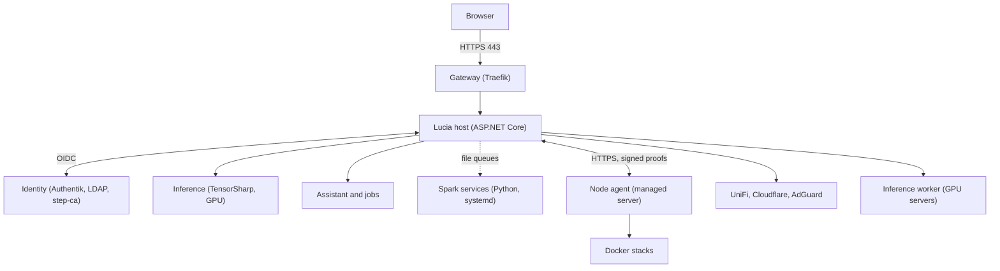

import WhoWhatWhy from '@site/src/components/WhoWhatWhy';
import Source from '@site/src/components/Source';

# Architecture overview

<WhoWhatWhy
  who="Developers who are new to the codebase or about to change something that crosses projects."
  what="Every project in the repository, the processes they become on the Spark and on managed nodes, and the rules that keep them apart."
  why="Lucia can restart servers and erase disks. The layout makes the dangerous parts small, separate and easy to audit."
/>

Lucia is one controller process, a few narrow helper services, and a node agent on each managed machine. The controller is a single ASP.NET Core app that serves the REST API, the React portal, the OpenAI-compatible inference API and the assistant. Almost every feature is a folder inside it.

## System diagram

Read it as three rings. The browser and gateway are the outer ring and only speak HTTPS. The host and the identity stack are the middle ring. The file queues, the node agent and the external systems are the inner ring, where real changes happen and where each action is narrow on purpose.

## Projects

| Path | Role |
|---|---|
| <Source path="src/Lucia.Homelab.Server"/> | The controller. Folders per domain: `Host`, `Assistant`, `Stacks`, `Nodes`, `Onboarding`, `Boot`, `Domains`, `Packages`, `Telemetry`, `LabMap` |
| <Source path="src/frontend"/> | React 19 and Vite portal. Built into the server's `wwwroot` |
| <Source path="src/Lucia.NodeAgent"/> | Root service on managed servers. Enrollment, heartbeat, desired state, node actions, the installer's runner |
| <Source path="src/Lucia.Inference.Worker"/> | The server's inference stack as a standalone app for GPU servers |
| <Source path="src/Lucia.Desktop"/>, <Source path="src/Lucia.Desktop.Core"/> | Avalonia setup app and its SSH and protocol library. See [desktop bootstrap](./desktop-bootstrap.mdx) |
| <Source path="src/Lucia.Homelab.AppHost"/> | Development AppHost: server, Redis, Vite |
| <Source path="src/Lucia.Homelab.Identity.AppHost"/> | Production AppHost. Publishes the Spark's Docker Compose file |
| <Source path="tools"/> | Python for the Spark side (`identity`, `host`, `desktop`, `domains`, `nodes`, `packages`, `runners`, `boot`), plus `docs` and `assets` |
| <Source path="deployment"/> | Dockerfiles and boot, identity and desktop assets |
| <Source path="tests"/> | Console-app test projects, one per domain |

Two AppHosts exist for different jobs. The development one starts a server on your machine with authentication off. The production one reads a state directory written by `tools/identity/provision.py` and describes the whole Spark stack. They share nothing at runtime.

## Who talks to whom

**Browser to host.** The gateway terminates TLS and forwards to port 8080 in the host container. The host accepts forwarded headers only from the configured proxy networks, and only for the configured public origins. [Host server](./host-server.mdx) walks through the middleware order.

**Host to identity.** The portal signs in through OIDC with Authentik. API clients can present an Authentik access token or one of two static API keys. See [Identity](./identity.mdx).

**Host to Spark OS.** The host container has no Docker socket. Jobs that need the Spark itself, such as activating a domain profile, enrolling a node or installing apt packages, are written as request files into a mounted directory. A systemd unit outside the container reads them, validates them and acts. The units and their trust rules are in [Domains and DNS](./domains-and-dns.mdx), [Nodes](./nodes.mdx) and [Spark updates](./spark-updates.mdx).

**Host to nodes.** The node agent long-polls and heartbeats to the host, applies desired stacks and runs approved actions. The host never opens a connection into a node. See [Nodes](./nodes.mdx) and [Apps and stacks](./apps-and-stacks.mdx).

**Host to the lab.** UniFi, Cloudflare and AdGuard each have a connection class with credentials stored encrypted under `/data`. See [Domains and DNS](./domains-and-dns.mdx) and [Network devices](./network-devices.mdx).

**Host to models.** `InferenceRuntime` loads GGUF models in-process through TensorSharp and serves them from `/v1`. The assistant uses the same runtime when you pick a local model. See [Local AI](./local-ai.mdx) and [Assistant](./assistant.mdx).

## Why it is built this way

**One process, many folders.** A homelab controller has one operator and one machine. Splitting domains into services would add deployment and version problems with no scaling benefit. Folders keep the boundaries visible and each domain owns its `AddX` and `MapX` pair, which `Program.cs` calls in order.

**Privilege lives elsewhere.** The web host is the part most exposed to input, so it holds no capability that could be abused for a root shell. A compromised host can queue an apt upgrade. It cannot run an arbitrary command on the Spark.

**Machines are not users.** Node agents do not use LDAP accounts. Each one proves itself with a short-lived certificate from the private CA plus a signature over a fresh server challenge, using a key that never leaves the node.

**Python on the Spark, C# for the product.** Installers and workers that run before .NET exists on the box, or as small root-adjacent services, are standard-library Python with fixed action lists. Everything with a UI or an API is C#.

**Defaults refuse.** Authentication must be enabled outside Development, the assistant is default-deny for tools, and installs stay blocked until their prerequisites are marked qualified. A missing setting fails startup with the name of the setting.

## Reading order

1. [Getting started](./getting-started.mdx) to build and run it.
2. [Host server](./host-server.mdx) for the controller's wiring.
3. The domain page for what you are changing.
4. [Desktop bootstrap](./desktop-bootstrap.mdx) if you touch installation.

For the operational view of the same system, see the [deployment overview](../deploy/overview.mdx).
