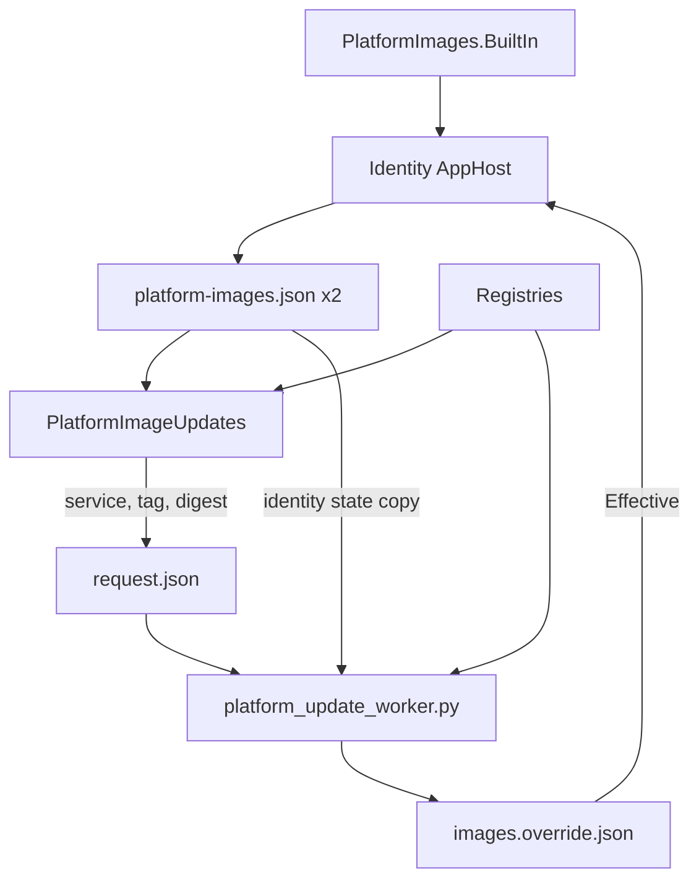

import WhoWhatWhy from '@site/src/components/WhoWhatWhy';
import Source from '@site/src/components/Source';

# Platform images

<WhoWhatWhy
  who="Developers changing the Spark's pinned third-party images, their update policy, the platform update worker or its page."
  what="The shared pins and policy in PlatformImages, the override file and its rules, the host's update service, the Python worker, the assistant tools and the NVIDIA device-list guard."
  why="The pins used to be literals in AppHost.cs, so a security patch to Authentik needed a release. The owner now applies it from the Spark updates page, and the code still decides what is allowed."
/>

For the people who press the buttons and run the worker, see [Spark updates in the guide](../guide/updates.mdx) and [Platform images in deploy](../deploy/platform-images.mdx).

## Layout

| Path | Role |
|---|---|
| `src/Lucia.Homelab.Server/Platform/PlatformImages.cs` | Built-in pins, policy classes, version rules, the override reader and the manifest writer. Linked into the identity AppHost. |
| `src/Lucia.Homelab.Identity.AppHost/AppHost.cs` | Reads the override, writes the manifest, builds every third-party container from a pin |
| `src/Lucia.Homelab.Server/Platform/PlatformImageUpdates.cs` | Finds offers through `ImageRegistry`, serves the page, writes the worker's request |
| `src/Lucia.Homelab.Server/Platform/PlatformImageEndpoints.cs` | `/api/host/platform-images` |
| `tools/runners/platform_images.py` | The worker's copy of the services, policies and version rules, request validation, registry reads and the device-list check |
| `tools/runners/platform_update_worker.py` | The setup-user service: verify, pre-flight, back up, deploy, wait, roll back |
| `src/Lucia.Homelab.Server/Assistant/AssistantPlatform.cs` | `list_platform_image_updates`, `apply_platform_image_updates`, `refresh_nvidia_device_list` |
| `src/Lucia.Homelab.Server/Assistant/Skills/BuiltIn/platform-image-updates/SKILL.md` | The built-in skill on safe use |
| `src/frontend/src/PlatformImagesSection.tsx`, `platformImages.ts` | The section on the Spark updates page, and the dashboard badge's parser |

## Who trusts what



The host container runs as the setup user, so anything in its data directory is writable by it. The worker therefore reads the running pins from the identity state copy of the manifest, which the host can't reach, and treats `request.json` as a wish: it reads the digest from the registry itself and checks the policy again. The AppHost, in turn, refuses an override it wouldn't have written. Three readers, each checking the one before.

## Pins and policy

Each pin is a record with the service key, the registry, the repository, the tag, the digest, the policy and the Compose services that run it:

```csharp title="src/Lucia.Homelab.Server/Platform/PlatformImages.cs"
new("authentik", "Authentik", "ghcr.io", "goauthentik/server", "2026.8.5",
    "sha256:602227a86455d6772e3d16b7d852713c4f864f40df5df894abd1285bb53979a5", Authentik, ["identity-server", "identity-worker"]),
```

The AppHost builds every container from one, so Authentik's server and worker can't drift apart:

```csharp title="src/Lucia.Homelab.Identity.AppHost/AppHost.cs"
IResourceBuilder<ContainerResource> Image(string name, string service)
{
    var pin = Pin(service);
    var container = builder.AddContainer(name, pin.Repository, pin.Tag).WithImageSHA256(pin.Sha256);
    return pin.Registry == "docker.io" ? container : container.WithImageRegistry(pin.Registry);
}
```

`Candidates(policy, current, tags)` lists what a class offers, and `Allowed(policy, current, candidate, tags)` says whether one move is permitted. They read tags with `Version`, a copy of `StackImages.Version`; the AppHost can't reference the server, and the domain checks assert the two agree. A tag only compares with tags of the same shape, so `16.15-alpine` never meets `16.16` and `v3.7.16` never meets `v3.7`.

Authentik's next line is the smallest `year.minor` above the running one among the registry's newer tags of the same shape. Release candidates have a different shape and never count.

## The override

`Effective(json, out kept)` returns the pins to deploy. An entry replaces a built-in pin while it is newer:

```csharp title="src/Lucia.Homelab.Server/Platform/PlatformImages.cs"
var newer = Compare(builtIn.Tag, tag) > 0
    || (tag == builtIn.Tag && digest != builtIn.Digest && replacedTag == builtIn.Tag && replacedDigest == builtIn.Digest);
```

The `replaces` record is what makes rebuilds safe. A rebuild has no newer tag to compare, so the entry remembers the built-in digest it replaced. Once a Lucia release moves the built-in pin to the same tag with any other digest, the entry no longer matches and is dropped. `kept` is the file without dropped entries, which the AppHost writes back.

## The host

`PlatformImageUpdates` reads `lucia-platform-updates/platform-images.json` (falling back to the built-in pins until a deploy writes one), and `PlatformImageChecks` calls `Check` every minute. For each pin older than six hours in its cache it lists tags and reads digests through `ImageRegistry`, the catalog's registry client, then builds `PlatformOffer`s: a `rebuild` when the running tag's digest moved, plus whatever `Candidates` returns. Release notes come from a per-service URL table, not image labels, so each link points at the exact version.

`Apply` turns a request into one `request.json`. The page names a service and a tag; the assistant names services and `patchOnly`. Either way the digest comes from the cached offer, and `Preferred` picks patches, then rebuilds, then minors, then a release line. The service refuses a release line alongside anything else, a busy or silent worker, and a pending request.

`seen.json` keeps when each offer first appeared. `Get` turns patches to Authentik, the gateway and the CA older than seven days into `securityWaiting`, which the dashboard's Spark card shows.

## The worker

`platform_update_worker.py` follows `spark_model_worker.py`: a generation counter, exact JSON keys, the `activation_worker` file helpers, a 10-second heartbeat, a user unit and a check that it runs from `~/.local/share/lucia/bootstrap/app/tools/runners/`. The update itself runs on a thread so the heartbeat keeps going during a multi-minute deploy, and the service waits for that thread before it stops.

`Worker.apply` is the order of operations: `plan` (registry and policy), pre-flight, then `deploy` under the two deploy locks. `deploy` keeps the previous override's bytes and, for a release line, the dump path, so the `except` branch can restore both. Errors reach the owner as their first line; `Provisioner.run` has already redacted secrets from command output.

## The NVIDIA device list

The package worker is root and runs from its own copy in `/usr/local/lib/lucia`, so it can't import the other workers' module. `gpu_devices` and `HOST_PATH` are duplicated in <Source path="tools/packages/package_worker.py" /> and `platform_images.py`, and `check_platform_images.py` runs both on the same fixture. A `hostPath:` line scan is enough: the spec is generated, one key per line, and PyYAML isn't installed on the Spark.

## Extending it

To add a platform image:

1. Add a `PlatformPin` to `BuiltIn` and build its container with `Image(name, service)` in the AppHost.
2. Add the service and policy to `SERVICES` in `platform_images.py`, and to the containers the worker waits for when it has a new one.
3. Add its release-notes URL to `PlatformImageUpdates.Notes`, and to `Disruption` if it carries web traffic.

To change a policy, change `Candidates` and `Allowed` in C# and `allowed` in Python together; both test files have the same cases.

## Tests

| Command | Covers |
|---|---|
| `dotnet run --project tests/Lucia.Homelab.DomainChecks` | `PlatformImageChecks`: version parity, policies, every override rule, the manifest, the host's requests and refusals, and the files the installers ship |
| `dotnet run --project tests/Lucia.Homelab.AssistantChecks` | The tools' tiers, refusals and the built-in skill |
| `uv run --no-project python tools/runners/check_platform_images.py` | The worker's policy, request and manifest validation and the device-list scan |
| `uv run --no-project python tools/packages/check_worker.py` | The `refresh-gpu-devices` action and its fallback |
| `npm test` in `src/frontend` | `platformImages.test.mjs` and the `gpuDevices` parsing in `packageUpdates.test.mjs` |
