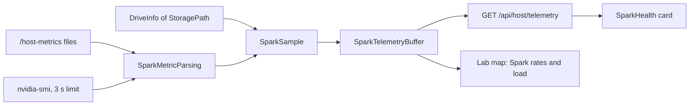

import WhoWhatWhy from '@site/src/components/WhoWhatWhy';
import Source from '@site/src/components/Source';

# Spark telemetry

<WhoWhatWhy
  who="Developers changing the Spark health card, the sampler, the telemetry relay or the generated Grafana dashboards."
  what="The in-process sampler and its ring buffer, the parsing rules, the health states, the relay configuration, and how Prometheus tiers feed the dashboards."
  why="The Home page needs honest numbers with no setup, so the host measures itself. History and fleet-wide charts need a real metrics store, so the same data also flows through a relay to the Observability app."
/>

Two things share the name "telemetry" and they are separate on purpose.

| | Spark health card | Observability pipeline |
|---|---|---|
| Source | `/proc` files and `nvidia-smi`, read by the host | node-exporter, nvidia_gpu_exporter, docker_stats, apps' OTLP |
| Storage | An hour of samples in host memory | Prometheus and Thanos in the Observability app |
| Always on | Yes, on the Spark | Only while an Observability app is installed |
| Used by | Home page, lab map, assistant `get_spark_health` | Grafana dashboards, the lab map's traffic rates |

For the user's view, see [Spark health](../guide/spark-health.mdx). For running it, see [Observability](./observability.mdx) and [Configuration](../deploy/configuration.mdx).

## Layout

| Path | Role |
|---|---|
| `Telemetry/SparkTelemetryService.cs` | Options, DI, the `GET /api/host/telemetry` endpoint, the sampling `BackgroundService` |
| `Telemetry/SparkTelemetryData.cs` | Records, the pure `SparkMetricParsing` functions, `SparkTelemetryBuffer` |
| `Telemetry/TelemetryRelay.cs` | Relay config and compose generation, `ControllerRelay`, `TelemetryForwarder` |
| `Telemetry/MetricTiers.cs` | The recording-rule tiers behind the longer charts |
| `Telemetry/HardwareDashboard.cs`, `ContainersDashboard.cs`, `InferenceDashboard.cs` | Grafana dashboards as C# objects |
| `src/frontend/src/SparkHealth.tsx`, `sparkTelemetry.ts` | The card and its parser |
| `tests/Lucia.Homelab.TelemetryChecks` | Console checks for parsing and the buffer |

## The sampler

`SparkTelemetryService` wakes every 10 seconds (`SparkTelemetryBuffer.IntervalSeconds`). In production the host runs in a container, so `/proc` would describe the container. The installer bind-mounts six host files read-only under `/host-metrics`, and the options name that folder:

```csharp title="src/Lucia.Homelab.Server/Telemetry/SparkTelemetryService.cs"
public sealed class SparkTelemetryOptions
{
    public bool Enabled { get; set; }
    public string ProcDirectory { get; set; } = "/host-metrics";
    public string StoragePath { get; set; } = "/data";
}
```

Each metric is read inside `Read(name, action)`. A failure adds the metric's name to `Unavailable` and logs the exception type. It never stops the others, so a Spark without readable GPU sensors still shows CPU and memory.



### Parsing rules

`SparkMetricParsing` is pure and static, so `TelemetryChecks` can feed it text directly. The rules exist because each source has a trap:

- **CPU.** `Cpu` sums the first eight fields of the `cpu` line. `guest` and `guest_nice` are already inside `user` and `nice`, so counting them again would inflate use. `CpuPercent` returns null for the first sample, a counter that went backwards, or a zero interval. A reset must not turn into a number.
- **Memory.** `MemAvailable`, not `MemFree`. Linux caches freely, and `MemFree` reads as "full" on a healthy box. Anything but kB units throws.
- **Network.** The default-route interface is chosen from `/proc/net/route` (destination `00000000`, the up flag, lowest metric), so Docker bridges never win. Rates are byte deltas over the real elapsed time. A counter reset or an interface change returns null.
- **GPU.** `nvidia-smi --id=0 --query-gpu=name,utilization.gpu,temperature.gpu,power.draw`. The GB10 reports `[N/A]` for some fields, which parse to null and not zero. Out-of-range values throw.

```csharp title="src/Lucia.Homelab.Server/Telemetry/SparkTelemetryData.cs"
public static double? CpuPercent(CpuCounters previous, CpuCounters current)
{
    if (current.Total <= previous.Total || current.Idle < previous.Idle || current.Cores != previous.Cores) return null;
    var total = current.Total - previous.Total;
    var idle = current.Idle - previous.Idle;
    return idle > total ? null : 100d * (total - idle) / total;
}
```

The `nvidia-smi` call has a 3-second timeout, a 4,096-character output cap, and kills the process tree if it hangs. A wedged driver cannot stall the sampler or the host.

## The buffer and the health states

`SparkTelemetryBuffer` is a locked `Queue<SparkSample>`. It keeps `RetentionSeconds = 3600`, at most 361 samples. If a new sample is older than the last one, the clock moved backwards, so the queue is cleared, and the service logs that. A timeline that jumped is worse than a short one.

`Snapshot` computes the state shown on the card, checked top to bottom:

```csharp title="src/Lucia.Homelab.Server/Telemetry/SparkTelemetryData.cs"
var (state, message) = !enabled ? ("Unavailable", "Spark monitoring is not configured.")
    : latest is null ? (_hasCollected ? ("Unavailable", "No host readings are available from the last hour.")
        : ("Starting", "Waiting for the first host readings."))
    : now - latest.Timestamp > TimeSpan.FromSeconds(30) ? ("Stale", "The latest host readings are out of date.")
    // ...
    : latest.StorageTotalBytes is > 0 && latest.StorageAvailableBytes / (double)latest.StorageTotalBytes < 0.05
        ? ("Attention", "The host volume has less than 5% space available.")
    : latest.MemoryTotalBytes is > 0 && latest.MemoryAvailableBytes / (double)latest.MemoryTotalBytes < 0.03
        ? ("Attention", "The host has less than 3% memory available.")
    : latest.Unavailable.Length > 0 ? ("Partial", "Some host readings are unavailable.")
    : ("Healthy", "Spark is reporting normally.");
```

The thresholds are deliberately blunt. Memory below 3% available matters on a box that keeps a 30 GB model resident. Disk below 5% matters because model downloads and Docker images both fill the same volume.

`UnifiedMemory` is set when the GPU name contains `GB10`. The card uses it to say "Unified memory" and to explain that separate VRAM figures do not exist.

## The frontend

`SparkHealth.tsx` fetches `/api/host/telemetry` every 10 seconds while the tab is visible, aborts the request when it is hidden, and refreshes on return. It renders only for owners. `parseSparkTelemetry` validates every field and turns a malformed one into null. The "Last hour" trend draws gaps for missing readings and never interpolates.

## The relay and the generated dashboards

When an Observability app is installed, each managed machine runs a relay, an OpenTelemetry collector that listens on loopback (OTLP gRPC 14317, HTTP 14318), scrapes node-exporter on `127.0.0.1:19100` and, with NVIDIA GPUs, nvidia_gpu_exporter on `127.0.0.1:19835`, labels everything with `host.name` and `lucia.node`, and forwards to the app. `TelemetryRelay.Config` builds the YAML and `Compose` wraps it.

The Spark cannot read the Observability app's credentials, so its relay sends through the controller: `POST /api/host/telemetry/relay/v1/{signal}` with a generated token in `X-Lucia-Relay`. `ControllerRelay` writes `relay.yaml` and keeps `relay-token` in `Telemetry:RelayDirectory`. The endpoint is anonymous but checks the token with `CryptographicOperations.FixedTimeEquals`, forwards to wherever the app is now, and wraps the forward in `SuppressInstrumentationScope` so forwarding does not generate telemetry about itself. `TelemetryForwarder` does the same job for the controller's own traces, metrics and logs.

`MetricTiers` exists because Prometheus keeps raw samples for about an hour. Thanos rulers record averaged series into 1-minute, 30-minute, 1-hour and 4-hour tiers, each built from the one before and kept for 6 hours, 24 hours, 7 days and 30 days. Gauges keep their average (`:avg`), counters their average rate (`:rate`) and delta counters their total (`:sum`). A chart then asks for "the finest resolution still kept":

```csharp title="src/Lucia.Homelab.Server/Telemetry/MetricTiers.cs"
internal static readonly (string Name, string Lookback, string Keep)[] Tiers =
    [("1m", "2m", "6h"), ("30m", "1h", "24h"), ("1h", "2h", "7d"), ("4h", "8h", "30d")];
```

The three dashboards (Hardware, Containers, Inference) are plain C# objects serialized to Grafana JSON, not hand-edited files, so queries can share the tier helpers. The Inference dashboard notes what each engine can and cannot report: llama.cpp keeps only running totals, and TensorFold does not count KV cache reuse.

## Extending it

- **A new host metric:** add a reader and a parser to `SparkMetricParsing`, a field on `SparkSample`, a `Read(...)` call in the sampler, and the parser in `sparkTelemetry.ts`. Add a case to `TelemetryChecks`.
- **A new chart:** add the metric to `MetricTiers.Gauges` or `Counters` so it gets recorded tiers, then query it through `MetricTiers.Gauge` or `Rate` in a dashboard.
- **A new health rule:** add a branch in `Snapshot`. Order matters, since the first match wins.

## Tests

```powershell
dotnet run --project .\tests\Lucia.Homelab.TelemetryChecks\Lucia.Homelab.TelemetryChecks.csproj
```

The checks use a manual clock and text fixtures. They cover the double-counted guest time, `MemFree` versus `MemAvailable`, container bridges losing to the real interface, counter resets, an unsupported GPU field becoming null, the 361-sample boundary, each health state and a clock rollback. The card's parser has its own test, `sparkTelemetry.test.mjs`, run by `npm test` in `src/frontend`.
