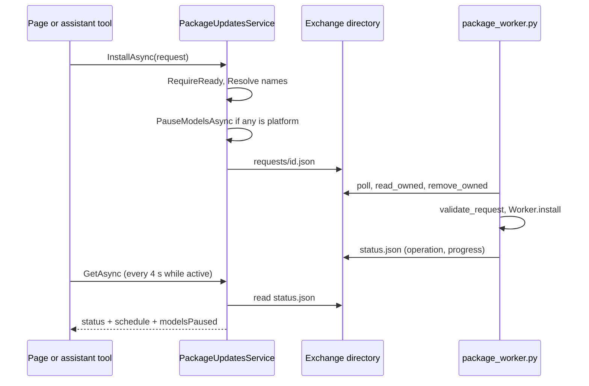
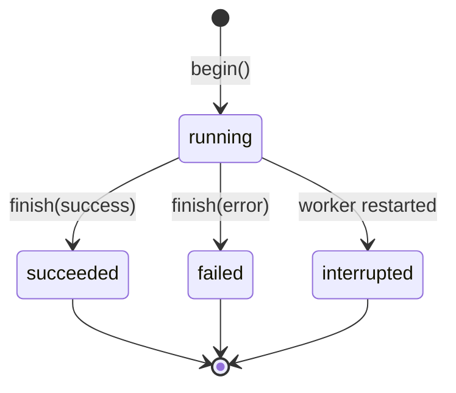

import WhoWhatWhy from '@site/src/components/WhoWhatWhy';
import Source from '@site/src/components/Source';

# Spark updates

<WhoWhatWhy
  who="Developers changing package updates, the worker protocol, the schedule or the Spark updates page."
  what="The service in the host, the Python worker, the file protocol between them, the state machine of a task, and the places to extend each."
  why="The web host runs without root. The only safe way to let it install packages is a worker that accepts a closed set of actions and treats every byte from the host as hostile."
/>

For the people who use it and run it, see [Spark updates in the guide](../guide/updates.mdx) and [Spark updates in deploy](../deploy/spark-updates.mdx).

## Who touches it and why

Three parties write to the exchange directory. The host writes requests and the schedule. The root worker writes status and responses. The owner changes things only through the portal or the assistant, never by editing the files. That split is the design: the worker's input is a small JSON document whose every field it validates, and the host never reads anything from the worker that it did not bound first.

## Layout

| Path | Role |
|---|---|
| `src/Lucia.Homelab.Server/Packages/PackageUpdatesService.cs` | Options, records, the service, the scheduler hosted service |
| `src/Lucia.Homelab.Server/Packages/PackageUpdatesEndpoints.cs` | DI registration, `/api/host/packages` routes, the error filter |
| `tools/packages/package_worker.py` | The root worker, plus its `install` command |
| `tools/packages/check_worker.py` | Pure checks for requests, classification and apt parsing. It never runs apt. |
| `src/frontend/src/SparkUpdates.tsx`, `packageUpdates.ts` | The page and its parser and helpers |
| `src/Lucia.Homelab.Server/Assistant/AssistantTools.cs` | `get_spark_updates`, `check_spark_updates`, `install_spark_updates` |

## Request flow



Every route returns a JSON object. Errors use one shape, produced by `PackageUpdatesFilter`:

```json
{ "error": { "code": "update_busy", "message": "Another update task is running. Wait for it to finish." } }
```

Unexpected exceptions are logged by type only and surface as `503 updates_unavailable`. Nothing from the worker's own text reaches the browser unbounded.

## The host side

`ReadWorker` decides whether the worker can take work. A missing or oversized file, a different `schemaVersion` or an old heartbeat all mean "not ready":

```csharp title="src/Lucia.Homelab.Server/Packages/PackageUpdatesService.cs" {4,7}
var path = Path.Combine(Root, "status.json");
DomainOnboardingStore.RejectLinks(path);
var info = new FileInfo(path);
if (!info.Exists || info.Length > 2 * 1024 * 1024) return (null, false);
var status = JsonNode.Parse(File.ReadAllBytes(path)) as JsonObject;
var checkedAt = status?["checkedAt"]?.GetValue<string>() is { } text && DateTimeOffset.TryParse(text, out var at) ? at : default;
return (status, status?["schemaVersion"]?.GetValue<int>() == 1 && DateTimeOffset.UtcNow - checkedAt < TimeSpan.FromSeconds(90));
```

`Resolve` turns the owner's selection into a validated list. It is the one place that decides what an install may contain:

```csharp title="src/Lucia.Homelab.Server/Packages/PackageUpdatesService.cs"
var available = Updates(status).ToDictionary(Name, u => u["platform"]?.GetValue<bool>() == true);
if (packages is null)
    return available.Where(pair => includePlatform || !pair.Value).Select(pair => pair.Key).Order().ToArray();
if (packages.Length > 1000 || packages.Distinct().Count() != packages.Length || packages.Any(p => p is null || !PackageName().IsMatch(p)))
    throw new PackageUpdatesException(400, "invalid_packages", "The update selection is invalid.");
if (packages.FirstOrDefault(p => !available.ContainsKey(p)) is { } missing)
    throw new PackageUpdatesException(409, "update_unavailable", $"{missing} is no longer an available update. Check for updates and review the list again.");
if (!includePlatform && packages.Any(p => available[p]))
    throw new PackageUpdatesException(400, "platform_confirmation", "Platform updates need their own confirmation.");
```

`null` means "everything that is available", which is how a scheduled window and the **Update everything** button work. The worker repeats these checks. The host check gives a clean error. The worker's is the one that counts.

Requests go out through `WriteRequestAsync`, which stamps a random 128-bit id, the schema version and the action onto the fields, then writes the file with the same atomic helper the domain onboarding code uses:

```csharp title="src/Lucia.Homelab.Server/Packages/PackageUpdatesService.cs"
var id = Convert.ToHexStringLower(RandomNumberGenerator.GetBytes(16));
fields["schemaVersion"] = 1;
fields["id"] = id;
fields["action"] = action;
fields["requestedAt"] = DateTimeOffset.UtcNow.ToString("O");
await DomainOnboardingStore.WriteJson(Path.Combine(Root, "requests", id + ".json"), fields, ct);
```

Concurrency is cooperative. `Busy` is "the status has an `operation`". `PendingRequest` is "a request file younger than 10 minutes exists". `RequireReady` checks both, so two quick clicks cannot queue two installs. Changelog requests skip `RequireReady`, since they are read-only and the worker runs them in a thread.

### The scheduler

`PackageUpdatesScheduler` is a `BackgroundService` on a 15-second `PeriodicTimer`. Each tick calls `TickAsync`, which does two things:

1. `ResumeModelsIfDoneAsync`, described below.
2. If `schedule.json` holds a window that is due, run it, or record it as `missed` when it is more than 60 minutes late.

A `SemaphoreSlim` guards `schedule.json`. A run records its outcome only if `CreatedAt` still matches, so an owner who edits the window while it runs does not lose the edit.

### Pausing Local AI

`InstallResolvedAsync` pauses Local AI when any selected package is `platform`:

```csharp title="src/Lucia.Homelab.Server/Packages/PackageUpdatesService.cs"
await DomainOnboardingStore.WriteJson(PausePath, new { version = 1, pausedAt = DateTimeOffset.UtcNow }, ct);
await runtime.UnloadAsync(ModelKind.Chat, ct, keepSelection: true);
await runtime.UnloadAsync(ModelKind.Embedding, ct, keepSelection: true);
runtime.StartupError = "Local AI is paused while platform updates install. Lucia reloads it when they finish.";
```

The pause is a file, not memory. A reboot, or a restart of Lucia's own container in the middle of a Docker update, loses process state. `HostModelStartup` checks `PackageUpdatesOptions.ModelsPaused` and defers loading while the file exists. The scheduler's tick deletes the file when the worker is ready, idle and has nothing queued, and not rebooting. It then reloads the saved selection through `ModelCatalog.ReadSelectionAsync`. A file older than three hours is treated as abandoned.

## The worker

`package_worker.py` has four parts.

**Safe file exchange.** `open_directory` walks from `/` one component at a time with `O_NOFOLLOW`, and rejects any ancestor that is not owned by root or the Lucia owner, or that is group- or world-writable. `read_owned` additionally requires a regular file, the owner's uid, a single hard link, at most 16 KiB and mode `0600`-or-tighter. `write_owned` writes a temporary file, `fsync`s, chowns it to the owner and renames it into place.

**Validation.** `validate_request` returns a normalized dictionary or raises. Unknown fields, a different schema version, an id that differs from the file name and duplicate JSON keys all fail:

```python title="tools/packages/package_worker.py"
if not isinstance(value, dict) or value.get("schemaVersion") != SCHEMA or value.get("id") != request_id:
    raise ValueError("Unsupported request.")
action = value.get("action")
if action not in ACTIONS:
    raise ValueError("Unknown action.")
allowed = {"schemaVersion", "id", "action", "requestedAt"}
```

**Classification and parsing.** `classify(name, origins)` returns `(platform, restart)` from the package name and its apt origins. `parse_simulation` reads `Inst` and `Remv` lines from `apt-get -s`. `parse_held` splits "kept back" from "phased" packages. `parse_needrestart` reads `needrestart -b`. `scan` joins them with `python3-apt`, imported lazily so the pure checks run without it.

**The loop.** `Worker.run` ensures the directories, publishes status, starts a 15-second heartbeat thread, scans, then loops: poll requests every 5 seconds, rescan when the watched files change or 10 minutes pass. `begin` and `finish` bracket each task and keep `operation` and `history` consistent. A task that was running when the worker restarted becomes `interrupted` in `load_state`.



Long commands go through `run`, which starts them in their own session (`start_new_session=True`) with a deadline. A worker restart therefore leaves apt running, which is what you want when dpkg is half-way through a package.

### Why a worker, and why these choices

- **Fixed actions beat a command whitelist.** Whitelisting `apt-get` with arguments still lets the argument vary. Six named actions have no free text except package names, which match a regex, and `--only-upgrade` ensures a name cannot install something new.
- **Files beat a socket.** A directory the owner can inspect, with atomic writes and no listener, adds no network surface and survives restarts of either side.
- **The worker re-derives everything.** It does not trust `platform` from the host. It reads its own snapshot.
- **No removals.** An update that would remove packages is refused after a simulation. An unattended removal on a controller is a bad surprise.
- **Plain failure text.** `plain_failure` maps apt's output to sentences a person can act on. The raw output goes to a log file and the last 60 lines to the status.

## The frontend

`SparkUpdates.tsx` polls `/api/host/packages` every 60 seconds, or every 4 seconds while something is active (an operation, a queued request, a reboot, a scan or paused models). `parseSparkUpdates` in `packageUpdates.ts` coerces the response and drops anything malformed. New everyday updates start selected, and platform updates never do. The page reads `restart` on each package to warn before installing something that needs a restart.

## Extension points

To add a worker action:

1. Add it to `ACTIONS` and, if it takes fields, to `validate_request`.
2. Handle it in `Worker.handle`, using `begin`, `apt` and `finish` so progress and history work.
3. Add a method to `PackageUpdatesService` that calls `SubmitAsync`, and a route.
4. Add a case to `check_worker.py`.

To change what counts as platform or what needs a restart, edit `PLATFORM_NAME`, `SPARK_RESTART` and `LUCIA_RESTART`, then the matching asserts in `check_worker.py`.

## Tests

```bash
python3 tools/packages/check_worker.py
```

It prints `package worker checks passed`. It tests request validation (including injection attempts such as `curl; reboot`), classification, source labels, apt parsing, failure messages and progress. Python is not installed on Windows dev machines, so run it with `uv run`, in WSL or on the Spark.

Nothing in `tests/` covers the C# service. The Python worker checks and the frontend's `packageUpdates.test.mjs` (run with `npm test` in `src/frontend`) are the automated tests for this feature.
