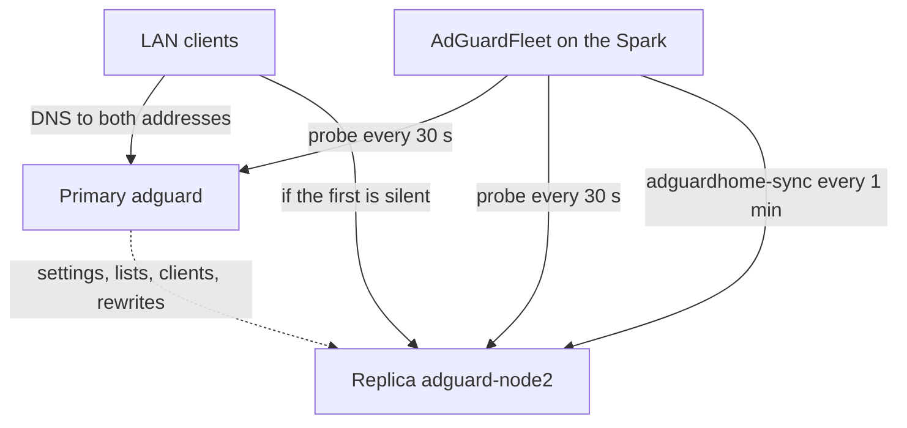

import WhoWhatWhy from '@site/src/components/WhoWhatWhy';

# AdGuard HA

<WhoWhatWhy
  who="DevOps engineers who own the network's DNS."
  what="The AdGuard fleet: one instance per managed server, each on its own address, synced every minute, with failover to the freshest replica."
  why="DNS is the service whose outage gets blamed on everything else. A single AdGuard means a reboot takes down name resolution for the house."
/>

Lucia runs AdGuard Home on every managed server, gives each copy its own IPv4 address, copies one primary's settings to the others every minute, and promotes a replica if the primary stops answering. There is no VRRP, keepalived or floating address. Each instance keeps its address for life. Failover means changing which instance is the primary, not moving an IP.



## Prerequisites

The fleet controller waits for three things and the AdGuard page names the one that is missing.

| Prerequisite | Message when missing |
|---|---|
| An AdGuard connection in **Settings → AdGuard** | Connect AdGuard first. |
| An active domain in **Settings → Domains** | Finish domain setup first. |
| The **AdGuard Home** catalog app installed once from **Apps** | Install AdGuard Home from Apps first. |

Installing the catalog app is the opt-in. Turn on **Manage AdGuard's certificate** as well: a new instance does not finish setup until Lucia has a certificate to hand it.

## What the controller does

`AdGuardFleet` is a hosted service on the Spark. It ticks every 30 seconds, and again as soon as the set of instances changes.

**One instance per server.** While the primary is healthy, it looks for online managed servers whose runtime is Ready and that have never had an instance. On each it saves an `adguard-<node>` app from the catalog template. It records every server that ever had one in `seen`, so deleting an instance does not bring it back.

**An address of its own.** The first instance's address is chosen when you install from the catalog. After that Lucia picks the first free address in the same /24 after the highest AdGuard address in use (`NextAddress`). The node agent then:

1. checks the address is free with `arping -D`;
2. adds it to the matching interface with `ip addr add`;
3. announces it with `arping -U`.

If another device answers, the app reports `InUse` and the fleet moves the instance to the next address. When an app moves between servers the old server drops the address first. After a reboot the agent reclaims its addresses through the same check. If the /24 runs out, the page says "There's no free address after the AdGuard addresses for another instance."

**First-run setup.** Lucia completes AdGuard's first-run wizard with the same account as your AdGuard connection, then pushes the certificate once over plain HTTP to the instance's address. Everything after that uses HTTPS. Each instance gets a local name `adguard-<node>.<namespace>`.

**The compose file.** The catalog app publishes `53/tcp`, `53/udp`, `80/tcp`, `443/tcp`, `443/udp`, `853/tcp`, `853/udp` and `3000/tcp` on `${LUCIA_ADDRESS}` only, so each instance binds just its own address.

## Primary and sync

The primary is the instance your AdGuard connection points at, the one Lucia writes DNS records to, and the one the `adguard` name resolves to. On first run it is the instance named `adguard`, or the oldest instance if there is none.

Once a minute `adguardhome-sync` (at `/opt/adguardhome-sync/adguardhome-sync`, in the host image) runs once per healthy replica from the primary. DHCP and TLS settings are excluded and stay per instance:

```csharp title="src/Lucia.Homelab.Server/Host/AdGuardFleet.cs"
["FEATURES_DHCP_SERVER_CONFIG"] = "false", ["FEATURES_DHCP_STATIC_LEASES"] = "false", ["FEATURES_TLS_CONFIG"] = "false",
```

A run has a one-minute deadline. The tool exits 0 even when a step fails, so Lucia treats any error-level JSON log line as a failure and keeps a sanitized message. If the binary is missing the page says "adguardhome-sync isn't in this host image, so instances aren't kept in sync."

Make changes on the primary. Edits on a replica are overwritten at the next sync.

## Failover

An instance is healthy if a DNS probe succeeded within the last 90 seconds. If the primary fails for **3 minutes**, Lucia promotes the healthy instance that synced most recently, provided that sync was within the last **10 minutes**. The page shows when and from which instance.

Lucia never fails back. When the old primary returns, it stays a replica until an owner picks **Make primary** (`POST /api/host/connections/adguard/instances/{name}/primary`). That works only for a running instance that finished setup (otherwise `409 adguard_instance_unhealthy`). Its settings then replace the others' within a minute.

:::caution
**Make primary** makes that instance's lists, rewrites and clients the source of truth. Anything that exists only on the old primary is overwritten.
:::

## Timings

| What | Value |
|---|---|
| Controller tick | 30 s |
| Settings sync | 1 min |
| Healthy if it answered within | 90 s |
| Failover after primary is down for | 3 min |
| Replica must have synced within | 10 min |
| Sync deadline | 1 min |
| Automatic failback | none |

## The manual part: DHCP DNS

Lucia does not edit UniFi's DHCP settings. Set the network's DHCP DNS servers to every instance address by hand, for example `192.0.2.20` and `192.0.2.21`. Clients then fall through to the next server when the first is silent. Lucia's part is making sure the next server has the same answers.

## The Spark is not in the fleet

The fleet is managed servers only. The Spark does not run an AdGuard instance. A lab with one server has one instance and nothing to fail over to, so you need at least two servers for this to help.

## State and verification

The fleet's state is `domains/adguard-fleet.json`, written atomically. It holds the primary, the seen servers, and per-instance health, setup and sync timestamps and the last error.

```bash
# Each instance answers DNS on its own address
dig +short @192.0.2.20 lucia.lab.example.com
dig +short @192.0.2.21 lucia.lab.example.com

# Fleet state: instances, health, primary, last promotion
curl -sS -H "Authorization: Bearer $LUCIA_OWNER_KEY" \
  https://lucia.lab.example.com/api/host/connections/adguard/instances

# Address held on a server
ssh node2 'ip -4 addr show | grep 192.0.2.21'
```

## Failure modes

| Symptom | Cause | Fix |
|---|---|---|
| "Another device answers on …; moving to …" | The address was in use | Wait; Lucia picks the next free one |
| Instance stuck in setup, "Waiting for AdGuard's certificate" | **Manage AdGuard's certificate** is off | Turn it on |
| "Waiting for AdGuard to start." | The container has not come up | Check the app on that server |
| Replica sync errors | A replica is down, or its AdGuard credentials differ | Check `SyncError` on the instance; the replica must use the connection's account |
| No promotion happens | No replica is healthy and synced in the last 10 minutes | Restore a replica, or choose **Make primary** by hand |
| Replica disagrees with the primary | An edit was made on the replica | It is overwritten at the next sync |

See also [Networking and DNS](./networking-and-dns.mdx) for the records Lucia writes into the primary, and [AdGuard and UniFi integration](../code/network-devices.mdx) for the code. The user-facing view is [Network](../guide/network.mdx).
