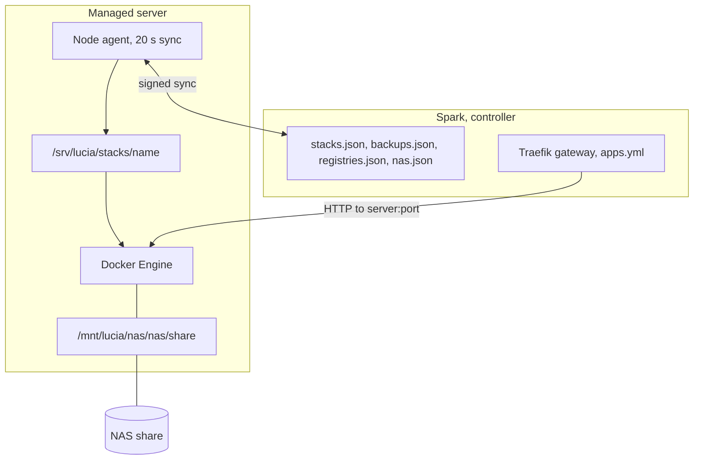

import WhoWhatWhy from '@site/src/components/WhoWhatWhy';

# Running apps

<WhoWhatWhy
  who="Operators who run a Lucia lab and need to find, check, back up and upgrade the apps on its servers."
  what="Where each stack's definition and data live, what the node agent writes, how traffic reaches an app, how backups and registry sign-ins work, and the rollout steps after a template change."
  why="An app that looks fine in the portal still fails at the Docker, NAS or network layer. You need to know which file or command to check."
/>

An **app** is a Docker Compose project that Lucia runs on one managed server. The Spark holds the definition. The server's node agent applies it with the Docker already installed there. Developers should read [Apps and stacks](../code/apps-and-stacks.mdx). This page covers operating them.

## Layout at a glance



## Where things live

### On the Spark

The controller keeps stack state in a `stacks` folder next to its onboarding state, one level up from `HardwareOnboarding:StateDirectory`. With the production setting `/data/onboarding`, that is `/data/stacks` inside the host container:

| File | Holds |
|---|---|
| `stacks.json` | Every stack: compose, environment (encrypted), manifest, desired state, revision |
| `backups.json` | The backup destination, its encrypted key, and each stack's last backup |
| `registries.json` | Registry sign-ins, secrets encrypted |
| `nas.json` | NAS servers and shares, SMB passwords encrypted |
| `external.json` | Web addresses for services Lucia doesn't run |

Encryption uses ASP.NET data protection, so the data-protection key ring in the Spark's state is part of what you must back up with them. A restored `stacks.json` without its key ring can't decrypt any stack's environment.

Node reports (container lists, backup status) are held in memory only. They reappear within one sync after a controller restart.

### On each server

| Path | Purpose |
|---|---|
| `/srv/lucia/stacks/<name>/` | One directory per app. Everything for that app is here |
| `compose.yaml`, `.env` | Written from the definition on every apply, mode private |
| `compose.lucia.json` | Override Lucia adds: volume bind mounts and log rotation |
| `volumes/<volume>/` | A named volume from the compose file, as a plain directory |
| `.lucia-applied.json` | What the agent last applied: revision, desired state, restart and pull counters, a hash |
| `.lucia-received`, `.lucia-sent`, `.lucia-restored`, `.lucia-backup.json` | Markers for moves, restores and the last backup |
| `/srv/lucia/stacks/.replaced-<name>-<time>/` | Data set aside by a move or restore. Delete it when you're sure |
| `/mnt/lucia/nas/<nas>/<share>` | A NAS share mounted by a systemd unit |
| `/etc/lucia/nas/<nas>.credentials` | SMB credentials, root only |
| `/etc/lucia/docker/config.json` | Registry sign-ins for Docker, root only |
| `/var/cache/lucia/restic` | restic's cache |

The Compose project name is `lucia-<name>`. Containers are `lucia-<name>-<service>-1`, so `docker ps --filter label=com.docker.compose.project=lucia-immich` lists one app.

Plain named volumes are rewritten to bind mounts at `/srv/lucia/stacks/<name>/volumes/<volume>`. Volumes marked `external` or with a custom driver stay as written and are **not** backed up or moved with the app.

## Placement, limits and requirements

| Limit | Value |
|---|---|
| Apps in total | 64 |
| Apps per server | 32 |
| Compose file | 128 KB |
| Env file | 32 KB |
| Combined size of one server's stacks | about 1.5 MB |
| Web addresses per app | 8 |
| NAS servers / shares per NAS | 16 / 32 |
| Registry sign-ins | 16 |

A new app goes to the pinned server, or to the eligible online server running the fewest apps. Requirements are strings checked against the server's last report: `gpu`, `gpu.vendor=nvidia`, `gpu.vram>=24G`, `memory>=32G`, `cuda=12`, `nas=<nas>/<share>`. Lucia adds `nas=` automatically for compose paths under `/mnt/lucia/nas`, so an app that mounts a share lands only where it's mounted.

Some catalog apps depend on other apps. CrowdSec needs Observability version 13 or later installed first and runs once at most; a new install that misses any of it gets `409 requires_app`, `409 requires_update` or `409 already_installed`. The catalog's `requires` entries carry `current: false` when the installed copy is too old. The catalog response lists each app's `requires` (with `installed`), `requiresWhy` and `single`, which the install page shows before you try. Existing installs are never refused on a re-render.

An app can also have direct names (`StackManifest.Names`): names under the domain that local DNS points straight at the app's server instead of the gateway. CrowdSec is the only one, because the gateway itself connects to it. A new install with direct names needs an active domain (`409 domain_required`), and the names share the checks of web addresses, so `409 route_in_use` covers a clash either way.

Moving an app takes its data: the source stops it and streams its directory as tar through the Spark to the target. The old copy stays on the source until you delete it. An app that is moving or restoring refuses edits until it finishes or you cancel.

## Routes through the gateway

With a domain active, each app route becomes `<host>.<namespace>` on the Spark's Traefik gateway, using the domain's wildcard certificate. The controller writes `apps.yml` next to `domain.yml` and Traefik reloads it. For a route of `grafana` on port 3030 at server `192.0.2.10`, the output looks like this:

```json
{
  "http": {
    "routers": {
      "app-observability-grafana": {
        "entryPoints": ["host"],
        "rule": "Host(`grafana.lab.example.com`)",
        "service": "app-observability-grafana",
        "tls": {}
      }
    },
    "services": {
      "app-observability-grafana": { "loadBalancer": { "servers": [{ "url": "http://192.0.2.10:3030" }] } }
    }
  }
}
```

A route with a gRPC port, as Observability's `otlp` has, adds a second router that matches `Content-Type: ^application/grpc` and forwards to `h2c://192.0.2.10:4317`. A route with a public name also answers on the `public` entrypoint, but only while public access is on, and only from Cloudflare's ranges. Local DNS points each name at the gateway. See [Networking and DNS](./networking-and-dns.mdx).

The gateway forwards to the server's address, so the app's port must be published on it. Catalog apps publish a `host:port` mapping for exactly this. An app with its own IP address (AdGuard) binds its ports to `${LUCIA_ADDRESS}` instead. The agent claims that address on the server's interface (after an `arping` check that nothing answers for it), sets `net.ipv4.ip_nonlocal_bind=1`, and records what it holds in `/var/lib/lucia-agent/addresses.json`.

## NAS storage

Shares are mounted on **every** managed server at the same path by plain systemd mount units named `mnt-lucia-nas-*.mount`. NFS shares use `_netdev,nofail,hard,noatime`. SMB shares use `cifs` with a credentials file under `/etc/lucia/nas`. Lucia drops a systemd drop-in for Docker (`docker.service.d/lucia-nas.conf`) so Docker starts after `remote-fs.target`, the point where network mounts are up.

A stack that references a share that isn't mounted yet is held with the state **Waiting**, rather than letting Docker bind an empty directory. To check:

```bash
systemctl status 'mnt-lucia-nas-*.mount'
findmnt /mnt/lucia/nas/<nas>/<share>
```

## Backups

Backups use restic into one repository on a NAS share you choose under **Apps → Backups**.

| Setting | Value |
|---|---|
| Schedule | 03:00 daily, in the time zone saved with the destination |
| Retention | 7 daily, 4 weekly, 6 monthly, per app |
| Repository | `/mnt/lucia/nas/<nas>/<share>/<folder>` |
| Tags | `lucia:stack=<name>`, `lucia:version=1` |
| Run limit | 12 hours |
| Install | `restic` is installed from apt on a node the first time it needs it |

Every node writes to the same repository. The Spark generates the repository password once and keeps it encrypted. The portal reveals it under **Show recovery key**, and so does `GET /api/host/backups/recovery`. Store a copy outside the Spark, because backups taken with a lost key can't be opened.

An app's mode is `live` or `stop`. `stop` runs `docker compose stop` for the length of the backup, which Plex, LiteLLM, Leantime, Object storage and CrowdSec use because their data is only consistent while stopped. Some apps exclude rebuildable paths such as downloaded models.

### Leantime's lockdown

Leantime is PHP, so its catalog compose hardens it beyond the other apps. Its containers run as uid 1000 with `cap_drop: [ALL]`, `no-new-privileges`, a read-only root, `pids_limit: 256` and a 1 GB memory limit. Only its data volumes (`userfiles`, `public-userfiles`, `plugins`, `logs`, `storage/framework`) and uid-1000 tmpfs mounts for `/run`, `/tmp`, `bootstrap/cache` and nginx's temp and log folders can be written. MySQL 8.4 sits alone on a Compose network with `internal: true`, so it publishes no port and has no route out. A one-shot `init` service runs `db:migrate` with the owner's email and a generated `ADMIN_PASSWORD`. The installer page is therefore never open, and each update migrates the database before the app starts. MySQL's healthcheck pings over TCP, because its first boot runs a server without networking that a socket ping reports as ready.

Once the Authentik client exists, `LEAN_OIDC_ENABLE` and `LEAN_DISABLE_LOGIN_FORM` both follow `LUCIA_SSO_ENABLED`. Owners sign in through Lucia, accounts are created as admins (role 40), and the password form only comes back if sign-in through Lucia is off. Leantime trusts `X-Forwarded-*` only from private addresses, which is how it sees HTTPS behind the gateway.

To open the repository without Lucia:

```bash
export RESTIC_REPOSITORY=/mnt/lucia/nas/<nas>/<share>/lucia   # or the path shown in the portal
export RESTIC_PASSWORD='<recovery key>'
restic snapshots --tag lucia:stack=immich
restic restore <snapshot> --target /srv/restore-test
```

A restore from the portal stops the app, restores into `.restore-<name>`, moves the current directory to `.replaced-<name>-<time>`, moves the snapshot into place, and applies the stack onto it. Paths the app excludes from backups are carried over from the old directory. Nothing is deleted.

Backups of a moving or restoring stack are skipped. A backup that fails because the share isn't mounted says so in its status.

## Registry sign-ins

Under **Settings → Registries**, add a host (`docker.io`, `ghcr.io`, your own), a username and a token. Lucia signs in to the registry first and refuses a bad secret. Every sync then writes `/etc/lucia/docker/config.json` on each server. Compose runs with `DOCKER_CONFIG=/etc/lucia/docker` while that file exists, so root's own `~/.docker` is untouched. Removing the last sign-in deletes the file.

To confirm on a server:

```bash
sudo test -f /etc/lucia/docker/config.json && echo present
sudo DOCKER_CONFIG=/etc/lucia/docker docker pull ghcr.io/<owner>/<private-image>:<tag>
```

Image update checks use the same sign-ins to read tags from private registries.

## Update and upgrade

There are two different upgrades.

**Image updates** change the tags an app runs. Lucia checks every 6 hours. **Update** in the portal (or `POST /api/host/stacks/<name>/upgrade-images`) takes the newer tags, bumps the pull counter, and the node runs `docker compose pull` then `up -d`. Major versions need `{"major": true}`. A catalog app keeps these as overrides until its template catches up.

**Template updates** change how Lucia writes the compose file. They arrive with a new server build, but **deploying the server doesn't touch installed apps**. An app whose installed `template.version` is lower than the catalog's `template.latest` shows an **Update** button in its settings. That saves it again and re-renders.

### Roll out a template change

After you deploy a server build whose catalog version for an app went up, re-render each installed stack of that app. As owner, with a CSRF token from `/api/auth/session`:

```bash
# 1. Read the current revision, placement and settings
curl -s -H "Authorization: Bearer $KEY" https://lucia.lab.example.com/api/host/stacks/observability

# 2. Re-render onto the new template version
curl -s -X PUT https://lucia.lab.example.com/api/host/stacks/observability \
  -H "Authorization: Bearer $KEY" -H 'Content-Type: application/json' \
  -d '{
    "compose": null, "env": null, "expectedRevision": 41,
    "manifest": {
      "schemaVersion": 1,
      "placement": { "node": "server-a", "require": [] },
      "template": { "id": "observability", "version": 11, "settings": { "grafana-host": "grafana", "otlp-host": "otlp",
        "grafana-port": "3030", "otlp-grpc-port": "4317", "otlp-http-port": "4318" } }
    }
  }'
```

Copy `placement` and `template.settings` from step 1 and set `version` to the new catalog version. The server renders the compose again, keeps its generated secrets, bumps the revision, and the node redeploys on its next sync. `expectedRevision` makes the call fail with `stack_changed` (409) if someone else saved first.

The examples send an owner API key as a bearer token. From a browser session instead, send the CSRF token from `/api/auth/session` in `X-CSRF-TOKEN`. The `lucia-stack-templates` skill shows both routes used in the project's own lab.

### Verify

```bash
sudo docker ps --filter label=com.docker.compose.project=lucia-observability
sudo docker compose -p lucia-observability -f /srv/lucia/stacks/observability/compose.yaml ps
cat /srv/lucia/stacks/observability/.lucia-applied.json
```

`appliedRevision` in the portal (or the revision in `.lucia-applied.json`) should equal the stack's revision. The state shows **Running** when every service is running and none is unhealthy. One-shot services that other services wait on (an init step) count as done when they exit with code 0.

## Failure modes

| Symptom | Cause | Check |
|---|---|---|
| State stays **Applying changes** | Image pull is slow, or compose is invalid | `journalctl -u lucia-node-agent`, then `docker compose ... config` in the stack directory |
| **Waiting** for a share | NAS unmounted or NAS offline | `findmnt /mnt/lucia/nas/...`, the NAS itself |
| **Waiting** for an address | Another device answers for the app's IP | `arping` from another machine. Choose a free address |
| **Failed**, retried every 2 minutes | The apply threw. The message holds the cause | The message in the portal. Fix, and it retries on its own |
| **Server not reporting** | No sync for more than 90 seconds | Is the agent running, is the Spark reachable. The agent logs `Stack sync failed; retrying` |
| Old catalog behaviour after a server deploy | The stack wasn't re-rendered | Compare `template.version` with `template.latest` and roll out |
| Backup status `Failed` with "isn't mounted" | The backup share isn't mounted on that server | Mount check above |
| Backup "kept the repository locked" | Another node's backup or prune ran past 30 minutes | Retry later. Don't `restic unlock` while another node is running |
| Pull fails for a private image | No registry sign-in, or the token expired | **Settings → Registries**, then the `docker pull` test above |

## Deleting

Deleting an app removes its definition. The node takes the containers down and removes `compose.yaml`, `.env`, `compose.lucia.json` and the applied marker. The `volumes/` directories and any `.replaced-*` folders stay. Remove them by hand when you're done with the data. A server with apps, or apps moving to or from it, can't be removed from Lucia until they're moved or deleted.
