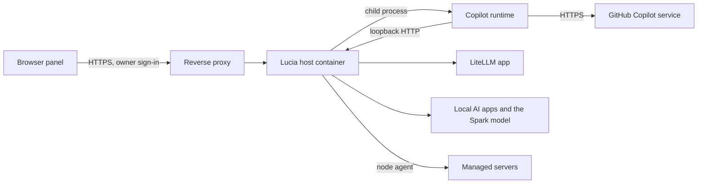

import WhoWhatWhy from '@site/src/components/WhoWhatWhy';

# Assistant

<WhoWhatWhy
  who="The person who runs the Spark and the managed servers."
  what="What the assistant depends on, where its state lives, which loopback routes the host lets through, what it can reach in the lab, and how to verify it."
  why="The assistant can run commands as root on your servers. You should know exactly which doors it has, and which ones are shut."
/>

The assistant is part of the Lucia host: the `lucia-homelab-host` container on the Spark. There is no separate service to install. The host starts a Copilot runtime as a child process, and the runtime talks to a model. Tools reach the rest of your lab through the same services the web page uses. For the user's side, see [Assistant](../guide/assistant.mdx) and [Assistant jobs](../guide/assistant-jobs.mdx). For the code, see [the developer page](../code/assistant.mdx).



## What it needs

| Need | For | Notes |
|---|---|---|
| An owner signed in to Lucia | Everything | Every `/api/assistant` route requires the `HostOwner` policy. See [Identity](./identity.mdx). |
| Outbound HTTPS to GitHub | Copilot models, the sign-in | Device flow at `github.com`, user lookup at `api.github.com`, then Copilot's own service. The runtime child inherits `HTTP_PROXY`, `HTTPS_PROXY` and `NO_PROXY`; the host's own sign-in calls go direct. |
| A GitHub account with Copilot | Copilot models only | Each owner signs in from the panel. The host holds the token. |
| The LiteLLM catalog app | `litellm:` models | Optional. The host mints a virtual key for each owner. |
| A model on the Spark, or the Local AI app on a node | `local:` models | Optional. See [Local AI](./local-ai.mdx). |
| `HostPlatform__InferenceApiKey` | The Spark's own model | At least 32 characters and different from the owner API key. |
| Node agents that report the `exec` feature | `run_command` | Update the agent first. See [Nodes](./nodes.mdx). |
| HTTPS on a name devices trust | Browser notifications | Web Push needs a secure context. See [Networking and DNS](./networking-and-dns.mdx). |

None of the model sources is required on its own. The assistant works with Copilot only, with local models only, or with both. A source that isn't ready says why in the model picker.

The Copilot runtime binary is downloaded at build and publish time for the target platform (a SHA-256-checked release from GitHub), so the running container makes no download for it.

## Configuration

The compose service for the host sets the settings that matter here. The paths are examples; yours come from your install.

```yaml title="host service environment (example)"
environment:
  Assistant__Directory: /data/assistant
  HostPlatform__InferenceApiKey: ${INFERENCE_API_KEY}
  HostAuthentication__DataProtectionKeysDirectory: /data/data-protection
  ASPNETCORE_HTTP_PORTS: "8080"
volumes:
  - /srv/lucia/data:/data
```

| Setting | Default | Meaning |
|---|---|---|
| `Assistant__Directory` | `Lucia/data/assistant` under local app data; `/data/assistant` in the container | Must be an absolute path. The host refuses to start otherwise. |
| `Assistant__GitHubClientId` | Lucia's public GitHub App | Overrides the app the device flow uses. It is a public client ID, so no secret is needed. |
| `Assistant__Model` | none | The model used when the panel picks none. Empty lets the runtime choose. |
| `HostPlatform__InferenceApiKey` | generated by the installer | Key the assistant presents to the Spark's `/v1` over loopback. |

Other settings are in [Configuration](./configuration.mdx).

## State and backups

All assistant state lives under `Assistant__Directory`, with one folder per owner:

```text
/data/assistant/
  users/<owner>/            settings, devices, chats, jobs
  github/<owner>.json       GitHub token, encrypted
  litellm/<owner>.json      LiteLLM virtual key, encrypted
  push-key.json             VAPID private key, encrypted
  runtime/                  Copilot runtime state
  workspace/                its working directory (kept empty)
```

Back up the whole `/data` bind mount, and keep `data-protection` with it. The GitHub token, the LiteLLM key and the push key are encrypted with ASP.NET Core Data Protection, and the keys for that live in `/data/data-protection`.

If the Data Protection keys are lost:

- Owners sign in to GitHub again. The old token file can't be read.
- A LiteLLM key that can't be read is replaced: the host mints a new one on the next use.
- Delete `push-key.json`. The host makes a new key, and each owner turns notifications on again for their devices.

Chats are JSON files, capped at 16 MB each. A bigger chat refuses new messages and tells the owner to start a new one.

## Loopback and the host proxy

The Copilot runtime runs inside the host container, so it reaches the host over `http://127.0.0.1:8080` (the first plain HTTP address the host listens on). Two path prefixes are used that way:

| Path | Who calls it | Why |
|---|---|---|
| `/v1` | The runtime, using `HostPlatform__InferenceApiKey` | The Spark's loaded chat model, as an OpenAI-compatible API |
| `/assistant-engine/v1` | The runtime, using a one-turn random token | The shim that writes a reasoning effort into requests for LiteLLM and Local AI models |

Normally the host proxy refuses requests that don't arrive over HTTPS on the public origin. For these two prefixes it makes one exception. The rule in `HostAuthentication.UseHostProxy` lets a request through only when all of these hold:

1. The connection's local address is loopback.
2. The path starts with `/v1` or `/assistant-engine`.
3. An `Authorization: Bearer` header is present.

The bearer is still checked after that. `/v1` needs a valid inference key. `/assistant-engine` is anonymous at the framework level, and the shim does its own check: the caller's address must be loopback, and the token must be one the host issued for a turn in progress. The token is 24 random bytes, lives in memory, and is removed when the turn ends. Anything else gets a 404.

The reverse proxy never reaches the host over loopback, since it connects through Docker's network. A request from outside that names these paths fails the origin check or gets a 404.

## What the assistant can reach

| Target | How | What it can do |
|---|---|---|
| Managed servers | Lucia's node agent | Read servers, containers and logs. Install updates, restart, update the agent. `run_command` runs a command as root (`bash`, `sh` or `python3`, up to 16 KB, limit up to 30 minutes, empty stdin, output tail of 32 KB, four commands at once per node). |
| Apps and stacks | The stack store | Read, save, install, start, stop, move, back up, restore, delete, publish. |
| The Spark | Host services | Read its health and updates, check for updates, install updates (never restarts it). |
| DNS | The host's resolver and AdGuard | Look up names and AdGuard rewrites. Read only. |
| UniFi | The saved controller connection | List clients. Read only. |
| Container registries | The registry protocol | Tag counts and digests. Private images use sign-ins from Settings → Registries. |
| The public web | `read_web_page` | Public sites only: up to 2 MB fetched, 20,000 characters per read. |
| Owner's browsers | Web Push | Notifications to devices the owner registered. |

It has no direct file access, no shell on the Spark and no access to GitHub beyond the model service. Commands run only on managed servers whose agent announces command support. A command outlives an agent restart, but its exit code is lost.

## Security boundaries

- **Policy sits on the server.** Each tool call passes a deny-by-default policy. Destructive tools always ask in a chat, and Plan mode refuses everything that changes the lab. Details are in the [developer page](../code/assistant.mdx).
- **Owner only.** Chats, settings, jobs and devices belong to one owner each. The folder name is a hash of the signed-in subject. A stable subject is required.
- **Secrets stay out of the model.** A secret card saves the value straight into an app's environment. Tool results pass through a redactor that masks credentials and the catalog's secret fields. A result that the redactor can't finish in time is withheld.
- **A clean child process.** The runtime starts in Empty mode: no built-in tools, no files, no shell, no ambient config. Its environment is a short allow-list (path, home, locale, temp folders, proxy variables and CA bundle paths), so `GH_TOKEN` and similar variables never reach it. The GitHub MCP server is disabled.
- **The web tool can't read your network.** `read_web_page` resolves the name itself and refuses private and reserved ranges (10/8, 172.16/12, 192.168/16, loopback, link-local, carrier-grade NAT and more). It follows redirects only within the same site, 5 hops at most, and it runs no scripts.
- **Bounded turns.** At most 50 tool calls per turn, 48 KB per tool result, and 30 minutes to answer an approval.
- **Push is narrow.** Subscriptions are accepted only from the known push services (Google, Mozilla, Apple and Microsoft), 20 devices per owner.
- **The risky tool.** `run_command` is root on a server. Treat approval of a command card like typing the command yourself over SSH. Don't allow `run_command` for a job.

Decisions are logged with the tool, tier, mode and the rule that matched, and counted on the `AgentGovernance` meter. Arguments are not logged. See [Observability](./observability.mdx).

## Verify it works

Use an owner API key (shown as `$LUCIA_OWNER_KEY`) against your public origin (`lab.example.com` here).

```bash
# 1. Model sources. Each source lists its models or a reason it has none.
curl -s -H "Authorization: Bearer $LUCIA_OWNER_KEY" \
  https://lab.example.com/api/assistant/models | jq '.sources[] | {id, models: (.models | length), reason}'

# 2. The owner's standing permissions.
curl -s -H "Authorization: Bearer $LUCIA_OWNER_KEY" \
  https://lab.example.com/api/assistant/settings | jq '{autoTools, hosts}'

# 3. Jobs, with next run and last status.
curl -s -H "Authorization: Bearer $LUCIA_OWNER_KEY" \
  https://lab.example.com/api/assistant/jobs | jq '.[] | {name, enabled, next, running}'

# 4. The shim must refuse callers that aren't on loopback. Expect 404.
curl -s -o /dev/null -w '%{http_code}\n' https://lab.example.com/assistant-engine/v1/models
```

Then, in the panel:

1. Pick a model and ask "List my servers." A reply that names your servers proves the model, the runtime and the read tools work.
2. Switch to Plan and ask it to restart an app. It should refuse and say Plan mode changes nothing.
3. In Execute, ask it to back up a small app. An approval card should appear.
4. For notifications, open **Settings → Notifications**, turn them on, then choose **Send a test**.

## Failure modes

| Symptom | Likely cause | Fix |
|---|---|---|
| Copilot group says "Sign in with GitHub" | No token for this owner, or GitHub ended the sign-in | Sign in again from the panel. Check the account has Copilot. |
| "Device sign-in is turned off for Lucia's GitHub App" | The App has device flow disabled | Enable device flow on the GitHub App, or set `Assistant__GitHubClientId` to your own. |
| Local group: "Set HostPlatform:InferenceApiKey…" | No inference key | Set `HostPlatform__InferenceApiKey` (32+ characters, different from the owner key). |
| Local group: "needs the host to listen on HTTP" | The host has no plain HTTP address | Keep `ASPNETCORE_HTTP_PORTS` set. The runtime needs loopback HTTP. |
| LiteLLM or Local AI source says "isn't answering" | The app is stopped or unhealthy | Check it in Apps, read its logs. |
| `run_command` says the agent can't run commands | Old node agent | Update the node's agent from Servers, then try again. |
| A job run shows "Lucia restarted during this run" | The host restarted mid-run | Expected. The next run starts on schedule. |
| Notifications stop after a restore | Data Protection keys differ | Delete `push-key.json` and turn notifications on again. |

## Upgrades and restarts

A host restart cancels turns in progress. Lucia gives running turns up to 10 seconds to save what they have, and an interrupted job run shows as failed. Chats, settings, jobs and run history survive, because they are files under `/data/assistant`. "Allow for this chat" grants live in memory and reset with the process.
