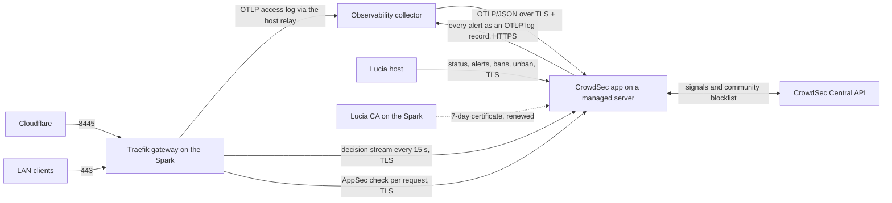

import WhoWhatWhy from '@site/src/components/WhoWhatWhy';
import Source from '@site/src/components/Source';

# Gateway protection (CrowdSec)

<WhoWhatWhy
  who="Operators running the Spark who expose apps to the internet or want to see who is poking at the gateway."
  what="The CrowdSec catalog app, the bouncer plugin inside Traefik, the log path through Observability, the certificates that tie them together, the ban policy, and how to check, unban and recover."
  why="Port 8445 faces the internet through Cloudflare, and scanners find it within hours. A banned address should stay out of every app at once, and none of that work should cost the Spark CPU or memory."
/>

CrowdSec is a catalog app, installed from **Apps** on a managed server like any other. The Spark keeps only the cheap half: the gateway's bouncer plugin, which asks the engine about each request. The engine itself, its database and the log parsing all run on the server you pick, and the app moves, updates and backs up the way every other app does.

Everything fails open. If the engine, its server or the network between them goes away, traffic keeps flowing.



## Install it

1. Set up your domain first (**Settings → Domains**). The gateway reaches CrowdSec by a name under it, so Lucia refuses the install without an active domain (`409 domain_required`).
2. Install **Observability**, at catalog version 13 or later. CrowdSec reads the gateway's access log through Observability's collector (version 12 and later forward it), and version 13 adds CrowdSec's dashboards and indexes its alerts by kind in Loki. Lucia refuses a new install without Observability (`409 requires_app`) or with an older one (`409 requires_update`). Catalog apps don't update themselves, so an Observability installed before this release needs **Update** on its app page first.
3. Install **CrowdSec** from **Apps → Catalog** on the server you want. Lucia runs one copy at most. Its **Name** setting (`crowdsec-host`, default `crowdsec`) becomes `crowdsec.<your namespace>`, for example `crowdsec.lab.example.com`.
4. Within a minute or two Lucia publishes that name in AdGuard, asks its CA for the engine's certificate, the engine starts, and the **Gateway protection** page (`#/security`) shows **Protecting the gateway**.

The engine's first start needs internet: it registers with the Central API and downloads the hub collections. Until it answers over TLS, the gateway's middlewares are empty chains and nothing waits on it.

### Its name

The name points straight at the server CrowdSec runs on, never at the gateway, because the gateway itself is the client. `ManagedNodeDns` publishes it next to the servers' own names, from the app's `names` in its manifest, and moves it when the app moves. It shares the checks of an app's web address: one DNS label that no web address, other app, server or Lucia service already uses.

Everything that talks to the engine uses the name: the gateway, Observability's collector, the host's page queries, and the engine itself. Inside the engine's container `extra_hosts` points the name at loopback, so AppSec's key check and `cscli` reach the local API under the same name and certificate.

If the Spark can't resolve the name (the network's DNS isn't AdGuard, or AdGuard is down), the host's check fails with "`crowdsec.…` doesn't resolve here", the middlewares become empty chains and traffic flows. Point the Spark at AdGuard for DNS.

If the domain is taken away after install, the app keeps running but has no name. The page says **Waiting for your domain** and the gateway lets everything through.

## What runs where

| Piece | Where | Notes |
|---|---|---|
| Engine | `crowdsec` service in the app's stack, `crowdsecurity/crowdsec:v1.8.1@sha256:0f2523fa…7f71a` (multi-arch) | Runs as root with every capability dropped except `SETUID` and `SETGID`, `no-new-privileges`, 512 processes and 1 GB of memory at most. Not read-only: compose writes the app's inline configs into the container. The two capabilities let CrowdSec start its notification plugin as `nobody` (`plugin_config`). The plugin's socket is then `0660` for group `nobody` (`PLUGIN_UNIX_SOCKET_GROUP`), and `group_add: ["65534"]` puts the engine in that group, because without `CAP_DAC_OVERRIDE` it couldn't open the socket otherwise. |
| Sidecar | `lucia` service, `alpine:3.22.1` pinned by digest | No network, read-only, no capabilities, 32 MB. Writes what Lucia sends (certificate, root CA, safe harbor, enroll key, custom AppSec rules, the collector's address and credentials) into the in-memory `state` volume. |
| Engine data | Volumes `data` (SQLite database, hub data) and `config` (`/etc/crowdsec`, including Central API credentials) under `/srv/lucia/stacks/<name>/volumes/` | Backed up with the app, with the app stopped, because SQLite is only consistent then. `state` is tmpfs and skipped. |
| Bouncer plugin | `identity/plugins-local/` on the Spark, read-only in the gateway | `maxlerebourg/crowdsec-bouncer-traefik-plugin` v1.8.1, a local plugin. Traefik never downloads code. |
| Middlewares | `identity/gateway/security/crowdsec.yml` on the Spark | Written as empty chains by every identity deploy, then pointed at the engine by the host while it's healthy. |

### Ports

| Default port | Published on | Used by |
|---|---|---|
| 8088 → 8080 | The server's LAN addresses | The gateway's decision stream and the host's page queries (local API). |
| 7422 | The server's LAN addresses | The gateway's AppSec checks. |
| 7423 | The server's LAN addresses | Observability's collector, posting the gateway's access log. |
| 19060 → 6060 | `127.0.0.1` on the server | That server's telemetry relay, which scrapes the metrics as the `crowdsec` job. |

All four are settings on the app, and they must differ. Every LAN listener serves TLS only; plain HTTP gets `400`.

## How the pieces trust each other

| Link | Server proves itself with | Client proves itself with |
|---|---|---|
| Gateway → local API and AppSec | A certificate from Lucia's CA naming `crowdsec.<namespace>`. The plugin trusts only `lucia-root-ca.crt` (`crowdsecLapiTLSCertificateAuthority`, `crowdsecAppsecTLSCertificateAuthority`) and checks the name. | The bouncer key, `GATEWAY_KEY` in the app's environment. |
| Collector → log intake | The same certificate. The collector's `ca_pem` is Lucia's root. | The `X-Lucia-Intake` header, `INTAKE_TOKEN` in the app's environment. |
| Host → local API | The same certificate, checked against `HostAuthentication:CaCertificatePath`. | The `lucia-host` machine and `LUCIA_MACHINE_PASSWORD`, registered by the image's start script on every start. |
| Engine's notification plugin → Observability's alert intake | A certificate from Lucia's CA naming `otlp-alerts.<namespace>`, issued to the Observability app. The plugin trusts only Lucia's root (`ca_cert_path`) and checks the name. | Basic credentials for the collector, `LUCIA_CROWDSEC_OTLP_AUTHORIZATION`. | The same certificate under the same name, which `extra_hosts` points at the container's loopback. | The engine's own machine credential. |

The three secrets are generated when the app is first rendered and kept on every re-render. They stay in the app's encrypted environment; the gateway's copy of the bouncer key is in `crowdsec.yml`, mode `0600`.

`GET /api/host/stacks/<name>` (the Apps page, and the assistant's `get_app`) shows them, the TLS key, the enroll key and Observability's `LUCIA_CROWDSEC_TOKEN` as `[kept by Lucia]`. Saving the app, or converting it to a custom app, puts the stored values back whatever was sent, so nobody can read, drop or replace them from there.

### The certificate

The host never holds CA credentials. It makes a P-256 key, writes a signing request to `~/.local/share/lucia/host/data/nodes/app-certificate-requests/<stack>.json`, and the scoped enrollment worker on the Spark (`lucia-node-enrollment.service`, the one that already signs node certificates) signs it with the `lucia-installer` provisioner for 168 hours. The worker refuses unless:

- the request names a stack that runs the `crowdsec` or `observability` app, settled, on the server named in the request;
- the address is that server's address from Lucia's records, in `10/8`, `172.16/12` or `192.168/16`, and isn't the CA's own host;
- the request's subject is `CN=lucia-app-<stack>` and its only name is `<label>.<namespace>`. The worker reads the label from the stack's own manifest and the namespace from the active domain (`host/data/domains`), never from the request, and refuses Lucia's own names and the server's.

The certificate names the app, not its server, so a move keeps it: AdGuard follows the app. The host renews once fewer than 4 days remain, and at once when the name changes (a new **Name** setting or another domain). The new certificate reaches the sidecar only, so compose recreates the sidecar and leaves the engine running; the engine's start script sees the new files and sends CrowdSec `SIGHUP`, which reloads the local API, AppSec and the log intake in about two seconds. A new name is different: it changes the engine's `LOCAL_API_URL` and `extra_hosts`, so the engine restarts. If the enrollment worker isn't running, the page says so and the current certificate keeps serving until it expires.

Observability's alert intake gets its certificate the same way, as the Observability stack with the name `<alerts-host>.<namespace>` (default `otlp-alerts`). Lucia writes it into Observability's environment as the collector config `LUCIA_CROWDSEC_INTAKE` and redeploys the collector; the Apps page shows that variable as `[kept by Lucia]`, since it holds the key. Renewal works as above, except that the collector restarts to load the new certificate. That takes a few seconds, and an alert raised during them is dropped.

## The log path

The gateway on the Spark still sends its access log over OTLP to the host's relay endpoint, as it did before CrowdSec existed. The host forwards it to Observability. Observability's collector, given `LUCIA_CROWDSEC_COLLECTOR` by Lucia, filters the `lucia-gateway` records and posts them as OTLP/JSON to the intake ([details](./observability.mdx#forwarding-the-gateways-log-to-crowdsec)).

CrowdSec's `http` datasource takes each post and a `transform` expression turns every log record's attributes back into the JSON line Traefik would have written. From there `crowdsecurity/traefik-logs` parses it as usual. The source address is the last entry of `ClientHost`: on the public entrypoint that's the visitor Cloudflare saw, because Traefik trusts `X-Forwarded-For` only from Cloudflare's ranges; everywhere else Traefik drops the header first, so a LAN client that forges one is recorded under its real address.

## Who gets checked

| Traffic | Ban check (`crowdsec`) | AppSec (`crowdsec-appsec`) |
|---|---|---|
| Internet, port 8445 (public apps, public Authentik) | Yes | Yes, on the entrypoint |
| LAN to an app's address (`app.lab.example.com`) | Yes | Yes, on the app's route |
| LAN to Lucia's console and API (port 443) | Yes | No |
| LAN to Authentik on 9443 | Yes | No |
| Safe-harbor addresses | Skipped | Skipped |

AppSec stays off Lucia's own API on purpose. Node agents and the console upload compose files, scripts and hours-long stack moves, and a generic WAF rule tripping on a shell script would break a deploy. The API already requires an owner session or a signed node proof.

## Ban policy

The app's `profiles.yaml` decides what an alert does, first match wins:

| Source | Result |
|---|---|
| Safe harbor | Nothing. The `lucia-safe-harbor` allowlist drops the alert. |
| Cloudflare's ranges | Alert recorded, never banned. |
| Private addresses (`10/8`, `172.16/12`, `192.168/16`, loopback, CGNAT, link-local, IPv6 ULA and link-local) | Alert recorded, no automatic ban. A ban by hand still applies. |
| Any range alert | Alert recorded only. |
| Every other address | Ban for 4 hours, then 24 hours, then 7 days, counting that address's decisions from the last 30 days. |

`db_config.flush.max_age: 30d` keeps the history the escalation counts. Scenarios have a blackhole window (two minutes for `http-probing`), so an address that keeps scanning right after a ban doesn't raise a second alert straight away.

AppSec blocks show up as alerts too, of kind `waf`, named after the rule that matched (`crowdsecurity/vpatch-env-access`). One block on its own bans nobody, because CrowdSec marks those alerts as already handled. Trip two different rules within a minute and `crowdsecurity/appsec-vpatch` raises a normal alert, which the table above turns into a ban for a public address and a note for a LAN one. If AppSec blocks reach the counter but never the alert list, check that the AppSec source in `acquis.yaml` still has `unique_id: lucia-appsec` (see [Gateway security](../code/gateway-security.mdx#the-log-transform)).

Collections: `crowdsecurity/traefik`, `http-cve`, `base-http-scenarios`, `appsec-virtual-patching`, `appsec-generic-rules` and `whitelist-good-actors`. The stock `crowdsecurity/whitelists` parser is removed at every start, since it would drop every private address and the LAN alerts with it. Signal sharing and the community blocklist are on.

Lucia adds one parser of its own, `lucia/telemetry-collectors` in `s02-enrich`. OpenTelemetry Collectors send `User-Agent: OpenTelemetry Collector Contrib/<version> (<os>/<arch>)`, and the bad-user-agent list's `\bCollector\b` entry matched every export from the nodes' telemetry relays to Observability. The parser drops a request only when all of these hold: it's a `POST`, the user agent starts with `OpenTelemetry Collector`, the path is `/v1/logs`, `/v1/metrics`, `/v1/traces` or a gRPC `/opentelemetry.proto.collector.*` method, and the source is a private address. The same user agent from the internet, or on any other path, still reaches every scenario.

## Alerts in Loki

Every alert also goes to Observability, so its history lives in Loki for 7 days. The free CrowdSec Console stops showing alerts after 50 a month, which a lab on the internet passes in a day. CrowdSec's own `http` notification plugin posts each alert to Observability's collector as an OTLP/JSON log record. The record's resource carries `service.name=crowdsec` and `crowdsec.kind` (`crowdsec` or `waf`). Loki indexes those two, as `service_name` and `crowdsec_kind`, and keeps everything else as structured metadata:

| Structured metadata | Holds |
|---|---|
| `source_address`, `crowdsec_scope`, `crowdsec_value` | The address or range |
| `crowdsec_scenario`, `crowdsec_rule` | The scenario, or for an AppSec block the rule that matched |
| `url_path`, `http_request_method`, `http_response_status_code`, `user_agent_original`, `server_address` | The request, from the alert's first event or its context |
| `source_geo_country_iso_code`, `source_as_number`, `source_as_organization_name` | Where it came from |
| `crowdsec_decision`, `crowdsec_duration`, `crowdsec_origin` | `ban` with its length and who placed it, or `none` |
| `crowdsec_source_class` | `lan`, `public`, `trusted` (Cloudflare), `range` or `other`: which profile handled it |

Each profile names its own notification (`lucia_alerts_lan` and so on), and that's how a record knows its class. Two last profiles, `lucia_public_recorded` and `lucia_other_recorded`, catch alerts no other profile matches (an AppSec block from the internet, which bans nobody) only to send them on. Bans placed by hand pass through the same profiles and arrive too.

The records go to the collector's alert intake, an OTLP/HTTP receiver that serves TLS only, at `https://otlp-alerts.<namespace>:4319` (`LUCIA_CROWDSEC_OTLP_ENDPOINT`, with the collector's Basic credentials in `LUCIA_CROWDSEC_OTLP_AUTHORIZATION`). They never pass through the gateway: an alert about an attack carries the attack's path and user agent, so AppSec on the gateway's OTLP route would block the post and raise a new alert about the alert. The intake's certificate comes from Lucia's CA the same way the engine's does, and the plugin checks it against Lucia's root, which the start script copies to `/tmp/lucia-ca/ca.crt` because the plugin runs as `nobody` and can't read the `state` volume. A collector with any other certificate gets no alerts: the plugin logs `x509: certificate signed by unknown authority` and drops them. The plain OTLP receivers on 4317 and 4318 stay as they were for every other app.

Lucia hands the engine the intake's address only after it answers over verified TLS. Until then the page's **Alerts to Grafana** row says what's missing:

| State | Meaning |
|---|---|
| `off` | Observability isn't installed. |
| `update-observability` | Observability runs a catalog version older than 13, which has no alert intake. Update it from **Apps**. |
| `waiting-domain` | No active domain, so the intake has no name or certificate. |
| `waiting-certificate` | The enrollment worker hasn't signed the intake's certificate yet, or isn't running. |
| `stopped` | Observability is stopped or moving. |
| `unreachable` | The name doesn't resolve yet, the collector still serves no certificate (it hasn't been redeployed), or the port doesn't answer. |
| `on` | Alerts are flowing. |

In every state but `on` the engine keeps `profiles-quiet.yaml` and its alerts stay in CrowdSec. Bans, AppSec and the local API work the same either way.

Without Observability the engine uses `profiles-quiet.yaml`, which names no notification. When the collector appears, moves or goes away, the sidecar gets the new address and the engine swaps the profiles and reloads (`SIGHUP`). A collector that goes down after that costs one retry per batch and an `error` line in the engine's log (`delivery failed after retries`). The alert, the ban and everything else carry on; alerts raised meanwhile stay in CrowdSec only. AppSec alerts carry a user agent only when the bouncer sends `X-Crowdsec-Appsec-User-Agent`, which the Traefik plugin does.

Grafana's **Lucia CrowdSec** dashboard reads these records ([Observability](./observability.mdx#crowdsec-in-grafana)). The engine also exports Prometheus metrics at `prometheus.level: full`, which adds `cs_active_decisions`, `cs_alerts` and the local API's per-route timings to what `aggregated` gave.

## Custom AppSec rules

The owner's own rules live in `/data/security/crowdsec-appsec-rules.json` on the Spark, beside the safe harbor, 50 at most. The Gateway protection page lists and removes them, and the assistant adds them (`crowdsec_add_appsec_rule`, always with the owner's approval). Each one matches one part of a request with one operator:

| Field | CrowdSec zone | Operators |
|---|---|---|
| `path` | `URI` | `equals`, `prefix`, `contains`, `regex` |
| `query` (any parameter's value) | `ARGS` | the same |
| `user-agent` | `HEADERS`, variable `User-Agent` | the same |
| `header` (named) | `HEADERS`, variable the name | the same |
| `method` | `METHOD` | `equals` only |

Matching is exact and case-sensitive. Lucia refuses a rule that would match empty text, `/` or one of Lucia's console and API paths, an ordinary browser's or Lucia's own user agent, the `Host` header, or the methods `GET`, `HEAD`, `POST` and `OPTIONS`. A header rule can't name a header ordinary requests carry: `Accept*`, `Cookie`, `Content-*`, `Cf-*`, `X-Forwarded-*`, `X-Real-Ip`, `Connection`, `Authorization`, `Cdn-Loop` or `Sec-*` (`User-Agent` becomes a `user-agent` rule), nor match a common value such as `*/*`, `gzip, deflate, br`, an address, `a=b` or a UUID. Values run to 200 characters of printable ASCII and never contain quotes or `%{`, so nothing reaches CrowdSec's rule language except as a value. A reason may use any text up to U+FFFF; emoji are refused because CrowdSec's YAML reader rejects the escaped surrogate pairs they become.

The host renders the list as one YAML stream for the sidecar (`LUCIA_CROWDSEC_APPSEC_RULES`, base64). The engine's start script splits it into `/etc/crowdsec/appsec-rules/lucia-custom-<id>.yaml`, one rule named `lucia/custom-<id>` per file, and reloads with `SIGHUP`. Each document is read on its own: one the YAML reader refuses is left out, the others load, and the next status report carries `rulesProblem`, which the page shows in the **Custom rules** card (`lucia: AppSec has 2 custom rules from Lucia; skipped lucia/custom-…` in the engine's log). The `lucia/custom` AppSec config loads `lucia/custom-*` in band beside `crowdsecurity/appsec-default`. CrowdSec refuses to start when that pattern names no rule, so `lucia/custom-none` is always there; it matches only the impossible path `lucia:never-matches`.

A reload takes about three seconds. The local API and AppSec restart inside the running process, so for that moment the gateway's bouncer fails open: requests pass unchecked and the bans it already pulled stay. A block by a custom rule is an alert of kind `waf` named `lucia/custom-<id>`. Safe-harbor addresses skip custom rules, as they skip all of AppSec.

## Bans by hand

The page's `POST /api/host/security/crowdsec/ban` and the assistant's `crowdsec_ban` post the alert `cscli decisions add` would, as the `lucia-host` machine: scenario `lucia/manual-ban`, one `ban` decision, the reason as the message, and who asked in the alert's context. The decision's origin is `lucia` from the page and `lucia-assistant` from the assistant, which the page shows under **Placed by**. Either way Lucia refuses:

- the safe harbor, Lucia's own addresses (loopback, its Docker networks, the Spark's LAN address, every managed server and every app's own address) and Cloudflare's ranges, IPv4 and IPv6, or a range that covers or sits inside any of them;
- a range wider than `/16` (IPv6 `/48`), or one written with host bits set;
- a ban shorter than a minute or longer than 30 days, and a reason that's empty or over 200 characters.

The gateway picks the ban up at its next pull, within 15 seconds. An unban by address deletes every decision on it; an unban by id deletes that one decision.

## The safe harbor

Lucia's own addresses (loopback, the identity network's subnets and the Spark's LAN address) plus your list, kept in `/data/security/safe-harbor.json` on the Spark and edited on the **Gateway protection** page or through the API:

```bash title="Trust your desktop"
curl -s -X PUT https://lucia.lab.example.com/api/host/security/safe-harbor \
  -H "Authorization: Bearer $(cat ~/.local/share/lucia/identity/secrets/host-owner-api-key)" \
  -H "Content-Type: application/json" \
  -d '{"addresses": ["192.168.1.50"]}'
```

On save the host rewrites `crowdsec.yml` (the bouncer's `clientTrustedIps`) at once, and hands the whole list to the app as `LUCIA_CROWDSEC_HARBOR`. The engine's start script syncs the `lucia-safe-harbor` allowlist within 20 seconds; AppSec rereads allowlists once a minute.

## Gateway configuration follows the app

Every 15 seconds the host checks the app and rewrites the middlewares when something changed:

| App | `crowdsec` and `crowdsec-appsec` |
|---|---|
| Not installed, stopped, moving or restoring | Empty chains. |
| No active domain, so no name | Empty chains. |
| Waiting for its first certificate | Empty chains. |
| Running, and `GET /health` answers over verified TLS at its name | The bouncer plugin, pointed at `crowdsec.<namespace>`. |
| Running, but `/health` failed twice in a row (about 30 seconds) | Empty chains, until it answers again. |

The identity deploy always writes empty chains first, so a restarted gateway never names a middleware it can't build.

## Fail-open behaviour

Checked on a local copy of the whole path with the real images:

| Failure | What visitors see |
|---|---|
| Engine stopped or its server off | Requests pass at once. The plugin keeps the bans it already pulled. |
| Engine hung (connections accepted, nothing answered) | Requests on AppSec routes wait 2 seconds (`httpTimeoutSeconds`), then pass. Lucia's console isn't affected. After about 30 seconds the host switches to empty chains and the delay goes. |
| Engine's certificate not from Lucia's CA, or not for its name | The plugin refuses the connection and everything passes. |
| The engine's name doesn't resolve on the Spark | Requests pass at once (AppSec logs `unreachable`). The host's check fails the same way and switches to empty chains. |
| Gateway restarts while the engine is down | No bans until the first pull (`streamStartupBlock: false`). |

One case blocks: AppSec answering `401`, which means it doesn't know the gateway's key. The plugin treats any status other than 200, 403 and 5xx as a block. Lucia only points the middlewares at an engine whose key it rendered, so this shows up only if someone changes the key by hand.

:::warning
The plugin itself is the other piece that fails closed. If routes on 443 and 8445 all return 404 after an upgrade, check `docker logs lucia-identity-gateway` for `Plugins are disabled`, then rerun `tools/identity/provision.py prepare` to restore the verified tree.
:::

## The Gateway protection page

Owners see engine health, version, server, certificate expiry, the Central API state, the gateway's last ban pull, counters since the engine started, active bans with **Unban**, recent alerts, AppSec blocks and the trusted-address list. The host serves it from:

| Endpoint | Does |
|---|---|
| `GET /api/host/security/crowdsec` | Status. Engine facts come from the `lucia-status` line the engine logs every minute, read through the server's agent. |
| `GET /api/host/security/crowdsec/alerts?limit=50` | Recent alerts, community blocklist excluded. Each has a `kind` (`waf` for an AppSec block) and, for blocks, the `path`. Filter with `kind` (`waf` or `appsec`, `crowdsec` or `scenario`), `ip`, `range`, `scenario` and `since` (`30m`, `6h`, `7d`, 30 days at most). CrowdSec 1.8.1's own `ip` and `range` filters miss AppSec alerts, so Lucia matches an address by value and a range from the newest 500. |
| `GET /api/host/security/crowdsec/alerts/{id}` | One alert with its context lists and up to 20 events. |
| `GET /api/host/security/crowdsec/decisions` | Bans in force from alerts with an active decision, each with its `origin`. |
| `POST /api/host/security/crowdsec/ban` | `{"target": "203.0.113.7", "duration": "4h", "reason": "..."}`. See [Bans by hand](#bans-by-hand). |
| `POST /api/host/security/crowdsec/unban` | `{"ip": "203.0.113.7"}` or a network lifts every decision on it; `{"id": 42}` lifts one. |
| `GET` and `POST /api/host/security/crowdsec/rules`, `DELETE /api/host/security/crowdsec/rules/{id}` | The custom AppSec rules. A `POST` takes `field`, `operator`, `value`, `reason` and, for a header rule, `header`. |
| `PUT` / `DELETE /api/host/security/crowdsec/enrollment` | Saves or forgets a Console enroll key. |
| `GET` / `PUT /api/host/security/safe-harbor` | The trusted-address list. |

All are owner-only. Nothing secret reaches the browser.

The page says **Protecting the gateway** only when the log path works too. Two warnings replace it while the gateway still checks every request:

| State | Means |
|---|---|
| `needs-observability` | Observability is missing or older than version 12, so no access log reaches CrowdSec. Only AppSec and the community blocklist protect the gateway. |
| `no-logs` | The engine's access-log line count hasn't moved for 15 minutes (from its `lucia-status` line). Check that Observability runs and its collector reaches the engine's name. A quiet lab with nobody using the gateway shows this too. |

## CrowdSec Console

Paste the enroll key from [app.crowdsec.net](https://app.crowdsec.net) on the page. Lucia stores it in the app's encrypted environment as `LUCIA_CROWDSEC_ENROLL_KEY` and the sidecar hands it to the engine. Within a minute the engine runs `cscli console enroll --name lucia-<server> --tags lucia` and the page shows **pending**; once you accept the engine in the Console it shows **accepted**, and the engine reloads to pick up Console features. A wrong key shows the Console's own error and is retried every ten minutes. The key never appears in the engine's log.

## Everyday commands

On the CrowdSec server, where `<name>` is the app's name:

```bash
docker exec lucia-<name>-crowdsec-1 cscli decisions list                    # who is banned
docker exec lucia-<name>-crowdsec-1 cscli alerts list                       # everything noticed
docker exec lucia-<name>-crowdsec-1 cscli decisions delete --ip 203.0.113.7 # unban
docker exec lucia-<name>-crowdsec-1 cscli allowlists inspect lucia-safe-harbor
docker exec lucia-<name>-crowdsec-1 cscli capi status
docker exec lucia-<name>-crowdsec-1 cscli metrics
docker exec lucia-<name>-crowdsec-1 cscli appsec-rules list | grep lucia     # custom rules loaded
docker exec lucia-<name>-crowdsec-1 cscli notifications list                # lucia_alerts_* while Observability runs
docker logs lucia-<name>-crowdsec-1 2>&1 | grep lucia-status | tail -1      # what the page reads
```

An unban reaches the gateway at its next pull, within 15 seconds.

## Updating to app version 3

Version 3 adds the alert notifications, custom rules and full metrics. Update in this order:

1. Deploy the host and the enrollment worker on the Spark (`tools/nodes/enrollment_worker.py`), which now signs for the Observability app too. Nothing on the servers changes yet.
2. Update **Observability** to version 13 on its app page. Loki restarts with the `crowdsec.kind` label and Grafana gets the CrowdSec dashboards. Records already in Loki have no `crowdsec_kind` label. Lucia then gets the alert intake's certificate, publishes `otlp-alerts.<namespace>` in AdGuard and redeploys the collector with the intake on 4319.
3. Update **CrowdSec** to version 3. The engine restarts once, since its config and capabilities changed. From then on, rules and the collector reach it through the sidecar and a reload.
4. Check that `cscli notifications list` shows five `lucia_alerts_*` entries, that the Gateway protection page shows **Alerts to Grafana** as on, that the engine's log has `lucia: alerts go to Observability's collector at https://otlp-alerts.…:4319`, and that `{service_name="crowdsec"}` in Grafana's Explore returns records after the next alert.

## Moving from the engine on the Spark

Lucia's first CrowdSec release ran the engine beside the gateway as `lucia-identity-crowdsec`. To move:

1. Deploy the host with this release. Make sure a domain is active and the Spark resolves names through AdGuard, install Observability if it isn't there, then install the CrowdSec app on a managed server.
2. Wait for **Protecting the gateway** on the page, and check `docker exec lucia-<name>-crowdsec-1 cscli bouncers list` shows a recent last pull. `getent hosts crowdsec.<namespace>` on the Spark should answer with the server's address.
3. Deploy the identity stack (`tools/identity/provision.py apply`). It no longer has the engine, the JSON access-log file or the Spark relay's `crowdsec` scrape. If `docker ps` still lists `lucia-identity-crowdsec`, remove it with `docker rm -f lucia-identity-crowdsec`.
4. Delete what the old engine left: the volumes ending in `_lucia-crowdsec-data` and `_lucia-crowdsec-config` (`docker volume ls | grep lucia-crowdsec`), and under `~/.local/share/lucia/identity/` the folders `config/crowdsec`, `access-logs`, `crowdsec` and the file `secrets/crowdsec-bouncer-key`.

Ban and alert history starts fresh on the new engine. The community blocklist comes back with its first Central API pull.
