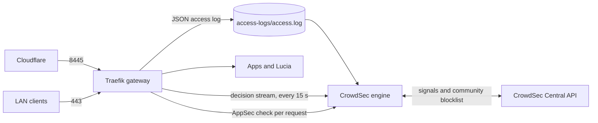

import WhoWhatWhy from '@site/src/components/WhoWhatWhy';
import Source from '@site/src/components/Source';

# Gateway protection (CrowdSec)

<WhoWhatWhy
  who="Operators running the Spark who expose apps to the internet or want to see who is poking at the gateway."
  what="The CrowdSec engine beside the gateway, the bouncer plugin inside Traefik, the ban policy, the safe harbor, and the commands to check, unban and recover."
  why="Port 8445 faces the internet through Cloudflare. Scanners find it within hours, and a banned address should stay out of every app at once, without anyone babysitting logs."
/>

CrowdSec runs as `lucia-identity-crowdsec` in the identity compose project. The gateway writes a JSON access log, CrowdSec reads it and decides who to ban, and a Traefik plugin enforces those bans on every HTTP entrypoint. The same plugin sends requests to CrowdSec's AppSec engine, which blocks known exploit requests one at a time. The design choice that matters most: everything fails open. If CrowdSec is down, traffic keeps flowing.



## What runs where

| Piece | Where | Notes |
|---|---|---|
| Engine | `lucia-identity-crowdsec`, `crowdsecurity/crowdsec:v1.8.1` pinned by digest | Local API on 8080 and AppSec on 7422, both reachable only on the compose network. Prometheus metrics on `127.0.0.1:19060`. |
| Engine state | Docker volumes `lucia-crowdsec-data` (database, hub data) and `lucia-crowdsec-config` (`/etc/crowdsec`) | Survive restarts and upgrades. |
| Lucia's engine settings | `identity/config/crowdsec/` (from <Source path="deployment/identity/crowdsec" />), read-only at `/lucia/config` | `start.sh`, `profiles.yaml`, `acquis.yaml`, `config.yaml.local`. Rewritten by every `provision.py` run. |
| Bouncer plugin | `identity/plugins-local/`, read-only at `/plugins-local` in the gateway | `maxlerebourg/crowdsec-bouncer-traefik-plugin` v1.8.1, loaded as a local plugin. Traefik never downloads code. |
| Middlewares | `identity/gateway/security/crowdsec.yml` | Defines `crowdsec` and `crowdsec-appsec`. Written by the AppHost on every publish and deploy, and by the host when the safe harbor changes. |
| Access log | `identity/access-logs/access.log` | Written by the gateway, read-only for the engine. Truncated in place once it passes 50 MB. |
| Bouncer key | `identity/secrets/crowdsec-bouncer-key` | Mounted into both containers. Created by `provision.py`, also on an install that predates CrowdSec. |
| Console enroll key | `identity/crowdsec/enroll/enroll-key` | Optional. See [Console](#crowdsec-console). |

The gateway image moved to `traefik:v3.7.16` for this. Version 3.7 added `--accesslog.dualoutput`, which writes the JSON file and keeps sending the same records to Observability over OTLP. Query strings are still dropped and the only header kept is `User-Agent`.

## Who gets checked

| Traffic | Ban check (`crowdsec`) | AppSec (`crowdsec-appsec`) |
|---|---|---|
| Internet, port 8445 (public apps, public Authentik) | Yes | Yes, on the entrypoint |
| LAN to an app's address (`app.lab.example.com`) | Yes | Yes, on the app's route |
| LAN to Lucia's console and API (port 443) | Yes | No |
| LAN to Authentik on 9443 | Yes | No |
| Safe-harbor addresses | Skipped | Skipped |

AppSec stays off Lucia's own API on purpose. Node agents and the console upload compose files, `.env` files, scripts and stack-move streams that can be hours long. A generic WAF rule tripping on a shell script in a compose file would break a deploy, and the API already requires an owner session or a signed node proof. Apps are third-party code, so they get the rules.

The entrypoint order is `forwarded-strip@file,crowdsec@file` on `host` and `authentik`, and `public-sources@file,forwarded-strip@file,crowdsec@file,crowdsec-appsec@file` on `public`. The cheap filters run first, so a connection that isn't from Cloudflare is refused before the bouncer spends anything on it.

### Real client addresses

Public visitors arrive from Cloudflare's proxies. Only on the `public` entrypoint does Traefik trust `X-Forwarded-For`, and only from Cloudflare's ranges. Everywhere else it drops the header, so a LAN client can't claim to be someone else. The access log's `ClientHost` then holds the visitor chain, and CrowdSec's Traefik parser takes its last address, the one Cloudflare itself saw. The bouncer reads the same header with `forwardedHeadersTrustedIps` set to Cloudflare's ranges. Banning a visitor never bans the Cloudflare proxy in front of them.

## Ban policy

`profiles.yaml` decides what an alert does. The first matching profile wins.

| Source | Result |
|---|---|
| Safe harbor | Nothing. The `lucia-safe-harbor` allowlist drops the alert. |
| Cloudflare's ranges | Alert recorded, never banned. |
| Private addresses (`10/8`, `172.16/12`, `192.168/16`, loopback, IPv6 ULA and link-local) | Alert recorded, no automatic ban. You can still ban by hand. |
| Any range alert | Alert recorded only. |
| Every other address | Ban for 4 hours the first time, 24 hours the second, 7 days from then on, counting that address's decisions from the last 30 days. |

`config.yaml.local` keeps alerts for 30 days (`db_config.flush.max_age: 30d`) so the escalation has something to count. An address that keeps hitting the gateway while banned can climb the ladder quickly, since each new alert adds a decision.

The engine installs these hub collections: `crowdsecurity/traefik`, `crowdsecurity/http-cve`, `crowdsecurity/base-http-scenarios`, `crowdsecurity/appsec-virtual-patching`, `crowdsecurity/appsec-generic-rules` and `crowdsecurity/whitelist-good-actors`. The last one keeps search-engine crawlers and CDN addresses out of the scenarios, which matters once a public app gets indexed. The stock `crowdsecurity/whitelists` parser is removed at every start (`DISABLE_PARSERS`), because it would silently drop all private addresses and the LAN alerts with them.

The Central API is on. The engine shares signals and pulls the community blocklist, so well-known attackers are refused before they touch anything.

## The safe harbor

The safe harbor is Lucia's own addresses plus a list you keep. Lucia's part is loopback, the compose network's subnets (the host's trusted proxy networks) and the Spark's LAN address. Your part is stored in the host's data at `/data/security/safe-harbor.json` and edited on the **Settings → Domains** page (the **Trusted addresses** card, shown once a domain is connected) or through the API:

```bash title="Trust your desktop"
curl -s -X PUT https://lucia.lab.example.com/api/host/security/safe-harbor \
  -H "Authorization: Bearer $(cat ~/.local/share/lucia/identity/secrets/host-owner-api-key)" \
  -H "Content-Type: application/json" \
  -d '{"addresses": ["192.168.1.50"]}'
```

`GET` on the same path shows the list, Lucia's part and who changed it last. The host accepts up to 32 entries. Private networks may be as wide as their range. Internet addresses must be a /24 (IPv6 /48) or narrower. It refuses `0.0.0.0/0`, loopback, multicast, anything overlapping Cloudflare, and a network written with host bits set.

On save, the host rewrites `gateway/security/crowdsec.yml` (the bouncer's `clientTrustedIps`) and `gateway/security/safe-harbor.txt`, then touches the directory so Traefik reloads. The engine's start script checks `safe-harbor.txt` every 20 seconds and syncs the `lucia-safe-harbor` allowlist. AppSec refreshes allowlists once a minute, so give a change a minute before testing it.

## Fail-open behaviour

| Failure | What visitors see |
|---|---|
| Engine stopped | The bouncer keeps the bans it already has and lets everyone else through. AppSec checks fail in about a second and pass. |
| Engine hung | AppSec checks time out after 2 seconds and pass. The ban check isn't affected. |
| Gateway starts while the engine is down | No bans until the first successful stream pull (`streamStartupBlock: false`). |
| Plugin missing or changed | Traefik can't build any middleware that uses it, and every HTTP route fails. The AppHost refuses to publish unless the plugin tree matches its pinned digest, so this only happens if files change after a deploy. |

The bouncer uses `updateMaxFailure: -1`, `crowdsecAppsecFailureBlock: false`, `crowdsecAppsecUnreachableBlock: false` and `crowdsecAppsecUnreadableBodyBlock: false`. The last one lets HTTP/2 uploads without a length through on their headers alone. Bodies are inspected up to 10 MB and the rest streams on untouched.

:::warning
The plugin is the one piece that fails closed. If routes on 443 and 8445 all return 404 after an upgrade, check `docker logs lucia-identity-gateway` for `Plugins are disabled`, then rerun `tools/identity/provision.py prepare` to restore the verified tree.
:::

## Deploying

`provision.py prepare` (and `apply`) does the preparation:

1. Creates `crowdsec-bouncer-key` if it's missing.
2. Copies the engine settings to `config/crowdsec/`.
3. Downloads the plugin's Go module zip and the two modules it vendors (`leprosus/golang-ttl-map` v1.1.7, `maxlerebourg/simpleredis` v1.0.12) from `proxy.golang.org`, checks each zip's SHA-256, unpacks them and checks the tree digest. This needs internet once. Later runs reuse the verified tree.

Then the AppHost checks the plugin tree again, writes `crowdsec.yml`, and Aspire restarts the gateway with the new static configuration. Expect a few seconds without the gateway while Traefik restarts.

The engine's first start needs internet too. It registers with the Central API and downloads the hub collections, usually in under a minute. Without internet it exits and Docker restarts it until it gets through, and the gateway serves traffic unprotected meanwhile. `provision.py verify` doesn't wait for the engine.

## Everyday commands

```bash
docker exec lucia-identity-crowdsec cscli decisions list            # who is banned, and for how long
docker exec lucia-identity-crowdsec cscli alerts list               # everything noticed, LAN included
docker exec lucia-identity-crowdsec cscli decisions delete --ip 203.0.113.7   # unban
docker exec lucia-identity-crowdsec cscli decisions add --ip 192.168.1.66 --duration 24h --reason "manual"
docker exec lucia-identity-crowdsec cscli allowlists inspect lucia-safe-harbor
docker exec lucia-identity-crowdsec cscli capi status
docker exec lucia-identity-crowdsec cscli metrics
```

An unban reaches the gateway at its next stream pull, within 15 seconds.

## CrowdSec Console

To see and manage the engine from [app.crowdsec.net](https://app.crowdsec.net), put your enroll key in the identity state:

```bash
install -m 0600 /dev/stdin ~/.local/share/lucia/identity/crowdsec/enroll/enroll-key <<< "YOUR-ENROLL-KEY"
```

Within 20 seconds the engine enrolls as `lucia-<spark name>` and logs `lucia: enrollment sent to the CrowdSec Console`. Accept it in the Console. A wrong key logs a failure and is retried every ten minutes; the engine keeps running either way. CrowdSec 1.8 turns Console decision management on by itself when your plan includes it, which is how you ban and unban from the Console.

## Metrics

The engine's Prometheus metrics (level `aggregated`) are published on `127.0.0.1:19060`. The controller's telemetry relay scrapes them as the `crowdsec` job, so they show up in Observability next to the node exporter. See [Observability](./observability.mdx).
