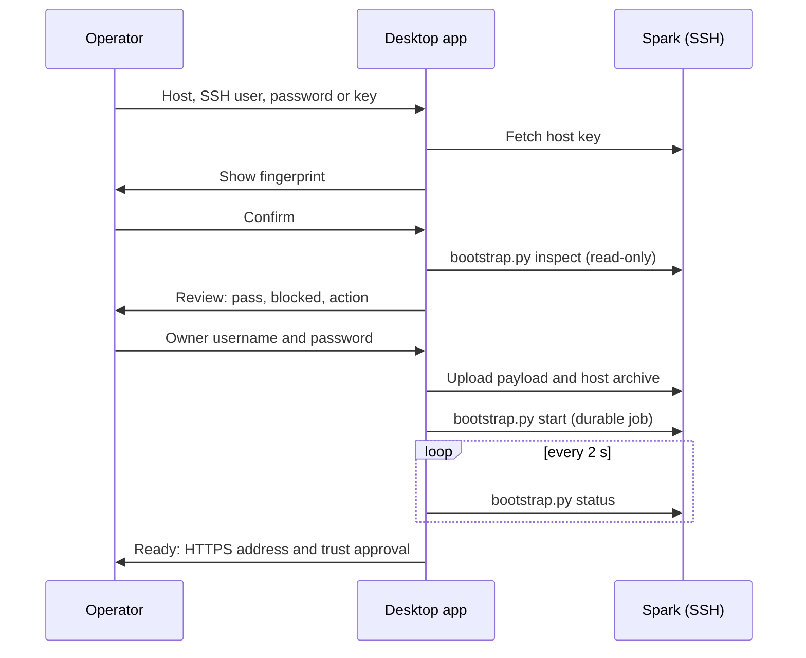

import WhoWhatWhy from '@site/src/components/WhoWhatWhy';

# Desktop bootstrap

<WhoWhatWhy
  who="Engineers who run the setup app, or who need to debug a half-finished install."
  what="The preflight checks, the remote job and what it leaves on the Spark, and how to reconnect, retry or rerun."
  why="The Spark has no terminal step for the user. The app does the work over SSH, and a job on the Spark survives a closed laptop."
/>

The setup app is an Avalonia program that takes a Spark from NVIDIA's first-run state to a running Lucia. Its design rule is that setup never asks the user to open a terminal on the Spark. One step is the exception: the root update worker needs `sudo`, and the app refuses to ask for that password. See [install from source](./install-from-source.mdx) for building it, and the [code page](../code/desktop-bootstrap.mdx) for how it is built.

:::note
No signed or notarized build exists. Windows SmartScreen and macOS Gatekeeper warn on the unsigned output of `tools\desktop\publish.ps1`.
:::

## The flow



## Preflight

`inspect` makes no changes. Each check comes back as passing, blocking or action-needed, and the app refuses to continue while anything blocks.

| Check | Wants |
|---|---|
| OS | Ubuntu 22.04 or 24.04 |
| Architecture | `aarch64` |
| Docker | Daemon reachable by the SSH account, version 28 or newer, Compose plugin |
| GPU | CDI device `nvidia.com/gpu=all` |
| Python, OpenSSL | Python 3.11 or newer, OpenSSL installed |
| .NET, Aspire | SDK 10.0.401, Aspire 13.5.4. If missing, installed under `~/.local/share/lucia/bootstrap` from pinned, checksummed packages once approved |
| Ports | 443, 636, 9443, 9444 free or owned by Lucia |
| Disk | 12 GiB free for a fresh install |
| Lingering | `loginctl show-user` reports `Linger=yes`. Without it the user services are skipped |
| Host package | The desktop bundle carries a valid `HostPayload` |

The app never changes Docker, the GPU stack, or system packages. When an earlier install exists, preflight treats ports held by Lucia's identity services as expected and reports that existing users, trust and volumes will be kept. If a setup job is already running, the only option is to reconnect to it.

## The remote job

The app uploads its payload to `~/.local/share/lucia/bootstrap` and starts `tools/desktop/bootstrap.py` there. The job id is a 32-character hex string, and its record lives under `jobs/<id>` with `active.json` pointing at the running one. In order, the job:

1. Provisions identity with `tools/identity/provision.py`: PostgreSQL, step-ca, OpenLDAP, Authentik, Traefik.
2. Enrolls the owner in the directory and checks sign-in through Authentik.
3. Registers Lucia as an OIDC application.
4. Prepares the managed host with `tools/host/provision_host.py`: verifies the archive, builds the `lucia-managed-host` image, writes host settings.
5. Installs the user services (domain activation, node enrollment, Spark model, Spark runner) if lingering is on.
6. Deploys the whole project with the Identity AppHost, Aspire to Docker Compose.

Monitoring is separate from the work. Closing the app, or **Stop watching**, stops polling and leaves the job running. **Reconnect to Spark** attaches to the active job again. Starting a second job while one holds `.provision.lock` is refused.

## Credentials

- The owner password reaches the Spark as private JSON on standard input over the pinned SSH session. It is never a command-line argument, and it is redacted from progress and logs.
- The SSH host key is shown for confirmation before any credential is sent. A confirmed key is pinned under the desktop user's application data (`%LOCALAPPDATA%\Lucia\Desktop\host-pins` on Windows). A changed key is refused.
- Uploaded directories are checked for mode 0700 and files for 0600 and for the SSH account's ownership.

## Trust approval

Ready shows the HTTPS origin and, separately, offers to trust the private root. Only the public root is copied.

| Desktop OS | Destination |
|---|---|
| Windows | Current user's Trusted Root store |
| macOS | Login keychain |
| Linux | System CA store after a native privileged prompt |

**Export certificate** saves the public root so an administrator can import it elsewhere.

## Rerun and recovery

A rerun against an installed Spark is safe. The installer keeps existing secrets and CA material, and if any are missing it stops and asks for a restore instead of generating replacements.

When a job fails, the app shows a redacted error. For the full record, read the job directory on the Spark:

```bash
ls ~/.local/share/lucia/bootstrap/jobs/
docker ps --filter label=io.lucia.component --format 'table {{.Names}}\t{{.Status}}'
```

Fix the cause, then inspect again from the app. For the identity stack alone, `tools/identity/provision.py verify` rechecks it from a shell. The app never sets up the boot service, which is prepared separately (see [Installer](./installer.mdx)).
