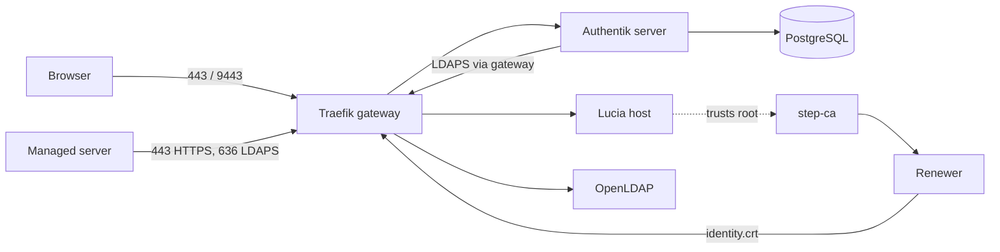

import WhoWhatWhy from '@site/src/components/WhoWhatWhy';
import Source from '@site/src/components/Source';

# Identity

<WhoWhatWhy
  who="Operators running Lucia's Spark: whoever deploys, upgrades, backs up or repairs it."
  what="The seven identity containers, what each port is for, where state and secrets live, how certificates are issued and renewed, how to check health, and how to recover."
  why="Sign-in, server logins and every machine certificate depend on this stack. Knowing where its state lives and what can't be regenerated saves you from a lockout."
/>

The identity stack is a Docker Compose project that Aspire generates from the Identity AppHost, <Source path="src/Lucia.Homelab.Identity.AppHost/AppHost.cs" />. It runs on the Spark beside the Lucia host. People get one account that works for the portal, supported apps and SSH on managed servers. Machines get short-lived certificates instead of passwords.

The stack is separate from the Lucia host on purpose. Whoever compromises the portal still can't read the CA keys or the Authentik admin credentials, because the host container doesn't mount them. [Security model](./security-model.mdx) has the full boundary.

## What runs

| Container | Image | Role |
|---|---|---|
| `lucia-identity-db` | `postgres:16-alpine` | Authentik's database. Never published. |
| `lucia-identity-ca` | `smallstep/step-ca:0.30.2` | The private certificate authority. |
| `lucia-identity-ldap` | `vegardit/openldap` | The directory: people, groups, password hashes (Argon2), 14-character minimum policy. |
| `lucia-identity-server` | `goauthentik/server:2026.8.3` | Sign-in (OIDC) and the web UI. |
| `lucia-identity-worker` | `goauthentik/server:2026.8.3` | Authentik's background worker. Holds the bootstrap admin password and token. |
| `lucia-identity-gateway` | `traefik:v3.6` | TLS front door for Authentik, LDAPS, the Lucia host and public routes. |
| `lucia-identity-renewer` | `smallstep/step-ca:0.30.2` | Renews the gateway's certificate. |

Every image is pinned by digest in the AppHost, so a rebuild can't pull something different. Containers run with `restart: unless-stopped` and `no-new-privileges`, and carry the label `io.lucia.component=identity`. When the managed host is installed, the same compose project also runs `lucia-homelab-host`, the telemetry relay and its exporters, and, when boot is prepared, `lucia-boot`. See [Host server](../code/host-server.mdx) and [Installer](./installer.mdx).



## Ports

| Port | Published on | Serves | Notes |
|---|---|---|---|
| `9443/tcp` | all interfaces | Authentik (OIDC) | The `Authority` URL is `https://<host>:9443/application/o/lucia/`. |
| `636/tcp` | all interfaces | LDAPS | Through the gateway only. Plain LDAP (389) isn't published. |
| `9444/tcp` | all interfaces | step-ca API and ACME | Published directly from the CA container. |
| `443/tcp` | all interfaces | Lucia host and portal | Gateway entrypoint `host`, present once the managed host exists. |
| `8445/tcp` | all interfaces | Public routes | Only Cloudflare's address ranges are admitted. See [Networking and DNS](./networking-and-dns.mdx). |

The three identity ports are settings (`--auth-port`, `--ldap-port`, `--ca-port`), must differ, and are fixed once chosen. The AppHost refuses to start if port 443 collides with one of them.

## State and secrets

Everything mutable sits outside the checkout, under one directory.

```text
~/.local/share/lucia/identity/
  settings.json            public host, ports, base DN, UID/GID. Reruns must match it
  secrets/                 0600 files: identity-db-password, authentik-secret-key,
                           authentik-admin-password, authentik-bootstrap-token,
                           ldap-admin-password, authentik-ldap-password, ca-password,
                           host-owner-api-key, host-inference-api-key,
                           host-oidc-client-secret
  ca/  certificates/       CA keys and the gateway's certificate
  trust/                   lucia-root-ca.crt, fingerprint.txt, install-node-trust.sh
  config/  gateway/        LDIF seeds, renewal script, Traefik file-provider config
  ldap/data  ldap/config   the directory
  owner.json  host-auth.json  host-settings.json  boot-settings.json
~/.local/share/lucia/host/data/   Lucia host state, mounted at /data in the host container
```

Three Docker volumes hold Authentik's data and aren't part of that directory: `lucia-identity-postgres`, `lucia-authentik-data` and `lucia-authentik-media`.

`provision.py` writes files atomically at mode `0600` and refuses to run if the state path is a symlink. The AppHost also rejects symbolic links in every path it reads, files over 64 KiB where it expects settings, and secrets readable by group or others.

## Provisioning

The desktop app runs the installer. You can also run it from a checkout on the Spark.

```bash
python3 tools/identity/provision.py verify
python3 tools/identity/provision.py owner --owner-username <name>
python3 tools/identity/provision.py verify-owner-login
```

The commands are `prepare`, `publish`, `apply`, `verify`, `owner` and `verify-owner-login`. Reruns are safe. If `settings.json` already exists and the request differs, the command stops and tells you a reviewed migration is needed. It never renames a directory, rotates trust or changes an endpoint on its own.

During `apply`, `configure_authentik` creates an LDAP source named `lucia-ldap` with explicit CA verification, turns on password write-back, and waits up to 5 minutes for a fresh successful sync before it records `last-verification.json`. It also upgrades Authentik's default browser session from session-only to 8 hours, unless an operator already chose a duration. Setup isn't complete until a real sign-in through Authentik works.

How the Lucia host registers with Authentik, and why, is on [Identity (code)](../code/identity.mdx).

## Two user services

The Lucia host holds no Authentik admin token, so two scoped workers on the Spark do the privileged work. Both are `systemd --user` units, so the account needs lingering (`loginctl enable-linger`).

| Unit | Does | Fed by |
|---|---|---|
| `lucia-domain-activation.service` | People, group and app-access changes; app SSO clients; domain activation. Publishes `directory.json` about once a minute. | JSON files the host writes under `host/data/domains/` |
| `lucia-node-enrollment.service` | Signs node certificates and creates each node's LDAP reader. | Files under `host/data/nodes/enrollment-requests/`. See [Managed nodes](./nodes.mdx) |

```bash
systemctl --user status lucia-domain-activation.service lucia-node-enrollment.service
journalctl --user -u lucia-domain-activation.service -n 50
```

If the People page sits on **Waiting for the identity service**, look at the first unit.

## Certificates

Each install gets its own Smallstep CA at first provisioning. The root certificate lives in `trust/lucia-root-ca.crt`, and its SHA-256 fingerprint in `trust/fingerprint.txt`. The CA issues the gateway's certificate for the portal, Authentik, LDAPS and the CA itself, and it issues node certificates (24 hours, renewed with 6 hours left). The renewer container watches the gateway certificate with `step ca renew --daemon` and rewrites `identity.crt` and `ready.sha256` when it renews. The gateway waits for that checksum at start-up, so it never starts with a half-written file.

The CA's private keys stay in `ca/`. Only the root certificate is for distribution. To trust it on another Debian-family machine:

```bash
sudo sh install-node-trust.sh lucia-root-ca.crt <sha256-fingerprint>
```

The script checks the fingerprint, requires `CA:TRUE`, refuses to replace a different Lucia root, then runs `update-ca-certificates`.

:::note
The CA publishes no CRL or OCSP endpoint. Clients that insist on revocation checks, such as curl with Schannel on Windows, may reject its certificates. Don't turn off verification. Short lifetimes limit exposure, and removing a node also revokes its access on the controller.
:::

Once you connect a Cloudflare domain, browser-facing names move to Let's Encrypt certificates through DNS-01. Machine and LDAPS traffic stays on the private CA.

## Check health

```bash
docker ps --filter label=io.lucia.component=identity \
  --format 'table {{.Names}}\t{{.Status}}'

ROOT=~/.local/share/lucia/identity/trust/lucia-root-ca.crt
curl -fsS --cacert "$ROOT" https://lucia.example.com:9444/health
curl -fsS --cacert "$ROOT" -o /dev/null -w '%{http_code}\n' https://lucia.example.com:9443/-/health/live/
openssl s_client -connect lucia.example.com:636 -CAfile "$ROOT" </dev/null 2>&1 | grep 'Verify return code'
curl -fsS --cacert "$ROOT" https://lucia.example.com/health/live
```

Expect `{"status":"ok"}` from the CA and `Verify return code: 0 (ok)` from LDAPS. The container health checks use the same probes. For a deeper check, `provision.py verify` repeats the LDAP sync and TLS checks.

## Back up and recover

Back up these together, encrypted:

- `~/.local/share/lucia/identity`, which has the CA keys, secrets, settings and the LDAP data.
- A dump of Authentik's database (`docker exec lucia-identity-db pg_dump -U postgres authentik`), plus the `lucia-authentik-data` and `lucia-authentik-media` volumes.
- `~/.local/share/lucia/host/data`, especially `data-protection`, which holds the key ring for every stored credential.

The installer refuses to regenerate missing secrets. If something is gone, you restore it. You don't quietly get a new CA that nothing trusts.

:::danger
Don't run `aspire destroy` against a running identity install. Teardown can remove the Docker volumes that hold PostgreSQL and Authentik data. Aspire also derives volume names from the AppHost path, so moving the AppHost directory looks like a fresh install.
:::

| Failure | What happens | Fix |
|---|---|---|
| AppHost refuses to start: path, link or secret error | A guard caught a symlink, loose permissions or a missing file | Restore the file or fix its mode to `0600`, then redeploy. |
| CA container exits with "Partial CA initialization found" | `ca/` holds some but not all CA files | Restore the directory from backup. The script won't replace trust keys. |
| Authentik login works but Lucia says sign-in failed | CA trust or callback mismatch | Check the host's `HostAuthentication__*` settings and the logs for `OIDC sign-in failed`. |
| Owner password lost | No owner can sign in | Another owner sets a temporary password in Settings → People. Otherwise use the `akadmin` account with the password in `secrets/authentik-admin-password`. |
| LDAP unreachable | Server logins fall back | Managed servers still accept the `lucia-recovery` key. |

## Upgrade

Identity versions are pinned in the AppHost. Bump a tag and digest there, then redeploy with `provision.py apply`, which repeats the Authentik reconciliation. Take the backups above first. For Authentik major versions, read its release notes, since the provisioning script is verified against 2026.8.3.
