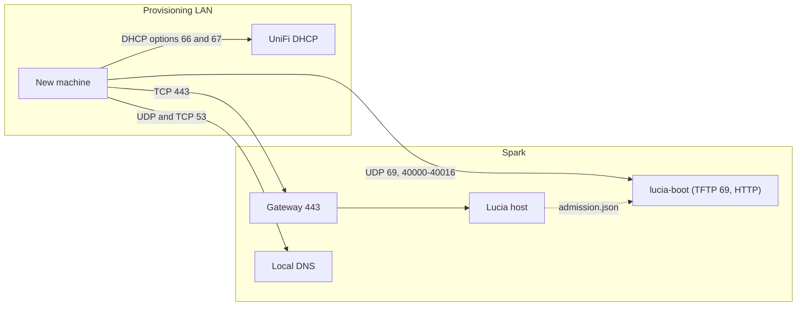
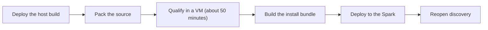

import WhoWhatWhy from '@site/src/components/WhoWhatWhy';
import Source from '@site/src/components/Source';

# Installer

<WhoWhatWhy
  who="Operators who prepare, deploy and troubleshoot Lucia's network install for new servers."
  what="The boot container and what it exposes, the router, DNS and firewall settings it needs, how a bundle is built, qualified and deployed, and how to check and repair it."
  why="Installing Debian over the network erases disks. Each artifact is hash-pinned and gated by a qualification run, so you can reason about exactly what will run on a stranger's hardware."
/>

Lucia installs servers by network boot. A new machine asks your router's DHCP server where to boot from, fetches a verified Debian installer from the Spark, registers itself, and waits for an owner to approve it. Owners see [Adding a server](../guide/adding-a-server.mdx). Developers should read [Installer (code)](../code/installer.mdx). This page covers running it.

The boot service is optional. The identity AppHost adds the `lucia-boot` container only when `boot-settings.json` exists in the identity state directory. A stock install doesn't have one, so discovery and installation stay unavailable until a maintainer prepares and deploys a bundle.

## Layout



UniFi stays the only DHCP server. Lucia never changes its configuration and holds no UniFi credentials for boot. The optional UniFi API key, used for address reservations, is separate (see [Networking and DNS](./networking-and-dns.mdx)).

## The boot container

| Property | Value |
|---|---|
| Name and image | `lucia-boot`, tag `lucia-boot:<hash>` built from `deployment/boot` (Debian 13.7 slim, `python3`, `dnsmasq-base`) |
| User and filesystem | `65534:65534`, read-only root, `/tmp` tmpfs with `noexec`, all capabilities dropped, `no-new-privileges` |
| Mounts | The prepared `public/` directory at `/boot` (read-only) and the host's `boot-control` directory at `/control` (read-only) |
| Ports | `<bind address>:69/udp`, `<bind address>:40000-40016/udp`, `<bind address>:<http port>` (default `9080`) to container port 8080 |
| Health check | `HEAD /debian-installer/amd64/linux`. A `403` counts as healthy, because it means the lease is closed. |

The ports are bound to one address, the Spark's address on the provisioning network, never `0.0.0.0`. TFTP (`dnsmasq`) runs only while the admission lease is valid. HTTP always runs but answers `403` when the lease is closed.

The lease is a file the Lucia host writes while the owner's discovery window is open. If the host stops, the container closes boot service within 10 seconds on its own. [Installer (code)](../code/installer.mdx#why-admission-is-a-lease-file) has the details.

## Router, DNS and firewall

### UniFi Network Boot, once

In UniFi Network, open **Settings → Networks**, pick the network new servers boot on, keep the gateway as the DHCP server and turn on **Network Boot**.

| Setting | Value |
|---|---|
| Boot server | The Spark's IPv4 address on that network, with no scheme or port |
| Boot file | `debian-installer/amd64/bootnetx64.efi` |
| **TFTP Server** toggle | Off. It sends option 66 again and isn't a TFTP daemon. |

Don't add duplicate custom options 66 or 67. The boot file is a TFTP path: keep the slashes and the directory prefix. UniFi is the only supported gateway today. Leave the setting on permanently. The owner's discovery window decides whether anything answers, so you don't revisit the router per server.

### DNS for the booting machine

The installer fetches its preseed over HTTPS from the controller's hostname and verifies the certificate. That name must resolve through the DNS servers that DHCP hands out. With AdGuard Home that's a rewrite from the controller's hostname to the Spark's address. A hosts-file entry on your desktop does nothing for a server that's still booting.

If DHCP supplies a search domain, the Debian installer appends it to a hostname without dots. `provision.py` therefore adds each `/etc/resolv.conf` search-domain form of the public host to the gateway certificate, and the controller accepts any host name on `/api/boot`. Make sure that longer name resolves too.

The target's clock has to be right. Lucia never turns off certificate checks to make an install work.

### Firewall

If the boot network is segmented, allow it to reach only these:

| Destination | Port | Used for |
|---|---|---|
| Spark | UDP 69 and UDP 40000-40016 | TFTP and its transfer ports |
| Spark | TCP 443 | The HTTPS preseed and API |
| Spark | TCP `<http port>` (default 9080) | Boot assets over HTTP |
| Your DNS server | UDP and TCP 53 | The controller's name |

No WAN forwarding. No second DHCP server.

:::warning
Classic PXE and TFTP don't authenticate the boot configuration or the initrd. Secure Boot doesn't cover them either. Run onboarding on a network you trust, ideally a dedicated provisioning VLAN, and never expose these ports to the internet. Lucia verifies everything from the HTTPS preseed onward.
:::

## What is qualified

| Configuration | Status |
|---|---|
| x86-64 UEFI network boot on the same LAN as the Spark | Qualified |
| Secure Boot | Reported, never changed. Qualified with it **off**. |
| Legacy BIOS PXE | Not qualified |
| ARM64 servers | Not qualified |
| Routed or cross-VLAN PXE | Not qualified |
| NICs that need firmware other than Realtek `rtl_nic` | Add the firmware to the bundle. The overlay carries Debian's verified `firmware-realtek` only. |

The first boot menu starts on its own after 3 seconds, and no screen waits for a key.

## Build, qualify and deploy

Any change to the boot scripts, the node agent or the bundle's packages changes `installation_payload_sha256` and needs a new qualification run. The pipeline is a set of maintainer scripts. The skill files in `.github/skills/lucia-installer-deploy` hold them.



1. **Deploy the host first.** The installer deploy checks that the running backend and the agent files match the ones that were qualified.
2. **Pack the source** (in WSL or Linux) into `install-source.tar.gz` plus its `.sha256`.
3. **Qualify.** Copy the archive to the Spark and run the disposable-VM install with `run-managed-vm.py`. It boots a UEFI guest with private networking, installs Debian on the chosen disk and checks enrollment, a heartbeat and a directory login. Look for `phase: qualified`. It takes about 50 minutes and can use KVM on another host.
4. **Deploy.** Upload `install-source.tar.gz`, its checksum, `deploy-install.py` and `managed-node-agent.tar.gz`, then:

```bash
python3 deploy-install.py prepare
python3 deploy-install.py deploy
```

`prepare` builds the installation bundle in a container with no network and verifies it against the qualified payload. `deploy` closes the discovery window, snapshots the previous source and `boot-settings.json`, installs the directory policy and the enrollment service, runs `prepare_boot`, redeploys, and then waits up to 3 minutes for `canInstall` to turn true. It asserts that no identity container was recreated. On any failure it restores the previous files and, if it had gone far enough, redeploys.

`--skip-qualification` exists for development builds that haven't passed the VM run. Never use it for a release.

:::note
Deploying closes the discovery window. Tell whoever is adding hardware to open **Add hardware** again before booting a machine.
:::

New boot files need to be added to `tools/desktop/bootstrap.py`, `src/Lucia.Desktop.Core/BootstrapPayload.cs` and `Lucia.Desktop.csproj`, or the desktop bootstrap won't ship them.

### Settings the deploy writes

`prepare_boot` records the prepared service in `boot-settings.json`, and the AppHost validates it on every start.

| Field | Meaning |
|---|---|
| `bind_address`, `network_cidr` | The Spark's address on the provisioning network and its private subnet |
| `http_port` | Boot HTTP port, 1024 or above. It must not collide with an identity port. |
| `bundle_sha256`, `assets_directory` | The prepared `public/` directory, under `boot/bundles/<hash>/public` |
| `image_tag`, `image_id`, `image_source_sha256` | The immutable boot image and its receipt |
| `discovery_qualified`, `installation_qualified` | The readiness flags that the host reads |

The state lives beside the identity directory, in `~/.local/share/lucia/boot`, with an `owner.json` that ties it to this installation. The AppHost rejects boot state that another installation owns, a mismatched image receipt or a symlink anywhere in the path.

## Check health

```bash
docker ps --filter name=lucia-boot --format 'table {{.Names}}\t{{.Status}}'
docker logs --tail 20 lucia-boot       # boot-admission-open / boot-admission-closed events

# HTTP: 200 while discovery is open, 403 while it is closed
curl -sI http://192.0.2.10:9080/debian-installer/amd64/linux | head -n 1

# TFTP only answers while discovery is open
curl -s -o /dev/null -w '%{http_code}\n' tftp://192.0.2.10/debian-installer/amd64/bootnetx64.efi
```

From an owner session, `GET /api/host/onboarding` shows the window, the readiness reasons, devices and tasks:

```bash
STATE=~/.local/share/lucia/identity
curl -fsS --cacert "$STATE/trust/lucia-root-ca.crt" \
  -H "Authorization: Bearer $(cat $STATE/secrets/host-owner-api-key)" \
  https://lucia.example.com/api/host/onboarding | jq '{window, readiness}'
```

The same API opens and closes the window: `POST /api/host/onboarding/window` with `{"minutes":30}` (1 to 60) and `DELETE /api/host/onboarding/window`. The window is closed after every host restart.

## Failure modes

| Symptom | Check |
|---|---|
| PXE times out | Is the discovery window open? Then the boot file path, the Spark's address and the UDP firewall rules. |
| The first loader downloads, then TFTP reports `/grubx64.efi` missing | The bundle predates the root `grubx64.efi` alias. Rebuild and redeploy the bundle. Don't change the UniFi boot file. |
| GRUB can't find its config, kernel or initrd | Keep the `debian-installer/amd64/` layout. Use Lucia's prepared bundle, not a stock Debian menu. |
| HTTPS preseed or registration fails | Client DNS, the target's clock, the hostname matching the certificate, and the current root CA in the overlay. Never disable verification. |
| Installer stops at `check-missing-firmware` | Read the missing filename on the diagnostic console (Alt+F4), add the verified Debian firmware to the bundle and network-boot again. A booted installer doesn't pick up a replaced overlay. |
| A disk has no stable identity | Leave it unapproved. Lucia won't substitute `/dev/sda` or a guess. |
| Installation controls are disabled | One of the readiness reasons on the Devices page is true: unqualified artifacts, enrollment or the worker not ready. Not a fault. |
| `lucia-boot` restarts with `invalid-admission-lease` | The lease file isn't a bounded regular file with the expected schema. Check `boot-control/` permissions (`0755`) and that nothing else writes there. |
| AppHost refuses to start with a boot error | The prepared boot state, receipt or image no longer matches. Redeploy the bundle with `deploy-install.py`. |
| A machine says it could not join Lucia after Debian installed | The install finished but enrollment staging failed. Read the task's message, fix it and network-boot again. A reinstall replaces what is there. |
