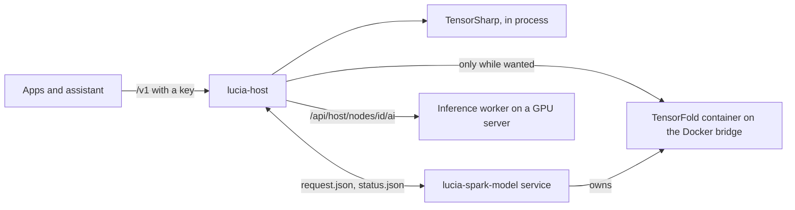
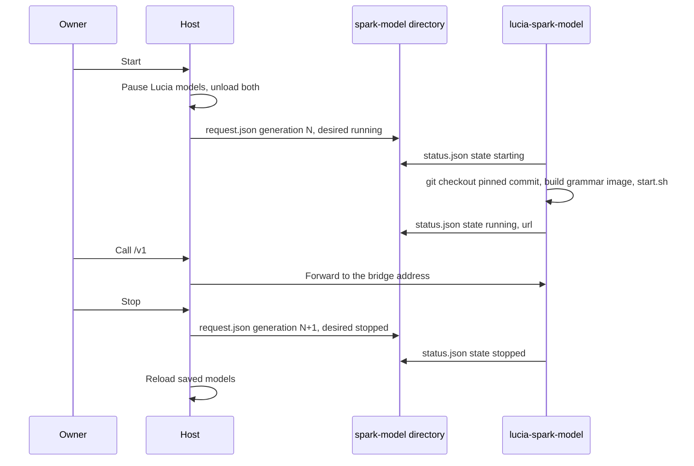

import WhoWhatWhy from '@site/src/components/WhoWhatWhy';
import Source from '@site/src/components/Source';

# Local AI

<WhoWhatWhy
  who="Operators who run, size, secure or debug Lucia's local model serving."
  what="The three engines, how memory is budgeted, where models and keys live, the API's authentication, the Spark recipe protocol and the inference worker image."
  why="The Spark has 128 GB of unified memory, and a model that does not fit takes the controller down with it. Lucia refuses a load it cannot fit instead of finding out at allocation time."
/>

## What runs where

| Engine | Runs in | Use |
|---|---|---|
| TensorSharp | `lucia-host` container on the Spark, on the GB10 GPU | Lucia's own LLM and embedding model, one of each |
| TensorFold recipe | A container started by the `lucia-spark-model` user service on the Spark | Qwen3.8-Flash-Next, 200,000 tokens of context, 4 conversations, nearly all of the Spark's memory |
| Local AI app | `lucia-inference` container on a managed GPU server | Lucia Inference (the same engine), vLLM or llama.cpp, from the catalog. See [Apps](./apps.mdx). |



The web host has no Docker access. Anything that needs a container runtime goes through a worker that owns the privileged step: `lucia-spark-model` for the Spark recipe, and the node agent for servers.

## State and storage

In the production deployment the host container mounts two host directories, both created by the installer under `~/.local/share/lucia/host`.

| Container path | Holds | Back up? |
|---|---|---|
| `/models` | Model library and `active-models.json` | Usually no. Models re-download. |
| `/data/huggingface` | `hf` cache and auth home | No |
| `/data/inference-keys` | `keys.json`, SHA-256 hashes of API keys | Yes |
| `/data/provider-credentials` | Hugging Face token, encrypted with Data Protection | Yes, with `/data/data-protection` |

Inside `/models` each model has its own directory named by a GUID with no dashes:

```text
/models/
  .lucia-model-catalog.lease      held open while the host runs
  active-models.json              saved chat and embedding selection with context sizes
  <guid>/model.json               manifest: source, state, inspection
  <guid>/files/                   what `hf download` wrote
```

The lease file keeps two hosts from sharing one directory. A second process fails to start rather than corrupt the first one's catalog. Do not point two Lucia hosts at the same NFS path, unless each uses its own subfolder, as the Local AI app does for a shared library.

A model has the states `Queued`, `Downloading`, `Ready`, `Failed`, `Canceled` and `Interrupted`. At startup the host marks anything that was queued or downloading as `Interrupted`, keeps the partial files, and shows **Retry**. It re-inspects every `Ready` GGUF, and a file that now fails validation becomes `Failed`. The queue holds at most 16 downloads at a time.

## The memory plan

Before every load the host computes a plan and refuses the load if the context does not fit:

```text
cacheBudget = memoryLimit
            - (OsReserveGiB + ServicesReserveGiB + VoiceReserveGiB + RuntimeReserveGiB)
            - weights * WeightMemoryMultiplier
            - the other loaded model (weights + its KV cache)
context     = min(nativeContext, cacheBudget / kvBytesPerToken), rounded down to 256
```

`kvBytesPerToken` is attention layers × KV heads × (key + value length) × 2 bytes (4 with `KV_CACHE_DTYPE=f32`). For the hybrid Qwen architectures only the full-attention layers count. Embedding models load on the CPU and count at their file size.

The memory limit is what .NET reports as available, so on the Spark it is the container's view of the unified memory. On anything that is not Linux arm64, a CUDA backend with no `HostPlatform__MemoryBudgetGiB` throws "Set HostPlatform:MemoryBudgetGiB to the usable device-memory budget", because host RAM is not VRAM.

The four reserves also set `TS_VRAM_HEADROOM_MB` for TensorSharp (their sum in MiB, or the existing value if it is larger). The production reserves are 8 GiB each, so TensorSharp keeps 32 GiB of headroom. The defaults in code are 4, 3, 8 and 3 GiB. The weight multiplier is 2 in the shipped `appsettings.json`. It is a calibration knob and not a measured constant.

The voice reserve belongs to a voice pipeline that does not exist on the Spark yet. It still counts, and it cannot go below 8 GiB.

Chat loads run with `MaxNumRunningSequences = 1` and a KV cache of context ÷ 256 blocks. All loads, unloads and requests share one semaphore, so model swaps wait for running requests to finish.

## API and authentication

The portal origin serves the OpenAI-compatible routes at `/v1`. They require the `HostInference` policy, which accepts any of these:

| Credential | Role | Notes |
|---|---|---|
| A signed-in portal session | Owner or Inference | What the Playground uses |
| `HostPlatform__ApiKey` as a bearer token | Owner | At least 32 characters |
| `HostPlatform__InferenceApiKey` | Inference | At least 32 characters, must differ from the owner key. The assistant uses it, over loopback, to reach the Spark's own model. |
| `lucia_inf_…` key from **Local AI → API keys** | Inference | Stored as a SHA-256 hash, optional expiry, checked on every request, up to 1,000 keys |

An inference role can call `/v1` and nothing under `/api/host`.

```bash
export LUCIA=https://lucia.example.com
export KEY=lucia_inf_xxxxxxxx   # created on Local AI → API keys

curl -sS -H "Authorization: Bearer $KEY" $LUCIA/v1/models | jq '.data[] | {id, backend, context_length}'

curl -sS $LUCIA/v1/chat/completions \
  -H "Authorization: Bearer $KEY" -H "Content-Type: application/json" \
  -d '{"model":"Qwen3.6-35B-A3B-UD-Q6_K_XL","messages":[{"role":"user","content":"Say hello."}],"max_tokens":64}'
```

The `model` field is the loaded chat model's file name without the extension, as listed by `/v1/models`. A name that does not match returns 404 with "The requested model is not the loaded chat model."

| Route | Notes |
|---|---|
| `GET /v1/models` | Loaded chat and embedding models |
| `POST /v1/chat/completions`, `POST /v1/responses` | Text only, 2 MiB body. `max_tokens`, `max_completion_tokens` and `max_output_tokens` must be between 1 and `MaxOutputTokens`. |
| `POST /v1/embeddings` | `503 model_not_loaded` when no embedding model is loaded |
| `GET /v1/responses/{id}` | A stored response |

Kestrel caps request bodies at 16 MiB. A 503 with `code: model_not_loaded` means nothing is loaded, paused for platform updates, or held by the Spark recipe. The body says which.

## Spark recipe: Qwen3.8-Flash-Next on TensorFold

TensorFold has no authentication, so it never listens on the LAN. The `lucia-spark-model` user service binds it to the gateway address of the host container's Docker network, which the host reaches and the LAN does not. Lucia's authenticated `/v1` forwards `models`, `chat/completions`, `responses`, `systemone` and `decisions` to it. While the recipe is stopped, `systemone` and `decisions` answer 503 with `code: model_not_loaded`.

<Source path="tools/runners/spark_model_worker.py" /> owns the recipe, pinned to one commit of its git repository, and its settings (`CHECKPOINT=nvfp4`, `VISION=1`, `PARALLEL=4`, `CONTEXT=200000`, `PORT=8888`, `PULL=0`). The host can only ask for `running` or `stopped`.

The pin is the head of the recipe's PR #69. That PR runs TensorFold's Zig engine (`tensorfold-native`) on NVIDIA's `nvidia/Qwen3.8-Flash-Next-FP4-Local` checkpoint, reads the n-gram table from the SSD, and serves images. Its patch 0016 builds xgrammar into the engine, so `response_format`, `text.format` and the `guided_*` fields are enforced. PR #69 isn't merged yet, so the worker fetches it by commit.

Lucia adds one engine patch of its own. <Source path="tools/runners/tensorfold/0017-engine-systemone.patch" /> brings `POST /v1/systemone` and `POST /v1/decisions` over from TensorFold's main branch. Both read the model's logits for each option at the end of the prompt and return probabilities, with thinking off and no generated text. The worker copies every file in `tools/runners/tensorfold/` into the recipe's `patches/` before it runs `scripts/prepare.sh`. The recipe labels its image with a hash of all the patches, so changing one rebuilds the image on the next start. No published image includes Lucia's patch, so the Spark always builds its own (`PULL=0`).

:::warning
The first start after a move to a new pin builds the engine and downloads about 96 GiB of weights. Plan for an hour or more of downtime. A container still running an older build gets stopped first, because a rebuild keeps the same image tag and the worker compares image IDs.
:::

The bootstrap installs the service but leaves it stopped. It needs `docker` and `git`, a non-root user and persistent user services (`loginctl` linger). It runs as `systemctl --user` unit `lucia-spark-model.service`.



The files sit in `<data>/spark-model/`:

```json
{ "schemaVersion": 1, "generation": 3, "desired": "running" }
```

`status.json` echoes the `generation` it applied, with `state` (`starting`, `running`, `stopping`, `stopped`, `failed`), `since`, `message`, `url` and `checkedAt`. The host ignores a status whose generation does not match the request, and treats the worker as unavailable when `checkedAt` is older than one minute. The first start builds the engine and downloads about 100 GB. The worker reports the last line of the recipe's output while it waits, which keeps the heartbeat fresh.

After a reboot the worker resets its remembered generation, so it re-applies the current request. Starting a running model again leaves it alone, unless the container runs an image other than the grammar image. Then the worker stops it, giving it 60 seconds, and starts it on the new image. If the container dies while `state` is `running`, the status becomes `failed` with its exit code.

While the model runs, the worker writes `telemetry/spark-model.json`, a Prometheus file-based service-discovery file. The Spark's relay reads it and scrapes TensorFold's `/metrics`. See [Observability](./observability.mdx).

## Hugging Face access

Downloads call the `hf` CLI (`HostPlatform__HuggingFaceExecutable`, `/opt/hf/bin/hf` in the container) with `--revision`, `--local-dir` and `--quiet`. The host strips `HF_TOKEN` and `HUGGING_FACE_HUB_TOKEN` from the child's environment and sets one deliberately: a token saved on the Models page wins, then `HostPlatform__HuggingFaceToken`. With no token, `HF_HUB_DISABLE_IMPLICIT_TOKEN=1` stops the CLI from picking up cached credentials. The token is never put in an argument list or a log.

## Inference worker for GPU servers

`Lucia.Inference.Worker` is the same runtime without the portal. It serves `/health`, `/metrics` (scrape with the inference key), `/api/worker/*` for model management (owner key) and `/v1/*` (inference key). Lucia deploys it as the Local AI app and sets these:

```yaml
services:
  inference:
    image: seiggy/lucia-inference:0.1.9-cuda13@sha256:d925446dc536136b7340689cc6586e6ceeadb315033f226e48ec3cf6a7ccb09b
    restart: unless-stopped
    ports: ["8080:8080"]
    environment:
      HostPlatform__ApiKey: ${LUCIA_WORKER_KEY}
      HostPlatform__InferenceApiKey: ${LUCIA_INFERENCE_KEY}
      HostPlatform__MemoryBudgetGiB: "24"
      HostPlatform__ModelDirectory: /models
    volumes: ["models:/models", "data:/data"]
```

The worker refuses to start unless `MemoryBudgetGiB` is positive, both keys are at least 32 characters and differ, the backend is `ggml_cuda` and the runtime reserve is at least 1 GiB. Its built-in defaults are OS, services and voice reserves of 0 and a runtime reserve of 2 GiB, because a GPU server serves models only and its OS lives in host RAM.

Build one image per CUDA line, from the commands at the top of <Source path="deployment/inference/Dockerfile" />:

```bash
dotnet publish src/Lucia.Inference.Worker -c Release -p:CudaLine=13 -o <context>/publish
docker build --platform linux/amd64 -f deployment/inference/Dockerfile -t lucia-inference:<version>-cuda13 <context>
```

With the vLLM or llama.cpp engine, the app sets `Worker__LibraryOnly=true`. The worker then only keeps the model library, mounts no GPU, and sets `RequireTensorSharp` to false so GGUFs that TensorSharp cannot run still become `Ready`. For llama.cpp, `HostPlatform__LlamaCache` points at a local directory that Ready GGUFs are copied into, with a `llama-models.ini` preset file that its router reads. `HostPlatform__LlamaLoadOnStartup` lists the model names it loads at start. Loading 40 GB from a 1 GbE share takes minutes. From local NVMe it takes seconds.

`HostPlatform__LlamaUrl` is `http://llama:8080`, the router on the app's own network. Whenever `llama-models.ini` changes, the worker calls `GET /models?reload=1` with the inference key. The router then picks up new downloads and restarts any loaded model whose settings changed. If the router isn't up yet, the worker logs that and moves on, because the router reads the file when it starts.

### Batch size for decision models

llama.cpp reads a prompt in micro-batches of 512 tokens by default. A `/v1/systemone` server has to fit one question and all its options in a single batch, so a choice with long option lists fails with HTTP 400 and "increase the batch size (current batch size: 512)". A 151-option question needs about 1,900 tokens.

The **Batch size** action on a GGUF LLM sets `LlamaBatchTokens` in its `model.json`, from 512 to 65,536 tokens. The preset file then gets `batch-size` and `ubatch-size` for that model. A larger batch costs GPU memory for llama.cpp's compute buffers. Embedding models aren't affected: they already get a batch as long as their context.

The vLLM app has two image settings. `vllm-image` picks `stable`, which is `vllm/vllm-openai:v0.32.0` (`v0.32.0-cu129` on CUDA 12), or `nightly`, a pinned build of vLLM main at commit `e68efc685ab1` from 2026-10-19. The nightly image runs CUDA 13 only. Lucia sets it when a model needs architectures that 0.32.0 does not support. `vllm-quantization` picks `none` or `fp8`. FP8 adds `--quantization fp8` and needs a GPU with compute capability 8.9 or newer (Ada or Hopper). `vllm-memory` (10 to 95, default 90) becomes `--gpu-memory-utilization`. vLLM checks that this share of each GPU is free at start-up, so lower it when other containers hold GPU memory.

## Metrics

TensorSharp logs each finished chat request. Lucia reads those entries with a logger provider and records the numbers as OpenTelemetry metrics under the meter `Lucia.Inference`, without the prompt or answer text. They are `lucia.inference.input_tokens`, `cached_tokens`, `output_tokens`, `time_to_first_token` and `duration`, tagged with `model` and `outcome`. The Observability app charts them next to vLLM, llama.cpp and TensorFold on its Inference dashboard.

## Checks and failure modes

```bash
docker inspect lucia-homelab-host --format '{{.State.Health.Status}}'
docker logs lucia-homelab-host --tail 50
ls -l ~/.local/share/lucia/host/data/spark-model/
```

| Symptom | Cause |
|---|---|
| Host exits at startup with an options error | A key shorter than 32 characters, both keys equal, an unsupported `Backend` (use `cpu`, `ggml_cpu`, `ggml_cuda` or `cuda`) or a reserve out of range |
| `/v1` returns `model_not_loaded` | No model selected, a platform update is running ([Spark updates](./spark-updates.mdx)), or the Spark recipe holds the memory |
| "The model does not fit after voice, OS, services, and runtime reservations." | Lower the context, pick a smaller quantization, or unload the other model |
| Startup message "Startup model loading failed" | The saved selection could not load. The management API stays up so an owner can fix it. |
| Recipe `state: failed` | Read `status.json` `message`, then `journalctl --user -u lucia-spark-model` |
| Another Lucia host fails on `/models` | The lease file is held. Stop the other host. |
| 409 `vllm_nightly_needs_cuda13` | `vllm-image` is `nightly` on a server without CUDA 13. Use `stable`, or move the model to a CUDA 13 host. |
| 409 `vllm_fp8_unsupported` | `vllm-quantization` is `fp8` on a GPU below compute 8.9. Use `none`. |

All settings are listed in [Configuration](./configuration.mdx). The code behind this page is in [Local AI (code)](../code/local-ai.mdx).
