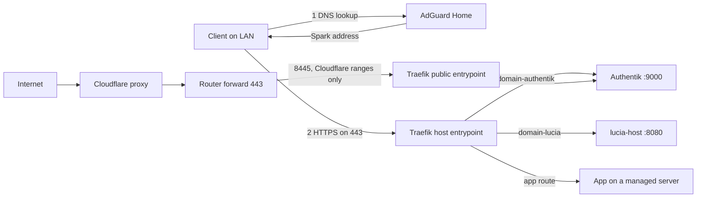

import WhoWhatWhy from '@site/src/components/WhoWhatWhy';

# Networking and DNS

<WhoWhatWhy
  who="DevOps engineers running a Lucia Spark and the servers behind it."
  what="The Traefik gateway, the DNS records in AdGuard, the Let's Encrypt certificate, the activation helper, public access, the ports, and how to check each."
  why="A homelab has to be useful on the LAN, publish nothing by default, and change as little of an existing network as it can. This layout does that with one TLS front door."
/>

## How a request gets to an app

One Traefik container on the Spark terminates TLS for every Lucia name. AdGuard Home answers the names on the LAN. Cloudflare only proves domain ownership, unless you turn on public access.



For `https://grafana.lab.example.com` from the LAN:

1. The client asks its DNS server, which is AdGuard. A rewrite `grafana.lab.example.com` points at the Spark.
2. The client connects to the Spark on 443 and sends the name in TLS SNI. Traefik serves the Let's Encrypt certificate, whose wildcard covers `*.lab.example.com`.
3. A router in `apps.yml` matches the host and forwards to the server that runs the app. A gRPC request (by `Content-Type`) goes to the route's separate cleartext HTTP/2 port.

Until a domain is active, the gateway serves a certificate from Lucia's private CA for the Spark's own name.

## Ports

| Port | Host | What is behind it |
|---|---|---|
| 443 | Spark | Traefik `host` entrypoint (container port 8444): Lucia, the Spark alias and app routes |
| 9443 | Spark | Authentik, with the private CA's certificate |
| 636 | Spark | LDAPS to OpenLDAP |
| 9444 | Spark | The private CA (step-ca) |
| 8445 | Spark | Traefik `public` entrypoint. Published only while public access is on. |
| 53 | Servers | Each AdGuard instance, on its own address. See [AdGuard HA](./adguard-ha.mdx). |

The 9443, 636 and 9444 defaults come from the bootstrap settings and can differ per installation.

## Gateway configuration

Lucia generates the gateway's routes as files and Traefik watches them. The web host never gets the Docker socket.

| File | Written by | Holds |
|---|---|---|
| `gateway/domains/domain.yml` | `DomainIngressConfiguration` | Routers for Lucia, Authentik and the Spark alias redirect, plus the TLS certificate pair |
| `gateway/domains/apps.yml` | `AppGateway` | One router per app route and per external service |

The host container mounts that directory at `/domain-gateway` and sets `DomainOnboarding__GatewayDirectory` to it. Traefik mounts the parent as `/config` and the certificates read-only as `/domain-certificates`. The files use the `.yml` extension but hold JSON, which is valid YAML. Traefik ignores `.json`, and its watcher does not follow nested directories, so Lucia touches the top-level directory after every write to force a reload.

A trimmed `domain.yml` for `example.com`:

```json title="gateway/domains/domain.yml (shape)"
{
  "http": {
    "routers": {
      "domain-lucia": { "entryPoints": ["host"], "rule": "Host(`lucia.lab.example.com`)", "service": "domain-lucia", "tls": {} },
      "domain-authentik": { "entryPoints": ["host"], "rule": "Host(`auth.lab.example.com`)", "service": "domain-authentik", "tls": {} },
      "domain-spark": { "entryPoints": ["host"], "rule": "Host(`atlas.lab.example.com`)", "service": "noop@internal",
        "middlewares": ["domain-spark-redirect"], "tls": {} }
    },
    "services": {
      "domain-lucia": { "loadBalancer": { "servers": [{ "url": "http://lucia-host:8080" }] } },
      "domain-authentik": { "loadBalancer": { "servers": [{ "url": "http://identity-server:9000" }] } }
    }
  },
  "tls": { "certificates": [{ "certFile": "/domain-certificates/...", "keyFile": "/domain-certificates/..." }] }
}
```

Each write goes through a pending file and an atomic rename, and refuses symlinks. The previous file is stored in the job so a failed activation can restore it.

## DNS records

AdGuard rewrites are the only local DNS Lucia touches. The reconciler `ManagedNodeDns` runs on every change and at least every 5 minutes.

| Record | Answer | Kept by |
|---|---|---|
| Lucia, Authentik, Spark alias | Spark ingress address | Domain activation |
| `<node>.<namespace>` | The node's latest heartbeat address | `ManagedNodeDns` |
| `<app>.<namespace>` | Spark ingress address | `ManagedNodeDns` from `StackStore.ActiveRoutes` |
| `adguard-<node>.<namespace>`, the AdGuard connection's name | Each instance, and the primary | `AdGuardFleet` |

Lucia adds only missing exact records. A matching existing rule is kept and never claimed. A different or duplicate rule blocks setup, and review lists it. Answers must be private (RFC 1918 or ULA); a public address is refused. The ownership journal for records Lucia wrote lives in the node DNS state file, so it deletes only what it created.

UniFi stays in charge of DHCP. To make clients use AdGuard, set the network's DHCP DNS servers to the AdGuard addresses yourself. Lucia never edits them.

## Certificates

Certbot 5.8.0 with the Cloudflare DNS plugin is installed in the host image at `/opt/certbot`. It runs as the host's non-root user.

- **Challenge:** ACME DNS-01. Certbot writes `_acme-challenge.<name>` TXT records through the Cloudflare API, waits for propagation (default 60 s, range 10 to 600), then removes them. After each run Lucia lists the challenge records and fails if a new one remains.
- **Names:** the namespace and `*.<namespace>`, plus an exact name for any custom URL outside that wildcard coverage. A wildcard covers one label only.
- **Staging first:** activation runs a `--dry-run` against Let's Encrypt staging. It still creates and deletes real TXT records.
- **Isolation:** Certbot gets `--config`, `--work-dir`, `--logs-dir` under the state directory, a generated empty `cli.ini`, `--no-directory-hooks`, and `--strict-permissions`. Saved renewal hooks in the lineage are rejected.
- **Token:** written to a private temp file, passed by path, and deleted after the run. A hard crash can leave the file until the next operation replaces it.
- **Renewal:** `renew --keep-until-expiring` every 12 hours from the host's worker, with no independent systemd or cron timer. The result is `Renewed`, `NotDue` or `Failed`.
- **Publication:** the leaf, chain and key are copied to `certificates/` as an immutable pair, and the gateway config points there. Lucia then probes HTTPS by SNI against the expected SHA-256 before changing DNS.

Cloudflare needs a token scoped to the one root zone with **DNS Write** and **Zone Read**. Both policies must name the same zone. DNS Write is not limited to `_acme-challenge`, so the token can edit any record in that zone.

## Activation helper

The web host holds neither Authentik's admin token nor the Docker socket. A user service on the Spark, `lucia-domain-activation.service`, reads reviewed requests from `activation-requests/` and writes `activation-responses/`. It can change only Lucia's own OIDC callbacks and launch URL, and it touches `tls.yml` to wake the gateway.

```bash
# Run as the account that did the setup
loginctl show-user "$USER" -p Linger            # expect Linger=yes
systemctl --user status lucia-domain-activation.service
```

If lingering is off, the service stops at logout and the review shows a blocker, "The scoped activation service is not ready." Fix it with `loginctl enable-linger "$USER"`.

## Public access

Off by default. `PUT /api/host/domains/public` with `{"enabled": true}` (owner credentials) queues a change, and the worker runs a longer flow: issue a certificate that adds `*.<zone>`, publish routers that include the `public` entrypoint, add local DNS for Authentik's new name `auth.<zone>`, rewrite the profile, and restart. A failure keeps the previous gateway file and addresses.

While it is on, `PublicIngress` re-checks every 5 minutes and whenever routes change:

- proxied Cloudflare A records for Authentik and each public app name, pointing at the WAN address that `https://1.1.1.1/cdn-cgi/trace` reports, with the comment `Managed by Lucia`. Lucia changes or deletes only records with that comment. It adopts an existing record only if it already answers with the WAN address.
- a UniFi port forward named `Lucia public ingress`, TCP 443 to the Spark's port 8445. Without UniFi you forward it yourself.
- Traefik's `public` entrypoint accepts connections only from Cloudflare's published ranges (`ipAllowList`), and trusts Cloudflare's `X-Forwarded-For` and `X-Forwarded-Proto`. Only the Authentik router and routes with a public name join it.
- Each public router gets a `<router>-forwarded` header middleware. It clears the proxy headers a visitor could send (`Forwarded`, `X-Forwarded-Host`, `X-Real-Ip` and the other `X-Forwarded-*` and rewrite headers), then sets `X-Forwarded-Host` to the public name and `X-Forwarded-Port` to 443.

Turning it off deletes Lucia's records, disables its forward and moves Authentik back under the namespace.

## State and backup

Everything lives under the host's data directory, in `domains/` (mounted as `/data/domains`), next to `network-credentials/` and `data-protection/`.

| Path | Contents |
|---|---|
| `domains/workflow.json` | The plan or job, its phases, receipts and the mutation journal |
| `domains/active.json` | The committed domain profile |
| `domains/certbot/`, `domains/certificates/` | ACME account and lineage, published certificate pairs |
| `domains/activation-requests/`, `activation-responses/` | The queue to the activation helper |
| `domains/adguard-fleet.json`, `adguard-certificate.json` | Fleet primary, health and the AdGuard certificate state |
| `network-credentials/` | Cloudflare token, AdGuard login and UniFi API key, each encrypted |
| `data-protection/` | The keys that decrypt the above |

Back up `domains/` and `data-protection/` together. Without the keys, the saved Cloudflare, AdGuard and UniFi credentials cannot be read, and you would reconnect each one. Never delete `workflow.json` or `.workflow.lock` to start over; the store refuses to reset an in-flight change.

## Verify

```bash
# The gateway answers for the name and serves the right certificate
curl -sS --resolve lucia.lab.example.com:443:192.0.2.10 https://lucia.lab.example.com/health/live
openssl s_client -connect 192.0.2.10:443 -servername lucia.lab.example.com </dev/null 2>/dev/null \
  | openssl x509 -noout -dates -ext subjectAltName

# Authentik's issuer matches its public name
curl -sS --resolve auth.lab.example.com:443:192.0.2.10 \
  https://auth.lab.example.com/application/o/lucia/.well-known/openid-configuration

# AdGuard answers the name (use an AdGuard address)
dig +short @192.0.2.2 lucia.lab.example.com

# Public path, from outside: the Cloudflare edge answers, the origin only accepts Cloudflare
curl -sS -o /dev/null -w '%{http_code}\n' https://auth.example.com/
```

The same checks are visible in **Settings → Domains**, from `GET /api/host/domains/overview`: published routes, certificate names and expiry, the last renewal outcome, and every managed AdGuard record with its state.

## Failure modes

| Symptom | Likely cause | Fix |
|---|---|---|
| Setup blocked: delegation mismatch | The registrar's NS records differ from the Cloudflare zone | Point the registrar at the zone's nameservers |
| `_acme-challenge` is a CNAME, or a name has an NS delegation | Delegated challenge layouts are unsupported in v1 | Serve the names directly from the zone |
| Certbot fails in staging | Token lacks DNS Write, wrong zone, slow propagation | Rescope the token, raise propagation seconds |
| Gateway serves a different certificate | Traefik did not reload, or cannot read the pair | Check `domain.yml` loaded and `/domain-certificates` is mounted |
| Activation stuck in `ActivationCheck` | The restarted host cannot confirm the new URLs | It retries each minute; legacy API access stays available |
| `409` changing the AdGuard or Cloudflare connection | A setup, renewal or public change is running | Wait for it to finish |
| Renewal shows `Failed` | Token expired, deleted, or the account changed | Replace the token in **Settings → Domains** |

Failed setup keeps the job and a confirmed diagnosis. Cleanup is ownership-checked: Lucia removes only rewrites it created and the gateway file it published, and anything that changed in the meantime is left for you. When it cannot be sure, `recoveryRequired` stays set and `POST /api/host/domains/jobs/{id}/recover` retries the cleanup. Authentik registration is rolled back through the activation helper.

An optional advisory support agent explains the diagnosis through the loaded local chat model, with a 90 second deadline and no tools. It never falls back to a cloud model. See [the code page](../code/domains-and-dns.mdx) for how it is wired.

## Related pages

- [Domains and DNS (code)](../code/domains-and-dns.mdx), the onboarding state machine.
- [AdGuard HA](./adguard-ha.mdx), the replicated DNS fleet.
- [Identity](./identity.mdx), the Authentik and private CA side of sign-in.
- [Nodes](./nodes.mdx), where server addresses come from.
