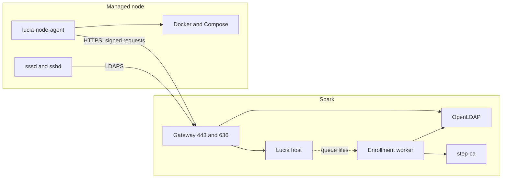

import WhoWhatWhy from '@site/src/components/WhoWhatWhy';
import Source from '@site/src/components/Source';

# Managed nodes

<WhoWhatWhy
  who="Operators who run a Lucia Spark and the Debian servers it manages."
  what="The controller and node layout, the files and services on a node, network requirements, controller state, health checks, agent upgrades and failure modes."
  why="Nodes run your containers and take actions from the controller as root. Knowing exactly what is on them, and what each side may reach, is how you keep them predictable."
/>

A **managed node** is an x86-64 Debian 13 server with a Lucia agent on it. The agent calls the Spark and never listens for connections. Owners use it through the Devices page ([Servers](../guide/servers.mdx)). Developers will want [Managed nodes (code)](../code/nodes.mdx). To create one, see [Installer](./installer.mdx).



## Requirements for a node

| Need | Detail |
|---|---|
| Hardware | x86-64 with UEFI. Secure Boot is reported and never changed. It's qualified with Secure Boot off. |
| Network | In one of the subnets listed in `Boot__AllowedNetworks`. The controller refuses `/api/nodes` calls from any other source address. |
| Outbound to the Spark | TCP 443 (HTTPS API) and 636 (LDAPS), both by the controller's hostname. |
| Outbound to the internet | `deb.debian.org` for packages, your image registries, and `nvidia.github.io` when an NVIDIA driver is loaded. |
| DNS | The controller's hostname must resolve. The agent pins the controller's origin and CA at install time, so renaming the controller's public host later doesn't move nodes. |
| Clock | Accurate. A certificate with a `NotBefore` in the future is refused. |

Nodes open no inbound port of their own except SSH. All controller traffic is initiated by the agent.

## What the installer puts on a node

| Path | Content | Mode |
|---|---|---|
| `/usr/lib/lucia/agent/` | The agent: a flat, self-contained .NET runtime and `lucia-node-agent` | root, `0700`/`0600` |
| `/etc/systemd/system/lucia-node-agent.service` | Runs `lucia-node-agent managed-run` as root, `UMask=0077`, restart on failure | |
| `/etc/lucia/managed.json`, `/etc/lucia/public-ca.crt` | The pinned origin and the private root | |
| `/var/lib/lucia-agent/private/` | The node's P-256 key, the CSR, the grant, the certificate and LDAP settings. Losing it means reinstalling the node. | `0700`/`0600` |
| `/etc/sssd/sssd.conf` | LDAPS, `lucia-owners` only, cached credentials | `0600` |
| `/etc/ssh/sshd_config.d/00-lucia.conf` | No root login; only `lucia-owners` and `lucia-recovery`; PAM on | |
| `/etc/ssh/lucia-authorized-keys/<user>` | Owner keys delivered by each heartbeat | `0644`, root-owned |
| `/etc/sudoers.d/lucia-owners`, `lucia-recovery` | `%lucia-owners` with password; the recovery key without | `0440` |
| `/etc/docker/daemon.json` | Lucia-owned: `172.16.0.0/12` networks in /24s, `local` log driver, `cgroupfs` | |
| `/srv/lucia/stacks/<name>/` | Each app's compose file, `.env` and `volumes/` | root, `0700` |
| `/srv/data` | The pooled extra disks, if the machine had any (`nofail` in fstab) | |

The agent installs Docker, Compose and, with an NVIDIA driver loaded, the container toolkit from NVIDIA's repository using a key embedded in the agent. GPU drivers stay yours to manage.

## Controller state

On the Spark, under `~/.local/share/lucia/host/data` (mounted as `/data` in the host container):

| Path | Holds |
|---|---|
| `onboarding/state.json` | The journal of devices, tasks and events. Never delete it: the host refuses to start on a missing or corrupt file. |
| `nodes/identities/<nodeId>.json` | Each node's certificate, key fingerprint, latest heartbeat and address |
| `nodes/enrollment-requests/`, `enrollment-responses/` | The queue between the host and the enrollment worker |
| `nodes/enrollment-worker.json` | The worker's liveness record. The host needs it fresher than 45 seconds. |
| `nodes/ssh-keys.json` | Owner SSH keys, up to 10 each |
| `nodes/dns-records.json` | The AdGuard rewrites Lucia created for nodes |
| `boot-control/admission.json` | The boot lease. See [Installer](./installer.mdx). |

Back all of it up with the rest of `/data`. See [Identity](./identity.mdx) for the backup set.

Settings arrive as environment variables on `lucia-homelab-host`, set from `boot-settings.json`:

```text
HardwareOnboarding__DiscoveryNetworkCidr=192.0.2.0/24
HardwareOnboarding__BootBaseUrl=https://lucia.example.com
HardwareOnboarding__EnrollmentStatusFile=/data/nodes/enrollment-worker.json
Boot__Enabled=true
Boot__AllowedNetworks__0=192.0.2.0/24
```

Both CIDRs must be private IPv4 subnets (RFC 1918) no wider than a `/8`.

## Check a node

From the Spark, with the owner key:

```bash
STATE=~/.local/share/lucia/identity
curl -fsS --cacert "$STATE/trust/lucia-root-ca.crt" \
  -H "Authorization: Bearer $(cat $STATE/secrets/host-owner-api-key)" \
  https://lucia.example.com/api/host/nodes \
  | jq '.[] | {hostname, state, address, lastSeenAt, certificateExpiresAt}'
```

`state` is `Online` when the last heartbeat is under 2 minutes old, `Stale` after that, and `AwaitingHeartbeat` before the first one. On the node (as `lucia-recovery`, or as an owner with `sudo`):

```bash
sudo systemctl is-active lucia-node-agent
sudo journalctl -u lucia-node-agent -n 50 --no-pager
getent group lucia-owners          # directory lookup works
sudo docker compose ls             # stacks the agent runs
```

On the Spark:

```bash
systemctl --user status lucia-node-enrollment.service
```

## Remote actions and their limits

Owners can run **Check now**, **Install updates**, **Restart** and **Update agent** from Devices. The assistant can do the same, and can run a command on a node, always after asking. None of these accepts an arbitrary executable from the server.

| Action | What runs | Limits |
|---|---|---|
| Check for updates | `apt-get update`, then `apt-get -s upgrade --with-new-pkgs` | Also on its own 2 minutes after start and every 6 hours |
| Install updates | `apt-get -y upgrade --with-new-pkgs`, keeping existing config, in a transient `lucia-apt-upgrade` unit | Never removes packages or changes releases. One update action at a time. |
| Restart | `systemctl reboot` | |
| Update agent | Downloads the agent the controller ships, checks its release ID, swaps `agent` and `agent.prev` | Tar of plain files only, 512 files, 512 MiB |
| Assistant command | A script as a transient `lucia-exec-<job>` unit | bash, sh or python3. 16 KB of script, 30 minutes, 4 at once, last 32 KB of output |

An assistant command runs as root. Its output stays in the journal (`journalctl -u 'lucia-exec-*'`), and it outlives an agent restart. See [Assistant](./assistant.mdx) for how approval works and [Security model](./security-model.mdx) for why owner access equals root on nodes.

## Upgrade the agent

If the node's agent can report its release, **Update agent** on the Devices page does everything. The controller ships the agent inside its own publish output under `boot/node-agent-linux-x64`, so deploying a new host build is what makes an update available.

The first upgrade of an old agent that predates self-update is manual:

```bash
scp managed-node-agent.tar.gz upgrade-agent.sh lucia-recovery@node.example.com:/tmp/
ssh lucia-recovery@node.example.com "sudo bash /tmp/upgrade-agent.sh"
```

The script stops the service, copies `agent` to `agent.prev`, unpacks the new build, fixes ownership and modes, starts the service and prints `active` after 20 seconds if it's healthy. To roll back by hand:

```bash
sudo systemctl stop lucia-node-agent
sudo rm -rf /usr/lib/lucia/agent && sudo mv /usr/lib/lucia/agent.prev /usr/lib/lucia/agent
sudo systemctl start lucia-node-agent
```

Build the tarball with `dotnet publish src/Lucia.NodeAgent -c Release -r linux-x64 --self-contained true`. Run the agent checks (`tests/Lucia.NodeAgent.Checks`) on Linux first when the agent changed. Don't skip the checks: the agent runs as root on every node.

## Remove a node

**Remove from Lucia** deletes the device record, task, identity and DNS name. The agent's next heartbeat gets the same refusal as an unknown node. The enrollment worker then deletes the node's LDAP reader and enrollment receipt. Lucia refuses while an app is placed there or an install is running. The machine itself is untouched: wipe it or reinstall it separately. To reuse the hardware, network-boot it again.

## Failure modes

| Symptom | Likely cause | What to do |
|---|---|---|
| Node stays `AwaitingHeartbeat` | First-boot enrollment is pending or failed | `journalctl -u lucia-node-agent` on the node. Check `enrollment-worker.json` freshness and the worker unit on the Spark. |
| Enrollment returns 503 `node_worker_unavailable` | Worker not running or its record is over 45 seconds old | Restart `lucia-node-enrollment.service`. |
| Heartbeats refused after a long outage | The 24-hour certificate lapsed | The agent recovers through `/renew` on its own. If it can't, check the clock and the CA. |
| Node's `sshd` rejects every owner | LDAP unreachable or `lucia-owners` empty | Use `lucia-recovery` with the recovery key and `systemctl status sssd`. |
| `This agent is too old to update itself` | Agent predates release reporting | One manual upgrade, as above. |
| Node reports from the wrong address range | It's outside `Boot__AllowedNetworks` | Add its subnet to the boot settings and redeploy the identity AppHost. |
| `docker` or the NVIDIA toolkit not ready | The 15-minute check hasn't run or failed | The heartbeat carries the last failure. It shows on the node's card. |
