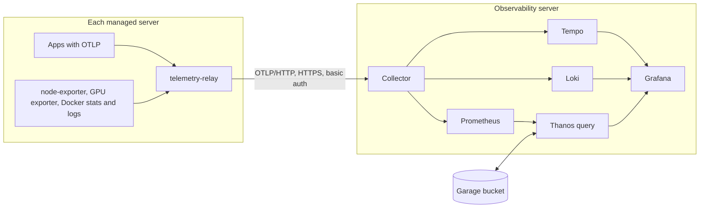

import WhoWhatWhy from '@site/src/components/WhoWhatWhy';

# Observability

<WhoWhatWhy
  who="Operators who install, size, secure and troubleshoot Lucia's telemetry stack."
  what="What the Observability and Object storage apps run, which ports they open, how data flows from a server to a Grafana panel, how long each signal is kept, and how to check it works."
  why="Lucia runs this stack for you, but when a panel is empty you have to know which hop broke. The design also decides your disk use: one hour of raw metrics, then averages."
/>

Lucia has two telemetry layers. The Spark's own health on the Home page is built into the web host, with no extra containers. The full stack is two optional catalog apps: **Object storage** (Garage, an S3-compatible store) and **Observability** (OpenTelemetry Collector, Prometheus, Thanos, Loki, Tempo and Grafana). A third piece, the **telemetry relay**, is a small collector that Lucia runs on every machine while Observability is installed. Developers should read [Observability internals](../code/observability.mdx). Newer users get [Monitoring](../guide/monitoring.mdx).

## Data flow



The relay posts over HTTPS to the collector's `otlp` name once your domain is active, or to `http://<server>:4318` before. Every request carries HTTP basic auth, so the collector accepts no anonymous data.

## Requirements and install order

- A server with Docker ready and room for about 20 GB of telemetry. Metrics and logs are bounded by the retention below, but traces and Loki chunks vary with traffic.
- Install **Object storage** first, on any server with room for what your apps keep. Observability then finds its bucket within about 15 seconds. You can install it afterwards too. Until the bucket exists, Thanos writes its averaged tiers to a local Docker volume. Lucia doesn't copy those blocks into the bucket afterwards.
- Install **Observability** from **Apps → Add an app**.
- For Grafana sign-in through Lucia and friendly names, activate your domain first. See [Networking and DNS](./networking-and-dns.mdx) and [Identity](./identity.mdx).

Both apps can run on the same server or different ones. Object storage isn't server-bound, so it can move, and Lucia follows it.

## Components and ports

Versions are pinned by digest in the template. Changing one means a template version bump and a re-render ([Running apps](./apps.mdx#roll-out-a-template-change)).

| Component | Version | Role | Retention |
|---|---|---|---|
| OpenTelemetry Collector (contrib) | 0.161.0 | OTLP in with basic auth, NetFlow in, routes to the stores | Persistent sending queue of 5,000 batches on disk |
| Prometheus | v3.15.0 | Raw metrics, OTLP receiver enabled | 1 hour |
| Thanos | v0.42.4 | Sidecar, query, store, 4 rulers, compactor | 6 h, 24 h, 7 d and 30 d per tier |
| Loki | 3.7.8 | Logs, filesystem storage | 168 hours (7 days) |
| Tempo | 3.1.0 | Traces, local storage | 336 hours (14 days, default) |
| Grafana | 13.2.2 | Dashboards, sign-in through Authentik | |
| Garage (Object storage) | v2.4.1 | S3 store, one node | Until you delete |
| garage-ui (Object storage console) | v0.13.0 | Web console, owners only | |

### Ports published on the host

| Port | Protocol | Service | Setting |
|---|---|---|---|
| 3030 | TCP | Grafana | `grafana-port` |
| 4317 | TCP | Collector, OTLP gRPC | `otlp-grpc-port` |
| 4318 | TCP | Collector, OTLP HTTP | `otlp-http-port` |
| 4319 | TCP | Collector, CrowdSec's alert intake (TLS only) | `alerts-port` |
| 2055 | UDP | Collector, NetFlow v5/v9 and IPFIX | Fixed |
| 3900 | TCP | Garage S3 API | `s3-port` |
| 3909 | TCP | Garage console | `console-port` |

Everything else stays on the stack's private Docker network: Prometheus (9090), Loki (3100), Tempo (3200 and OTLP 4317), Thanos query (10902, gRPC 10901) and Garage's RPC (3901) and admin API (3903). Garage's admin token and the collector's credentials are generated into the app's `.env` and never leave the Spark and the node.

With a domain active, the gateway also serves two names for Observability (`grafana` and `otlp`, by default) and two for Object storage (`s3` and `storage`). The `otlp` name routes gRPC (by content type) to the gRPC port and everything else to the HTTP port. A third name, `otlp-alerts` (setting `alerts-host`), doesn't go through the gateway: AdGuard points it straight at the Observability server, for CrowdSec's alert intake. Observability installs without a domain; that name only appears once one is active. Point a NetFlow exporter, such as a UniFi gateway, at `<observability server>:2055`.

### On each managed server

The relay is a Compose project named `lucia-telemetry-relay`. It runs on the host network and binds only to loopback:

| Address | What |
|---|---|
| `127.0.0.1:14317` | Relay OTLP gRPC, for apps and Lucia's agent |
| `127.0.0.1:14318` | Relay OTLP HTTP |
| `127.0.0.1:19100` | node-exporter |
| `127.0.0.1:19835` | `nvidia_gpu_exporter`, only on servers with an NVIDIA GPU usable from containers |

It also reads the Docker socket (read-only) and `/var/lib/docker/containers`, so the collector runs as root with all capabilities dropped and `no-new-privileges`. Any process that can read that socket controls Docker anyway, so the relay doesn't widen the exposure.

Scrape and collection interval is 30 seconds.

### On the Spark

The installer runs a relay container with `node-exporter` beside the controller. It has no Observability credentials. It posts to the controller at `/api/host/telemetry/relay/v1/{traces|metrics|logs}` with an `X-Lucia-Relay` token generated into `relay-token` in `Telemetry:RelayDirectory`. The controller forwards to wherever Observability runs now, so moving the app doesn't break the Spark's feed. The gateway's access logs take the same path, with credentials and query strings dropped. While a CrowdSec app runs, the Observability collector also forwards those records to it (see below). CrowdSec's metrics come from the server it runs on: that server's relay scrapes them on loopback as the `crowdsec` job. See [Gateway protection](./crowdsec.mdx).

### Forwarding the gateway's log to CrowdSec

The collector loads a third config from its environment, `--config=env:LUCIA_CROWDSEC_COLLECTOR`, next to the lab map's SNMP one, and a fourth, `--config=env:LUCIA_CROWDSEC_INTAKE`, for CrowdSec's alerts. All are empty until Lucia fills them, and the health check validates all four. While a CrowdSec app is installed, settled, running and holding its certificate, Lucia sets two variables on every Observability app:

| Variable | Holds |
|---|---|
| `LUCIA_CROWDSEC_COLLECTOR` | One line of YAML, single-quoted so compose leaves it alone. It adds a `logs/crowdsec` pipeline that keeps only records whose `service.name` is `lucia-gateway`, stamps a `time` attribute, and sends them as OTLP/JSON to CrowdSec's log intake over TLS that trusts Lucia's root alone. |
| `LUCIA_CROWDSEC_TOKEN` | The intake's shared secret. The collector expands it into the `X-Lucia-Intake` header itself, so it never sits in the config line. |
| `LUCIA_CROWDSEC_INTAKE` | One line of YAML with the alert intake: an OTLP/HTTP receiver on 4319 with TLS 1.2 or later and the collector's own Basic credentials, whose only pipeline goes to Loki. It holds the intake's certificate and key from Lucia's CA inline, so the Apps page shows it as `[kept by Lucia]`. Set once the certificate is issued, while a CrowdSec app is installed, whether its engine runs or not. | Lucia's web address, such as `https://lucia.lab.example.com`, set whenever a CrowdSec app is installed and a domain is active. Compose writes it into the Lucia CrowdSec dashboard's links. |

A send that fails is dropped instead of retried (`retry_on_failure: {enabled: false}`, 5 second timeout). An engine that's down therefore loses its share of the log and nothing else; the Loki pipeline never waits on it. Changing either variable bumps the stack's revision, so the collector container restarts once.

### CrowdSec in Grafana

From catalog version 13, Loki indexes one resource attribute beyond the defaults, `crowdsec.kind`, so CrowdSec's alert records get the labels `service_name="crowdsec"` and `crowdsec_kind` (`crowdsec` or `waf`). Everything else in them is structured metadata ([the fields](./crowdsec.mdx#alerts-in-loki)). The engine sends them straight to the alert intake over TLS, checking the certificate against Lucia's root.

| Dashboard | Source | Shows |
|---|---|---|
| **Lucia CrowdSec** (`lucia-crowdsec`) | Loki, plus `cs_active_decisions` and the AppSec counters from Prometheus | Alerts, bans and AppSec blocks in the time range; alerts by scenario and by source class; an offenders table (address, scenario, path, user agent, country, count, last seen, decision, and a line to paste to the assistant); top offenders; active bans by origin; recent blocks and bans |
| **CrowdSec overview**, **details per server**, **insight**, **local API** (`crowdsec-*`) | Prometheus, job `crowdsec` | CrowdSec's community dashboards, adapted for Lucia |

The community dashboards come from `crowdsecurity/grafana-dashboards` (`dashboards_v5`, commit `0d34f68`, MIT; the license ships beside them). `tools/telemetry/crowdsec-dashboards.mjs` fetches that commit and adapts them: the provisioned `prometheus` datasource, `job="crowdsec"` on process metrics, `cs_bucket_instantiation_total` for the renamed bucket counter, the access log and AppSec in place of the file, journald, syslog and CloudWatch sources Lucia doesn't have, and a heartbeat panel that charts heartbeats. They read raw samples, so they show the last hour. `cs_appsec_reqs_total`, `cs_appsec_block_total`, `cs_httpsource_hits_total` and `cs_active_decisions` join the metric tiers for the Lucia dashboard.

The offender row's address and the dashboard's header link to `#/security` at `LUCIA_CROWDSEC_CONSOLE`. In a table cell, the inspect icon opens the value with a copy button.

## Storage and the metric tiers

Prometheus keeps raw samples for one hour. Four Thanos rulers record averages of the dashboard metrics into the bucket, each from the tier before. The compactor deletes each tier when it ages out:

| Tier | Slice | Kept |
|---|---|---|
| raw | every scrape | 1 hour |
| `1m` | 1 minute | 6 hours |
| `30m` | 30 minutes | 24 hours |
| `1h` | 1 hour | 7 days |
| `4h` | 4 hours | 30 days |

Only the metrics Lucia charts get tiers. Other metrics exist for one hour. Grafana and the lab map query Thanos query, which merges the sidecar (raw), the store (bucket blocks) and the rulers (recent tier blocks, kept 3 hours locally).

### Docker volumes

Lucia rewrites named volumes to bind mounts, so on the Observability server everything is under `/srv/lucia/stacks/<name>/volumes/`:

| Volume | Holds |
|---|---|
| `collector` | The collector's persistent queue |
| `prometheus` | Raw TSDB, 1 hour |
| `loki` | Log chunks and index |
| `tempo` | Trace WAL and blocks |
| `grafana` | Grafana's database and plugins |
| `bucket` | Local object store, used only until Object storage exists |
| `rule-1m`, `rule-30m`, `rule-1h`, `rule-4h` | Each ruler's last 3 hours |

Object storage keeps `meta` and `data` volumes. Its backup mode is `stop`, so its nightly backup stops it briefly.

:::note
The collector's queue and Loki/Tempo disks are what grow. If the Observability server's disk fills, Loki and Tempo fail first. Leave 20 GB free, and watch it with the Hardware dashboard's storage row.
:::

## Sign-in and access

Grafana's sign-in is Authentik's OIDC, registered by Lucia once the domain is active. Members of `lucia-owners` become Grafana Admin and everyone else a Viewer. A local `admin` account exists with a generated password, shown on the app's page in the portal. To reach it when single sign-on is working (it auto-redirects), open `https://grafana.<namespace>/login?disableAutoLogin=true`.

The OTLP username is `lucia`, and the password is the app's `OTLP_PASSWORD`. Apps in the catalog that send telemetry get it as `LUCIA_OTLP_ENDPOINT` and `LUCIA_OTLP_AUTHORIZATION` and are refreshed every 15 seconds. For your own app, the portal's Observability section has a **Copy variables** button with the standard `OTEL_EXPORTER_OTLP_*` settings.

Object storage's console accepts Lucia owners through OIDC, and its admin password is in the app's `.env`. Each app that keeps a bucket gets its own key, derived from a grant secret in that `.env`. Keep that file's backup, because the keys are derived from it.

## Send your own data

```bash
export OTEL_EXPORTER_OTLP_ENDPOINT=https://otlp.lab.example.com
export OTEL_EXPORTER_OTLP_PROTOCOL=http/protobuf
export OTEL_EXPORTER_OTLP_HEADERS="Authorization=Basic $(printf 'lucia:%s' "$OTLP_PASSWORD" | base64)"
```

For an app on a managed server, point at the relay instead and skip the credentials: `http://127.0.0.1:14318`. The relay labels everything with the machine's name.

## Verify it works

1. **Collector accepts data.** An empty OTLP request with the right login gets a success response, and a request without it gets 401:

   ```bash
   curl -s -o /dev/null -w '%{http_code}\n' -u "lucia:$OTLP_PASSWORD" \
     -H 'Content-Type: application/json' -d '{}' https://otlp.lab.example.com/v1/metrics
   curl -s -o /dev/null -w '%{http_code}\n' -H 'Content-Type: application/json' -d '{}' https://otlp.lab.example.com/v1/metrics
   ```
2. **All services are up.** On the Observability server:

   ```bash
   sudo docker compose -p lucia-observability -f /srv/lucia/stacks/observability/compose.yaml ps
   ```

   Every service should be `running`. `init` shows `exited (0)`, which is correct. The collector has a health check that validates its config.
3. **Grafana is healthy.**

   ```bash
   curl -s http://<observability server>:3030/api/health
   ```
4. **Metrics flow through Thanos.** In Grafana, **Explore** with the `Prometheus` data source and `up`, or the Hardware dashboard's Machines table, should list every server. A server missing from it points to its relay.
5. **Relay on a server.**

   ```bash
   sudo docker compose -p lucia-telemetry-relay ps
   sudo docker logs --tail 50 lucia-telemetry-relay-collector-1
   ```
6. **Bucket exists.** Object storage's `provision` logs `Bucket observability is ready.`

   ```bash
   sudo docker logs lucia-object-storage-provision-1 | tail
   ```

Use the actual stack names if you installed under a different name. The project is always `lucia-<name>`.

## Failure modes

| Symptom | Likely cause | What to do |
|---|---|---|
| One server missing from the Hardware dashboard | Its relay isn't running. The agent is old, Docker isn't ready, or the server can't reach the OTLP name | Check the relay containers. From the server, `curl` the OTLP name. Check the agent log for `Stack sync failed` |
| No data from any server | The collector is down or the OTLP name doesn't resolve | `compose ps`, then DNS for `otlp.<namespace>` |
| 401 from OTLP | Wrong password, or the app's env is stale | Wait 15 seconds after a re-render. Compare with `OTLP_PASSWORD` in the app's `.env` |
| Graphs stop at 1 hour and nothing older shows | No bucket, or the rulers can't reach it | Install Object storage and look for `LUCIA_S3_OBJSTORE` in the app's env. Check `rule-*` logs for S3 errors |
| Collector restarts or drops data | Its 512 MB limit. A spike in logs | The sending queue is persistent, and `memory_limiter` refuses new data before the container is killed. Check for noisy containers |
| Grafana loops on sign-in | The domain's `grafana` name or Authentik client isn't ready | Use `/login?disableAutoLogin=true` and the local admin |
| Object storage app won't start provisioning | Garage isn't healthy yet | `provision` retries (`restart: on-failure`). Check `garage` logs |

Lucia provisions no alert rules, so nothing pages you. For "tell me when something breaks", use a scheduled [assistant job](./assistant.mdx).

## Spark health, built in

The Home page's Spark readings don't need Observability. The web host samples its own host counters every 10 seconds and keeps the last hour (at most 361 samples) in memory, so a restart starts the history over. It marks a reading stale after 30 seconds.

The production deployment turns it on with:

```bash
SparkTelemetry__Enabled=true
# optional: SparkTelemetry__ProcDirectory=/host-metrics  SparkTelemetry__StoragePath=/data
```

It requires Linux and absolute paths. The defaults mount the host's `/proc` at `/host-metrics` and read the data volume at `/data`. Off by default, so a bare development run shows "Spark monitoring is not configured." The API is `GET /api/host/telemetry`. See [Spark telemetry](../code/spark-telemetry.mdx) for the code and [Spark health](../guide/spark-health.mdx) for what the page shows.
