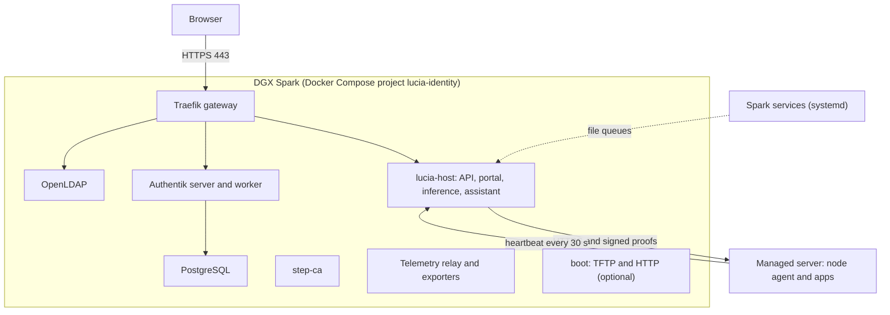

import WhoWhatWhy from '@site/src/components/WhoWhatWhy';

# Deployment overview

<WhoWhatWhy
  who="DevOps engineers who run, upgrade or debug a Lucia install."
  what="The machines, containers, ports and state directories, with commands to check each."
  why="Lucia is one Docker Compose stack on a DGX Spark plus a small agent on every managed server. Knowing that layout is most of operating it."
/>

## Topology

One Spark is the controller. Managed servers are x86-64 machines that Lucia installs with Debian 13. The Spark runs everything else.



The compose file is generated by Aspire from the `Lucia.Homelab.Identity.AppHost` project and written for the project name `lucia-identity`. The identity stack and the Lucia host share that one file, so one `compose up` covers both. See the [code map](../code/overview.mdx) for how the pieces call each other.

## Containers on the Spark

| Container | Image | Role |
|---|---|---|
| `lucia-homelab-host` | `lucia-managed-host` (built on the Spark, never pulled) | API, portal, in-process inference, assistant, controllers. Runs as the setup user, `CapDrop: ALL`, GPU through CDI |
| `lucia-identity-gateway` | `traefik:v3.7.16` | The only TLS entry. Waits until certificates verify before it starts |
| `lucia-identity-crowdsec` | `crowdsecurity/crowdsec:v1.8.1` | Intrusion detection for the gateway. See [Gateway protection](./crowdsec.mdx) |
| `lucia-identity-server`, `lucia-identity-worker` | `goauthentik/server:2026.8.3` | OIDC sign-in |
| `lucia-identity-ldap` | `vegardit/openldap` | Directory. Plain LDAP on 389 stays inside the Docker network |
| `lucia-identity-db` | `postgres:16-alpine` | Authentik's database, not published |
| `lucia-identity-ca` | `smallstep/step-ca:0.30.2` | Private certificate authority |
| `lucia-identity-renewer` | `smallstep/step-ca:0.30.2` | Renews the gateway certificate |
| `lucia-telemetry-relay`, `lucia-telemetry-node-exporter`, `lucia-telemetry-gpu-exporter` | OpenTelemetry Collector 0.161.0, node-exporter v1.10.2, nvidia_gpu_exporter 1.15.1 | Host network, loopback listeners only |
| `lucia-boot` | `lucia-boot` (built locally) | TFTP and HTTP for network install. Present only when boot settings exist |

Every container is labelled `io.lucia.component` and has `restart: unless-stopped` and `no-new-privileges`. The host container never mounts the Docker socket. It gets a few read-only `/proc` files for health sampling, its data and model directories, and the public CA certificate.

## Ports

| Port | Protocol | Served by | Notes |
|---|---|---|---|
| 443 | TCP | Gateway to `lucia-host:8080` | Portal, `/api`, `/v1`. Must match `PublicOrigin` |
| 9443 | TCP | Gateway to Authentik | Default, set at provisioning |
| 636 | TCP | Gateway to LDAP | LDAPS for managed servers. Default |
| 9444 | TCP | step-ca, published directly | Private CA. Default |
| 8445 | TCP | Gateway `public` entrypoint | Only admits Cloudflare ranges. Used when public access is on |
| 69, 40000-40016 | UDP | `lucia-boot` | Bound to the boot address only |
| 9080 | TCP | `lucia-boot` | Default `http_port`, on the boot address |

The three identity ports are distinct and stored in `settings.json`. Provisioning refuses 443 as an identity port. Nothing else is published: PostgreSQL 5432, Authentik 9000 and LDAP 389 stay on the Docker network, and the telemetry exporters bind to `127.0.0.1`.

## State directories

Everything lives under the setup user's home on the Spark.

| Path | Holds |
|---|---|
| `~/.local/share/lucia/bootstrap` | Uploaded desktop payload, job records, pinned tools (.NET, Aspire) |
| `~/.local/share/lucia/identity` | `settings.json`, `ca/`, `certificates/`, `config/`, `secrets/`, `trust/`, `gateway/`, `ldap/data`, `ldap/config`, `boot-settings.json` |
| `~/.local/share/lucia/host/data` | Mounted as `/data` in the host: `data-protection`, `inference-keys`, `provider-credentials`, `network-credentials`, `domains`, `onboarding`, `packages`, `assistant`, `telemetry`, `boot-control`, `nodes`, `huggingface` |
| `~/.local/share/lucia/host/models` | Mounted as `/models`. Model weights |
| Docker volumes `lucia-identity-postgres`, `lucia-authentik-data`, `lucia-authentik-media` | Authentik's data |
| `/var/lib/lucia/packages` | Root package worker state |

`identity/ca` and `identity/secrets` hold the CA keys and every bootstrap secret. Back them up encrypted and never copy them to another machine casually. A restore needs all of identity state, the host data directory and the three volumes, in the same version set.

:::danger
Never run `aspire destroy` against a live install. Teardown can remove the Compose volumes that hold PostgreSQL and Authentik data. Aspire also derives Compose project and volume names from the AppHost path, so keep that path stable across upgrades.
:::

## Spark-side services

Work that needs more privilege than the host container runs outside it, as systemd units that read file queues in `/data`.

| Unit | Scope | Does |
|---|---|---|
| `lucia-domain-activation.service` | user | Applies a reviewed domain profile and restarts the stack |
| `lucia-node-enrollment.service` | user | Enrolls managed nodes against the directory and CA |
| `lucia-spark-model.service`, `lucia-spark-runner.service` | user | Optional Spark model and on-demand GitHub runner |
| `lucia-skill-runner.service` | user | Runs Spark-mode assistant skill scripts in throwaway containers; builds its own image on first start |
| `lucia-package-updates.service` | root | A fixed list of apt actions. Installed by hand with `sudo` |

User units need lingering, or they stop at logout and the portal reports domain, people and enrollment work as blocked:

```bash
loginctl show-user "$USER" -p Linger --value   # expect: yes
loginctl enable-linger "$USER"
```

The root worker is installed on purpose by an operator:

```bash
sudo python3 ~/.local/share/lucia/bootstrap/app/tools/packages/package_worker.py install
```

## Managed servers

Each server runs the node agent as root under systemd, plus whatever Docker stacks you install. It sends a heartbeat every 30 seconds over HTTPS and proves its identity with a certificate from the private CA plus a signature over a fresh challenge. See [Nodes](./nodes.mdx) and [Installer](./installer.mdx).

## Verify health

From any machine that trusts the private CA (or add `-k` for a one-off):

```bash
curl -fsS https://lucia.example.com/health/live        # {"status":"ok"}
docker ps --filter label=io.lucia.component --format 'table {{.Names}}\t{{.Status}}'
docker inspect lucia-homelab-host --format '{{.State.Health.Status}}'
```

`/health/live` is the only unauthenticated path the origin check lets through. The `/health` and `/alive` endpoints from the service defaults exist only when `ASPNETCORE_ENVIRONMENT` is `Development`.

Every compose service has a healthcheck, so an unhealthy container shows in `docker ps`. If `lucia-homelab-host` is unhealthy, read its log first:

```bash
docker logs --tail 100 lucia-homelab-host
```

Startup validation errors name the setting at fault, for example `HostAuthentication: ClientSecretFile cannot be read`. [Configuration](./configuration.mdx) lists them.

## Where to go next

- [Security model](./security-model.mdx) covers trust boundaries.
- [Identity](./identity.mdx) covers Authentik, LDAP and the CA.
- [Networking and DNS](./networking-and-dns.mdx) covers domains, AdGuard and public access.
- [Install from source](./install-from-source.mdx) and [Desktop bootstrap](./desktop-bootstrap.mdx) cover first install.
