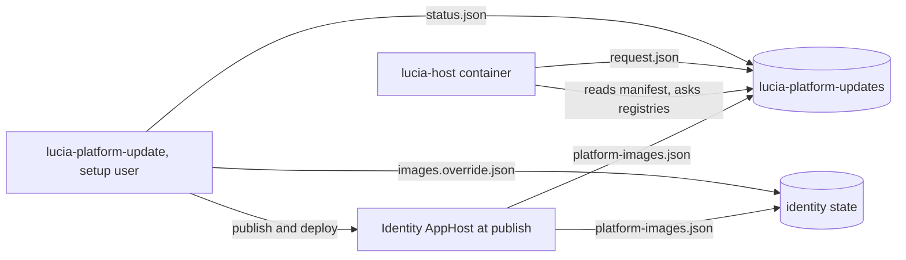
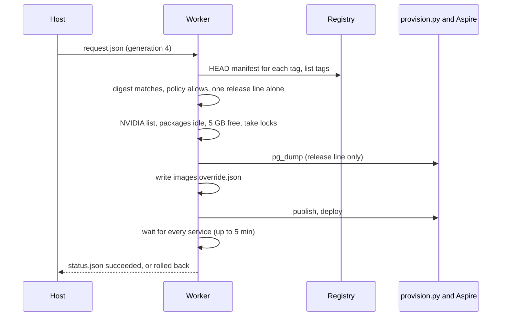

import WhoWhatWhy from '@site/src/components/WhoWhatWhy';
import Source from '@site/src/components/Source';

# Platform images

<WhoWhatWhy
  who="Operators who install, monitor or debug updates to the Spark's own third-party containers."
  what="Which images count, how the web host finds updates, the setup-user worker that applies them, the files it reads and writes, what it checks before and after, and how it rolls back."
  why="Authentik, the gateway and the CA are pinned in the identity AppHost. Without this, the only way to take a security patch was a code change and a deploy as the setup user."
/>

## What it covers

The identity AppHost pins ten third-party containers to a tag and a digest. They share eight images, and each image has a policy class that decides what Lucia offers. The pins live in <Source path="src/Lucia.Homelab.Server/Platform/PlatformImages.cs" />, which the AppHost and the server both compile.

| Service key | Containers | Image | Policy |
|---|---|---|---|
| `authentik` | `lucia-identity-server`, `lucia-identity-worker` | `ghcr.io/goauthentik/server` | `authentik` |
| `gateway` | `lucia-identity-gateway` | `traefik` | `minor` |
| `ca` | `lucia-identity-ca`, `lucia-identity-renewer` | `smallstep/step-ca` | `minor` |
| `database` | `lucia-identity-db` | `postgres` | `patch` |
| `directory` | `lucia-identity-ldap` | `vegardit/openldap` | `patch` |
| `telemetry-relay` | `lucia-telemetry-relay` | `otel/opentelemetry-collector-contrib` | `minor` |
| `node-exporter` | `lucia-telemetry-node-exporter` | `prom/node-exporter` | `minor` |
| `gpu-exporter` | `lucia-telemetry-gpu-exporter` | `utkuozdemir/nvidia_gpu_exporter` | `minor` |

`patch` offers a change in the last number only. `authentik` offers patches of the running release line and the newest version of the next line, one line at a time. `minor` offers anything in the same major; a newer major is listed as `major` with `applicable: false`. Every class also offers a `rebuild`: the same tag with a newer digest. The gateway's CrowdSec bouncer plugin is listed from its GitHub releases and never applied, because <Source path="tools/identity/provision.py" /> pins its zip by SHA-256.

`lucia-managed-host`, `lucia-boot` and the Qwen recipe aren't in this list. Lucia builds the first two and updates them with a host deploy; the recipe has its own worker.

## Moving parts



The web host never touches Docker. It finds updates with the same registry code the app catalog uses (`ImageRegistry.Tags` and `ImageRegistry.Digest`), every six hours, and writes a request. <Source path="tools/runners/platform_update_worker.py" /> does the rest as the setup user, with the rules in <Source path="tools/runners/platform_images.py" />.

## Files

| File | Written by | Read by |
|---|---|---|
| `~/.local/share/lucia/identity/platform-images.json` | The AppHost, at every publish and deploy | The worker (the host can't reach the identity state) |
| `~/.local/share/lucia/identity/images.override.json` | The worker | The AppHost |
| `~/.local/share/lucia/identity/backups/authentik-<from>-<to>.sql.gz` | The worker, before an Authentik release line | You, or the worker's rollback |
| `~/.local/share/lucia/host/data/lucia-platform-updates/platform-images.json` | The AppHost | The host (`/data/lucia-platform-updates` in the container) |
| `…/lucia-platform-updates/request.json` | The host | The worker |
| `…/lucia-platform-updates/status.json` | The worker, every 10 s | The host |
| `…/lucia-platform-updates/seen.json` | The host | The host: when each offer first appeared, for the seven-day badge |

Every file is `0600` and every directory `0700`, owned by the setup user. The worker opens them through `activation_worker.regular`, which refuses links, other owners, group or world bits and anything over its size bound.

### The request

```json
{
  "schemaVersion": 1,
  "generation": 4,
  "requestedAt": "2026-10-28T12:00:00+00:00",
  "updates": [{ "service": "authentik", "tag": "2026.8.6", "digest": "sha256:…" }]
}
```

The keys are exact. `service` must be one of the eight keys above, `tag` matches `[A-Za-z0-9_][A-Za-z0-9._-]{0,127}`, `digest` is `sha256:` and 64 lowercase hex digits. The host takes the digest from its own registry check, never from the browser or the assistant. The worker acts when `generation` differs from the one in `status.json`.

### The override

```json
{
  "schemaVersion": 1,
  "images": {
    "authentik": {
      "repository": "ghcr.io/goauthentik/server",
      "tag": "2026.8.6",
      "digest": "sha256:…",
      "replaces": { "tag": "2026.8.5", "digest": "sha256:…" }
    }
  }
}
```

`PlatformImages.Effective` reads it at every publish. It refuses the whole file, and so the deploy, when it is over 16 KiB, has a field it doesn't expect, names an unknown service, changes a repository, has a bad tag or digest, or pins a version the policy wouldn't offer. An entry is used while it is newer than the built-in pin: a newer tag of the same shape, or the same tag with a new digest while the built-in pin still equals `replaces`. When a Lucia release catches up, the AppHost drops the entry and rewrites the file, or deletes it when nothing is left. A newer override survives an older built-in pin, so a release never quietly moves Authentik back a release line.

## An update, step by step



1. **Verify.** For each update the worker reads the registry's digest for the tag and refuses when it differs from the request. It lists the tags and checks the policy against the running tag from the trusted manifest. For Authentik, a new line must be the first line after the running one. A release line can't share a request with anything else.
2. **Pre-flight.** The NVIDIA device list must be current (see below). The root package worker must have no operation in `packages/status.json`. Docker's root directory needs 5 GB free. The worker then takes `~/.local/share/lucia/bootstrap/.run.lock` and `~/.local/share/lucia/identity/.provision.lock` with `LOCK_NB`, the same locks a host deploy and `provision.py` take. When either is held, the status is `busy` and nothing changes.
3. **Back up.** For an Authentik release line only: `docker exec lucia-identity-db pg_dump -U postgres -d authentik`, gzipped to `identity/backups/authentik-<from>-<to>.sql.gz`. The last three are kept.
4. **Deploy.** The worker writes the override, then calls `Provisioner.load_existing()`, `publish()` and `deploy()` from <Source path="tools/identity/provision.py" />, as `deploy-agent-jobs.py` does.
5. **Wait.** Up to five minutes in total: `wait_container` for every identity container (and the telemetry ones when the host is installed), the gateway's TLS listener, an LDAP bind through the gateway, `application.application_status` for Authentik, then `docker inspect` to confirm each container runs the new `tag@digest`. Each check retries until the deadline, because Authentik needs about 30 seconds after a restart.

## Rollback

When the deploy or the wait fails, the worker:

1. puts the previous override back, or deletes it when there was none;
2. for a release line, stops `lucia-identity-server` and `lucia-identity-worker`, drops and recreates the `authentik` database, and restores the dump with `psql -v ON_ERROR_STOP=1`;
3. publishes and deploys again, and waits for the same checks.

`status.json` then has `state: failed`, `rolledBack: true` and the first line of the error. When `publish` failed before anything restarted, it only restores the override and publishes again, so the manifests are right. If the rollback fails too, the message says so and names the backup. Run a host deploy (`deploy-agent-jobs.py`, see the `lucia-host-deploy` skill) to bring the stack back; it publishes and deploys with whatever override is in place.

:::warning
Restoring the dump replaces Authentik's database with its state from before the update. Users, flows and tokens created during the failed attempt are gone. That window is a few minutes.
:::

## The NVIDIA device list

GPU containers start from the CDI spec at `/var/run/cdi/nvidia.yaml`, which `nvidia-cdi-refresh.service` writes at boot. It names driver files by version. On 27 Oct 2026 an upgrade of `libnvidia-egl-wayland1` left it naming a file that no longer existed, and every GPU container failed to start until a reboot.

- The root package worker reports `gpuDevices` in `packages/status.json`: `present`, `current`, `missing` (up to 50 paths) and `message`. It reads every `hostPath:` line of the spec and checks each path exists. It rechecks on its usual triggers and when the spec changes.
- After an install that touched a package starting with `nvidia`, `libnvidia` or `cuda`, it runs `systemctl start nvidia-cdi-refresh.service` before it reports the task done, or `nvidia-ctk cdi generate --output=/var/run/cdi/nvidia.yaml` when the unit is missing or left the list stale. The result goes into the task's message and log.
- `refresh-gpu-devices` is a fixed action of that worker. The page's **Refresh NVIDIA device list** button and the assistant's `refresh_nvidia_device_list` both queue it.
- The platform update worker and the Qwen worker read the spec directly (it is world-readable) and refuse to create GPU containers while it is stale. A spec they can't read counts as stale.

## Install

A fresh install runs this from the desktop bootstrap. On an existing Spark, the host deploy runs it too:

```bash
python3 ~/.local/share/lucia/bootstrap/app/tools/runners/platform_update_worker.py install
```

It needs Docker, a non-root user and persistent user services (`loginctl` linger). It writes the user unit `lucia-platform-update.service` with `TimeoutStopSec=20min`, so stopping the service lets an update finish or roll back first. It only runs from that exact path.

```bash
systemctl --user status lucia-platform-update
journalctl --user -u lucia-platform-update -n 50 --no-pager
python3 -m json.tool ~/.local/share/lucia/host/data/lucia-platform-updates/status.json
```

`checkedAt` should be under a minute old; the host shows the worker as `stale` after that.

## API

The routes sit under `/api/host/platform-images`, need `HostOwner` and answer errors as `{"error":{"code":…,"message":…}}`.

| Method and path | What it does |
|---|---|
| `GET /api/host/platform-images` | Each image's running pin, offers with release notes and `firstSeenAt`, the plugin, the worker's state and status, and `securityWaiting` |
| `POST /check` | Ask the registries again on the next pass, within a minute |
| `POST /update` | `{"updates":[{"service":"authentik","tag":"2026.8.6"}]}`, or `{"services":["authentik","gateway"],"patchOnly":true}` |
| `POST /api/host/packages/refresh-gpu-devices` | Queue the NVIDIA device-list refresh |

`POST /update` answers `503 worker_missing` or `worker_unavailable`, `409 update_busy`, `no_platform_updates` or `update_unavailable`, and `400 release_line_alone` or `unknown_service`.

## Failure modes

| Symptom | Cause and fix |
|---|---|
| The page shows the built-in versions and "Lucia records what the Spark runs at its next identity deploy" | No identity publish has written the manifest yet. Run a host deploy. |
| `status.state` is `busy` | A host deploy, `provision.py` or a package install held the Spark. Try again later. |
| "The registry now serves a different … than Lucia found" | The tag moved between the host's check and the worker's. Press **Check again** and update again. |
| "The NVIDIA device list is out of date" | Refresh it on the Spark updates page, or reboot. |
| "images.override.json is invalid" in a host deploy | Someone edited the file. Delete `~/.local/share/lucia/identity/images.override.json` to deploy the built-in pins, then update again from Lucia. |
| A failed rollback | Restore with a host deploy; for Authentik, the dump is in `identity/backups/`. |

See [Spark updates](./spark-updates.mdx) for the package worker, and [Platform images in code](../code/platform-images.mdx) for how the pieces fit.
