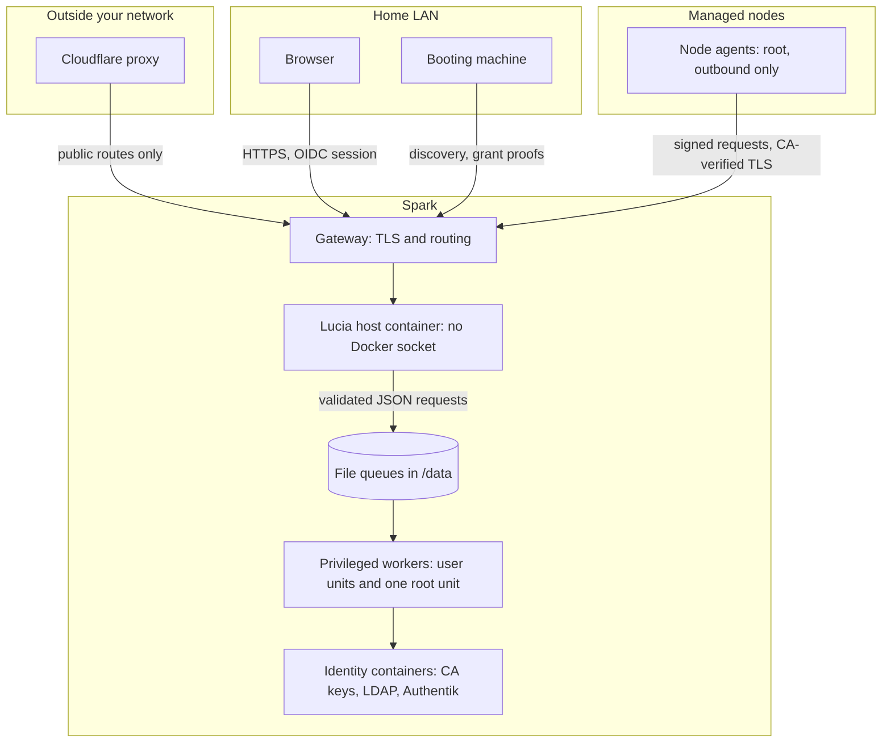

import WhoWhatWhy from '@site/src/components/WhoWhatWhy';
import Source from '@site/src/components/Source';

# Security model

<WhoWhatWhy
  who="Operators and reviewers who need to know what a compromised Lucia component could do, and what it couldn't."
  what="The trust boundaries from browser to disk, the identities Lucia recognizes, the privileged workers behind file queues, where secrets are stored, and the approvals that always need a person."
  why="Lucia runs your lab's DNS, sign-in, certificates and servers. A compromised portal should be a strong asker and a weak doer: it can ask for plenty, but whatever touches the Spark, the directory or the disks decides for itself."
/>

[Identity](./identity.mdx) and [Managed nodes](./nodes.mdx) cover how those parts run. This page is the map of who trusts whom.

## Trust boundaries

Every arrow is a place where the receiver checks the sender and doesn't take the sender's word for what it may do. The weakest link in that chain is the host, so most controls limit what the host holds.

## Identities

Human and machine identities are kept apart. None can stand in for another.

| Identity | What it is | What it can do |
|---|---|---|
| A person | An OpenLDAP account. Sign-in goes through Authentik. | Owners (`lucia-owners`) get the portal, SSO into supported apps, and SSH with `sudo` on managed servers. Members (`lucia-users`) get the Home, Playground and Appearance pages. |
| The owner API key | `HostPlatform:ApiKey`, a bearer key of 32+ characters | Role `Owner` on the host API, for automation. It carries no username, so it can't manage people or SSH keys. |
| Inference API keys | The fixed inference key, or managed keys (`lucia_inf_…`) from **Local AI → API keys** | Role `Inference`: the `/v1` model API only. Managed keys are stored as hashes and shown once. |
| An Authentik access token | A JWT with the `lucia_api` scope and `azp` equal to Lucia's client | Same roles as the browser session, for API clients |
| A node agent | A P-256 key generated on the node and a 7-day private-CA certificate | Its own heartbeats, stack sync, requests and agent download. Every call signs a fresh challenge. |
| A booting machine | A per-device key and a one-time capability, valid 30 minutes | Registering, reporting progress and requesting one grant. No erase authority until an owner approves. |
| `lucia-recovery` | A local account on each server, password locked | SSH with the single recovery key chosen at approval |
| `akadmin` | Authentik's break-glass administrator | Authentik administration. Its password is in `secrets/authentik-admin-password`. |

API keys are compared as SHA-256 hashes in constant time, anything shorter than 32 characters never matches, and the owner and inference keys must differ.

### Browser sessions

The host holds the OIDC client secret and gives the browser an encrypted cookie. The browser never has a token. The cookie is `__Host-` prefixed, `Secure`, `HttpOnly` and lasts 8 hours with no sliding renewal. Writes by cookie also need a CSRF header from a `Strict` cookie. The code flow uses PKCE, validates issuer, audience, signature and lifetime, and accepts only RS256. `/auth/login` accepts only a local return path. The host accepts requests only for its configured HTTPS origins (the public origin plus at most four exact aliases) and only trusts `X-Forwarded-*` from `HostAuthentication:TrustedProxyNetworks`, which must be private CIDRs. See [Identity (code)](../code/identity.mdx).

## What the web host holds

The host (`lucia-homelab-host`) is a normal container that runs as the identity user, not root, with all capabilities dropped. It gets:

- `/data` (its state, the Data Protection key ring and the credential stores) and the model directory;
- a handful of read-only counter files from `/proc`, for health sampling;
- the private root CA's public certificate, read-only, and its own OIDC client secret file;
- a writable directory shared with the gateway for domain routing files and certificates;
- the Spark's GPUs.

It does **not** get the Docker socket, the CA's keys, the LDAP admin password or any Authentik admin token. No Lucia container gets the Docker socket. The exception is the optional GitHub runner app, whose Docker-in-Docker daemon is a separate, privileged container of its own. It can't reach the host's Docker daemon, but it's a privileged container on your Spark, so enable that app deliberately.

### Privileged work goes through file queues

Anything that must touch the Spark runs as a separate service outside the host container. The host writes a small JSON file with an exact schema. The service validates it, decides, acts and writes an answer. A request file can hold a password, so services delete it once read.

| Service | Runs as | The host can ask for |
|---|---|---|
| `lucia-domain-activation` | The setup user (`systemd --user`) | Domain activation, people and group changes, app SSO clients. It alone holds Authentik admin credentials. |
| `lucia-node-enrollment` | The setup user | A node certificate and LDAP reader, only for a request the onboarding journal also authorizes |
| `lucia-spark-model` | The setup user | Start or stop the pinned model. The recipe and settings belong to the worker. |
| `lucia-spark-runner` | The setup user | Repositories, labels, idle time and the token. It can't choose what the runner runs. |
| `lucia-package-updates` | **root** | One of six fixed actions: `check`, `install`, `changelog`, `restart-services`, `restart-spark`, `repair`. It validates package names, never runs a command it was given and refuses removals. |

A compromised portal could queue an apt upgrade or a Spark restart. It couldn't run arbitrary commands as root on the Spark through these paths, and it couldn't touch the CA.

:::note
Managed servers are the deliberate exception. Stacks run as root there, and the assistant's `run_command` and some node actions execute as root through the agent. A Lucia owner is effectively root on every managed server. These sit behind the approval rules below, and the agent runs only fixed executables for everything else: a 16 KB script, 30 minutes, 4 concurrent commands and the last 32 KB of output for assistant commands. See [Managed nodes](./nodes.mdx).
:::

## Network boundaries

| Boundary | Control |
|---|---|
| Browser to gateway | Traefik terminates TLS with a private-CA certificate, or Let's Encrypt once a domain is connected. |
| Gateway to host | Forwarded headers are trusted only from the configured proxy networks. |
| Published ports | The gateway (443, 9443, 636, 8445), the CA (9444) and, if enabled, the boot service on its provisioning address. PostgreSQL, Authentik's HTTP port and plain LDAP aren't published. See [Identity](./identity.mdx#ports). |
| Public routes | An app's optional public route comes in on port 8445, where a middleware admits only Cloudflare's address ranges. |
| Host to nodes | Nodes call the controller. The agent has no HTTP listener. TLS is verified against the private CA, and each request carries a signed proof. |
| Boot and node endpoints | `/api/boot` and `/api/nodes` accept only source addresses inside `Boot__AllowedNetworks` (private subnets). The discovery endpoints also need the owner's discovery window to be open. |
| Boot service | Serves a fixed allowlist of nine files, and only while the host renews a 10-second lease. |
| Local model server | It has no authentication of its own, so the worker binds it to the Docker bridge shared with the host, not the LAN. Clients use Lucia's authenticated `/v1`. |
| Lab to internet | Nothing is exposed by default. Domains use DNS-01 and never publish private A or AAAA records. See [Networking and DNS](./networking-and-dns.mdx). |

Classic PXE and TFTP don't authenticate the boot configuration or the initrd. Treat the provisioning network as trusted. See [Installer](./installer.mdx).

## Certificates

Each install has its own Smallstep CA. Its private keys stay on the Spark and are never copied to nodes, desktops or other containers. You distribute only the public root, and `install-node-trust.sh` refuses to replace a different Lucia root.

:::note
The CA publishes no CRL or OCSP endpoint. Short node certificates (7 days, renewed daily) limit how long a stolen one is useful. They don't replace revocation, so **Remove from Lucia** also deletes the node's identity on the controller, which refuses every later call. Lucia's own TLS clients skip the revocation check for the private CA and still verify the chain, validity, key usage and hostname.
:::

## Secrets at rest

Credentials you give Lucia are encrypted with ASP.NET Core Data Protection, one purpose string per kind. The key ring is in `/data/data-protection`.

| Secret | Entered in |
|---|---|
| Hugging Face token | Local AI → Models |
| Cloudflare API token | Settings → Domains |
| AdGuard credentials | Settings → AdGuard |
| UniFi API key and SNMP settings | Settings → UniFi Network |
| NAS credentials | Settings → Storage |
| Registry sign-ins | Settings → Registries |
| Backup repository password | Apps → Backups |
| App environment secrets | Apps, including values typed through the assistant's `request_secret` |
| The assistant's GitHub sign-in and LiteLLM key | The assistant panel, per owner |
| The Web Push signing key | Generated automatically |

Encrypted doesn't mean the secret never leaves. Some must be handed to the thing that uses them:

- NAS credentials sit in root-only files under `/etc/lucia/nas` on each node that mounts the share.
- Registry sign-ins go into `/etc/lucia/docker/config.json` on each node.
- Each app's `.env` is a root-only file on its node.
- The GitHub runner's token is written in plain text to a private `.env` the runner reads.

The infrastructure secrets (CA password, database passwords, LDAP admin password, Authentik secret key, owner and inference API keys, the OIDC client secret) are `0600` files in `~/.local/share/lucia/identity/secrets`. For the secrets the host reads, the AppHost refuses a file that is group- or world-readable.

:::danger
Back up `/data/data-protection` with the rest of `/data`. Without the key ring, every encrypted credential above is unreadable and you'll enter them all again.
:::

The portal shows stored secrets as hidden. The assistant is told never to ask for, guess or show them. `request_secret` has you type a value straight into an app's environment, so the model never sees it.

## The assistant's approval boundary

Every assistant tool call goes through a policy whose default is **deny**. Rules apply in priority order:

1. **Plan mode** denies every change, destructive and secret tool. Reads still run.
2. In a **scheduled job**, destructive tools you pre-approved for that job run.
3. Otherwise **destructive tools always ask**: deleting, restoring, publishing to the internet, server updates and restarts, and `run_command`. No chat setting turns that off.
4. **Secret** requests run, since they only ask you to type something.
5. **Reads** run.
6. **Web fetches and registry lookups** run for allowed hosts and ask for others.
7. **Changes** run when you allowed that tool automatically, and ask otherwise.

An approval waits up to 30 minutes. A turn is capped at 50 tool calls. "Allow for this chat" grants live in memory only. Details are in [Assistant](./assistant.mdx).

## Notifications

Web Push messages are encrypted end to end (RFC 8291) and signed with VAPID, but they still travel through your browser vendor's push service. Each one holds a title of up to 120 characters, a body of up to 1,500 and a link back to the portal. Skip **Settings → Notifications** if that's more than you want leaving the lab.

## Disk erasure

Nothing installs without an explicit owner approval: a hostname, the disk for Debian, a recovery key and the word `ERASE`. Approval erases **every** non-removable, writable disk in the machine, not only the one that gets Debian. The others are pooled into `/srv/data`. The node's guard re-checks the hardware immediately before partitioning and refuses on any difference. See [Installer (code)](../code/installer.mdx).
