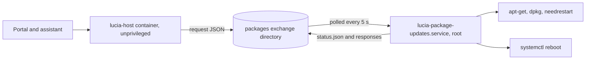
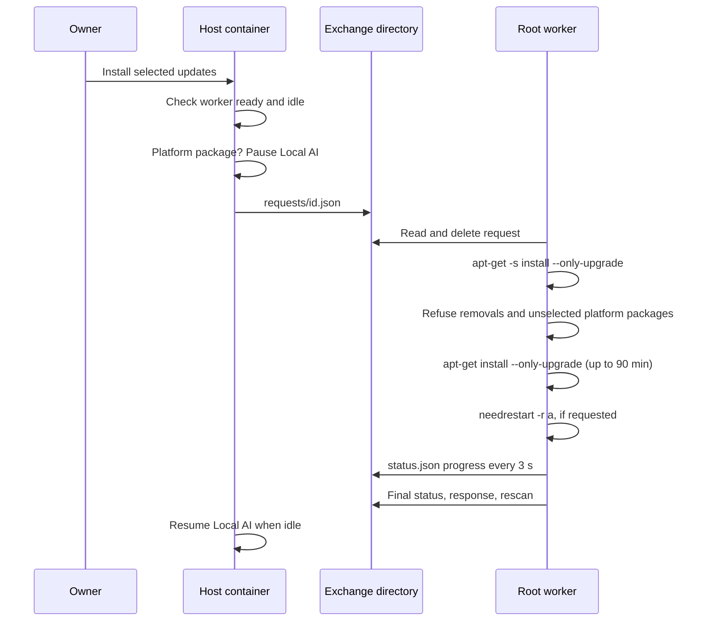
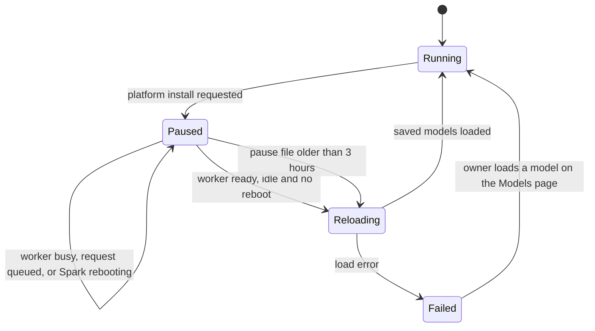

import WhoWhatWhy from '@site/src/components/WhoWhatWhy';
import Source from '@site/src/components/Source';

# Spark updates

<WhoWhatWhy
  who="Operators who install, monitor or debug OS package updates on the DGX Spark that runs Lucia."
  what="The root worker, the files it exchanges with the host container, the schedule, how Local AI is paused for platform updates, and what happens across a restart."
  why="Installing packages needs root, and the web container deliberately has none. A small fixed-action worker on the Spark does the privileged part, and everything else stays unprivileged."
/>

## Who touches this

The Spark owner runs the worker's installer once, as a normal user with `sudo`. After that, owners use the **Spark updates** page (see [Spark updates in the guide](../guide/updates.mdx)) or the assistant. Nothing else needs to reach the worker. The developer view is in [Spark updates (code)](../code/spark-updates.mdx).

## Moving parts



The worker is <Source path="tools/packages/package_worker.py" />. It accepts seven fixed actions: `check`, `install`, `changelog`, `restart-services`, `restart-spark`, `repair` and `refresh-gpu-devices`. It never runs a command a caller supplies. Package names are matched against `^[a-z0-9][a-z0-9+.-]{0,127}$`, and `install` only touches packages that the last scan listed as upgradable.

| Piece | Location |
|---|---|
| Installed worker | `/usr/local/lib/lucia/package_worker.py` |
| systemd unit | `lucia-package-updates.service` (`Restart=always`, `RestartSec=5`, `UMask=0077`, `KillMode=process`) |
| needrestart override | `/etc/needrestart/conf.d/50-lucia.conf` |
| Worker-private state | `/var/lib/lucia/packages/state.json` |
| apt logs, one per task | `/var/log/lucia/packages/<id>.log` |
| Exchange directory (host path) | `~/.local/share/lucia/host/data/packages` |
| Exchange directory (in the container) | `/data/packages`, set by `PackageUpdates__Directory` |

`KillMode=process` matters. apt and dpkg children run in their own session, so restarting the worker in the middle of an install does not kill dpkg half way through a package.

## Install the worker

The worker is not installed by the desktop bootstrap. The portal shows the command until the worker's heartbeat appears:

```bash
sudo python3 ~/.local/share/lucia/bootstrap/app/tools/packages/package_worker.py install
```

It needs `python3-apt` and exits with `python3-apt is required.` without it. The installer takes the account that ran `sudo` from `SUDO_UID` and treats that user as the owner of the exchange files. It derives the data directory from that user's home. To override either, pass `--owner <uid>` and `--data <path>`.

The installer also writes the needrestart override, which sets the restart decision to 0 (never) for `lucia-package-updates`, `docker` and `containerd`, so a service restart pass can never stop the worker or the container runtime underneath Lucia.

Verify it:

```bash
systemctl status lucia-package-updates
journalctl -u lucia-package-updates -n 50 --no-pager
python3 -m json.tool ~/.local/share/lucia/host/data/packages/status.json | head -30
```

`ready` is true and `checkedAt` should be less than 15 seconds old.

## Files and trust

The worker is strict about what it reads. Every ancestor directory of the exchange directory must be owned by root or the Lucia owner and must not be group- or world-writable. Directories are opened with `O_NOFOLLOW`, one component at a time. A request file is accepted only if it is a regular file, owned by the Lucia owner, has one hard link, is at most 16 KiB, and has no group or other permission bits.

```text
packages/
  requests/<id>.json     host writes, worker reads and deletes
  responses/<id>.json    worker writes; changelog text arrives here
  status.json            worker writes every 15 s and after each change
  schedule.json          host only; the single maintenance window
  models-paused.json     host only; present while Local AI is paused
```

The file name is a 32-character lowercase hex id and must match the `id` inside. Unknown fields and duplicate keys are refused. A request that fails validation gets a `success: false` response with "Lucia's update service refused this request." and its detail goes to the journal as an error type only.

An install request looks like this:

```json
{
  "schemaVersion": 1,
  "id": "0f3a9c1d5b7e4a2c8d6e1f0a3b5c7d9e",
  "action": "install",
  "requestedAt": "2026-10-13T13:42:06.0000000+00:00",
  "packages": ["netplan.io", "curl"],
  "includePlatform": false,
  "restart": "services"
}
```

`packages` is a list of unique names, or the string `"all"`. `restart` is `none`, `services` or `spark`. The host always sends an explicit list, so `"all"` only appears in hand-written requests.

The worker keeps a list of the last 500 request ids it processed. A request id it has seen is dropped, so a file that reappears does not run twice.

### status.json

The host reads `status.json` on every page load. It treats the worker as `ready` only when `schemaVersion` is 1 and `checkedAt` is less than 90 seconds old. A missing file reads as `missing`, an old one as `stale`.

| Field | Meaning |
|---|---|
| `ready`, `checkedAt` | Heartbeat. A thread rewrites it every 15 s, so long installs do not look dead. |
| `system` | `os`, `dgx` release, `kernel`, `architecture` |
| `lastUpdateCheckAt` | Newest mtime of the apt update stamp and `/var/lib/apt/lists` |
| `updates` | Up to 2,000 upgradable packages, security ones first (see below) |
| `restart` | `sparkRequired`, `sparkReasons` (up to 100), `kernelPending`, `services` (up to 200), `heldServices`: listed services that were still listed after the last `needrestart -r a` run. needrestart won't restart some services while they run (dbus, systemd-logind, and Docker and containerd through Lucia's `50-lucia.conf`), so any held service sets `sparkRequired`. The list is kept in the worker's state and cleared on reboot. |
| `automaticUpdates` | `installed` and `enabled` for `unattended-upgrades` |
| `packageDatabase` | `healthy` is false when `dpkg --audit` prints anything |
| `gpuDevices` | Whether every `hostPath` in the NVIDIA device list `/var/run/cdi/nvidia.yaml` exists: `present`, `current`, `missing` (up to 50), `missingCount`, `message` |
| `scanning`, `scannedAt` | True until the first scan finishes |
| `operation` | The running task: id, action, state, progress, packages, a 20-line live log tail |
| `history` | The last 15 finished tasks (30 are kept in `state.json`) |
| `rebootingAt` | Set from the moment the worker decides to reboot until it starts again |

Each entry in `updates` carries `name`, `summary`, `currentVersion`, `candidateVersion`, `source`, `security`, `platform`, `restart` (`services`, `spark` or `lucia`), `downloadBytes`, `keptBack` and `phased`.

The worker rescans when `/var/lib/dpkg/status`, `/var/lib/apt/lists`, `/var/run/reboot-required`, the apt update stamp or the NVIDIA device list change, and at least every 10 minutes. It does not run `apt-get update` by itself. Lucia has no update timer. **Check for updates** is the only thing that refreshes the package lists.

## Classification

The worker decides what counts as a platform update with name patterns and package origin. A package is **platform** when its source mentions NVIDIA or DGX, or when its name starts with `linux-`, `nvidia`, `libnvidia`, `cuda`, `libcu` (not `libcurl`), `libnccl`, `libcudnn`, `tensorrt`, `dgx`, `grub` or `shim`, contains `firmware`, ends in `-microcode`, or belongs to Docker, containerd, runc or the NVIDIA container toolkit.

Its **restart** class is `lucia` for Docker, containerd, runc and the NVIDIA container packages (installing them restarts Docker, so Lucia is offline for about a minute), `spark` for kernel, driver, firmware, glibc, systemd, dbus, GRUB, shim and microcode packages, and `services` for everything else.

## An install, step by step



1. The host checks that the worker is ready (heartbeat under 90 s) and that nothing is running or queued. A request file younger than 10 minutes counts as queued. Otherwise it answers `409 update_busy`.
2. The worker simulates the install first. A removal anywhere in the plan stops it with "Lucia doesn't remove packages during updates." A platform dependency pulled in by an everyday install also stops it, naming the package.
3. The real install runs with `--only-upgrade`, `DEBIAN_FRONTEND=noninteractive`, `--force-confdef` and `--force-confold`, so existing config files stay. It waits up to 300 seconds for the dpkg lock and is killed after 90 minutes.
4. With `restart` set to `services` or `spark`, the worker runs `needrestart -r a -q` (15-minute limit).
5. If the install touched a package whose name starts with `nvidia`, `libnvidia` or `cuda`, it regenerates the NVIDIA device list (`systemctl start nvidia-cdi-refresh.service`, or `nvidia-ctk cdi generate --output=/var/run/cdi/nvidia.yaml` when the unit is missing or left the list stale) and adds the result to the task's message and log. This runs even when apt failed part-way.
6. It rescans. With `restart: spark` and a restart still required, it records `rebootingAt`, waits 3 seconds and runs `systemctl reboot`.

Other timeouts: 20 minutes for `apt-get update` during a check, 60 minutes for each repair step.

Only one task runs at a time. Changelog requests are the exception: they run in a thread, because `apt-get changelog` can take a while and must not block the heartbeat.

## Platform updates pause Local AI

Platform updates can swap the kernel and the NVIDIA driver under the inference engine. The host unloads the models first, so the engine is not holding GPU memory while the driver changes.

When an install request includes at least one `platform: true` package, the host:

1. writes `models-paused.json`,
2. unloads the chat and embedding models but keeps the saved selection (`keepSelection`),
3. sets the runtime's startup message to "Local AI is paused while platform updates install. Lucia reloads it when they finish."

`/v1` calls then answer `503 model_not_loaded` until the models are back.



The scheduler resumes Local AI on its 15-second tick when the worker is ready, has no operation, no request is queued and `rebootingAt` is empty. A three-hour cap on the pause file prevents a vanished worker from leaving Local AI off forever. If the Spark reboots, the host sees the pause file at startup, defers model loading, and the same tick reloads the models after the worker reports ready and idle. If the reload fails, the startup message becomes "Local AI couldn't reload after the updates. Open AI models and load it again."

If the Qwen3.8-Flash-Next recipe holds the memory, the runtime already has its own pause. The resume step then removes `models-paused.json` and skips the reload. See [Local AI](./local-ai.mdx).

## Schedule

One maintenance window lives in `schedule.json` in the exchange directory. The host owns it. The scheduler wakes every 15 seconds.

| Rule | Value |
|---|---|
| Earliest start | 2 minutes from now |
| Latest start | 30 days ahead |
| Start | When due, if the worker is ready, idle and has nothing queued |
| Missed | More than 60 minutes late: nothing runs and the outcome is `missed` |
| After a run | `schedule` clears and `last` holds `started`, `failed` or `missed` with a message |
| Restart-only | Allowed: `packages: []` with `restart: spark` reboots only if a restart is still required |

A schedule that lists packages is checked again when it fires. If one of them is no longer an available update, the window fails with that message and installs nothing. A schedule with `packages: null` takes whatever is available then.

## API

All routes sit under `/api/host/packages`, need the `HostOwner` policy, answer with `Cache-Control: no-store` and accept JSON bodies up to 64 KiB.

| Method and path | What it does |
|---|---|
| `GET /api/host/packages` | Worker status plus `worker.state` (`missing`, `stale`, `ready`), `schedule`, `lastSchedule`, `pendingRequest`, `modelsPaused` |
| `POST /check`, `/repair`, `/restart-services`, `/refresh-gpu-devices` | Queue that action |
| `POST /restart-spark` | Body `{"confirm": true}` required |
| `POST /install` | `packages`, `includePlatform`, `restart` |
| `POST /changelog` | `{"package": "..."}`, waits up to 120 s for the worker |
| `PUT` and `DELETE /schedule` | Save or cancel the window |

An owner bearer key works for reads:

```bash
curl -sS -H "Authorization: Bearer $LUCIA_OWNER_KEY" \
  https://lucia.example.com/api/host/packages | jq '{state: .worker.state, updates: (.updates | length), restart: .restart.sparkRequired}'
```

Errors look like `{"error":{"code":"worker_missing","message":"..."}}`.

## Failure modes

| Symptom | Cause and fix |
|---|---|
| `worker.state` is `missing` | The installer has not run, or the exchange directory is not the one the worker uses. Run the install command. Check `PackageUpdates__Directory` against the container's `/data` mount. |
| `stale` | Heartbeat older than 90 s. `systemctl status lucia-package-updates`. The unit restarts itself after 5 s. |
| Requests never start | The worker logs `package-request-rejected`. Look for wrong ownership or permissions on the request file, or an ancestor directory that is writable by others. |
| "Another package tool … was busy for more than five minutes" | A manual apt, or `unattended-upgrades`, holds the dpkg lock. Wait and retry. |
| "An earlier package install was interrupted" | Run repair: `dpkg --configure -a`, then `apt-get -f install`. |
| History shows `interrupted` | The worker restarted while a task ran. Run repair, then check again. |
| `gpuDevices.current` is false | A manual apt or `unattended-upgrades` changed NVIDIA packages. Queue `refresh-gpu-devices` (the page's **Refresh NVIDIA device list**). If it stays stale, reboot. GPU containers, platform image updates and the Qwen recipe wait until then; see [Platform images](./platform-images.mdx). |
| Local AI stays paused | Look at `modelsPaused` and `operation`. A stuck pause file clears itself after 3 hours. Deleting `packages/models-paused.json` ends it earlier. |

Failed tasks keep the last 60 lines of apt's output in `history[].log`, with control characters stripped, and the full log in `/var/log/lucia/packages`.

## Automatic security updates

Lucia does not install or enable `unattended-upgrades`. `automaticUpdates` reports whether it is installed and whether `APT::Periodic::Unattended-Upgrade` is `1`. Anything it installs on its own appears in history only if Lucia ran it.
